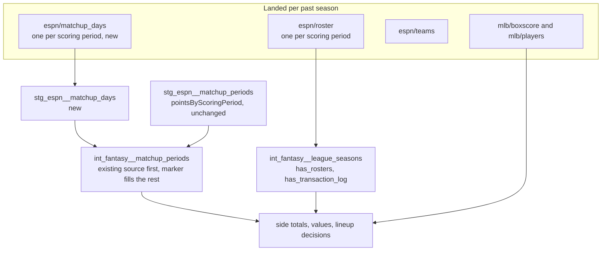

# Past seasons' rosters and boxscores — design

Issue: #83 · Requirements: [requirements.md](requirements.md) · Tasks: [tasks.md](tasks.md)

## Overview

A past season becomes covered (ADR 0026) by landing what 2026 has: teams and a roster
per scoring period from ESPN, and the player list and boxscores from MLB. Staging
already builds per league-season, so those need no model change. Three things do.
The day-to-matchup mapping gains a second source: ESPN, asked for the matchups of one
scoring period, attaches that day's rosters to the matchups of exactly one matchup
period, and one small capture per day records which. Complete games gains a component
and a rule. And a covered season with no transaction log, which ESPN no longer serves
for past seasons, is stated in the coverage model.

A dbt term used below: a *unit test* runs one model on rows written in the test and
compares the output with rows written in the test; no warehouse data is involved. It is
how the new paths are tested in CI, where no past season has rosters.

## Claims ledger

Local queries read `data/warehouse.duckdb` read-only, or the newest committed capture
under `data/raw/`. The probe is the ten authenticated GETs the owner approved on
2026-10-11; its responses were kept outside the repo and nothing was landed.

| # | Claim | Query (or script) | Result | Run on |
|---|---|---|---|---|
| C1 | Only 2025 and 2026 carry a full `pointsByScoringPeriod`; 2018 carries one key per matchup period; 2019 and 2021 to 2024 carry none | per season, over `schedule[*].home/away.pointsByScoringPeriod` of the newest matchups capture: matchup periods with keys, and keys per period | 2018: 24 periods, 1 key each · 2019, 2021, 2022, 2023, 2024: 0 periods · 2025: 25 periods, lengths 13, 7×14, 14, 7×9 · 2026: 24 periods, lengths 12, 7×13, 14, 7×9 | 2026-10-11 |
| C2 | 2018's one key per period looks like the period's first scoring period. Not established: nothing landed says where a 2018 period starts. The marker for each key and for the day before it settles it (expected values) | `select matchup_period, min(scoring_period), lead(...) - min(...)` on `stg_espn__matchup_periods`, 2018 | starts 1, 12, 19 … 173; gaps 11, 7×13, 14, 7×8 | 2026-10-11 |
| C3 | Nothing in the landed settings maps days to matchups | every key of `settings` containing `period`, `date` or `week`, 2019 and 2026; `scheduleSettings.matchupPeriods` all seasons | `matchupPeriods` is `{"1": [1], "2": [2] …}` in every season; no other candidate key | 2026-10-11 |
| C4 | A landed roster capture does not say which matchup period its day belongs to | keys matching `matchupPeriod` in 2026 roster captures of periods 10, 60, 180 | only `status.currentMatchupPeriod`, 24 in all three | 2026-10-11 |
| C5 | Matchup periods per season | `count(distinct matchup_period)` on `stg_espn__matchups` | 2018, 2019, 2021, 2022, 2023, 2026: 24 · 2024: 26 · 2025: 25 | 2026-10-11 |
| C6 | A calendar rule (Monday to Sunday; a week of fewer than seven scoring days joins its neighbour; the All-Star week joins the week before) gives the right number of periods in every season but 2019 | calendar weeks and short weeks per season from `stg_espn__scoring_periods`, less merges, against C5 | 2018: 26−2=24 ✓ · 2019: 27−2=25 ✗ (24) · 2021: 24 ✓ · 2022: 27−3=24 ✓ · 2023: 24 ✓ · 2024: 29−3=26 ✓ · 2025: 27−2=25 ✓ · 2026: 24 ✓ | 2026-10-11 |
| C7 | In 2025 and 2026 the only periods not Monday to Sunday of seven days are the first and the All-Star one | `stg_espn__matchup_periods` joined to dates, `having count(*) <> 7 or dayname(min) <> 'Monday'` | 2025: period 1, 03-18 to 03-30 (13); period 16, 07-07 to 07-20 (14) · 2026: period 1, 03-25 to 04-05 (12); period 15, 07-06 to 07-19 (14) | 2026-10-11 |
| C8 | ESPN serves a per-day roster with that day's game lines for past seasons | probe: `view=mRoster&scoringPeriodId=60` for 2018, 2021, 2023; and 61 for 2023 | HTTP 200 each, 1.36 to 1.46 MB; 12 teams; 288, 292, 300 entries; the 2026 entry keys and lineup slots; a non-empty game line for the period on 153, 126, 164 entries. 2023 periods 60 and 61 differ in 28 and 27 (team, player, slot) rows | 2026-10-11 |
| C9 | **The marker.** A matchups request for one scoring period carries `rosterForCurrentScoringPeriod` on the sides of one matchup period only | probe: `view=mMatchupScore&view=mScoreboard&scoringPeriodId=N`; matchup periods whose sides carry the key | *Falls in:* 2023 period 60 → matchup period 8 only, as the calendar rule gives for 2023 (period 1 of 11 days, then weeks). *Falls out, against the calendar rule:* 2019 period 15 → matchup period 1 only, where a 12-day opener would give 2; so 2019's first period is at least 15 days, and 19 fits C5. *Where it behaves badly:* not yet known. Two periods probed of 1,469; a final period, a playoff period with a bye and the day after the final period are untried. R6.1 checks all 368 periods of 2025 and 2026 before anything else is landed | 2026-10-11 |
| C10 | `matchupPeriodId` in the request does not choose the marked period; `scoringPeriodId` does | probe: `view=mBoxscore&view=mMatchupScore&matchupPeriodId=9&scoringPeriodId=60`, 2023 | marker on matchup period 8 | 2026-10-11 |
| C11 | A marker response is about 1 MB and holds the top-level keys of the matchups capture | the three probe responses | 1.05, 0.95, 0.99 MB; keys `schedule`, `settings`, `status`, `teams` and the identifiers | 2026-10-11 |
| C12 | ESPN does not serve the transaction log of 2023 or 2025. The other five seasons were not asked: R6.10 asks them before anything is landed | probe: the transactions request with a limit of 5, for 2023, 2025 and 2026 | 2023: 404 · 2025: 404 · 2026: 200, 5 topics | 2026-10-11 |
| C13 | Complete games is scored in 2018, 2019 and 2021 and is the only reported stat with no rule | `int_fantasy__categories` by season; stats of `stg_espn__matchup_category_results` absent from `int_fantasy__stat_components` | CG in 2018 to 2021 (2020 unplayed); stat 62 alone, in 2018, 2019, 2021 | 2026-10-11 |
| C14 | ESPN's complete-game totals | `sum(score)` where `stat_id = 62`, by season | 2018: 33 over 288 sides · 2019: 29 over 286 scored sides · 2021: 37 over 286; most on one side 2, 2, 3 | 2026-10-11 |
| C15 | MLB's boxscore gives complete games per pitcher, already staged and summed per day, and not yet a component | `describe stg_mlb__pitching_game_logs`; `grep complete_games dbt/`; `fo_pitching_columns` | staged; in `int_mlb__player_game_days`; absent from `fo_pitching_columns`. 2026: 21 complete games in 20,800 lines, none by a pitcher who did not start | 2026-10-11 |
| C16 | The id map covers the probed past rosters | ESPN ids of the three probed rosters against `stg_idmap__players` | 288 of 288, 292 of 292, 300 of 300 | 2026-10-11 |
| C17 | What a season costs to land | 2026: `data/raw/mlb` 970 MB for 4,950 boxscore captures; roster captures 182; C8 and C11 sizes; `stg_mlb__games` by season | about 0.2 MB a boxscore, 1.4 MB a roster, 1.0 MB a marker. Seven seasons: 1,289 scoring periods, 17,012 scheduled games. About 1.8 GB of rosters, 1.5 GB of markers, 3.3 GB of boxscores a pass | 2026-10-11 |
| C18 | Models are keyed by season, so an earlier season's data should not reach 2026 | `int_mlb__player_game_days` groups by `season`; `int_fantasy__replacement_levels` partitions by league-season; `int_fantasy__category_scales` reads earlier seasons only through `int_fantasy__reported_matchup_margins`, built from ESPN's totals | read, not proved: R6.7's `EXCEPT ALL` is the proof | 2026-10-11 |
| C19 | Side totals and transaction facts today | counts by season | sides: 286 in 2018, 2019, 2021, 2022, 2023, 2026; 310 in 2024; 298 in 2025. Side totals: 286. `fct_transaction_impact`: 737, all 2026 | 2026-10-11 |

## Alternatives considered

### Where the day-to-matchup mapping comes from

| | A — ESPN's marker, one capture per scoring period (chosen) | B — ESPN's marker at week ends only | C — a calendar rule, checked by reconciliation | D — a seed kept by hand |
|---|---|---|---|---|
| Rests on | what ESPN reports for each day | A, plus "a boundary falls only between a Sunday and a Monday" | C6's rule | someone reading ESPN's site |
| 2019 | answered by the data | answered | wrong period count; needs a 2019 clause | typed in |
| Another league, or matchup periods of another length | works | fails silently if a period ends midweek, unless both ends of every week are fetched and compared | wrong | a seed per league |
| ESPN requests | 1,469 | about 400 | 0 | 0 |
| Landed | about 1.5 GB | about 0.4 GB | nothing | a CSV |
| A wrong mapping is caught by | R2.4 against the other source, R2.7, reconciliation | the same, less R2.4's reach | reconciliation only | reconciliation only |

**A — one capture per scoring period.** Each day's mapping is a fact ESPN stated, read
the same way for every league and season. It costs requests and disk, once.

**B — week ends only.** A quarter of the requests. It loses because ingestion would
have to decide what to fetch from a calendar assumption, and where that assumption
fails the days in between are inferred, not read.

**C — a calendar rule.** No requests. It loses on C6: it cannot say why 2019 has 24
periods, and a rule with a clause per season is a seed written as SQL. It is also
fitted to this league's weekly matchups.

**D — a seed.** It loses because nothing ties it to ESPN, and every new league-season
needs a person.

### A covered season with no transaction log

| | A — state it: `has_transaction_log` on the coverage model (chosen) | B — change nothing | C — rebuild moves from roster differences | D — do not cover a season without a log |
|---|---|---|---|---|
| "No log" told apart from "no moves" | in data | only in prose | not applicable | not applicable |
| Past seasons' values and lineup decisions | built | built | built | not built: the point of #83 is lost |
| New meaning to decide | one boolean | none | what a move is, its acting team (ADR 0004) and its time, from two days' rosters | none |
| Size | one column, one test | none | a model and its reconciliation | none |

**A.** A reader of `fct_transaction_impact` can tell an empty season from an unlanded
log, and a test holds the mart to it.

**B** loses because seven seasons with zero transactions would read as seven seasons in
which nobody made a move. **C** loses as a no-go: a roster difference shows that a
player arrived, not whether by add, waiver or trade, nor who acted. **D** loses because
nothing else these seasons need depends on the log.

### How complete games is computed

| | A — MLB's `completeGames`, summed (chosen) | B — derived: a starter who recorded all his team's outs | C — leave it without a rule |
|---|---|---|---|
| Source | the official scorer | our own rule | none |
| Shortened games | as MLB credits them | needs a rule for rain and seven-inning games | not applicable |
| Already staged | yes (C15) | outs are; team outs per game are not | not applicable |
| 2018, 2019, 2021 | covered | covered | never covered |

**A** is one component and one seed row, and ESPN's totals (C14) check it. **B**
rebuilds a statistic MLB already publishes. **C** fails R3.3 for three seasons.

### CI coverage

| | A — unit tests only (chosen) | B — marker captures added to the 2026 fixture season | C — a covered past season in the fixtures |
|---|---|---|---|
| New JSON read in CI | from rows in the unit tests | from real captures cut down | from real captures cut down |
| Fixture files | unchanged | seven new captures, a new allowlist | a season of rosters and boxscores |
| Privacy surface | none | a response holding `teams` and `settings` | large |
| Catches a changed ESPN shape | no; the real build does | no; fixtures are frozen | no |

**A** tests the logic where CI can, and the real seasons test it on data (R6). **B**
makes `stg_espn__matchup_days` non-empty in CI at the price of a new allowlist. **C**
is a season of fixture work for no path A leaves untested.

## Decisions

| ADR | Decision | Status |
|---|---|---|
| [0055](../../adr/0055-a-scoring-periods-matchup-period-is-the-one-espn-attaches-its-rosters-to.md) | A scoring period's matchup period is the one ESPN attaches that day's rosters to, where the matchup does not list its days | accepted |
| [0056](../../adr/0056-a-covered-league-season-says-whether-it-has-a-transaction-log.md) | A covered league-season says whether it has a transaction log | accepted |
| [0057](../../adr/0057-complete-games-is-mlbs-count.md) | Complete games is MLB's count, credited like every pitching component | accepted |
| [0061](../../adr/0061-two-endpoints-that-hold-member-data-are-uploaded-as-projections.md) | Two endpoints that hold member data are uploaded to BigQuery as projections of allowlisted fields; amends 0054 | proposed |

Settled by the owner on 2026-10-11, going through the decisions one at a time: tier M;
all seven played seasons; the three ADRs above, option 1 of each; CI coverage by unit
tests only, with no fixture file changed; and the second boxscore pass, which ADR 0019
already requires, run after the build's PR as an owed task, with #83 open until it is
done.

## Detailed design

### Ingestion

- `cli.py`, `backfill espn`: `--only` also accepts `rosters` and `matchup-days`.
- `--only rosters`: credentials, the writing session, then settings, teams and rosters
  exactly as a full run makes them, in that order. The settings fetch is there because
  `backfill_rosters` takes its periods from that response's `status`. A past season's
  `latestScoringPeriod` is past every period by more than seven (C8: 187 against a
  final period of 179), so each period is closed and settled on its first capture
  (ADRs 0016, 0018) and one run lands the season.
- `espn/matchup_days.py`, new. `ENDPOINT = "matchup_days"`,
  `VIEWS = ("mMatchupScore", "mScoreboard")`. `backfill_matchup_days(zone, client,
  season, league_id, fetched_at, refresh)` reads `firstScoringPeriod` and
  `finalScoringPeriod` from the newest committed settings capture through `LandingZone`,
  and for each period not already landed (`has_landed`) requests the league resource
  with the views and `scoringPeriodId`, writing
  `partitions={"season", "league_id", "scoring_period"}` and the request record a roster
  capture has. A failed period is logged and counted and the run goes on; an
  `AuthExpired` stops it. It returns a summary shaped like `RosterBackfillSummary`.
  It never opens a payload: the settings status is read as the roster path reads it.
- No settle rule for `matchup_days`. It is fetched for seasons that are over, and
  `--refresh` refetches. A running season has `pointsByScoringPeriod` (C1).
- Raw `matchup_days` responses hold `teams` and `settings` (C11), which carry member
  data as the matchups capture does. They are gitignored and never selected.
- `load.py` and the freshness declarations do not change: the ESPN run marker is the
  settings capture of the latest season (ADR 0050), which none of this lands.

### `stg_espn__matchup_days`

Grain: one row per (`league_id`, `season`, `scoring_period`, `matchup_period`). One row
per scoring period when ESPN marks one period, which R2.5 requires.

| Column | Meaning |
|---|---|
| `league_id`, `season` | from the payload, as `stg_espn__matchup_periods` |
| `scoring_period` | from the request's `scoringPeriodId` (`fo_request_param`) |
| `matchup_period` | `matchupPeriodId` of a schedule entry with a side for which `rosterForCurrentScoringPeriod` exists |
| `fetched_at` | of the capture |

Newest capture per (`league_id`, `season`, `scoring_period`), by
`fo_latest_by_entity`. Rule 1 applies: a `header` CTE takes the identifiers and the
`schedule` array out of the payload, and the `unnest` runs beside those small columns
only, one constant-path branch per side, as `stg_espn__matchup_periods` does. Only the
existence of the key is read; the roster inside it is never selected. All JSON access
through `fo_json_*`.

Two singular tests: `stg_espn__matchup_days_mark_one_period` (R2.5: a landed capture
with no row, or a scoring period with two matchup periods) and
`stg_espn__matchup_days_answer_the_period_asked` (R2.5: the payload's `scoringPeriodId`
against the request's).

### `int_fantasy__matchup_periods`

Grain and existing columns unchanged; `mapping_source` added (R2.6). Rows:

1. every row of `stg_espn__matchup_periods`, `mapping_source =
   'points_by_scoring_period'`;
2. every row of `stg_espn__matchup_days` whose (`league_id`, `season`,
   `scoring_period`) has no row in 1, `mapping_source = 'matchup_day_marker'`;

joined to `stg_espn__scoring_periods` for the date, as today. The existing source wins
per scoring period so that no 2026 row changes, and so that a running season, whose
`pointsByScoringPeriod` grows by the day, never depends on a marker. 2018 takes 24 rows
from the first and 155 from the second, whatever day of its period each key turns out
to be.

`int_fantasy__matchup_period_sources_agree` (R2.4) returns each scoring period the two
staging models map to different matchup periods.

The three tests that read `stg_espn__matchup_periods` directly
(`…every_scoring_period_has_one_matchup`, `…matchup_periods_are_contiguous`,
`…matchup_periods_use_their_own_scoring_periods`) are repointed at
`int_fantasy__matchup_periods` and renamed `int_fantasy__…` (R2.7). Their logic and
their restriction to covered league-seasons do not change. `scripts/make_fixtures.py`
names the staging model in comments only.

### Complete games

- `fo_pitching_columns` gains `complete_games`, after `blown_saves`. Every model built
  from that list gains the column (R3.1), and its contract in the yml gains it too;
  `int_mlb__player_game_days` already has it.
- The `accepted_values` list of `int_fantasy__stat_components.component` gains it.
- `espn_stat_components.csv` gains `62,numerator,complete_games,1`. This seed is the
  rules, kept by hand; `scripts/make_espn_seeds.py` does not write it (C15's grep). A
  seed gaining a row, not a column, needs no `--full-refresh`.
- Stat 62 is then a count, higher is better, as `int_fantasy__categories` already has
  it from ESPN's settings.

### Coverage

`stg_espn__transaction_logs`, new: one row per (`league_id`, `season`) for which a
`transactions` response is loaded, with the newest `fetched_at`. It reads the
identifiers only, never the topics, so a log that ESPN answered with no topics still
has its row. `int_fantasy__league_seasons` gains `has_transaction_log`: true when that
model has a row for the league-season. Singular test
`fct_transaction_impact_holds_only_league_seasons_with_a_log` (R4.3). The mart's
description gains R4.4's sentence. No model filters on the new column: a season with no
log has no transaction rows to begin with.

### Landing

In this order, each step's evidence on the issue:

1. `--only matchup-days` for 2026 and 2025; load; R6.1's comparison. A stop here costs
   368 requests.
2. 2025 whole: `backfill mlb --season 2025`, `--only rosters`. It has neither gap, so a
   failure here is about past seasons as such.
3. 2018, 2019, 2021 to 2024: `backfill mlb`, `--only rosters`, `--only matchup-days`.
4. The second boxscore pass, seven days after each season's first (R6.9).

Totals (C17): 2,777 authenticated ESPN requests at the client's 1.5 s spacing, about 70
minutes; about 17,000 MLB requests a pass at 0.5 s, about 2.4 hours; about 6.6 GB
landed after the first pass and about 10 GB after the second. The NAS backup grows by
the same amount: that is the owner's to weigh.

### What does not change

Staging models other than the new one; the value and lineup models, which already
build for a league-season once `has_rosters` is true; the audit; the fixtures; the
freshness declarations.

## Test strategy

| Requirement | Test | Catches |
|---|---|---|
| R1.1–R1.5, R5.1 | pytest with a fake transport | a transaction request for a past season; a marker run refetching what is landed; a failed period hidden by exit 0 |
| R1.7 | the existing credential tests, extended to the new module | a cookie in a sidecar |
| R2.1, R5.2 | dbt unit tests on `stg_espn__matchup_days` | reading the marker from the wrong side or key; an old capture winning |
| R2.3, R2.6, R5.3 | dbt unit tests on `int_fantasy__matchup_periods` | the marker overriding the existing source; a day mapped twice |
| R2.4 | singular test; on real data it compares 368 + 24 periods | a marker that does not mean what C9 says |
| R2.5 | two singular tests | a response that marks nothing, or the wrong day |
| R2.7 | the three repointed tests, real build | a gap or an overlap in a past season |
| R3.1, R3.2, R5.4 | dbt unit test on the side totals | a complete game credited from the bench |
| R3.3 | the existing test, real build | a scored category still without a rule |
| R4.1–R4.3, R5.5 | dbt unit tests; singular test | transaction facts for a season with no log |
| R6.3, R6.4 | real build; `rec_espn__*` models | totals that do not reconcile |
| R6.7 | `EXCEPT ALL` against a copy of the warehouse | 2026 moving |

## Risks

- **The marker does not hold everywhere** (C9 rests on two periods) — moderate
  likelihood of an edge at the final period or a bye; high impact — R6.1 tests 368
  periods first, R2.4 and R2.5 fail the build, and reconciliation against ESPN's totals
  would show a misplaced day as two sides out by a day's play.
- **Past seasons do not reconcile** — likely somewhere: 2026 has 22 registered
  player-day differences — R6.4 stops for the owner; no test is narrowed.
- **The build outgrows the machine** — unknown; the roster payloads are the known
  memory risk (rule 1) and there will be eight times as many — R6.6 measures and stops.
- **ESPN stops serving past rosters partway** — low — captures are immutable and runs
  resume; a season half landed fails `…rostered_league_seasons_are_landed_whole` or the
  one-matchup test, as intended.
- **Older stat ids or slots in past game lines** — unknown — a failing relationship
  test is R6.4.

## Open questions

- **Does the marker hold on the final scoring period, in a playoff period with a bye,
  and for every day of the All-Star period?** R6.1 answers it for 2025 and 2026.
- **Does `mMatchupScore` alone carry the marker?** R1.6; one request in the build.
- **Does ESPN credit a seven-inning complete game (2021 doubleheaders) as MLB does?**
  The 2021 reconciliation answers it.
- **Do past seasons' player-day game lines reconcile as 2026's do?** Not probed beyond
  their presence (C8).
- **How long does the real build take with eight covered seasons?** R6.6.
- **Do 2018, 2019, 2021, 2022 and 2024 serve a transaction log?** Not probed (C12).
  R6.10 asks each; a yes stops the build for the owner.
- **Should the audit understand a season with no transaction log?** Out of scope here,
  as it was in spec 0085; R6.8 records what it says.

## Review log

| Source | Finding | Resolution |
|---|---|---|
| design-review | F1 (P1): the no-go allowed new columns under R2.6 and R4.2 only, while `complete_games` adds one to every model built from `fo_pitching_columns` | Confirmed. The no-go, R3.1 and R6.7 now name the column and compare 2026 over each model's earlier columns |
| design-review | F2 (P1): a flag read from staged transactions calls a landed, empty log "no log" | Confirmed. The flag is `has_transaction_log`, read from a new `stg_espn__transaction_logs` of loaded responses; ADR 0056 says so |
| design-review | F3 (P1): R6.5 asked for every season to be landed before a stop that R6.1 makes immediate | Confirmed. R6.5 covers R6.4 only |
| design-review | F4 (P2): the log was probed for 2023 and 2025 only | Confirmed. C12 says so; R6.10 asks the other five seasons before anything is landed and stops if one is served |
| design-review | F5 (P2): C2's query cannot show that 2018's keys are period starts | Confirmed. C2 is reworded as not established; the marker check on each key and the day before it was already an expected value |
| design-review | F6 (P2): task 11 verified everything before the PR while R6.9 falls after it | Confirmed. Task 11 excludes R6.9, the PR says it is owed, and #83 stays open until task 12 |

## Amendments

### 2026-10-11: the own-scoring-periods test reads the two sources

*Detailed design* repoints three tests at `int_fantasy__matchup_periods`. For
`…matchup_periods_use_their_own_scoring_periods` that would have emptied the test: the
model inner-joins `stg_espn__scoring_periods` for its dates, so a mapped period with no
scoring period of its own league-season is dropped before the test could see it. Found
by the implementer in task 4. The test is renamed as designed and reads the union of
`stg_espn__matchup_periods` and `stg_espn__matchup_days` instead, which is the combined
mapping before the date join. It is as strong as before for the existing source and
now covers the marker too (R2.7). The other two tests are repointed as designed. No
requirement changes.

### 2026-10-11: a stat the host does not report is not computed, and a new component adds rows

Found in task 6, in CI, and settled by the owner the same day.

`int_fantasy__matchup_stat_values` computed every stat that has a rule, for every
league-season, and the reconciliation fails on a stat we hold and ESPN lacks
(`missing_espn`). With a rule for stat 62 the 2026 fixture season failed
`fct_matchup_scores_match_espn` on 4 rows, ours 0.0 and ESPN's absent. The same would
have happened without complete games as soon as a past season was covered: ESPN reports
18 distinct stats in 2018, 23 in 2019, 22 in 2021 and 24 from 2022 on, and of the stats
with a rule it does not report 0, 33, 37, 39, 45, 60 and 83 in 2018, nor 33, 60 and 83
in 2021 (real warehouse, 2026-10-11). The spec's ledger did not look at this.

The owner chose: **a stat's value is computed only where the host reports that stat
somewhere in the league-season** (R3.4). The alternative, computing every stat and
giving the reconciliation a status for "not reported", would have added 286 rows of
stat 62 to 2026. Scored categories are always reported, so nothing scored is lost; the
components stay in the side totals whatever is reported. Accepted cost: a league-season
whose host has not yet reported any side has no stat values until it does.

`int_fantasy__replacement_levels` holds one row per (league-season, day kind,
component), so the new component adds two rows per league-season: 48 to 50 in CI and
for 2026. No existing row changes. The owner accepted these and R6.7 now says so.

### 2026-10-12: an eligibility for a slot the league does not have is no row

Found by the first real build with 2025 covered. ESPN lists two 2025 call-ups (Grant
Taylor, periods 85 to 138; Payton Tolle, 165 to 188) as eligible for lineup slot 22, on
78 player-days. No roster entry sits in slot 22, no season's league settings hold it,
2026's eligibility lists do not have it, and the seed generated from the espn-api
package does not name it, so `not_null` on `lineup_slot` and `is_starting_slot` of
`stg_espn__roster_entry_slots` failed. What ESPN means by 22 was not established.

The owner chose on 2026-10-12: **an eligibility is kept only for a slot in that
league-season's own slot settings**, whatever the slot's count. It needs no name for 22
and holds for any league. Measured before the change: it removes those 78 rows and no
other, in 2025 or 2026 (every season's settings list slots 0 to 19). The spec's ledger
had looked only at the slots players sat in on three probed days.

### 2026-10-12: the BigQuery upload gains two endpoints, as projections (ADR 0061)

Found when `main` was merged after #142: `stg_espn__transaction_logs` and
`stg_espn__matchup_days` are parents of two models of the BigQuery slice, and their
captures are not uploaded (ADR 0054). Six slice tests fail. Decided by the owner on
2026-10-12: `scripts/spike_load_bigquery.py` uploads `espn/transactions` with an empty
payload and `espn/matchup_days` with the five things the marker model and its tests read,
each built from a list of wanted fields and checked by the same privacy patterns before
anything is sent. This goes beyond the spec's original scope (the upload script is spec
0130's); the ADR records why. The slice's expected models, its test counts and the
portable SQL of the new models follow once this branch has `main`'s #143.

### 2026-10-13: after `main`'s #143, the marker model is batched and one lookup is allowed

`main` was merged into this branch on 2026-10-13 (56a38f6) with spec 0143: the staging
models that parse a payload per game or per day are built a season at a time, reading
their captures through `stg_raw__season_responses`. Three things followed here.

- **`stg_espn__matchup_days` is the sixth such model**, as ADR 0058 named it: the same
  configuration, the capture macro given the view, and `season_start` as its last column.
  It joins the list in `test_dbt_batched_models.py` and the two singular tests of spec
  0143. Its unit tests take the same rows through the view.
- **`stg_espn__roster_entry_slots` reads a lookup.** The slot-22 rule above joins
  `stg_espn__lineup_slot_limits`, which has no event time, and spec 0143's test refuses
  such an input to a batched model. Decided by the owner on 2026-10-13: the test allows
  inputs named as lookups, each for one model and with the reason it cannot multiply
  rows; this one is joined on league, season and slot, the view's unique key. A second
  test fails a stale entry, or a lookup that has lost its uniqueness test.
- **The two models new to the BigQuery slice are written under ADR 0051**, and the slice
  is 33 models: `stg_espn__matchup_days` and `stg_espn__transaction_logs` join it, and
  `compare_bigquery_slice.py` holds DuckDB's side of the raw view to the nine uploaded
  endpoints (ADR 0061).

On the fixtures, every relation is identical to the build of this branch before the
merge (58 of 58); the only additions are the view and the `season_start` columns.

