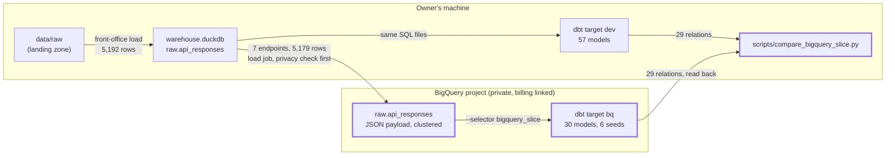

# Spike: a representative slice of the dbt project on BigQuery — design

Issue: #130 · Requirements: [requirements.md](requirements.md) · Tasks: [tasks.md](tasks.md)

## Overview

Thirty of the 57 models are ported so that each exists once and builds on both
warehouses, and the port is done to be merged, not thrown away. The slice is the matchup
category scores with everything under them, the reconciliation of those scores against
ESPN, and the category scales: it reads boxscores, rosters and five smaller endpoints, and
it holds every kind of construct BigQuery is known to refuse except three that only later
models use (`md5`, `to_timestamp`, `list(…)`). A model keeps SQL both warehouses accept
and reaches the rest through dispatched `fo_*` macros. The raw rows of seven endpoints are copied from the
local warehouse into a BigQuery table by a load job. Then the slice is built on both
sides from the same rows and compared: everything that is not floating-point exactly,
floats to a tolerance. What it took, and what it billed, is posted on the issue and
becomes the milestone's remaining issues.

Three dbt terms used below, since they are new here:

- A **target** is one named connection in `profiles.yml`. `dbt build --target bq` runs
  the same project against a different warehouse.
- An **adapter** is the plugin that speaks to one kind of warehouse (`dbt-duckdb`,
  `dbt-bigquery`). **`adapter.dispatch`** lets one macro name have a form per adapter:
  `fo_json_text` calls `adapter.dispatch('fo_json_text')`, and dbt picks
  `duckdb__fo_json_text` or `bigquery__fo_json_text` by the target. A model calls the one
  name and never knows.
- A **selector** is a named selection kept in `dbt/selectors.yml`, used as
  `dbt build --selector bigquery_slice`, so the slice is written down once.

Where the slice sits, and what is new:



## Alternatives considered

What kind of spike this is:

| | A — port a slice to merge (chosen) | B — throwaway branch | C — transpile compiled SQL | D — a second model tree |
|---|---|---|---|---|
| Measures the real cost of the migration | Yes: the cost includes keeping DuckDB exact | No: skips the half that is hard | Partly: only what the transpiler cannot do | Yes, of a design nobody wants |
| Risk to the DuckDB build | Held to an exact comparison (R4.4) | None | None | None |
| Work left over when done | 27 models, by a pattern already used 30 times | All 57, again | All of it, if it fails on one model | 57 models kept twice for ever |
| Stays inside dbt (lineage, tests, docs) | Yes | Yes | No: SQL is run outside dbt, or by a custom materialization | Yes |
| Handles what has no BigQuery form (ordered float aggregates, `from_json` with a structure) | Per construct, visibly, in a macro | Ad hoc | No | Per model |
| Time to a first number | Slowest | Fastest | Fast | Slow |

**A — port a slice to merge.** Every change is made the way the full migration would make
it, and is admitted only if the real DuckDB warehouse comes out identical. It wins because
the question is what the migration costs, and most of that cost is in doing it without
moving DuckDB's numbers.

**B — throwaway branch.** Edit the slice until it builds on BigQuery, report, delete.
It answers "can BigQuery compute this" in a day or two. It loses because nobody doubts
that; what is unknown is the price of one codebase for two warehouses, and a branch that
may break DuckDB never pays it.

**C — transpile.** Leave the models alone and translate dbt's compiled DuckDB SQL with
SQLGlot. It would handle `::`, `filter` and `try_cast` for free. It loses on three things
found on 2026-10-11 that are not translation: an ordered float aggregate has no BigQuery
form, `from_json` with a structure has none, and the JSON key order and wildcard differ in
behaviour. And the translated SQL is no longer a dbt model.

**D — a second model tree.** `models/` for DuckDB and a copy for BigQuery. It loses
because every later change is made twice and the two drift; it is the thing the
`fo_json_*` macros were built to avoid.

How a model is written for two warehouses, how the raw rows get there, what "the same"
means and what may be uploaded each have their own alternatives, in the ADRs below.

## Decisions

| ADR | Decision | Status |
|---|---|---|
| [0051](../../adr/0051-a-model-is-written-once-in-sql-both-warehouses-accept-and-dispatched-macros.md) | A model is written once: SQL both warehouses accept, and a dispatched `fo_*` macro for the rest | accepted |
| [0052](../../adr/0052-the-spike-loads-raw-rows-into-a-native-bigquery-table-with-a-json-payload.md) | The spike loads raw rows into a native BigQuery table with a `JSON` payload, clustered by source and endpoint | accepted |
| [0053](../../adr/0053-a-bigquery-build-is-held-to-duckdbs-exactly-except-floats-to-a-tolerance.md) | A BigQuery build is held to DuckDB's exactly, except floating-point columns, which are held to a tolerance | accepted |
| [0054](../../adr/0054-only-endpoints-without-member-data-are-uploaded-and-whole.md) | Only endpoints without league members' data are uploaded, and their captures whole | accepted |

Settled by the owner on 2026-10-11, going through the spec's decisions one at a time:

- Tier L; the spike is a port to merge (A); the slice is the 30 models and 6 seeds below.
- ADRs 0051, 0053 and 0054: option 1 of each.
- **A billing account is linked before the spike runs**, not the sandbox this spec was
  drafted for. The owner links it and sets a budget with an alert (R2.7); the per-query
  cap of R2.4 stays. Nothing in the design comes to depend on billing.
- ADR 0052: option 1, and option 3 (a bucket and an external table) measured once for
  `mlb/boxscore` (R6.6).
- The lineup solver is left out and gets its own issue at the end of the spike.
- `stg_espn__pro_games` is rewritten on DuckDB too, held to its 20,760 rows.

## Detailed design

### The slice

`dbt/selectors.yml`, new:

```yaml
selectors:
  - name: bigquery_slice
    description: The models ported to BigQuery by the spike (spec 0130).
    definition:
      union:
        - method: fqn
          value: fct_matchup_results
          parents: true
          indirect_selection: cautious
        - method: fqn
          value: rec_espn__category_result_differences
          parents: true
          indirect_selection: cautious
        - method: fqn
          value: int_fantasy__category_scales
          parents: true
          indirect_selection: cautious
```

It selects 30 models (21 tables, 8 views, the ephemeral `int_fantasy__player_crosswalk`)
and 6 seeds. Counted from the manifest of `main` at `988c188`.

`indirect_selection` says which tests come along with the selected models. dbt's default,
`eager`, takes every test that touches a selected model, and 23 of those also read a
model outside the slice (`rec_espn__register_rows`, for one), which BigQuery will not
have. `cautious` takes only tests whose every parent is selected: the 204 data tests and
59 unit tests of *Expected values*.

### The target

`dbt/profiles.yml` gains:

```yaml
    # BigQuery, for the slice of spec 0130. Credentials are application-default
    # (gcloud auth application-default login); nothing about them is in this file.
    bq:
      type: bigquery
      method: oauth
      project: "{{ env_var('FO_BQ_PROJECT') }}"
      dataset: main
      location: US
      threads: 4
      priority: interactive
      maximum_bytes_billed: 10000000000
      job_execution_timeout_seconds: 600
```

`dataset` is what dbt calls the schema on BigQuery. With the project's
`generate_schema_name` the datasets are `main` (seeds), `staging`, `intermediate`,
`marts` and `reconciliation`, the names DuckDB's schemas have. dbt creates them. `raw` is
created by the loader. `env_var` with no default makes dbt fail, naming the variable,
only when the `bq` target is used (R2.5): the build's first task confirms that `dev` and
`ci` parse without it, and if they do not, the default becomes a placeholder that the
loader and the build refuse.

`dbt-bigquery` goes in a `bigquery` dependency group in `pyproject.toml`, outside
`default-groups`, installed with `uv sync --group bigquery`.

### How each refused construct is written

A model of the slice may not contain the left column. The choice in the right column is
fixed here; an implementer does not choose.

| Refused on BigQuery | Written as | Kind |
|---|---|---|
| `x::integer`, `x::date`, `x::bigint` | `cast(x as integer)` etc. | plain SQL: both accept `integer`, `bigint`, `date`, `boolean` |
| `x::double`, `cast(x as double)` | `cast(x as {{ fo_type_float() }})` | macro: `double` / `float64` |
| `varchar` in a cast | `{{ fo_type_text() }}` | macro: `varchar` / `string` |
| `count(*) filter (where c)` | `count(case when c then 1 end)` | plain SQL |
| `sum(x) filter (where c)` | `sum(case when c then x end)` | plain SQL |
| `try_cast(x as t)` | `{{ fo_safe_cast('x', 't') }}` | macro: `try_cast` / `safe_cast` |
| `unnest(list) as x` in a SELECT list | `from t {{ fo_unnest('t.list', 'x') }}` | macro, in the FROM clause: `cross join unnest(t.list) as _u(x)` / `cross join unnest(t.list) as x` |
| two `unnest`s side by side (a key beside its value) | `{{ fo_unnest_pair('t.keys', 'k', 't.vals', 'v') }}` | macro: DuckDB's zipped unnest / two `unnest … with offset` joined on the offset |
| `generate_series(a, b)`, `range(a, b)` | `{{ fo_int_series('a', 'b') }}`, then `fo_unnest` | macro: `generate_series` / `generate_array`, both ends included |
| `sum(x order by k)` | `{{ fo_sum_in_order('x', 'k') }}` | macro: unchanged / `sum(x)` |
| `avg(x order by k)` | `{{ fo_avg_in_order('x', 'k') }}` | macro: unchanged / `avg(x)` |
| `bool_or(c)` | `{{ fo_any_true('c') }}` | macro: `bool_or` / `logical_or`; both give null over no non-null input |
| `epoch_ms(n)` | `{{ fo_timestamp_from_millis('n') }}` | macro: `epoch_ms` / `timestamp_millis` |
| `map_values(m)` on a `MAP` parsed by `fo_json_parse` | no map: see *The one model that is restructured* | — |
| `::bigint`, `try_cast(… as double)` in `fo_innings_to_outs`; `::integer` in `fo_espn_latest`; `unnest(players)` in `fo_boxscore_players` | the same rewrites, inside those macros | they are shared macros, not dispatched: ported like a model |
| `strptime` (in `fo_parse_fetched_at`) | the macro, dispatched | `strptime` / `parse_timestamp` |
| `at time zone` (in `fo_eastern_date`) | the macro, dispatched | as today / `date(ts, 'America/New_York')` |
| `regexp_extract(c, p, 1)` (in `fo_request_param`) | the macro, dispatched | as today / `regexp_extract(c, p)` |
| `timestamptz` (in `fo_json_timestamp`) | the macro, dispatched | `timestamptz` / `timestamp` |
| `a.b.c` on a value parsed by `fo_json_parse` | unchanged | works on both once `fo_json_parse` returns typed values (below) |

The DuckDB form of every macro emits the SQL the model has today, token for token where
it can, so that R4.4 holds by construction and is then checked. The three `filter`
rewrites and the casts are plain SQL on both; their DuckDB result types are the same
(`count` is `BIGINT` either way, `sum` over a `case` keeps the type of `sum` over the
column), which R4.5 checks.

`fo_sum_in_order` on BigQuery drops the order, because BigQuery has no way to state it.
That is the one place the port knowingly computes a number differently, and it is why
floats are held to a tolerance (ADR 0053). `test_dbt_ordered_aggregate_rule.py` learns
the macros: a float aggregate is in order if it is written with `order by` or through
`fo_sum_in_order` / `fo_avg_in_order`.

The table is what is known on 2026-10-11, from dry runs and from reading the slice. It
is not trusted to be complete: the first thing run against BigQuery is the slice with
`--empty` (R4.7), which executes every model's and test's SQL over no rows. A construct it
turns up that has a row above is fixed by that row. One that has no row is a `judgment`
task: by ADR 0051's rule it is plain SQL if both warehouses accept a spelling that reads
as plainly, and a new dispatched macro if not; it is added to the table's successor in
the findings and to the rule test.

Two kinds of macro are touched. A **dispatched** macro (`fo_json_*`, the new ones) has a
form per warehouse. A **shared** macro (`fo_boxscore_players`, `fo_espn_latest`,
`fo_latest_boxscore_responses`, `fo_latest_by_entity`, `fo_innings_to_outs`,
`fo_single_component_stats`, the stat-column lists) is SQL that models include; it is
ported like a model, by the table, and the rule test scans it like one.

New macros live in `dbt/macros/portable.sql`; each is
`{{ return(adapter.dispatch('fo_x')(...)) }}` with
`duckdb__fo_x` and `bigquery__fo_x` beside it. No `default__` form: an unknown adapter
fails at compile time instead of running DuckDB SQL somewhere else.

### The JSON macros on BigQuery

`dbt/macros/json.sql` gains a `bigquery__` form of each accessor. `column` is of type
`JSON` (ADR 0052).

| Macro | DuckDB (today) | BigQuery |
|---|---|---|
| `fo_json_string` | `c ->> 'p'` | `json_value(c, 'p')` |
| `fo_json_text` | `nullif(c ->> 'p', '')` | `nullif(json_value(c, 'p'), '')` |
| `fo_json_int` | `try_cast(c ->> 'p' as bigint)` | `safe_cast(json_value(c, 'p') as int64)` |
| `fo_json_bool` / `_date` | `try_cast(… as boolean / date)` | `safe_cast(json_value(c, 'p') as bool / date)` |
| `fo_json_timestamp` | `try_cast(… as timestamptz)` | `safe_cast(json_value(c, 'p') as timestamp)` |
| `fo_json_array` | `json_extract(c, 'p')::JSON[]` | by the path's wildcards, below |
| `fo_json_exists` | `json_extract(c, 'p') is not null` | `json_query(c, 'p') is not null` |
| `fo_json_keys` | `json_keys(c, 'p')` | `json_keys(json_query(c, 'p'), 1)` |
| `fo_json_values` | `json_extract(c, 'p.*')::JSON[]` | `array(select o[k] from unnest(json_keys(o, 1)) as k)`, `o` being `json_query(c, 'p')` |
| `fo_json_parse` | `from_json(json_extract(c, 'p'), '<schema>')` | generated from the same schema, below |

Seen on BigQuery on 2026-10-11, with constants: `json_query` returns SQL null for an
absent path and JSON `null` for a null, which is what `fo_json_exists` promises;
`json_value` keeps a number's text (`12.0` stays `12.0`); `json_keys(…, 1)` gives one
level; `o[k]` reads a value by a key that is not a constant, which a path cannot.
`fo_json_keys` and `fo_json_values` both follow `json_keys`' order, so a key still sits
beside its own value through `fo_unnest_pair`; the order is sorted, not the document's,
and no model of the slice may depend on it (none is known to; R5.2 would show one).

`fo_json_array` is called with paths that hold `[*]`: nine times with one at the end
(`$.schedule[*]`, `$[*]`) and twice with two (`$.dates[*].games[*]`). BigQuery's path has
no wildcard; run on 2026-10-11, `json_query_array(j, '$.a[*]')` fails where
`json_query_array(j, '$.a')` returns the elements. The BigQuery form splits the path on
`[*]` when the macro is compiled:

- one `[*]`, at the end: `json_query_array(c, '<path before it>')`;
- two: `array(select g from unnest(json_query_array(c, '<first part>')) as d cross join
  unnest(json_query_array(d, '$<second part>')) as g)`, seen to return `[1, 2, 3]` for
  two inner arrays `[1, 2]` and `[3]`;
- a `[*]` anywhere else, three or more, or a `.*`: a compilation error naming the path.

The models' paths do not change.

`fo_json_parse` takes the schema text the models pass today. The BigQuery form reads it
with Jinja's `fromjson` and walks it: a list becomes
`array(select as struct … from unnest(json_query_array(…)) as e)`, an object a
`struct(…)`, and a leaf `lax_int64(…)` for `BIGINT`, `lax_string(…)` for `VARCHAR`,
`lax_float64(…)` for `DOUBLE`, `lax_bool(…)` for `BOOLEAN`, each named as the schema
names it. The result has the same field names and nesting as DuckDB's, so
`entry.playerPoolEntry.player.fullName` in a model is unchanged. A fifth leaf, `JSON`,
means "leave this value as JSON": DuckDB's `from_json` accepts it as a type, and the
BigQuery form returns the value untouched. Any other type fails compilation with the
type named.

### The one model that is restructured

`stg_espn__pro_games` parses ESPN's per-period object as a DuckDB `MAP` whose type is
written inside the schema text, then calls `map_values`. BigQuery has no map type. This
model's SQL therefore changes on DuckDB too, beyond the table above, and is the only one
known to:

1. `proGamesByScoringPeriod` is declared `"JSON"` in `pro_teams_schema`.
2. `game_lists` takes `fo_json_values('team.proGamesByScoringPeriod', '$')`, the lists of
   games as JSON, through `fo_unnest`.
3. `listed_games` parses each list with `fo_json_parse(games, '$', games_schema)`, where
   `games_schema` is `[{"id": "BIGINT", "date": "BIGINT", "scoringPeriodId": "BIGINT",
   "homeProTeamId": "BIGINT", "awayProTeamId": "BIGINT"}]`, through `fo_unnest`.
4. In the final SELECT, both `epoch_ms(game.date)` become
   `fo_timestamp_from_millis('game.date')` (the second is the argument of
   `fo_eastern_date`), and `cast(game.id as varchar)` becomes
   `cast(game.id as {{ fo_type_text() }})`. Nothing else in it changes.

Its 20,760 rows on the real season must come out the same on DuckDB (R4.4), and its four
unit tests must pass on both. The payload is under 1 MB and there are nine, so rule 1's
memory concern is small here; it is still recorded in task 6.

### The loader

`scripts/spike_load_bigquery.py`, run by hand:

```
uv run --group bigquery python scripts/spike_load_bigquery.py \
    --db data/warehouse.duckdb --project "$FO_BQ_PROJECT"
```

1. Reads `raw.api_responses` from the local warehouse, read-only, for the seven
   allowlisted `(source, endpoint)` pairs (R3.2). The allowlist is a constant in the
   script; there is no option to widen it.
2. Checks every row first (R3.3) with `privacy.walk`, `FORBIDDEN_KEYS` and `GUID`. A
   forbidden key is a hit in any row, of any source, with one exception: `firstName` and
   `lastName`, and only those two, directly in the object at a `playerPoolEntry.player`
   path. The `GUID` pattern is applied to rows whose `source` is `espn` only, as
   `privacy.py` itself is scoped: MLB's `gameGuid` is a public game id that matches the
   pattern, and every schedule row has them. On any hit it prints endpoint,
   `request_key` and path, and exits 1 before writing a file.
3. Writes one newline-delimited JSON file per endpoint under `data/bigquery_export/`.
4. Creates dataset `raw` (location `US`) if missing, and loads the files into
   `raw.api_responses` with `WRITE_TRUNCATE` on the first file and `WRITE_APPEND` on the
   rest, schema stated: `source`, `endpoint`, `request_path`, `request_key`, `fetched_at`,
   `file_path` as `STRING`; `partitions`, `payload` as `JSON`; all `REQUIRED`; clustered by
   `source, endpoint`.
5. Reads every loaded row back through the BigQuery client (reading a table's rows is
   not billed), pairs it with its source row by the five key columns, and compares
   `file_path` exactly (it is the tie-break of `fo_espn_latest`) and
   `payload` and `partitions` as parsed JSON (`json.loads` on both sides); prints, per
   endpoint, rows paired, rows equal, and rows only on one side; exits 1 unless every row
   is paired and equal (R3.4). A number BigQuery's `JSON` type cannot hold as written (an
   integer beyond 64 bits) would show here, before any model reads it.

`--dry-run` does steps 1 and 2, prints the rows it would upload per endpoint, and stops.

It takes its rows from the local warehouse and not from the landing zone so that both
builds read the same rows by construction, already checked by `load.py` (keys,
collisions, valid JSON). A load job is not DML, and worked in the sandbox the spec was drafted in. `fetched_at`
stays text, as in DuckDB; `fo_parse_fetched_at` turns it into a timestamp on both.

### The comparison

`scripts/compare_bigquery_slice.py --db data/warehouse.duckdb --project "$FO_BQ_PROJECT"`:

1. Takes the 29 relations from `dbt ls --selector bigquery_slice` (the ephemeral model
   has no relation).
2. Reads each BigQuery relation back into a scratch DuckDB database through the BigQuery
   client (reading a table's rows is not billed) and attaches the local warehouse
   read-only.
3. Maps types before comparing: `INT64` and DuckDB's `BIGINT`/`HUGEINT`/`INTEGER` as
   integers; `TIMESTAMP` on both sides as an instant in UTC; text, dates and booleans as
   they are. A column on one side only, or of a different kind, is a failure.
4. Non-float columns: `EXCEPT ALL` both ways, reusing `warehouse_diff` (R5.2).
5. Float columns: joins on the relation's declared unique key, read from its `unique` or
   `dbt_utils.unique_combination_of_columns` test in the manifest, and applies R5.3. All
   seven float-bearing relations have such a test. Prints, per column: values compared,
   exactly equal, largest absolute and relative difference (R5.4).
6. Exit 0 only if every relation passes; prints one line per relation either way.

`--bq-against-bq DATASET_SUFFIX` compares two BigQuery builds exactly instead (R5.5); the
second build is made with `--vars '{fo_schema_suffix: _b}'`, which
`generate_schema_name` appends on the `bq` target only.

### What is reported

One comment on #130 with: the comparison's output; the unit-test table (R5.6); bytes
billed per model, per test and in total from `run_results.json`
(`adapter_response.bytes_billed`); the `STRING` comparison for one boxscore model (R6.4:
the same model built against a copy of the boxscore rows with `payload` loaded as
`STRING` and read through `parse_json`); every changed file by construct, and the count
of each construct in the 27 unported models, from the regular expressions of the new
rule test; the external-table measurement (R6.6: `mlb/boxscore` exported to a private
bucket, an external table over it, one boxscore model built against that table, bytes
billed and time beside the native table's, then bucket and table deleted); and anything
BigQuery refused.

## Test strategy

| Requirement | Test | Catches |
|---|---|---|
| R1.1, R1.2 | pytest: `dbt ls --selector bigquery_slice` gives the 30 model names and 6 seed names listed in the test, and no Python model | a model added to the slice by a new `ref`, unnoticed |
| R2.2, R2.5 | pytest: `dbt parse` on `dev` and on `ci` with `FO_BQ_PROJECT` unset succeeds | the new target breaking the gates for someone without GCP |
| R2.3 | pytest on `pyproject.toml` and `uv.lock`: `dbt-bigquery` is only in group `bigquery`, which is not a default group | CI installing Google's client libraries |
| R2.6 | pytest: the `bq` target has `method: oauth` and no `keyfile`; no tracked file holds a `private_key` field | a key file committed, or the target switched to one |
| R3.2, R3.3 | pytest on the loader's check with small payloads: a GUID; `firstName` under `members`; `firstName` under `playerPoolEntry.player` (allowed); an endpoint off the allowlist | member data uploaded; the player-name exception widening |
| R3.1, R3.4 | the loader's row-by-row comparison of parsed JSON on the real rows; the comparison function tested in pytest on pairs that differ in one field, in key order only (equal), and in a missing row | a payload that lost or changed a field in the load, which a row count would pass |
| R4.2, R4.3 | pytest `test_dbt_portable_sql_rule.py`: the known refused constructs, scanned in the slice's models and singular tests and in every macro they reach (from the manifest's `depends_on`, followed through macros), skipping `duckdb__` forms | a refused construct coming back in a ported model, or sitting in a shared macro such as `fo_boxscore_players` |
| R4.7 | `dbt build --target bq --selector bigquery_slice --empty` | a refused construct nobody listed; SQL a dry run accepts and BigQuery then fails, as a wildcard path does |
| R4.1 | pytest: `dbt compile --selector bigquery_slice` succeeds on `ci`; on `bq` it is a judgment task (needs credentials) | a macro with no DuckDB form |
| R4.4, R4.5 | `compare_warehouses.py OLD NEW --strict-columns` on the real season, and a query of `information_schema.columns` on both for types | a rewrite that changed a DuckDB number or a column type |
| R4.6 | `.agentic/gates`: the 437 data tests and 155 unit tests on fixtures, tenant isolation, examples | a ported model behaving differently on the fixtures |
| R5.1 | `dbt build --target bq --selector bigquery_slice` on the real rows | a BigQuery form that computes something a test forbids |
| R5.2, R5.3, R5.4 | `compare_bigquery_slice.py`; its float rule and type mapping unit-tested in pytest on two small DuckDB databases | a different row, a null on one side, a float beyond tolerance, a key that does not join |
| R5.5 | two `bq` builds compared exactly | BigQuery not reproducing itself |
| R5.6 | `dbt test --target bq --selector bigquery_slice,resource_type:unit_test` | a BigQuery form wrong on a case the real season does not contain |
| R6.1 to R6.5 | the issue comment, checked against `run_results.json` | a cost figure that is an estimate |

The 59 unit tests matter more than their number suggests: their expected rows were
written for DuckDB and say nothing about the engine, so each one that passes on BigQuery
is a behaviour shown to be the same on inputs chosen to be awkward.

## Risks

- **Moving `unnest` from the SELECT list to the FROM clause changes DuckDB's plan.** Rule
  1 was learned from exactly this kind of change (24 GB). Possible. The real `dev` build
  of R4.4 is run at the default four threads, and its time and peak memory are recorded
  beside those of the build before; a model that regresses keeps its DuckDB SQL exactly
  as it is today, behind the macro's DuckDB form.
- **The list of refused constructs is incomplete.** Certain: it grew by four in review.
  Accepted and bounded: R4.7 finds the rest at no cost before any real build, and what
  it finds is itself a finding (R6.2). If it finds a construct with no form on one side,
  as the ordered aggregate has none, that goes to the owner before any workaround.
- **`stg_espn__pro_games` is rewritten on DuckDB, not just respelled.** Its rows must
  come out equal (R4.4); if they cannot, the model keeps its DuckDB SQL and gets a
  BigQuery form of its own, which is then the first exception to ADR 0051 and is reported
  as one.
- **A ported model moves a DuckDB number.** Likely at least once (a `filter` rewrite on
  a nullable column, a cast). Impact high. Caught by R4.4 on the real season before
  anything is merged; the rewrite is then changed, never the comparison.
- **`safe_cast('12.0' as int64)` is null on BigQuery where DuckDB's `try_cast` gives 12.**
  Likely somewhere in ESPN's payloads. Shows as a non-float difference in R5.2; the fix
  is in `bigquery__fo_json_int` (`lax_int64` of the JSON value), once, not in a model.
- **`json_value` returns null for an object or array where `->>` returns its text.**
  Unlikely to matter: `fo_json_string` is used for scalars. Shows in R5.2.
- **`lax_*` in `fo_json_parse` accepts a value DuckDB's `from_json` would reject or read
  differently.** Possible. Shows in R5.2 on the two models that use it.
- **A key with a dot or a quote in it breaks `o[k]` or a path.** Not in the slice's
  payloads as far as known (keys are `ID669016`, `69`). Shows as missing rows.
- **dbt cannot type a `JSON` column in a unit test's fixture on BigQuery.** Possible; it
  would stop the staging models' unit tests. Recorded under R5.6, not worked around.
- **A local file of 944 MB is refused by the load job.** Possible. The loader then splits
  an endpoint into several files; the table and the counts are the same.
- **Bytes billed are far above the estimate.** The worst case, every raw-reading model
  scanning all 1.45 GB, is about 20 GB a build, against 1 TB a month free. Capped per
  query by R2.4.
- **A billed project can cost money.** Low: the worst case above is a fiftieth of the
  free monthly terabyte, and the bucket of R6.6 holds under 1 GB for under a day. Bounded
  by R2.4's cap per query and the owner's budget alert (R2.7).
- **A bucket is a second place raw data lives.** Only public MLB boxscores go there, the
  bucket is private, and it is deleted when measured (R6.6).
- **League and team names reach BigQuery** (the `settings` payload has the league's name,
  and the build runs with `anonymize: false` to compare like with like). The project is
  private to the owner's account. Accepted if the owner accepts ADR 0054.
- **The spike grows into the migration.** The selector and the no-gos bound it.

## Open questions

- Whether BigQuery's clustering reduces bytes billed for a model that filters on
  `endpoint` — the build measures it (R6.1); nothing is designed on the assumption.
- Whether a `JSON` column is billed by the paths read or whole — R6.1 and R6.4 measure.
- Whether a newline-delimited JSON load accepts a nested object for a `JSON` column, or
  needs the value as text — the loader's first run shows; either way the table is the
  same.
- Whether `env_var` without a default is evaluated when another target is used — task 2.
- Whether the `firstName`/`lastName` keys in rosters and matchups are only ever under
  `playerPoolEntry.player` — true of the latest capture of each (305 and 206 pairs); the
  loader checks all 194 before uploading.
- Whether any `dbt_utils.expression_is_true` expression in the slice's YAML uses a
  refused construct — not scanned; the `bq` build shows.
- Whether dbt's unit tests run against `JSON` inputs on BigQuery — R5.6.

## Review log

| Source | Finding | Resolution |
|---|---|---|
| design-review | F1 (P1): `fo_json_array` passes wildcard paths (`$.schedule[*]`, `$.dates[*].games[*]`) to `json_query_array`, which has no wildcard | Confirmed by running it: a dry run accepts the path and execution fails. `fo_json_array`'s BigQuery form now splits the path on `[*]` at compile time, with the two-level form run and shown. Problem table and R4.7 added. |
| design-review | F2 (P1): `stg_espn__pro_games` passes a `MAP(…)` schema and calls `map_values` and `epoch_ms`; `fo_json_parse` rejected it | Confirmed. New section *The one model that is restructured*; a `JSON` leaf for `fo_json_parse` (checked on DuckDB); `fo_timestamp_from_millis`. The same check found `bool_or`, now `fo_any_true`. |
| design-review | F3 (P1): shared macros emit refused SQL (`fo_boxscore_players`, `fo_espn_latest`, `fo_innings_to_outs`) and the rule test scanned only models and tests | Confirmed. Shared macros are ported like models and named; R4.3's scan follows the manifest into every macro the slice reaches; R4.7 runs the compiled SQL of the whole selector, tests included, on BigQuery. |
| design-review | F4 (P2): the load check failed only on row counts, so a payload could lose a field unnoticed | Changed: R3.4 pairs every loaded row with its source by key and compares parsed JSON. |
| design-review, round 2 | F1 (P1): the selector takes tests eagerly, and 23 tests of selected models also read a model outside the slice | Changed: each part of the selector sets `indirect_selection: cautious`; R1.4 added; the 204 and 59 of *Expected values* were already counted that way. |
| design-review, round 2 | F2 (P1): the `GUID` pattern matches MLB's public `gameGuid`, so the loader would refuse every schedule row | Changed: the GUID check applies to `espn` rows only, as `privacy.py` is scoped; R3.3 and the loader's tests say so, with an MLB schedule case. |
| design-review, round 2 | F3 (P2): the exception under `playerPoolEntry.player` allowed every forbidden key, not only a ballplayer's name | Changed: only `firstName` and `lastName` are excepted there; R3.3 reworded. |
| design-review, round 2 | F4 (P2): the `stg_espn__pro_games` steps left a `varchar` cast and a second `epoch_ms` in the final SELECT | Changed: step 4 names all three replacements. |
| design-review, round 2 | F5 (P2): the load check did not compare `file_path`, the tie-break of `fo_espn_latest` | Changed: R3.4 compares `file_path` exactly; a one-field case is in the loader's tests. |

## Amendments


### 2026-10-11: the selector names one test (build, task 2)

The selector as written above selects 203 data tests, not the 204 of *Expected values*.
dbt applies `indirect_selection: cautious` to each member of a union alone, so
`fct_matchup_results_match_espn`, whose parents lie in two members, is in neither,
although every model it reads is in the slice. The selector gains a fourth member naming
that test, and `test_bigquery_slice.py` fails if the selector's tests ever differ from
`dbt ls --select "+a +b +c" --indirect-selection cautious`, which applies the rule to the
union as a whole. No scope moves: the count is the spec's.

Also settled in task 2: `env_var('FO_BQ_PROJECT')` with no default is evaluated only when
the `bq` target is used. `dev` and `ci` parse with the variable unset, and with
`dbt-bigquery` not installed; `bq` fails naming the variable (R2.5).

### 2026-10-11: `fo_unnest` is given a column, not an expression over a payload (build, task 6)

The first real `dev` build of the ported models ran out of memory (23.9 GiB), which is
the first risk listed above. Measured on the real schedule captures, alone: unnesting in
the SELECT list, as before, 0.19 s; `from responses cross join
unnest(json_extract(responses.payload, …))`, 5.1 s and 1.9 GB for one query; the list
computed in one CTE and unnested from that CTE in the next, 0.05 s. DuckDB unnests a
column in place and plans an expression in the FROM clause as a join that carries what
the expression reads.

So the port follows AGENTS.md rule 1 in the FROM clause too: `stg_mlb__games`, its
singular test and `stg_espn__scoring_categories` compute the list in a CTE of their own
before `fo_unnest`, and `stg_espn__roster_entries` and `stg_espn__pro_games` take each
next list out as a column before unnesting it (`stg_espn__roster_entries` took 6.6 s
against 2.6 s until it did). No DuckDB SQL is kept behind a macro's DuckDB form, which is
what the risk allowed for: the models are still one definition. Small expressions
(`fo_int_series`, the keys of one matchup) are unnested directly.

Result, real season, four threads: 56 of 56 relations identical to the baseline with
`--strict-columns`, 815 of 815 columns of the same type and nullability; build 58.5 s
against 56.2 s, peak memory 19.8 GB against 20.0 GB.

Not in the design's table and written as plain SQL by ADR 0051's rule, since both
warehouses accept it: `max(x) filter (where c)` as `max(case when c then x end)`, and
`count(col) filter (where c)` as `count(case when c then col end)`.

sqlfluff's RF02 fires on the DuckDB form of `fo_unnest_pair`, a joined subquery, in
`stg_espn__matchup_category_results`. The table's columns are qualified; the two unnested
names cannot be, since what they would be qualified with differs by warehouse, and carry
`-- noqa: RF02` with that reason (ADR 0043).
