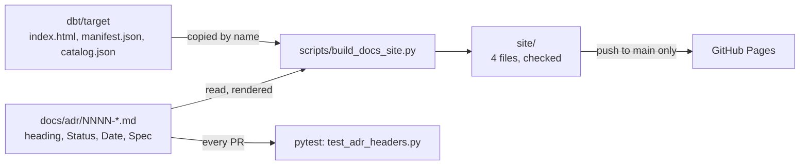

# The ADR index is generated onto the docs site — design

Issue: #133 · Requirements: [requirements.md](requirements.md) · Tasks: [tasks.md](tasks.md)

## Overview

The table of decisions stops being a committed file. The docs-site assembler, which
already runs in the gates and in CI and publishes on a push to `main`, reads the header
of every ADR file and writes a fourth file into the site, `decisions.html`. Nothing a PR
commits lists the ADRs, so two PRs that each add one have no line in common. A test in
the existing pytest step holds the ADR headers to the shape the generator reads, and
fails if `docs/adr/README.md` starts listing ADRs again.

## Claims ledger

Every statement this spec makes about the repository, with the command that showed it.
All run on `main` at `f6d2270`.

| # | Claim | Query (or script) | Result | Run on |
|---|---|---|---|---|
| C1 | The index has been edited by most PRs | `git log --first-parent --oneline origin/main -- docs/adr/README.md \| wc -l` | 53 | 2026-10-12 |
| C2 | Nine merges are of two commits that conflict in the index | for each merge `c` in `git log origin/main --merges`: `git merge-tree --write-tree --name-only c^1 c^2`, counting those that report `CONFLICT` in `docs/adr/README.md` | 9 of 98 merges, all dated 2026-10-10 or 2026-10-11: `200409e`, `815166f`, `609df2e`, `1c6a747`, `9288907`, `e9f4943`, `1318d22`, `490fe8b`, `94888bf`. Each merges `main` into a spec or build branch | 2026-10-12 |
| C3 | The branches of #83 and #143 conflicted there | `git merge-tree --write-tree --name-only feat/143-staging-by-season origin/feat/83-past-season-rosters` | `CONFLICT (content)` in `docs/adr/README.md` and `_espn__models.yml` | 2026-10-12 |
| C4 | Table and files hold the same ADRs | parse both; compare numbers | 60 rows, 60 files, none only in one | 2026-10-12 |
| C5 | Every header has one shape | first three header keys of each file | `Status, Date, Spec` in all 60; 8 add `Amends`, 1 adds `Supersedes` | 2026-10-12 |
| C6 | Headers pass the R2 checks as they are | heading form, heading number = filename number, ISO date, exactly one `Spec` link, relative header links resolve, no duplicate numbers, no gaps | no problem in any of 60 | 2026-10-12 |
| C7 | Three status words are in use | the leading run of letters of each `Status` line | accepted 56, proposed 3, superseded 1. Six lines continue straight into punctuation: `accepted;` in 3, `accepted,` in 3 | 2026-10-12 |
| C8 | Number, file, date and spec target agree between table and files | cell by cell | equal in 60 of 60; the spec link's text differs in all 60 (`0011` in the table, `0011-player-value` in the file), its target in none | 2026-10-12 |
| C9 | Titles have drifted | table title against heading text | 6 differ: 0023, 0031, 0033, 0034, 0035, 0038. The table's is longer in each, e.g. 0023 adds "; supersedes 0021", 0034 reads "…is the bridge from a platform's player to an M…" where the heading reads "…is the bridge, and facts carry the MLB id" | 2026-10-12 |
| C10 | Statuses have drifted | table status against `Status` line | 9 differ; the first word agrees in all 60. The file says more in each (longest `Status` line 363 characters, longest table cell 264); three differ only in `;` against `,` | 2026-10-12 |
| C15 | One file says the site has three files | `grep -n "three" README.md docs/README.md AGENTS.md dbt/models/overview.md` | `README.md:234`, "site is assembled from three named files that are checked before upload" | 2026-10-12 |
| C11 | Two files link the index | `grep -rnE "adr/README\.md"` outside `docs/adr` and `docs/specs` | `README.md:251`, `docs/README.md:40`; one spec's tasks name it (0052) | 2026-10-12 |
| C12 | The site holds no ADRs today | `grep -n adr scripts/build_docs_site.py` | no match; `FILES` is `index.html`, `manifest.json`, `catalog.json` | 2026-10-12 |
| C13 | CI cannot write to the repository, and `main` is unprotected | `permissions:` in `ci.yml`; `gh api repos/…/branches/main/protection` | `contents: read`; 404 "Branch not protected" | 2026-10-12 |
| C14 | Tests can import a script | `pythonpath` in `pyproject.toml`; `test_build_docs_site.py` line 9 | `["ingestion/src", "scripts", "dbt/python_modules"]`; `import build_docs_site as site` | 2026-10-12 |

## Alternatives considered

| | A — a page of the docs site (chosen) | B — committed, written by CI on `main` | C — committed, regenerated in each PR |
|---|---|---|---|
| Two PRs each adding an ADR | no shared line | no shared line | still conflict; the fix is to rerun the script |
| Table visible on GitHub itself | no: the directory listing, and a link to the site | yes | yes |
| New CI permission | none | `contents: write`, and a push to `main` after each merge | none |
| Table matches `main` | on each deploy, about as long as CI takes | a commit behind for about a minute, and local `main` a commit behind after every ADR merge | always, or the gate fails |
| Meets the issue's "done when" | yes | yes | no |

**A — a page of the docs site.** The assembler writes `decisions.html` from the ADR
files. It wins because it is the only option in which no PR and no bot ever writes a
shared file, and it adds no permission: the site is already built, checked and deployed
(ADR 0042). Its cost is real and accepted: on GitHub a reader sees filenames, which are
the titles, and has to open the site for status and date.

**B — committed, written by CI on `main`.** Keeps the table on GitHub with no conflict.
It loses on ADR 0042's own driver, "no new long-lived write permission on the
repository" (C13), and it makes every merge that adds an ADR two commits, so each local
`main` is behind straight after its own merge.

**C — committed, regenerated in each PR.** The least change. It loses because the
conflict it exists to remove would remain (C1 to C3): a generated file two PRs both
regenerate is still a file two PRs both change.

Not weighed as an option: `merge=union` on the file in `.gitattributes`. It would keep
the hand-kept table and let git take both sides' rows. Whether GitHub's merge honours it
was not tested, and it leaves the drift (C9, C10) in place. See *Open questions*.

## Decisions

| ADR | Decision | Status |
|---|---|---|
| [0061](../../adr/0061-the-adr-index-is-a-page-of-the-docs-site.md) | The ADR index is a page of the docs site, generated from the ADR files; no committed file lists them. Amends 0042: the site holds four files | proposed |

## Detailed design

### `scripts/adr_index.py` (new)

Reads headers and renders the page. No dependency beyond the standard library.

- `read_adr(path) -> Adr`: the header is everything before the first `## ` line. From it:
  `number` and `title` from `# NNNN. <title>`; `status`, `date`, `spec` from the lines
  `- Status: …`, `- Date: …`, `- Spec: …`; `amends` and `supersedes` if present. Each of
  the three must appear exactly once. `status_word` is what
  `^([a-z]+)(?=[ ,;]|$)` matches at the start of the status (R2.2): splitting on
  whitespace would make `accepted;` a fourth word (C7). Raises `AdrError(path, reason)`
  for each condition of R2.1, R2.2 and R2.4.
- `read_all(adr_dir) -> list[Adr]`: every `NNNN-*.md`, in number order; raises on a
  repeated number (R2.3), and on a directory that is missing or holds none (R1.10). `README.md` is not an ADR and is skipped by the pattern.
- `render(adrs, repo_url) -> str`: a complete HTML document. One `<table>`; a line above
  it with the count and the count per status word (R1.5). Every value passes through
  `html.escape` first (R1.4); then, in the status cell only, `[text](target)` becomes a
  link and `` `x` `` becomes `<code>x</code>` (R1.3). A relative target is resolved
  against `docs/adr/` and written as `<repo_url>/blob/main/<path>`; an absolute one is
  kept. The spec cell is the `Spec` line's one link, with its own text (C8: the file's
  text, `0011-player-value`, not the table's `0011`).
- The title and status are the file's, whole (requirements R1.2, R1.3). The 6 titles and
  9 statuses of C9 and C10 therefore read as the files do, and nothing is edited to make
  them shorter.
- `repo_url` is a constant in the module, `https://github.com/nick-socci/front-office`,
  the address `dbt/models/overview.md` already gives.

### `scripts/build_docs_site.py` (changed)

- `FILES` becomes the three copied files plus `GENERATED = ("decisions.html",)`. The
  three are copied by name as now; `decisions.html` is written from
  `adr_index.render(adr_index.read_all(adr_dir), …)`.
- A new `--adr-dir` argument, default `docs/adr` relative to the repository root, so the
  tests can point at a made-up directory.
- An `AdrError` is one of the problems the run prints before it deletes its copies and
  exits 1 (R1.6), the same path a forbidden key takes today.
- `check_site`: the listing must be exactly the four names (R1.7), and `privacy.GUID`
  must match nothing in `decisions.html`, as for `index.html`. No ADR holds league data,
  and the pre-commit guard already scans them; the check is here because everything
  that is published is checked where it is assembled.
- The module docstring and the messages that say "three files" are corrected.

### `ingestion/tests/test_adr_headers.py` (new)

Runs in the existing pytest step, so the gates and CI need no new step.

- On the real `docs/adr/`: `adr_index.read_all` raises nothing, and `README.md` links no
  `NNNN-*.md` file (R3.2).
- On made-up directories: one case per condition of R2.1 to R2.4, each asserting the
  error names the file and the reason.
- `test_build_docs_site.py` gains the four-file cases and the negatives of R1.6 and R1.7;
  its "exactly three files" case becomes four.

### Prose

- `docs/adr/README.md`: the two-line preamble it has, then what the three status words
  mean, that files are numbered in the order decided and listed in that order, and a
  link to the page on the site. No table, and no link to an ADR file.
- `README.md` line 251 and `docs/README.md` line 40 keep their link to
  `docs/adr/README.md` and gain one to the page. `README.md` line 234 says the site is
  assembled from three named files (C15): it becomes dbt's three and the generated page.
- `dbt/models/overview.md`: one sentence linking the page from the site's landing text.
- `AGENTS.md`, *How work is done here*: ADRs are listed by a page the docs site
  generates; no file is edited to list them.
- ADR 0042's `Status` line gains "amended by 0061" when 0061 is accepted, as 0010 and
  0012 record theirs.

## Test strategy

| Requirement | Test | Catches |
|---|---|---|
| R1.1, R1.2, R1.5 | render a made-up directory of three ADRs; assert rows, order, links, counts | a row missing, out of order, or linked to the wrong file |
| R1.3 | a status with a link and a code span | a link left as markdown, or lost |
| R1.4 | a title containing `<script>` and `&` | text written into the page unescaped |
| R1.6 | an ADR with no `Status` line in the made-up directory | a site published without a decision, silently |
| R1.10 | `--adr-dir` naming a directory that is missing, and one with only a `README.md` | an empty table published because a path was wrong |
| R2.1, repeated lines | an ADR with two `Status` lines | a page showing one status while the file states two |
| R2.2 | statuses `accepted`, `accepted; x`, `accepted, x`, `accepted.` and `Accepted` | `accepted;` counted as its own word; a misspelt or capitalised word passing |
| R1.7 | a fifth file; `decisions.html` removed; a GUID in an ADR title | the site check no longer holding the file list |
| R1.8 | a `decisions.html` planted in the target directory | a page copied from somewhere instead of generated |
| R2.1 to R2.4 | one made-up ADR per condition | a header the generator would misread |
| R2 on real files | `read_all("docs/adr")` | an ADR merged with a bad header |
| R3.2 | a made-up README with a link to `0001-x.md`; the real README | the hand-kept table coming back |

Each new test is seen to fail against the code it covers before the PR opens.

## Risks

- **A duplicate ADR number is caught later than a conflict was.** Two PRs that both add
  `0062-…` under different names merge without a git conflict. CI on the second PR runs
  on its merge with `main` and R2.3 fails there, but only if CI ran after the first
  merged; otherwise `main`'s own CI fails after the merge and the site is not deployed.
  Likelihood low: the `adr` skill numbers from `origin/main` and every open PR. Accepted.
- **The table is off GitHub.** A reader who never opens the site sees titles only.
  Accepted by the owner (2026-10-12); the README and the directory's own page link it.
- **The page is as old as the last deploy.** A deploy that fails leaves the previous
  table up. Same as the rest of the site (ADR 0042).
- **A link from dbt's overview may not resolve.** See *Open questions*.

## Open questions

- Whether a relative link to `decisions.html` in `dbt/models/overview.md` works from
  inside dbt's viewer, which is a single page that routes by URL fragment. Not tested.
  The build checks it on the assembled fixture site; if it does not resolve, the link is
  written as the site's full address.
- Whether GitHub's merge honours `merge=union`. Not tested, and not needed by the chosen
  option.

## Review log

| Source | Finding | Resolution |
|---|---|---|
| design-review | F1 (P1): "first word" of a status is undefined, and six lines open `accepted;` or `accepted,` | R2.2 now defines the status word and its terminators; C7 records the six; a test case per form |
| design-review | F2 (P1): C2's query does not reproduce "five" or show the merges resolved conflicts | recounted by replaying each merge's two parents: nine, listed in C2. The requirements and ADR 0061 say nine |
| design-review | F3 (P2): a missing or empty ADR directory would publish an empty table | R1.10 added, with its test |
| design-review | F4 (P2): a repeated `Status`, `Date` or `Spec` line is not caught | R2.1 now requires exactly one of each, with a test |
| design-review | F5 (P2): `README.md` says the site is three files | C15 and the prose section name line 234; task 6 changes it |

## Amendments
