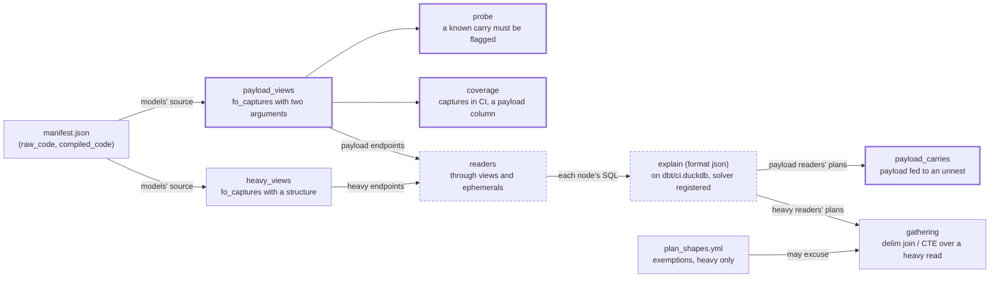

# Rule 1 is checked: no payload is carried into an unnest — design

Issue: #134 · Requirements: [requirements.md](requirements.md) · Tasks: [tasks.md](tasks.md)

## Overview

The plan-shapes gate (`scripts/check_plan_shapes.py`, ADR 0102) already explains every
model and test that reads a heavy endpoint, and fails on plans that gather the parse. This
spec adds a second check to the same step, for the seven endpoints that still have a
`payload` column. Every node that reaches one of those capture views is explained, and the
step fails if any operator that repeats its input once per list element (an unnest, or a
join with an unnest under one side) is fed a column named `payload`. That carry is what rule 1 forbids, seen where the memory is actually spent.
There is no exemption for it (ADR 0106). On every run three probe queries that do carry a
payload must be flagged, so a change in DuckDB's plan format cannot switch the check off
quietly. No model changes: nothing on `main` breaks the rule (C1, C5).

What the gate step reads and judges. The new parts are bold-bordered, the changed ones
dashed:

## Claims ledger

Scripts are in the session scratchpad, not in the repo. Each row says what it ran. All rows
were run on 2026-10-28 against `main` at dedbb8f, DuckDB 1.5.5. "CI warehouse" is
`dbt/ci.duckdb` from the gates, with the project compiled fresh by
`dbt compile --target ci --vars '{anonymize: true}'`.

| # | Claim | Query (or script) | Result | Run on |
|---|---|---|---|---|
| C1 | No unnest in the project's SQL has `payload` in its SELECT | Text scan of `dbt/models`, `dbt/tests`, `dbt/macros` with comments blanked. For each `fo_unnest(`, `fo_unnest_pair(` or `unnest(` call: the enclosing parenthesised SELECT (or the final statement), split at `union`/`intersect`/`except`, searched for `\bpayload\b` | 56 call sites: 43 `fo_unnest`/`fo_unnest_pair` in models, tests and `fo_boxscore_players`, and 13 raw `unnest(` in macro bodies (`portable.sql`, `json.sql`). 0 name `payload` | 2026-10-28 |
| C2 | The three models #134 names have changed since it was filed | `git log` on each file; `git show` of the earlier forms | `stg_espn__scoring_categories`: header form since 7379a07 (#130, 2026-10-11); at fe591f1 it was `fo_unnest(fo_json_array('latest.payload', …))` beside payload fields. `stg_espn__teams`: header form since f26a451 (#135, 2026-10-24); before it, a select-list `unnest` beside payload fields. `stg_mlb__games`: reads the structured `dates` since 58cef65 (#156); at fe591f1 it was `fo_unnest(fo_json_array('responses.payload', …))` with only `fetched_at` beside it | 2026-10-28 |
| C3 | Seven capture views still expose `payload`, and all have CI captures | `fo_captures` calls with two arguments in `raw_code`; `duckdb_columns()` of `staging.stg_raw__*` and `select distinct endpoint from raw.captures` in the CI warehouse | matchups, player_id_map, players, pro_schedule, settings, teams, transactions. Each view's last column is `payload`. The four structured views (matchup_days, roster, boxscore, schedule) have none. All 11 endpoints have CI captures | 2026-10-28 |
| C4 | Real-season payload sizes | `LandingZone(Path('data/raw')).committed(source=…, endpoint=…)`, the size of each capture's `payload_path`, sorted per endpoint (committed captures only; a first count with `find` gave the same numbers) | median / max bytes (count): settings 5,810 / 5,996 (21); teams 41,680 / 47,841 (13); matchups 914,048 / 951,737 (12); pro_schedule 935,600 / 949,233 (9); mlb players 1,676,637 / 1,751,301 (9); transactions 1,987,080 / 3,495,663 (7); player_id_map 4,285,343 (1). Heavy, for scale: roster 1,586,514 / 2,515,325 (1,471); schedule 3,549,212 / 3,612,415 (20) | 2026-10-28 |
| C5 | On `main` no plan carries a payload into an unnest | `readers()` of `check_plan_shapes.py` over the payload views; `explain (format json)` of each node's `compiled_code` on the CI warehouse, with the solver registered from `fo_duckdb_functions`; the R2.1 detector | 142 payload readers (41 heavy readers, 9 both, 174 together). 211 unnest operators, 0 cross products over an unnest, 0 carries, 0 nodes that cannot be explained. Without the solver registered, `int_fantasy__optimal_lineups` cannot be explained (`solve_lineup_period does not exist`) | 2026-10-28 |
| C6 | The detector flags the forbidden shapes and passes the header form, on the real capture view | Probe queries over `ci.staging.stg_raw__espn_teams`, explained, then the R2.1 detector | Flagged: select-list unnest beside a payload field (`UNNEST`, child projection `payload`, given as a string); expression over payload in FROM, with payload fields beside it or with only `fetched_at` (`INOUT_FUNCTION` `unnest`, child projects `json_extract(payload, …)` and `payload`); a header keeping `payload`, used beside the unnest (`UNNEST`). Passed: the header form; a header keeping `payload` that the unnesting SELECT never reads (optimizer prunes it). Missed: `payload as body` used beside the unnest (child projects `body`) | 2026-10-28 |
| C7 | An in-memory table with a JSON `payload` column plans the same as the capture view | The ten probe shapes of C6 and C11, run over `create table r as select '…'::json as payload, 'x' as fetched_at` | The same operator flagged, or nothing flagged, for all ten. The expression-in-FROM form is a `LEFT_DELIM_JOIN` whose subtree holds the `unnest` `INOUT_FUNCTION` | 2026-10-28 |
| C8 | A text rule strict about what `fo_unnest` may take would flag correct models | Prototype of C1 with one more rule: the list must be `'rel.col'` or `fo_int_series(…)` | 3 model sites flagged: `fo_json_keys`/`fo_json_values` over one matchup in `stg_espn__matchup_category_results` (line 64) and `stg_espn__matchup_periods` (line 60). The `fo_unnest` docstring allows these as small expressions | 2026-10-28 |
| C9 | Some nodes have a delim join over a payload endpoint | ADR 0102's `gathering()` with the payload endpoints in place of the heavy ones | 21 nodes: 19 over settings (`stg_espn__scoring_periods`, its tests, and nodes downstream of it), 1 over players (`not_null_stg_mlb__players_season`), 1 over matchups (`rec_espn__category_result_differences`) | 2026-10-28 |
| C10 | The local real-season warehouse is too old to explain against | `dbt compile --target dev`, then C5's run with `--db data/warehouse.duckdb` | The file is dated 2026-10-11, before the capture views (#150). 46 of 142 readers do not bind (`stg_raw__espn_settings does not exist`, …). No carries among the 96 that do | 2026-10-28 |
| C11 | A list that does not depend on the row is planned as a cross product, and the payload goes there | Probes on the CI warehouse and in memory: `select payload, e from V cross join unnest([1, 2])`; `select json_extract_string(payload,'$.id'), e from V cross join unnest(generate_series(1, 3))`; and the same list as a header column | The first two: `CROSS_PRODUCT` with children `PROJECTION` (`payload`) and `UNNEST`; the unnest's own child projects nothing. The header-column form plans as `UNNEST` fed `payload`. Small columns beside a constant list: nothing flagged | 2026-10-28 |
| C12 | The detector of R2.1 follows a filter or a join between the multiplying operator and the unnest, and has no false positive on `main` | Probes on the CI warehouse and in memory (design-review F1): `… cross join unnest([1,2]) as u(e) where e > 1` (`CROSS_PRODUCT` → `FILTER` → `UNNEST`); the same with a filter on the payload side instead; `inner join unnest([1,2]) as u(e) on true`; `inner join (select unnest([1,2]) as e) u on u.e = length(r.fetched_at)` (`HASH_JOIN`); `where fetched_at in (select unnest([…]))` (a semi join). Then all 142 payload readers, as in C5 | The four joins and filters are flagged, by operator: `CROSS_PRODUCT` ×3, `HASH_JOIN`. The semi join is not. The forms of C6 and C11 give the same result as before. On `main`: 0 carries | 2026-10-28 |

## Alternatives considered

| | A — plan check in the plan-shapes gate (chosen) | B — text test in pytest | C — both |
|---|---|---|---|
| Judges what DuckDB carries | yes (C6) | no: a pattern in the SQL | yes |
| `select *`, SQL a macro builds from pieces | seen | not seen | seen |
| A renamed payload (`payload as body`) | missed (C6) | missed | missed |
| Finding a SELECT through Jinja | not needed | heuristic: parentheses and set operators | heuristic |
| Endpoint with no fixture capture | fails the gate (R1.3) | seen | seen |
| When it fails | after the fixture build | in pytest, with file:line | both |
| Code to keep | ~120 lines in an existing script | a new ~200-line test module | both |

**A — plan check.** Chosen by the owner, 2026-10-28 (ADR 0106). It reads the same thing ADR
0102's check reads, for the same reason: the memory follows the plan. One detector covers
every way to write the forbidden shape, including the cross product (C11), which a text
rule would have to anticipate separately. Prototyped on `main` with no false positives (C5).

**B — text test.** It finds the SELECT around each unnest by its parentheses. It flags the
three earlier forms of #134's models and nothing on `main` (C1). Where it loses: it cannot
see `select *` or SQL built inside a macro; its SELECT bounds are a guess through Jinja;
and a stricter version that would also catch "an expression over something big" flags
three correct models (C8). It is a second mechanism next to one the project already
chose for this kind of question.

**C — both.** Two implementations that agree on every site today (C1, C5), and twice the
tests to keep. The text test's only real gain is failing a few minutes sooner.

The register (option 4 in ADR 0106) was weighed separately, and not chosen. No node needs
it (C5), and the header form is free.

## Decisions

| ADR | Decision | Status |
|---|---|---|
| [0106](../../adr/0106-the-plan-shapes-gate-fails-a-payload-carried-into-an-unnest.md) | The plan-shapes gate fails a payload carried into an unnest, with no exemption | proposed |

Settled without an ADR, as defaults with no real alternative:

- A payload endpoint with no CI capture fails the gate (R1.3), as a heavy one does.
- The check keys on the column name `payload`, and fails if a payload view stops having it
  (R1.4).
- The solver is registered from the plugin module, not stubbed, so its node's plan is the
  real one (R2.5).

## Detailed design

All of this goes in `scripts/check_plan_shapes.py`. The pure functions take dicts, as the
existing ones do.

- `payload_views(nodes) -> dict[str, tuple[str, str]]`: unique_id to (source, endpoint),
  for each model whose `raw_code` matches `fo_captures('<source>', '<endpoint>')`, two
  arguments and a closing parenthesis. It is the counterpart of `heavy_views`. A view can't
  match both, because the heavy pattern needs a third argument.
- `readers(nodes, payload)` is reused unchanged.
- `_projections(op) -> list[str]`: `extra_info.Projections` as a list, whether it was a
  string or a list.
- `_is_unnest(op)`: `name == "UNNEST"`, or `name == "INOUT_FUNCTION"` and
  `extra_info.Name == "unnest"`.
- `_is_join(op)`: `CROSS_PRODUCT`, or a name ending in `JOIN` that is not a delim join.
  A semi, anti or mark join (`extra_info["Join Type"]`) repeats nothing and is not a
  multiplying operator.
- `_emits(op) -> list[str]`: what an operator outputs, as far as the plan says. That is its
  `Projections` (through `_projections`). An operator without them emits what its children
  emit: for a semi, anti or mark join, the left child only. This over-approximates a join
  whose projection map drops a column. It fails safe, and C12 shows no false positive.
- `payload_carries(plan) -> list[str]`: the name of each operator that repeats a payload.
  For an unnest, the inputs are its children. For a multiplying join where some child has
  an unnest anywhere beneath it, the inputs are the other children (none if every child
  has one). An input carries a payload when something it emits matches `\bpayload\b`.
  Repeated operators are returned once per node, as `problems()` does for gathering.
- `payload_problems(found, reader_endpoints) -> list[str]`: one line per node and operator:
  `<node>: <operator> is fed a payload (<endpoints>); compute what it needs in a CTE before
  the unnest (AGENTS.md rule 1)`.
- `uncovered_pairs(payload_pairs, captured_pairs)`: one problem per payload (source,
  endpoint) with no CI capture, read with `select distinct source, endpoint from
  raw.captures` (design-review F2). The heavy check's `uncovered()` still compares
  endpoint names. No two heavy endpoints share a name today, and changing that check is
  outside this spec. A new `missing_payload_column(columns)` takes `{view name: [column
  names]}` read from `duckdb_columns()` and reports each payload view without
  `payload`.
- The probes (R3.1). Take the first payload view by name. Its relation comes from the
  manifest's `relation_name`. Explain three queries, and fail on each one for which
  `payload_carries` returns nothing:
  `with h as (select payload, [1] as l from <relation>) select h.payload, e from h cross
  join unnest(h.l) as _u(e)` (an `UNNEST`);
  `select payload, e from <relation> cross join unnest([1, 2]) as _u(e)` (a
  `CROSS_PRODUCT`);
  and the same with `where e > 1` (a `FILTER` between, C12).
- `main()`: register the solver on the connection. Add `dbt/python_modules` and
  `dbt/functions` to `sys.path` and call `con.create_function(NAME, solve_lineup_period,
  [t for _, t in ARGUMENTS], RETURNS, null_handling="special")`, with the same names the
  plugin uses. Explain the union of heavy and payload readers once each, and run
  `gathering` on heavy readers and `payload_carries` on payload readers. The summary line
  gains `N payload readers, M unnest operators`.
- `.agentic/gates` and `.github/workflows/ci.yml`: the step is renamed `plan shapes (heavy
  parses stream; no payload beside an unnest)`. Its command does not change.
- AGENTS.md rule 1: one sentence saying the plan-shapes gate holds it and cannot see a
  renamed payload. The `fo_unnest` docstring in `dbt/macros/portable.sql` is not touched:
  it is a macro file, and the no-gos keep the diff to scripts, tests and docs.

## Test strategy

All of these go in `ingestion/tests/test_check_plan_shapes.py`.

| Requirement | Test | Catches |
|---|---|---|
| R1.1 | two-argument `fo_captures` is a payload view; three-argument is not; multiline and double quotes | a payload view missed, or a heavy one counted twice |
| R1.2 | a reader of a payload view through a view is found; behind a table it is not | readers found differently from the heavy ones |
| R1.3 | a payload (source, endpoint) without CI captures is a problem, even when another source has that endpoint name | the check silently judging nothing for an endpoint |
| R1.4 | a payload view without a `payload` column is a problem | the name the check keys on going stale |
| R2.1, R2.2, R4.1 | forms (a)–(g) explained in an in-memory DuckDB are flagged, with the operator named | each forbidden shape, including the earlier forms of #134's models and a filter or join between the multiplying operator and the unnest |
| R4.2 | header form, unused kept payload, constant list beside small columns, semi join against an unnested list: not flagged | false positives that would push people to work around the check |
| R2.2 | `_emits` of a filter, a join and a semi join, on hand-written plan JSON | a carried column hidden behind an operator without `Projections` |
| R2.3 | `Projections` as a string and as a list are both read | the one-column case (C6) going unseen |
| R2.4 | a `plan_shapes.yml` entry with operator `unnest_payload` is rejected | an exemption creeping in through the register |
| R2.5 | the check's solver registration matches `fo_duckdb_functions`' `NAME`, `ARGUMENTS`, `RETURNS` | the optimal-lineup node becoming unexplainable after a signature change |
| R2.6, R2.7 | a node whose SQL does not explain is a problem; every problem is returned | one failure hiding others |
| R3.1 | with `payload_carries` replaced by one that finds nothing, each of the three probes is a problem | a plan-format change switching the check off quietly |
| R3.2 | existing tests unchanged and passing | the heavy check regressing |

## Risks

- A DuckDB upgrade renames an operator or moves `Projections`. The likelihood is low per
  upgrade, and the impact would be the check passing everything. → The probe (R3.1) fails
  the gate on the first run after such a change.
- A new large column that is not called `payload` (a parsed list) is carried beside an
  unnest. Possible, and it would cost memory. → Accepted (ADR 0106). The structured
  endpoints are held by ADR 0102's check, and their lists are unnested one level per CTE
  by convention.
- The gate step gets slower: 133 more nodes are explained (174 against 41). An explain does
  not run the query, so this is expected to be seconds. To be measured in task 6 and
  recorded on the issue.

## Open questions

- How long the extra explains take in CI. Not measured yet; task 6 measures it.

## Review log

| Source | Finding | Resolution |
|---|---|---|
| design-review | F1 (P1): a `FILTER` between a `CROSS_PRODUCT` and its `UNNEST` hides the carry | Fixed. R2.1 now covers any multiplying join with an unnest anywhere under one child, and emits through operators without `Projections` (`_emits`). Probed on four join and filter shapes, with no false positive on `main` (C12). Added forms (f) and (g), the filtered probe, and the semi-join pass case |
| design-review | F2 (P2): coverage by endpoint name alone lets `mlb/players` cover a future `espn/players` | Fixed for the payload check: R1.1 and R1.3 compare (source, endpoint). The heavy check is left as it is (detailed design) |
| design-review | F3 (P2): C4 counted payload files with `find`, not through `LandingZone` | Fixed: C4 recomputed with `LandingZone.committed`. The numbers are identical |

## Amendments
