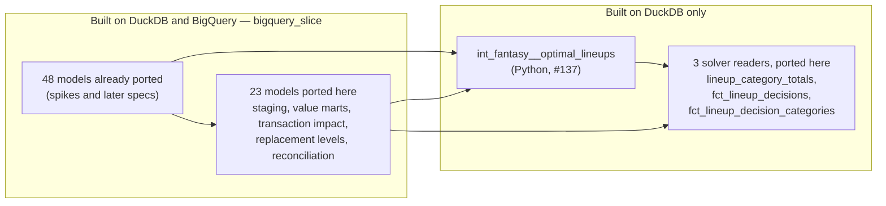

# Every SQL model on both warehouses: the 26 models outside the BigQuery slice — design

Issue: #135 · Requirements: [requirements.md](requirements.md) · Tasks: [tasks.md](tasks.md)

## Overview

The 26 SQL models outside `bigquery_slice` are ported the way the spike ported 30, by ADR
0051 and the construct table of spec 0130. Three new dispatched macros cover what the slice
did not contain: `md5`, `corr … order by` and `to_timestamp`. The rule test is widened
from the selector to the whole project. The selector is turned around: instead of three
models and their parents, it is every model except the lineup solver and the three models
that read it (ADR 0096). Twenty-three models join what BigQuery builds. The three solver
readers are ported and held on DuckDB, and wait for #137. Then the proof is the spike's:
the real DuckDB warehouse equal to its baseline, an empty build on BigQuery, a real build
there, and the two compared.

The port depends on #188. `stg_espn__transactions` dates a transaction in a way that
depends on the session's time zone, and on the owner's machine 28 transactions come out a
day early (C9). The owner chose on 2026-10-23 to fix that first, as its own issue. Until it
lands, DuckDB and BigQuery cannot agree on those rows. So the baseline (task 1) and every
comparison are taken from a real warehouse rebuilt after #188 merges, and R3.1 and R4.3
hold with no exception.

New dbt terms here:

- In `selectors.yml`, an **`exclude`** block removes nodes from a selection. With
  **`children: true`** it removes a model and everything downstream of it, tests included.
- **`indirect_selection: cautious`** (already used by the slice) takes a test only when
  every model it reads is selected.

What builds where once this lands:



## Claims ledger

Run against `main` at `8585a4e`, with the manifest of `dbt parse --target ci`, and against
`data/warehouse_main_ac0e2ac.duckdb` (the owner's real season, built 2026-10-19) unless
stated. All rows run on 2026-10-23.

| # | Claim | Query (or script) | Result | Run on |
|---|---|---|---|---|
| C1 | The project has 75 models, the slice 48. Selecting every model except `int_fantasy__optimal_lineups+`, cautious, takes 71 models (39 table, 30 view, 2 ephemeral: `int_fantasy__player_crosswalk`, `rec_espn__matchup_line_totals`), 7 seeds, 436 of 488 data tests, 187 of 211 unit tests. The slice takes 6 seeds, not `espn_activity_types` | `dbt ls --resource-type {model,seed,test,unit_test}`, with and without `--select "fqn:*" --exclude "int_fantasy__optimal_lineups+" --indirect-selection cautious` and `--selector bigquery_slice` | as stated | 2026-10-23 |
| C2 | 27 models lie outside the slice: 26 SQL and the Python solver. Downstream of the solver: `int_fantasy__lineup_category_totals`, `fct_lineup_decisions`, `fct_lineup_decision_categories`. The other 23 include `stg_raw__espn_teams` and `stg_raw__mlb_players`, which #136 built on BigQuery but did not select | `comm` of `dbt ls` of all models and of the slice; `dbt ls -s int_fantasy__optimal_lineups+` | as stated | 2026-10-23 |
| C3 | The refused constructs in the 26, as `test_dbt_portable_sql_rule.refused_constructs` counts lines: `filter (where …)` 51 in 8 models · ordered `sum` 15 in 9 · `bool_or` 11 in 5 · `::` 10 in 2 · `unnest(` 10 in 6 · type `double` 8 in 5 · type `varchar` 7 in 2 · bare `union` 2 in 1 · `try_cast` 2 in 1 · one each of `generate_series`/`range`, ordered `corr`, `to_timestamp`. 12 models hold none. Not in the patterns: `md5` and `concat_ws`, both in `rec_fantasy__category_wins_added` | scratch script calling `refused_constructs` on each file, plus `grep` for functions | as stated. The issue's counts (#130, task 16) were taken at the spike's base and counted `unnest` and `double` differently | 2026-10-23 |
| C4 | Rows of the 23 relations to be built on BigQuery: 3,089,233. `stg_espn__roster_entry_slots` 2,348,532 · `int_fantasy__lineup_options` 437,559 · `int_fantasy__candidate_day_values` 198,363 · `fct_player_category_value` 73,553 · `stg_mlb__players` 11,684 · the rest under 5,000 each | `count(*)` per relation | as stated | 2026-10-23 |
| C5 | 39 of the 76 singular tests are outside the slice, and 9 of them hold refused constructs: `list(` (1), bare `union` (3), `filter` (3), type `double` (2), ordered `sum` (2), `bool_or` (1), type `varchar` (1). The 6 project macros that only these models reach hold none | scratch script: `refused_constructs` over every singular test and every macro reached from all models, less those the slice reaches | as stated | 2026-10-23 |
| C6 | 13 of the 23 have float columns, and every one has a declared unique key (the comparison's float join needs one). Contracts are enforced on 6 of the 26, and they declare `varchar` 12 times, `double` 6 times and `timestamp with time zone` twice (`transacted_at` in `stg_espn__transactions` and `int_fantasy__transactions`) | `information_schema.columns`; `compare_bigquery_slice.unique_key` on the manifest; `grep data_type` | as stated | 2026-10-23 |
| C7 | DuckDB's `greatest` skips a null argument: `greatest(null::date, date '2026-01-01')` is 2026-01-01. BigQuery documents a null result. `fct_transaction_impact` calls `greatest` on a left-joined bound. In the real season no transaction lacks its bounds (737 of 737 have a `window_start`) | constant query on DuckDB; `count(window_start)` | as stated. BigQuery's side is from its documentation, not run | 2026-10-23 |
| C8 | DuckDB's default null order is `NULLS_LAST` both ways. BigQuery's is first for ascending | `current_setting('default_null_order')`, and `list(x order by x)` over `1, null, 2` gives `[1, 2, NULL]` | as stated. BigQuery's side is from its documentation | 2026-10-23 |
| C9 | `stg_espn__transactions` dates a transaction by `fo_eastern_date('to_timestamp(ms / 1000)::timestamp')`, whose result follows the session's time zone. In the owner's session (America/New_York), 28 of 737 rows are a day early. The full measurement is on #188 | DuckDB with `set TimeZone` three ways; a count against `cast(timezone('America/New_York', transacted_at) as date)`; posted on [#188](https://github.com/nick-socci/front-office/issues/188#issuecomment-6378337262) | as stated | 2026-10-23 |
| C10 | `bigquery_slice` is named in 7 tracked files outside `docs/`: AGENTS.md, README.md, `dbt/selectors.yml`, `test_bigquery_slice.py`, `test_compare_bigquery_slice.py`, `test_dbt_portable_sql_rule.py`, `scripts/compare_bigquery_slice.py` | `git grep -l bigquery_slice -- . ':!docs/specs' ':!docs/adr'` | 7 | 2026-10-23 |
| C11 | The draw in `rec_fantasy__category_wins_added` keeps its DuckDB value when written portably. `concat_ws('|', …)` equals the same arguments joined with `\|\|` when none is null (they differ when one is). `cast('0x' \|\| h as bigint)` equals `('0x' \|\| h)::bigint`. `bigint / 4294967296.0` is a `DOUBLE`. Every key it hashes is under a `not_null` contract | constant queries on DuckDB; the model's YAML | as stated. BigQuery's `to_hex(md5(…))` and hex cast are not yet run (O1) | 2026-10-23 |
| C12 | `espn_activity_types` has no `column_types`; DuckDB infers `INTEGER, VARCHAR, BOOLEAN, VARCHAR, VARCHAR, VARCHAR`, with `movement`, `method`, `team_field` null in 2 of 7 rows | `information_schema.columns`; counts | as stated | 2026-10-23 |
| C13 | The 26 SQL files hold 4,864 lines, 3,941 without the three solver readers | `wc -l` on each | as stated | 2026-10-23 |
| C14 | One build of the 30-model slice on BigQuery billed 5.35 GB (models 2.51 GB, data tests 2.85 GB). `stg_espn__roster_entries`, which reads the roster view as `stg_espn__roster_entry_slots` will, billed 256 MB | `run_results.json` of the spike's second real build, posted on #130 ([task 16](https://github.com/nick-socci/front-office/issues/130#issuecomment-6116071979)); not rerun | as stated | 2026-10-12 |

## Alternatives considered

The rule for writing a model is ADR 0051's, and is not reopened here. What is open is the
scope and how the work is cut (ADR 0096).

| | A — all 26 in one build, a commit per layer (chosen) | B — a PR per family of models | C — the 23 buildable only |
|---|---|---|---|
| Real-season builds and comparisons | One DuckDB baseline and one round on BigQuery | Four of each | One of each |
| Review size (C13) | 4,864 lines in the 26 files, in layered commits | about 1,200 per PR | 3,941 |
| A shared macro changed late | Re-checked once, by the one comparison | Re-checked in every later PR | Once |
| What #137 inherits | A decision only | A decision only | A decision and three ports |
| The rule test | Whole project, at once | Whole project only after the last PR | Leaves three models unchecked |

**A — all 26 in one build.** The spike did 30 this way, and its cost was dominated by the
comparisons, not by the edits. One baseline, one empty build, one real build, one
comparison. Commits per layer (macros and tests, staging, intermediate, marts and
reconciliation) keep the diff reviewable. It wins on total cost and on proof: every
relation is compared in one run against one baseline.

**B — a PR per family** (staging and teams; value and replacement; transactions; lineup
decisions; reconciliation). Each PR is smaller, but each needs its own real build,
baseline and BigQuery round, and the rule test cannot cover the project until the last
one. The families share macros (`fo_category_value`, `fo_replacement_group`) and parents
(`int_fantasy__replacement_levels` feeds three of them), so an early PR fixes what a later
one depends on. It loses on cost and on the order of the work, not on reviewability.

**C — the 23 only.** ADR 0096, option 3. It loses because #137 would then carry a port as
well as a decision, and three models stay outside the rule with nothing to hold them.

## Decisions

| ADR | Decision | Status |
|---|---|---|
| [0096](../../adr/0096-every-sql-model-is-written-for-both-warehouses-and-bigquery-builds-all-but-the-solver-and-its-readers.md) | Every SQL model is written for both warehouses; `bigquery_slice` becomes every model but the solver and its readers, name kept | proposed |

Chosen by the owner on 2026-10-23, going through the spec's decisions (the spec itself is
not yet approved, so ADR 0096 stays `proposed` until it is):

1. The selector keeps the name `bigquery_slice` and takes the exclusion form: every model
   except the solver and its descendants (ADR 0096, option 1). The rename is left to #137.
2. One build, with a commit per layer (*Alternatives considered*, A).
3. The solver readers are run over no rows on BigQuery against an empty stand-in solver
   table, and all four are then dropped (R5.2, as written).
4. The contract type `timestamp with time zone` is switched inline on `target.type` in YAML,
   as the owner chose for floats on #130 (2026-10-11).

Also, without an ADR because each follows a decision already made:

- Tier M. The approach is ADR 0051's, already used on 48 models. What is new is the
  scope.
- The 7 unit tests with DuckDB-SQL fixtures are not rewritten (a no-go). They are reported
  as not runnable on BigQuery.

## Detailed design

### The selector

```yaml
selectors:
  - name: bigquery_slice
    description: >
      Every model that builds on BigQuery: all of them but the lineup solver's Python model
      and what reads it (ADR 0096; #137 removes the exclusion).
    definition:
      union:
        - method: fqn
          value: "*"
          indirect_selection: cautious
        - exclude:
            - method: fqn
              value: int_fantasy__optimal_lineups
              children: true
```

The comment about `rec_espn__winner_differences` (spec 0147) goes, since there are no
longer several union members for a test to fall between. The pytest that guards that case
stays and still passes. `test_bigquery_slice.py`'s pinned names become the 71 and 7 of C1,
and its test counts become 436 and 187. The other assertions are unchanged, apart from the
contract and seed scans of R2.4, which now take every model and seed. The build confirms
with `dbt ls` that this YAML selects exactly C1's set. If dbt reads the YAML differently,
the definition is corrected to match C1, not the other way round.

### The rule test, project-wide

`collect_slice_sources` becomes `collect_project_sources`. It starts from every node of
the manifest that is a SQL model or a singular test of the project, instead of from
`dbt ls --selector`, and follows macros exactly as now. The Python model is skipped by
language. The pinned count in its test (48 models today, with a comment listing which spec
added which) becomes the count of SQL models, 74. New patterns, each with a one-line
test:

| Pattern | Why |
|---|---|
| `\bmd5\s*\(` | BigQuery's `md5` returns `BYTES`, not hex text |
| `\bconcat_ws\s*\(` | not a BigQuery function |

`test_dbt_ordered_aggregate_rule.py` adds `fo_corr_in_order` to the macros that count as
ordered.

### How the new constructs are written

The spike's table (spec 0130, design, *How each refused construct is written*) applies as
it stands. These rows are added. As before, an implementer does not choose.

| Refused or different on BigQuery | Written as | Kind |
|---|---|---|
| `corr(y, x order by k)` | `{{ fo_corr_in_order('y', 'x', 'k') }}` | macro: unchanged / `corr(y, x)` |
| `md5(t)` | `{{ fo_md5_hex('t') }}` | macro: `md5(t)` / `to_hex(md5(t))` |
| `concat_ws('\|', a, b, …)` with no argument that can be null | `a \|\| '\|' \|\| b \|\| …` | plain SQL |
| `(x)::bigint` of a `'0x…'` string | `cast(x as bigint)` | plain SQL (O1) |
| `to_timestamp(ms / 1000)`, an instant (`transacted_at`) | `{{ fo_instant_from_millis('ms') }}` | macro: `to_timestamp(ms / 1000)` / `timestamp_millis(ms)` |
| `list(distinct x order by x)` (one singular test) | `array_agg(distinct x order by x)` | plain SQL: both accept it. BigQuery refuses a null element, and the test's `where` excludes nulls |
| `unnest(range(1, n + 1))` | `{{ fo_unnest(fo_int_series('1', 'n')) }}` in the FROM clause | macros of the spike. `fo_int_series` includes both ends, `range` excludes the last |
| `greatest(a, b)` / `least` where an argument can be null | the null case written out with `coalesce`, so BigQuery gives DuckDB's result | plain SQL. Where every argument is not-null by a test or by construction, unchanged |
| an ascending `order by` key in a window, `qualify` or ordered aggregate that can be null | an explicit `nulls last` | plain SQL. DuckDB's default made explicit; unchanged where the key is not-null by a test |
| contract `data_type: varchar` | `string` | YAML: both accept it (spike) |
| contract `data_type: double` | `"{{ 'float64' if target.type == 'bigquery' else 'double' }}"` | YAML (spike) |
| contract `data_type: timestamp with time zone` | `"{{ 'timestamp' if target.type == 'bigquery' else 'timestamp with time zone' }}"` | YAML: new, the same switch |

The last two rows of "different" constructs (C7, C8) are not caught by a pattern or by an
empty build. They are applied by reading each `greatest`, `least` and window order of the
26 against the model's tests, and the comparison (R4.3) is the check. In `fct_transaction_impact`, the
bounds are left-joined, so both `greatest` calls get the coalesce:
`greatest(transactions.transaction_date, coalesce(bounds.first_scoring_date, transactions.transaction_date))`,
and the same for `+ 1`. DuckDB's result is unchanged by construction.

`espn_activity_types` is left without `column_types` (C12). DuckDB's inferred types must
not change (R3.2), and `int64` would turn its `INTEGER` into `BIGINT`. If BigQuery's load
types it so that a join or the comparison fails, the column type goes in as a switched
value, and that is recorded.

### Model by model

The 12 models with nothing to change (C3) are only checked by the rule test, the empty
build and the comparison. For the others the changes are the table's, with these notes:

- **`stg_espn__lineup_slot_limits`**: the paired keys and values become
  `fo_unnest_pair` over `fo_json_keys` and `fo_json_values`, the form the slice's own
  key-value models use. `try_cast(slot_key as bigint)` becomes `fo_safe_cast`.
- **`stg_espn__roster_entry_slots`**: three `fo_unnest`s (teams, entries, eligible slots),
  each in the FROM clause of its CTE. `header` stays as it is (rule 1). This is the model
  whose memory R3.4 records.
- **`stg_espn__teams`**, **`stg_mlb__players`**: one `fo_unnest` each. In `stg_espn__teams`,
  `fo_json_array` moves into a `header` CTE first, so that the payload is not carried
  beside the unnest (rule 1).
- **`stg_espn__transactions`**: `::integer` becomes `cast(… as integer)`, two `fo_unnest`s
  (topics, then messages, with `topic_id` and `topic_date_ms` computed in a CTE before the
  second unnest). #188 rewrites only `transaction_date`, as
  `fo_eastern_date(fo_timestamp_from_millis(ms))`, which is already portable. It leaves
  `transacted_at = to_timestamp(ms / 1000)`, and this port writes that as
  `fo_instant_from_millis`, whose DuckDB form is that same expression, so its value and
  type do not change. The `::timestamp` that #188 removes sat in a Jinja string and was
  never among C3's counts.
- **`dim_players`**, **`fct_player_season_value_day_counts_hold`**, the two
  `dim_player_league_seasons` tests: a bare `union` becomes `union distinct`.
- **`rec_fantasy__category_wins_added`**: the `::double`s become
  `cast(… as {{ fo_type_float() }})`, the `::varchar`s `cast(… as {{ fo_type_text() }})`,
  `range` the spike's series, and the draw is written as below. It reads as it does today:

  ```sql
  cast('0x' || substr({{ fo_md5_hex(
      "pair_components.platform || '|' || pair_components.league_id || '|' || "
      ~ "cast(pair_components.season as " ~ fo_type_text() ~ ") || '|' || …"
  ) }}, 1, 8) as bigint) / 4294967296.0
  ```

  The order and text of the hashed fields do not change, so the draws, and every count
  that rests on them, are the same on DuckDB (C11, R3.1).
- **`rec_fantasy__category_wins_by_group`**: `fo_corr_in_order`, and its two ordered sums
  through `fo_sum_in_order`.
- The value marts, `int_fantasy__candidate_day_values`, `fct_transaction_impact` and the
  solver readers: `filter` to `case`, `bool_or` to `fo_any_true`, ordered sums to
  `fo_sum_in_order`, `double` to `fo_type_float`. These are the bulk, and all mechanical.

### Comparing

`compare_warehouses.py BASE NEW --strict-columns` compares DuckDB with DuckDB over every
relation. Both sides are built after #188 has merged (R3.5).
`compare_bigquery_slice.py` takes its relations from the selector, so the 23 join the
comparison by themselves. One change: `slice_relations` lists `--resource-type model`
only, so the seeds were never compared, and it gains `--resource-type seed` (design review
F4). A seed's unique key is read from its tests as a model's is. A seed with no float
column needs none. `stg_espn__roster_entry_slots` is a scalar-column table, so it is
compared exactly, and that covers the roster view's `eligibleSlots` (R4.4).

On BigQuery, both builds leave out unit tests (`--exclude-resource-type unit_test`): dbt
runs a model's unit tests before the model, and those that cannot run there would stop it
(design review F1). R4.5 runs them on their own, as the spike's R5.6 did.

### The solver readers on BigQuery, over no rows

The three readers cannot be built from real rows until the solver runs on BigQuery (#137).
Their SQL is still run, once (R5.2):

1. `create table intermediate.int_fantasy__optimal_lineups (…)` on BigQuery, with the
   columns and types the DuckDB relation has, mapped as the comparison maps them (`BIGINT`
   to `INT64`, `VARCHAR` to `STRING`). DDL, not billed. No rows.
2. `dbt build --target bq --empty --exclude-resource-type unit_test --select
   int_fantasy__lineup_category_totals fct_lineup_decisions fct_lineup_decision_categories`.
   The Python model is not selected, so dbt reads the table of step 1 as it stands.
3. Drop the table of step 1, and the three relations, so that nothing on BigQuery looks
   like a built solver.

## Test strategy

| Requirement | Test | Catches |
|---|---|---|
| R1.1–R1.4 | `test_bigquery_slice.py`: the 71 models, 7 seeds, 436 data and 187 unit tests; no selected test reads an unselected relation; no Python model | the exclusion leaving in a solver reader, or dropping a buildable model |
| R2.1, R2.2 | `test_dbt_portable_sql_rule.py`, project-wide, with `md5(` and `concat_ws(`; before the port it fails naming the 26 models' and 9 tests' files and nothing in the slice | a refused construct anywhere in the project, including the solver readers |
| R2.3 | `test_dbt_ordered_aggregate_rule.py`: a case with `fo_corr_in_order` | the port being flagged, or an unordered `corr` coming back |
| R2.4 | the contract and seed type tests over every model and seed | a contract type that one warehouse refuses |
| R3.1, R3.2 | `compare_warehouses.py` against the baseline; `information_schema.columns` diff | a ported model that moves a DuckDB number or type |
| R3.3 | `.agentic/gates`; CI warehouse before and after | the port changing what CI builds |
| R4.1–R4.4, R4.7 | empty build, real build, `compare_bigquery_slice.py`, `run_results.json` | a construct no pattern sees; a difference in meaning (C7, C8, O1) |
| R4.5 | the unit tests on `bq`, tabled | BigQuery forms that are wrong on the cases the tests were written for |
| R5.2 | the three solver readers built with `--empty` on BigQuery over a hand-made empty solver table | a BigQuery form that renders but does not run, inherited by #137 |
| R4.3 (seeds) | `test_compare_bigquery_slice.py`: a case where `slice_relations` lists a seed | the seeds staying outside the comparison |

## Risks

- A difference in meaning that neither pattern nor empty build finds (like C7, C8) —
  likely to be one or two — the comparison finds it. R4.6 sends it to the owner with the
  rows, and the fix is a row in the table above.
- A tie broken differently in one of the 26 dedupes (#141 says nothing checks them) —
  plausible: `dim_players` and `dim_player_league_seasons` rank players by date and id —
  found by R4.3. It goes to the owner and is recorded on #141.
- `stg_espn__roster_entry_slots` getting slower or larger in memory on DuckDB — low: the
  slice made the same change to `stg_espn__roster_entries` — R3.4 records it and stops at
  a quarter more.
- The new comparison's BigQuery cost — the spike's slice billed 5.35 GB a build (C14). The
  23 read mostly built tables, and `stg_espn__roster_entry_slots` reads the roster view as
  `stg_espn__roster_entries` does (256 MB, C14). Accepted; reported (R4.7).

## Open questions

- O1. That BigQuery's `to_hex(md5(t))` is DuckDB's `md5(t)`, and that `cast('0x…' as
  bigint)` reads hex there, is from the documentation. A constant query (0 bytes) at the
  start of the BigQuery tasks settles it, and the exact comparison of
  `rec_fantasy__category_wins_added` holds it.
- O2. BigQuery's null handling of `greatest` and its null order (C7, C8) are from its
  documentation. The comparison is the check.
- O3. Whether `date + 1`, which `fct_transaction_impact` uses, runs on BigQuery as it does
  on DuckDB. It is believed to, and the empty build says.
- O4. That dbt reads a hand-made table in place of an unselected Python model on BigQuery,
  as it does any unselected parent. Believed so, since a `ref` resolves to a relation name.
  R5.2's run settles it.

## Review log

| Source | Finding | Resolution |
|---|---|---|
| design-review (Codex, 2026-10-23) | F1 (P1): both BigQuery builds would run the 7 SQL-fixture unit tests, and #138's, before their models and fail | Fixed: R4.1 and R4.2 build with `--exclude-resource-type unit_test`; R4.5 runs unit tests on their own, as the spike did |
| design-review | F2 (P1): on the split path R6.5 accepts a difference while R4.3 requires exit 0 | Moot here: the owner moved the transaction-date fix to #188 (2026-10-23), with ADR 0097 and R6. R4.3 keeps exit 0, against a warehouse rebuilt after #188. The finding was passed to #188 |
| design-review | F3 (P1): compiling the solver readers does not show they run on BigQuery | Fixed: R5.2 builds them with `--empty` over a hand-made, empty solver table, then drops it |
| design-review | F4 (P2): the comparison lists models only, so the 7 seeds are never compared | Fixed: R4.3 includes seeds, and `slice_relations` is taught to list them (task 4) |
| design-review | F5 (P2): the 5.35 GB and 256 MB figures had no ledger row | Fixed: C14, from the spike's `run_results.json` as posted on #130 |

## Amendments

- **2026-10-24, counts retaken at `main` 29982b1 (R1.2).** #188 added the unit test
  `transactions_are_dated_by_the_eastern_date_of_their_instant` on `stg_espn__transactions`,
  a selected model. So the project has 212 unit tests and the selector takes **188**, not
  C1's 211 and 187. Models (71), seeds (7) and data tests (436 of 488) are as C1 says.
  `test_bigquery_slice.py` pins 188.
- **2026-10-24, C3 corrected.** Recounted with `refused_constructs` on each file at 29982b1,
  18 of the 26 models hold a refused construct and 8 hold none, not 14 and 12. The 8 are
  `int_fantasy__lineup_options`, `int_fantasy__lineup_slots`,
  `int_fantasy__replacement_levels`, `int_fantasy__teams`, `int_fantasy__transactions`,
  `rec_espn__register_rows`, `stg_raw__espn_teams` and `stg_raw__mlb_players`. The work is
  unchanged: the rule test names exactly the 18 and the 9 singular tests, and nothing in the
  old slice.
- **2026-10-24, the empty build on BigQuery (task 11, round 1).** Two tests failed there,
  both outside the port's 26 models:
  - `stg_raw__capture_views_cover_the_manifest` reads `raw.captures`, DuckDB's loader
    manifest, which BigQuery does not have: its capture views read uploaded tables, not a
    file glob. The old selector never took it, because some capture views lay outside it;
    the exclusion form takes it. It is a check of DuckDB's glob, so the selector now
    excludes it by name beside the solver, and the selector's data tests are **435**: 365
    generic and 70 singular, where they were 365 and 71. R1.1 is read with this exclusion.
  - `stg_idmap__covers_started_players` (spec 0177, added after the last BigQuery build)
    names a CTE `started_players` and a `count(*) as started_players` in one SELECT, and
    BigQuery reads `started_players.league_id` in GROUP BY as a field of the count. The CTE
    is now read under the alias `started`; its DuckDB result is unchanged. No pattern can
    see this, so AGENTS.md's list of what the empty build finds names it.
  The 205 skipped nodes followed from the second: `dbt build` skips what is downstream of
  a failed test.
- **2026-10-24, the empty build on BigQuery (task 11, rounds 2 to 4).**
  - `int_fantasy__replacement_pool_has_played_days` (newly selected with
    `int_fantasy__replacement_levels`) wrote `max(pool_played_days) as pool_played_days`
    and `having max(pool_played_days)`. BigQuery reads the bare column in HAVING as the
    alias and refuses an aggregate of an aggregate. The column is now qualified.
  - `int_fantasy__started_days_match_the_starting_slots` fails over no rows by design: it
    fails when there are no started days. In `dbt build` a failing test skips everything
    downstream of its model (148 nodes here), so task 11 runs as `dbt seed`, then
    `dbt run --empty`, then `dbt test` over the empty tables (`dbt test` has no `--empty`;
    it reads what the run built). R4.1 asks for no error from BigQuery. A test that fails
    over no rows because it needs rows is reported as such, not counted as an error.
  - `rec_fantasy__category_wins_by_group` named a CTE `groups`, a word BigQuery reserves
    and DuckDB does not. The CTE is now `group_fits`. The rule test gains a pattern for a
    CTE named with one of the words BigQuery reserves that a model might use, with its
    cases (R2.2).
- **2026-10-24, the solver readers over no rows (task 12, round 1).**
  - `int_fantasy__lineup_category_totals` cross-joined `(values ('actual'), ('optimal'))`,
    a table constructor BigQuery does not have. It is now a CTE `lineups` holding a
    `union all` of two selects, which both warehouses accept and which gives the same two
    rows. The rule test gains a pattern for a VALUES list in a FROM clause (R2.2).
  - `fct_lineup_decisions_change_nothing_when_nothing_is_gained` summed
    `players_brought_in` into a column of the same name and summed it again in HAVING:
    the alias case of task 11. Its columns are now qualified.
  The 24 "not found" errors of that round followed from the first: the model was not
  built, and the model and the tests that read it found no table.
- **2026-10-24, the real build on BigQuery (task 13, round 1).**
  - Three models of the old slice, not changed by this port, ran into the bq target's
    600 s job timeout: `stg_mlb__batting_game_logs` (stopped at 615 s, 8.46 slot-hours),
    `stg_espn__player_game_stats` (614 s) and `stg_espn__matchup_player_lines` (606 s).
    The spike timed `stg_mlb__batting_game_logs` at 60 s over 827 MB; the upload of #136
    holds eight seasons, and its sibling `stg_mlb__pitching_game_logs` now bills 6.98 GB in
    312 s. The stopped jobs billed nothing. The owner chose (2026-10-24) to raise
    `job_execution_timeout_seconds` to 1800 on the bq target. `maximum_bytes_billed`
    (10 GB) is unchanged and stays the cost guard.
  - The unit tests run as `dbt test --selector bigquery_slice --resource-type unit_test`.
    Task 13's `--selector bigquery_slice,resource_type:unit_test` is read by dbt as one
    selector's name.
- **2026-10-24, the real build on BigQuery (task 13, round 2).** With the longer timeout,
  482 of 514 nodes passed, billing 29.88 GB in all, at most 6.98 GB in one query.
  `rec_espn__player_day_differences` (a model of the old slice) stopped with "floating
  point overflow" in SUM. ESPN writes the largest double, 1.797e308, for a rate it cannot
  compute: WHIP (stat 41, 32 values), ERA (47, 32) and K/BB (82, 1,717) in the real
  season. The model summed every stat per player-day before keeping the single-component
  stats it compares. Two of those values overflow: DuckDB gives infinity, which the join
  then drops, and BigQuery stops. `espn_days` now sums only the stats that
  `single_component_stats` names. The join already kept only those, so the result cannot
  change, and the real DuckDB warehouse rebuilt from it is equal to the baseline, 73 of
  73. What ESPN's sentinel means for the models that read rate stats is a question for
  the owner, not settled here.

