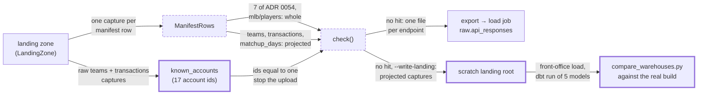

# The member-data endpoints on BigQuery: teams, transactions and MLB's player list — design

Issue: #136 · Requirements: [requirements.md](requirements.md) · Tasks: [tasks.md](tasks.md)

## Overview

The spike's upload, `scripts/spike_load_bigquery.py`, gains three endpoints:

- `espn/teams` and `espn/transactions` go up as projections, each built from the field
  list the fixtures already use for that endpoint (ADR 0093).
- `mlb/players` goes up whole (ADR 0095).

The privacy check of ADR 0054 still runs on every row as sent. It gains two narrow
exceptions:

- a ballplayer's `firstName` and `lastName` directly in an object of `people[]` of
  `mlb/players`;
- the GUID-shaped ids of a transaction's topics and messages, at their two paths, if none
  of them equals an account id found in the raw `teams` and `transactions` captures
  (ADR 0094).

To show the projections hold what staging reads, the loader can write its projected rows
as a landing root. The five staging models that read projected endpoints are built from
that root on DuckDB and compared with the same models built from the real captures. No
model is ported here; that is #135.

What reaches the export, and where each new rule applies:

## Claims ledger

The probes are Python, read-only, over the real landing zone `data/raw` through
`LandingZone.iter_landed`, unless the row says otherwise. They print counts and paths,
never values. "Projected" means rebuilt from the field lists of R1.2 and R1.3 and, for
`mlb/players`, `PLAYER_LIST_FIELDS`.

| # | Claim | Query (or script) | Result | Run on |
|---|---|---|---|---|
| C1 | 19 models need one of the three endpoints, and none of them is in the slice | `dbt ls --resource-type model --select "stg_espn__teams+ stg_espn__transactions+ stg_mlb__players+"`, without and with `stg_mlb__players+`, intersected with `--selector bigquery_slice` | 18 models for teams and transactions (the two staging models, `int_fantasy__teams`, `int_fantasy__transactions`, `int_fantasy__optimal_lineups`, `fct_lineup_decisions`, `fct_player_season_value`, `dim_player_league_seasons`, `dim_players` …). 19 with `stg_mlb__players`. Intersection with the slice: 0 | 2026-10-22 |
| C2 | `espn/teams` carries member names and account ids, all outside the fields staging reads | walk every key of every capture; `privacy.FORBIDDEN_KEYS` by path; `privacy.GUID` over string values by path | 13 captures, 0.52 MB, largest 47,841 bytes. Forbidden keys under `$.members[]` (`displayName`, `firstName`, `lastName`) in all 13. GUIDs: `members[].notificationSettings[].id` 1,529, `members[].id` 175, `teams[].owners[]` 175, `teams[].primaryOwner` 156 | 2026-10-22 |
| C3 | `espn/transactions` carries `author` on every topic and message | as C2 | 7 captures, 17.05 MB, largest 3.50 MB. `author` at `topics[]` and `topics[].messages[]`. GUID paths: `messages[].id` 25,103, `messages[].topicId` 25,103, `messages[].author` 15,448, `messages[].creationInfo.source` 15,448, `topics[].id` 9,779, `topics[].author` 7,989, `topics[].creationInfo.source` and `lastUpdateInfo.source` 7,989 each | 2026-10-22 |
| C4 | What the staging models read from each endpoint | the SQL of `stg_espn__teams`, `stg_espn__transactions`, `stg_espn__transaction_logs`, `stg_mlb__players` | teams: `id`, `seasonId`, per team `id`, `name`, `abbrev`, `playoffSeed`, `eliminated`, `record.overall.{wins, losses, ties, streakLength, streakType}`. Transactions: partitions, per topic `id`, `date`, per message `id`, `date`, `messageTypeId`, `targetId`, `to`, `from`, `for`. Players: request key's season, per person the 7 fields of `PLAYER_LIST_FIELDS`. These are the fixture lists `ESPN_TEAM_FIELDS`, `ESPN_TRANSACTION_MESSAGE_FIELDS` (+ ids) and `PLAYER_LIST_FIELDS` | 2026-10-22 |
| C5 | No capture's sidecar of the three endpoints holds a GUID | `privacy.GUID` over `json.dumps(meta)` of each capture | 0 of 13, 0 of 7, 0 of 9 | 2026-10-22 |
| C6 | Projected, teams and transactions hold no forbidden key, and transactions' only GUIDs are its two ids | as C2, on the projections | teams 0.03 MB in all, no forbidden key, no GUID. Transactions 4.18 MB, no forbidden key; GUIDs only at `topics[].id` (9,779) and `topics[].messages[].id` (25,103) | 2026-10-22 |
| C7 | Team names are already on BigQuery, and none contains a member's name as a word | `teams[].name` present in captures of each uploaded ESPN endpoint (first 40 each); member `firstName`/`lastName` (2+ letters) as whole words, case-insensitive, in each team-season's name | `espn/matchups` 12 of 12 captures carry `teams[].name` (`matchup_days` 40 of 40, but its projection drops `teams`; `roster`, `settings` 0). 96 team-seasons: 0 whole-word matches. As substrings, 12 match; those values were not looked at | 2026-10-22 |
| C8 | Today a transaction id and an account id differ in form, and authors are not all account ids | classify each value as braced or bare, upper, lower or mixed case, and whether it matches `privacy.GUID` whole; a non-GUID is described by length and character classes only | topic and message ids: bare lower, all 34,882. Member ids: braced upper (175). Authors: 23,437 GUIDs, all braced upper; 11,445 are not GUIDs, 3 distinct strings (32 letters ×10,080; 18 letters and `_` ×1,044; 3 letters ×321), not looked at further | 2026-10-22 |
| C9 | No topic or message id equals a known account id | the GUID-shaped values of `members[].id`, `teams[].owners[]`, `teams[].primaryOwner` (teams) and `topics[].author`, `messages[].author` (transactions), braces stripped and lower-cased; intersected with every topic and message id treated the same way | members 17; owners 17 and primary owners 15, both within members; GUID-shaped authors 13, all members. 17 account ids in all. 11,220 distinct ids, 0 in the set | 2026-10-22 |
| C10 | `mlb/players` names ballplayers with `firstName` and `lastName`, directly in each `people[]` object, and holds no GUID | as C2 | 9 captures. Forbidden keys only `firstName`, `lastName` at `$.people[i]`. GUIDs: none | 2026-10-22 |
| C11 | `mlb/players` whole against its projection | `len(json.dumps(...))` summed | 15.10 MB whole, 3.92 MB projected | 2026-10-22 |
| C12 | The manifest lists as many captures as the landing zone holds | `select source, endpoint, count(*) from raw.captures … group by all` on `data/warehouse_main_ac0e2ac.duckdb` | teams 13, transactions 7, players 9, matchup_days 1,469: the counts of C2, C3 and C10 | 2026-10-22 |
| C13 | The five staging models of R4.2 read only their capture views and one seed | `dbt ls --select "+stg_espn__teams +stg_espn__transactions +stg_espn__transaction_logs +stg_espn__matchup_days +stg_espn__matchup_player_lines"` | models and seeds: `stg_raw__espn_teams`, `stg_raw__espn_transactions`, `stg_raw__espn_matchup_days`, `espn_activity_types`, and the five themselves | 2026-10-22 |

## Alternatives considered

How teams and transactions go up (ADR 0093):

| | A — projection of the fields staging reads (recommended) | B — whole | C — staging built locally, tables uploaded | D — left off |
|---|---|---|---|---|
| Member names or account ids leave the machine | no (C6) | yes: 17 members' names and account ids (C2, C9) | no | no |
| A model is written once for both warehouses (ADR 0051) | yes | yes | no: two staging models read a `source()` on BigQuery | yes, for what builds |
| Lists of wanted fields | none new: the fixtures' (C4) | none | none | none |
| Models that can reach BigQuery (C1) | all 18 | all 18 | all but the 2 staging models | none of the 18 |
| A field added to a model without the list | null on BigQuery until the slice comparison | no gap | no gap | — |
| Bytes uploaded for the two | ≈ 4.2 MB (C6) | 17.6 MB (C2, C3) | the staging tables | 0 |

**A — projection.** The member data sits in fields no model reads (C2 to C4), so leaving
them behind costs the models nothing. The lists already exist and CI's fixtures are built
from them. It is ADR 0061's answer, extended to the two endpoints 0061 left open.

**B — whole.** The simplest, and the only option with no gap between the warehouses. It
puts other people's names and account ids in a cloud project. ADR 0054 declined to do that
by default, and nothing since has changed the reasons.

**C — staging built locally.** Keeps all raw member data home, but gives two staging
models a second form on BigQuery. They would never be held by the slice comparison, and the
migration would carry one local step forever.

**D — left off.** Nothing to build, and 18 models never reach BigQuery.

How the GUID-shaped transaction ids pass the check (ADR 0094) and how MLB's player list
goes up (ADR 0095) are weighed in those records.

## Decisions

| ADR | Decision | Status |
|---|---|---|
| [0093](../../adr/0093-teams-and-transactions-go-up-as-projections-of-the-fields-staging-reads.md) | Teams and transactions go up as projections of the fields their staging models read, from the fixtures' lists | proposed |
| [0094](../../adr/0094-a-transactions-own-ids-go-up-if-none-is-a-known-account-id.md) | A transaction's topic and message ids may be GUIDs at their two paths, if none equals a known account id | proposed |
| [0095](../../adr/0095-mlbs-player-list-goes-up-whole.md) | MLB's player list goes up whole, `firstName`/`lastName` allowed directly in `people[]` | proposed |
| [0061](../../adr/0061-two-endpoints-that-hold-member-data-are-uploaded-as-projections.md) | Accepted with this spec. It has been in force in the loader since #83. Its amendment of 0054 moves to an `Amends` line | proposed → accepted at approval |

## Detailed design

All changes are in `scripts/spike_load_bigquery.py` and its test,
`ingestion/tests/test_spike_load_bigquery.py`, plus the ADR headers of R6.2.

### What is read (R1)

- `ALLOWLIST` gains `("mlb", "players")`.
- `PROJECTIONS` gains `("espn", "teams"): project_teams` and
  `("espn", "transactions"): project_transactions`. The new `project_transactions` replaces
  the one that returns `{}`.
- The field lists come from `make_fixtures` by import: `ESPN_TEAM_FIELDS`,
  `ESPN_TRANSACTION_MESSAGE_FIELDS` and, for the test of R1.2 to R1.4, nothing else.
  `scripts/` is on the import path both when the script runs and under pytest
  (`pyproject.toml`).
- The projection's rebuild is the loader's own, not `make_fixtures.rebuild`. It follows
  each dotted path and keeps the value only when it is a single value (string, number,
  boolean or null), never an object or array (R1.5). `make_fixtures.rebuild` copies
  whatever it finds.
- `project_teams(payload)` builds `{id, seasonId, teams: [rebuild(team) …]}`. `id` and
  `seasonId` are kept only as single values, and a non-list `teams` gives `[]`.
- `project_transactions(payload)` builds `{topics: [{id, date, messages: [{id, …fields}]}]}`
  on the same rules.
- `project_matchup_day` is unchanged (R1.6).

### The check (R2)

- **Name keys.** `privacy_hits` allows `firstName` or `lastName` in two places:
  - directly in an `espn` `playerPoolEntry.player` object, as now;
  - in an `mlb/players` row, when the key's parent path is exactly `$.people[i]` (the
    regex `^\$\.people\[\d+\]$`, matched against the path `privacy.walk` yields).

  Nothing else changes in the key rule.
- **GUIDs.** In an `espn/transactions` row, a string at a payload path matching
  `^\$\.topics\[\d+\]\.id$` or `^\$\.topics\[\d+\]\.messages\[\d+\]\.id$` is allowed when
  the whole string is one GUID. The check then compares its normal form (braces stripped,
  lower case) with the known accounts. Equal is a hit:
  `espn/transactions <key>: transaction id equals an account id at $.topics[3].id`.
  A string at those paths with text around the GUID is a hit as now. Partitions, request
  path, request key and file path have no exemption.
- **Known accounts.** `known_accounts(rows) -> frozenset[str]` reads the raw payload of
  every `espn/teams` and `espn/transactions` capture in the run's snapshot (R2.7), through
  `LandingZone`. It
  collects the normal form of each value found at these paths that is one GUID whole (C8:
  some authors are not):
  - `members[].id`, `teams[].owners[]`, `teams[].primaryOwner` (teams);
  - `topics[].author`, `topics[].messages[].author` (transactions).

  It reads the raw payloads, not the projected rows, which no longer hold them. `main()`
  calls it once and passes the set to `check`.
- **The signature.** `check(rows, accounts)` and `privacy_hits(row, accounts)` take the
  set. If any `espn/transactions` row is checked and the set is empty, that is one hit:
  `no account ids were found to check transaction ids against` (R2.4).
- **Projected form.** The existing test of the projected form covers teams and transactions
  through `PROJECTIONS`, with no new code (R2.5). Its message names ADR 0061, and changes to
  name "its projection".
- **Dry-run output.** `--dry-run` prints rows per endpoint as now, plus the number of known
  accounts and the number of exempt ids checked (Expected values).

### One set of captures per run (R2.7)

`ManifestRows` today queries `raw.captures` again on each pass, and the export reads the
rows in a second pass after the check (design review F2). It changes to read the manifest's
narrow rows of every uploaded endpoint once, at construction, and to check them against the
landing zone then. Each pass then iterates that list and reads one payload at a time, as
now. Payload files are never replaced (ADR 0014), so the same list gives the same rows on
every pass. `known_accounts` takes its captures from the same list, the teams and
transactions rows of the snapshot read raw, rather than from the landing zone directly.

### Writing the projection as a landing root (R4.1)

`--write-landing ROOT` writes, after the check passes, every row of the projected endpoints
to `ROOT`. Each row becomes a capture written by `LandingZone(ROOT).write`, with:

- the original capture's partitions, capture name (`fetched_at=<stamp>`) and request (its
  sidecar's `url` and `params`), read from the `LandedResponse` the row came from;
- the row's `fetched_at`;
- the projected payload.

It refuses a `ROOT` that already exists, or one that `git check-ignore -q` does not report
as ignored (R4.3). It is otherwise independent of `--dry-run`, so it needs no credentials.
With R6.3, any root under `data/` is ignored.

### The DuckDB comparison (R4.2)

A procedure run once by the build, not a gate:

1. `--dry-run --write-landing data/proj136`.
2. `front-office load --raw-root data/proj136 --db data/proj136.duckdb`.
3. The same selection is built twice, `FO_LANDING_ROOT` and the warehouse path each pointing
   once at the projected root and once at the real one:
   `dbt run --select stg_raw__espn_teams stg_raw__espn_transactions stg_raw__espn_matchup_days stg_espn__teams stg_espn__transactions stg_espn__transaction_logs stg_espn__matchup_days stg_espn__matchup_player_lines`,
   after `dbt seed --select espn_activity_types`. The real build uses a fresh warehouse
   loaded with `front-office load` from `data/raw`, so the two differ only in the payloads.
4. `scripts/compare_warehouses.py <real> <projected> --strict-columns`, exit 0. The capture
   views' JSON columns are not compared (that script's rule). The five staging relations
   are.

### Records (R6)

- `.gitignore` gains `/data/` beside its existing `data/…` lines (R6.3).

- The loader's docstring states the eleven endpoints, the two key exceptions, the GUID
  exception and the cross-check.
- ADR 0061's header gains `- Amends: [0054](…)`, and the paragraph under the header that
  says so is removed (owner, #136, 2026-10-16). At approval, 0061 becomes `accepted;
  amended by [0093](…)` and 0054 becomes `accepted; amended by [0061](…), [0093](…),
  [0094](…), [0095](…)`.

## Test strategy

| Requirement | Test | Catches |
|---|---|---|
| R1.1 | `test_only_the_listed_endpoints_are_read` (replaces `…_seven_endpoints_…`): a landing root with every endpoint, plus an unlisted one | an endpoint read that no ADR allows, or one of the three left out |
| R1.2, R1.4 | `test_a_team_goes_up_as_the_fixtures_team_fields`: a teams payload with `members`, `owners`, `primaryOwner`, `logo`, an unknown key | anything beyond `ESPN_TEAM_FIELDS` going up; a list other than the fixtures' (asserted by identity of the imported tuple) |
| R1.3, R1.4 | `test_a_transaction_goes_up_as_its_ids_and_message_fields`: a payload with `author`, `creationInfo`, `topicId`, an unknown key | `author` or any unlisted field going up |
| R1.5 | `test_a_nested_value_at_a_wanted_field_is_dropped` | an object smuggled under a wanted name (`name: {firstName: …}`) |
| R1.6 | the existing matchup-day tests, unchanged | a regression in 0061's projection |
| R2.1 | `test_a_ballplayers_name_in_the_mlb_player_list_is_allowed_and_nowhere_else`: `firstName` at `$.people[0]` passes. At `$.people[0].currentTeam`, at `$.firstName`, in another MLB endpoint, and `displayName` at `$.people[0]` each stop | the exception widening past one endpoint, one place and two keys |
| R2.2 | `test_a_guid_is_allowed_only_at_a_transactions_two_id_paths`: passes at the two paths. Stops at `$.topics[0].topicId`, in `partitions`, in another ESPN endpoint at `$.topics[0].id`, and as `"x " + GUID` at an id path | the exemption by name only, or by endpoint only |
| R2.3 | `test_an_id_equal_to_a_known_account_stops_the_upload`: the account braced upper, the id bare lower | a cross-check that compares text as written |
| R2.3 | `test_known_accounts_are_read_from_raw_teams_and_transactions` (small landing root) | accounts gathered from the projected rows, which hold none |
| R2.4 | `test_transaction_rows_with_no_known_accounts_stop_the_upload` | a cross-check that silently checks nothing |
| R2.5 | `test_a_whole_teams_or_transactions_capture_is_refused`, replacing `test_a_transactions_capture_goes_up_with_no_payload` | a raw capture reaching the export |
| R2.6 | the existing message tests, extended to the new hit | a value in a hit message |
| R2.7 | `test_a_capture_loaded_after_the_check_is_not_exported`: add a manifest row and capture between `check` and the export | an unchecked row reaching the export |
| R4.1 | `test_the_landing_root_written_holds_the_projected_captures_under_their_own_names` | a capture written under a new stamp or partitions, which would change `fo_espn_latest`'s pick |
| R4.3 | `test_a_landing_root_git_does_not_ignore_is_refused` (a temporary git repository) | real captures written where a commit could take them |
| R4.2 | the procedure above, results on #136 | a field staging reads that the projection drops |
| R5 | the loader's own read-back, and a `count(*)` per view on each warehouse | rows lost or changed on the way |

## Risks

- **A model starts reading a field not on its list.** Medium likelihood over the migration,
  low impact: the field is null on BigQuery and in CI alike, and the slice comparison shows
  it once #135 ports the model. Accepted (ADR 0093).
- **ESPN reuses an account id as a message id.** Very unlikely: today the two are even
  written differently (C8). The cross-check stops it for
  every account the league has seen (ADR 0094).
- **Importing `make_fixtures` runs code at import.** Low: it defines constants and functions,
  and looks up its roots per call (`landed()` docstring). Checked by the test of R1.4.
- **The DuckDB comparison misses a difference in JSON-typed columns.** Low: the staging
  models' outputs are typed, and only the capture views carry JSON.

## Open questions

- Whether the 12 team names that contain a member's first or last name as a substring
  (C7) are names at all, or compound words. It does not change this spec: team names are
  already on BigQuery through `espn/matchups` under ADR 0054. Raised for the owner in case
  0054's view of team names should be revisited.

## Review log

| Source | Finding | Resolution |
|---|---|---|
| design-review | F1 (P1): `data/proj136` is not ignored by the tracked `.gitignore`; this clone ignores `/data` only through `.git/info/exclude` | Changed. R6.3 adds `/data/` to `.gitignore` (nothing under `data/` is tracked), and R4.3 refuses a root git does not ignore. The same gap held for the existing `data/bigquery_export/` |
| design-review | F2 (P1): the manifest is queried on each pass, so a capture loaded between the check and the export could go up unchecked, and the accounts could be stale | Changed. R2.7: one snapshot of the manifest per run, shared by the accounts, the check, the export and the landing root |
| design-review | F3 (P2): task 10 set the ADR statuses after the upload, while the design sets them at approval | Changed. Task 1 sets them, first thing in the build after approval |

## Amendments
