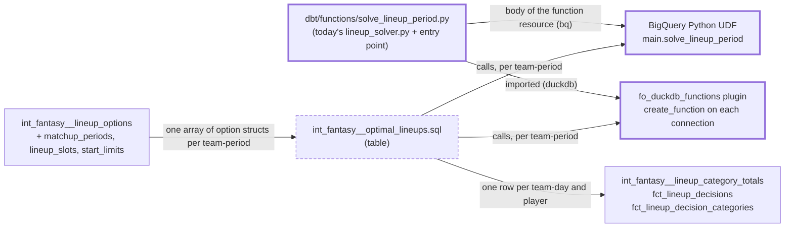

# The lineup solver on BigQuery — design

Issue: #137 · Requirements: [requirements.md](requirements.md) · Tasks: [tasks.md](tasks.md)

## Overview

The solver stops being a dbt Python model and becomes a **function called from SQL**. One
SQL model, `int_fantasy__optimal_lineups.sql`, gathers each team-period's options into an
array of structs and calls `solve_lineup_period` once per team-period. On BigQuery that
function is a **Python UDF**: BigQuery runs a Python 3.11 container with SciPy installed,
and dbt creates it from a function resource, `dbt/functions/solve_lineup_period.py`. On
DuckDB, a dbt-duckdb plugin registers the same Python function on the connection. Both
warehouses run the same file, and that file holds today's `lineup_solver.py` unchanged
plus a small entry point.

A probe on the real season showed that BigQuery runs the solver and returns DuckDB's row
count (C6), and that its rows are what the local solver gives on the same inputs (C7). The
probe also showed the inputs are not the same. BigQuery's option values differ from
DuckDB's in the last digits (C8), and that picks other lineups among exact ties in 1,187
team-days (C9). So the entry point rounds each value to 12 decimals before solving
(ADR 0104). With that, both warehouses give identical rows on the real season (C10). The
DuckDB build changes once: 1,231 team-days re-break a tie, with no change in value, size or
kept players (C11).

New dbt terms here:

- A **function resource** (dbt 1.11+) is a user-defined function that dbt creates in the
  warehouse as a node of the DAG. Its body is a file in `functions/`, its signature and
  options are in YAML, and a model calls it as `{{ function('name') }}`. dbt creates it
  before any model that calls it. dbt-bigquery supports Python ones. dbt-duckdb supports
  none (C17).
- A **dbt-duckdb plugin** is a Python class named in `profiles.yml` whose
  `configure_connection` dbt-duckdb calls on each connection it opens. Here it registers
  the function with DuckDB's `create_function`.

How the solve runs on each warehouse, and what is new:



## Claims ledger

The real season is a fresh build of `main` at 1c81306 (`data/spec137/warehouse.duckdb`, the
solver and its parents). BigQuery's tables are the `bigquery_slice` build of 2026-10-24.
Its lineup options were downloaded on 2026-10-26 to `data/spec137/bq_options_20261024.parquet`
(local, like all real data). C9 to C11 and C19 are rerun with
[`probes/compare_solves.py`](probes/compare_solves.py): `solve` solves every team-period as
the planned entry point does, and `compare` checks two solutions per team-day and per
team-period. The one-off probes behind C6, C7 and C14 to C16 are summarized in their rows.

| # | Claim | Query (or script) | Result | Run on |
|---|---|---|---|---|
| C1 | dbt-bigquery runs a Python model only through Dataproc (cluster or serverless batch) or BigFrames (a Colab Enterprise notebook job). Both require `gcs_bucket` and `compute_region` in the profile. BigFrames creates a Colab runtime template (`e2-standard-4`, network `default`) when none exists. A Python model there cannot import a local module: only the model file is uploaded. | read `dbt/adapters/bigquery/python_submissions.py`, dbt-bigquery 1.12.1 | as stated: `_BigQueryPythonHelper.__init__` raises without `compute_region`/`gcs_bucket`, `_create_notebook_template`, `_write_to_gcs(compiled_code)` | 2026-10-26 |
| C2 | The project has no bucket, and only BigQuery, Storage, Dataform, Dataplex and billing services enabled. No Dataproc, Vertex AI, Compute or Cloud Run. | `gcloud services list --enabled`, `gcloud storage buckets list`, explicit project | 13 services, all BigQuery-family, storage, billing, Dataform, Dataplex; 0 buckets | 2026-10-26 |
| C3 | BigQuery Python UDFs: Python 3.11 is the only runtime. No `JSON`, `RANGE`, `INTERVAL` or `GEOGRAPHY` types. `ARRAY` and `STRUCT` map to `list` and `dict`. PyPI packages come from `packages`. The containers run up to 4 vCPU and 16 GiB. No temporary UDFs. Results are never cached. | [BigQuery docs, user-defined-functions-python](https://docs.cloud.google.com/bigquery/docs/user-defined-functions-python) | as stated. The page shows no Preview banner in what was read, and states no launch stage either way. | 2026-10-26 |
| C4 | scipy 1.18.1 and numpy 2.5.3, the local versions, need Python ≥ 3.12. The newest releases with CPython 3.11 wheels are scipy 1.17.1 and numpy 2.4.6. scipy 1.17.1 needs numpy ≥ 1.26.4. | PyPI JSON API | as stated | 2026-10-26 |
| C5 | BigQuery's Python UDF environment constrains `numpy<2`. | `CREATE FUNCTION` with `numpy==2.4.6` | refused: "The user requested (constraint) numpy<2" | 2026-10-26 |
| C6 | The solver runs unchanged as a BigQuery Python UDF with `scipy==1.17.1` and `numpy==1.26.4`. It takes an array of option structs, the slots and the limit, and returns an array of (date, player, slot). | probe: `CREATE FUNCTION` holding `lineup_solver.py` + entry point; one `CREATE TABLE AS` over `intermediate.int_fantasy__lineup_options` | created in 64 s. First call 168.5 s wall (includes the image build), 356,515,840 bytes billed, 79,341 slot-ms, and `externalServiceCosts` of 24,000 slot-ms (`MANAGED_ROUTINE_EXECUTION`, billed as a services SKU), **162,974 rows**. Dataset dropped after. | 2026-10-26 |
| C7 | Given the same inputs, BigQuery's UDF and the local solver (scipy 1.18.1, Python 3.13) give the same rows. | BigQuery's options downloaded, solved locally with the same entry point, `EXCEPT ALL` against the UDF's rows | 0 and 0 | 2026-10-26 |
| C8 | BigQuery's lineup options are DuckDB's, except `option_value` in the last digits. | download, join on the seven key columns | 437,559 rows each; key and non-value columns identical; value exactly equal in 106,110; largest absolute difference 1.78e-15, largest relative 1.05e-11 | 2026-10-26 |
| C9 | BigQuery's UDF rows differ from DuckDB's model rows only among exact ties. | `compare_solves.py compare model <the UDF's rows>`, with DuckDB's values | 1,896 rows each way, in 1,187 team-days of 896 team-periods, all eight seasons. Per team-day: value gap ≤ 4.44e-16, kept count and size equal, other players in 94 (the rest are the same players in other slots). Per team-period: credited value under the start rule equal (gap 0), starts each day equal in all 896. | 2026-10-26 |
| C10 | Rounding each option value before the solve makes both warehouses' rows identical. | both inputs solved locally, value rounded: in SQL at 12, 9 and 6 decimals; in Python, `round(v, 12)` | SQL 12: 20 values straddle a rounding boundary, rows 0/0. SQL 9 and 6: 0 straddle, rows 0/0. Python 12: 16 values straddle, rows 0/0. | 2026-10-26 |
| C11 | Rounding in Python at 12 decimals changes DuckDB's own lineups only among exact ties. | `compare_solves.py solve --round 12`, then `compare model …`, with DuckDB's values | 162,974 rows. 1,987 rows differ each way, in **1,231 team-days** of **911 team-periods**. Per team-day: value gap ≤ 6.66e-16, kept count and size equal, other players in 74. Per team-period: credited value under the start rule equal (gap 0), starts each day equal in all 911. (SQL 9 decimals: 1,237 team-days, same bounds.) | 2026-10-26 |
| C12 | Option values are far from the rounding grid's scale. | `min/quantile/max(abs(option_value))` | min 6.6e-6, median 0.31, p99 1.71, max 5.31; none is 0 | 2026-10-26 |
| C13 | Solver input on the real season. | group options by team-period | 2,340 team-periods; options per team-period min 83, median 183, max 367; at most 13 days; 437,559 options; 195 start-limit rows in 8 league-seasons | 2026-10-26 |
| C14 | On DuckDB, SQL calling the solver as a Python function gives exactly the Python model's rows, about six times faster. | prototype: `create_function` on a connection, same SQL shape as the design | 162,974 rows, 0/0 against the model. 8.5 to 9.3 s, with 6.3 s of solver CPU over 2,340 calls. The Python model took 56.0 s in the same build (`run_results.json`). | 2026-10-26 |
| C15 | A function resource can be enabled on BigQuery only, and a model can call it through a dispatched macro on both warehouses. | throwaway copy of `dbt/`: `functions/solve_lineup_period.py` + YAML with `enabled: "{{ target.type == 'bigquery' }}"`; `dbt ls` and `dbt compile` per target | `ci`: function disabled, model parses with no node dependency. `bq`: model depends on `function.front_office.solve_lineup_period` and compiles to `` `<project>`.`main`.`solve_lineup_period`(…) `` | 2026-10-26 |
| C16 | A dbt-duckdb plugin can register a Python function that a model calls. A view calling it cannot be read outside dbt. | same copy: plugin with `configure_connection` → `create_function`; `dbt run --threads 4` | a table model calling it builds (PASS=2). Read outside dbt, a view calling it fails: "Scalar Function with name solve_lineup_period does not exist"; a table reads fine | 2026-10-26 |
| C17 | dbt function resources support Python UDFs on Snowflake, BigQuery and Databricks, not DuckDB. dbt-duckdb 1.11 has no function materialization. | [dbt docs, UDFs](https://docs.getdbt.com/docs/build/udfs); `grep` of `include/` | as stated; dbt-bigquery has `bigquery__scalar_function_python` | 2026-10-26 |
| C20 | Python UDFs are generally available (since 2026-06-22), billed under the BigQuery Services SKU, which has no free tier: 0.06 USD a slot-hour in the US multi-region from the first unit. On-demand analysis is 6.25 USD a TiB after a free TiB a month. The probe's UDF execution, 24,000 slot-ms (C6), is about 0.0004 USD. Image builds are billed separately, under the label `MANAGED_ROUTINE_BUILD`. They did not appear in the probe's job statistics. | Cloud Billing catalog API: services `16B8-3DDA-9F10` (BigQuery Reservation API) and `24E6-581D-38E5` (BigQuery), US SKUs; [GA announcement](https://cloud.google.com/blog/products/data-analytics/python-udf-in-bigquery-now-generally-available) | "BigQuery Services for US (multi-region)": hour, [(0, 0.06)]. "Analysis": tebibyte, [(0, 0), (1, 6.25)] | 2026-10-26 |
| C19 | Rounded, BigQuery's runtime gives both warehouses' inputs the same rows, and the same rows as the dev environment. | `compare_solves.py solve --round 12` under `uv run --no-project --python 3.11 --with scipy==1.17.1 --with numpy==1.26.4`, on DuckDB's options and on BigQuery's; then under the project's 3.13 / 1.18.1 | 162,974 rows each. DuckDB's inputs against BigQuery's: 0/0. Python 3.11 / SciPy 1.17.1 against 3.13 / 1.18.1: 0/0. (Not yet run inside BigQuery: task 10.) | 2026-10-26 |
| C18 | Python UDF limits and billing. | [BigQuery quotas](https://docs.cloud.google.com/bigquery/quotas); BigQuery UDF docs | 10 concurrent queries referencing Python UDFs per project; 10 GiB of UDF images per region; 30 creates or updates a minute. Billed under BigQuery Services SKUs: image builds by duration, calls by compute and memory used, reported per job as `externalServiceCosts` (C6). No rate found. | 2026-10-26 |

## Alternatives considered

| | A — Python UDF, one SQL model on both (chosen) | B — UDF on BigQuery, Python model kept on DuckDB | C — Python model via BigFrames | D — Python model via Dataproc Serverless | E — solve outside dbt | F — solver rewritten in JS or SQL |
|---|---|---|---|---|---|---|
| Runs in BigQuery's `dbt build`, from any runner (sub-project 4's Cloud Run included) | yes | yes | yes, through a notebook job | yes, through a Spark batch | no: a second step writes a table dbt reads as a source | yes |
| New GCP infrastructure | none (C2, C6) | none | bucket, Vertex AI and Compute APIs, a runtime template and network (C1) | bucket, Dataproc API, network (C1) | a job and its scheduler | none |
| Copies of the solver | one file, run everywhere | one file, two callers (Python model and SQL model) | one solver, inlined or packaged into the model (C1), plus DuckDB's model | as C, in PySpark | one, outside the DAG | two: today's and a port, with no SciPy |
| Same rows as DuckDB | yes, with ADR 0104 (C10) | yes, with ADR 0104, two code paths to keep equal | not measured | not measured | yes | only as good as the port |
| Model logic testable by dbt unit tests on DuckDB | expected (open question 1) | no, a Python model | no | no | no | yes |
| Measured here | yes (C6, C7, C14 to C16) | partly | no | no | no | no |
| Cost and latency per build | 168 s first call with the image build (C6); execution about 0.0004 USD a full build, image builds extra (C20) | as A on BigQuery | a notebook runtime per build, unmeasured | a Spark batch per build, unmeasured | a job run | none beyond SQL |

**A — Python UDF, one SQL model on both (chosen).** Everything happens inside BigQuery, with
no service to own, and the solve is one call per team-period from SQL. The same file is
the UDF body, the DuckDB function and the tested module, so there is nothing to keep in
step. It is the only option measured end to end on the real season. On DuckDB it is also
faster, because it drops the Python model's row-by-row insert (C14). Its costs: BigQuery
pins Python 3.11 and `numpy<2`, so the UDF runs older SciPy than the dev environment (C4,
C5). The function's signature is declared twice, in BigQuery YAML and in the plugin's
DuckDB types, which R6.3 holds together. And it is not free: the UDF's compute has no free tier, though one build's execution costs about 0.0004 USD. Image builds are billed on top, at an amount not yet seen (C20).

**B — UDF on BigQuery, Python model kept on DuckDB.** Smaller change on DuckDB, but two
models compute one table: a Python model on DuckDB and a SQL model on BigQuery, selected by
target. Every rule (unvalued periods, the bound, the cap) is written twice, and only the
real-season comparison would notice them drifting. The Python model also stays untestable
by dbt and keeps its 56 s.

**C — dbt Python model through BigQuery DataFrames.** dbt-bigquery's own path, but it runs
the model as a Colab Enterprise notebook job (C1). That needs a bucket, Vertex AI, a
runtime template and a network, none of which exist (C2), and a notebook runtime started
per build. The model can't import `lineup_solver`, so the solver would be inlined into the
model or installed as a package. The DuckDB model would differ from it anyway, because a
BigFrames DataFrame is not a DuckDB relation.

**D — dbt Python model through Dataproc Serverless.** The same objections as C, with Spark:
a bucket, the Dataproc API, a Spark batch per build, a PySpark rewrite of the model, and
the solver shipped as an extra file. Whether the runtime image holds SciPy was not checked.

**E — solve outside dbt.** A job reads the options, solves, and writes a table that dbt
reads as a source. ADR 0039 rejected this for DuckDB because it takes the result out of the
DAG. On BigQuery it would also need the job's own runner and scheduling (sub-project 4),
and a build that runs in two steps with a gap between them.

**F — rewrite the solver.** A JavaScript UDF or SQL would need an exact assignment solver
and the period DP written here. ADR 0039 chose not to own that code, and SQL has no exact
assignment. Two implementations would have to agree on ties to 1e-9.

## Decisions

| ADR | Decision | Status |
|---|---|---|
| [0103](../../adr/0103-the-lineup-solver-is-a-python-function-called-from-one-sql-model-on-both-warehouses.md) | The solver is a Python function called from one SQL model: a BigQuery Python UDF, and on DuckDB the same file registered by a plugin. Amends ADR 0039. | proposed |
| [0104](../../adr/0104-the-solver-rounds-each-option-value-to-12-decimals-so-both-warehouses-break-ties-alike.md) | The solver rounds each option value to 12 decimals before solving, so both warehouses break exact ties alike. | proposed |
| [0105](../../adr/0105-the-bigquery-selector-builds-every-model-and-is-renamed-bigquery.md) | The BigQuery selector builds every model and is renamed `bigquery`. Amends ADR 0096. | proposed |

## Detailed design

### The function file

`dbt/functions/solve_lineup_period.py` is today's `dbt/python_modules/lineup_solver.py`,
moved with `git mv` so its history follows, plus one entry point:

```python
def solve_lineup_period(team, matchup_period, options, slots, start_limit):
    """The optimal lineups of one team-period, as a list of {scoring_date, player_id, slot_id}."""
```

- `team` is a string naming the team (`platform=…, league_id=…, season=…,
  fantasy_team_id=…`). The function uses it only in error messages, because a UDF sees no
  column but its arguments (R2.3, R2.4).
- `options` is the array of option structs: `scoring_date`, `player_id`, `slot_id`,
  `role`, `value` (nullable), `is_actual`, `is_start`. `is_start` is computed in SQL as
  today's model does: `slot_role = 'pitcher' and day_kind = 'start'`.
- The entry point does what the Python model's loop does today, in the same order. It
  checks the bound on every non-null value, naming the team-day (R2.3). It returns `[]` if
  any value is null (R2.2). It **rounds each value with `round(value, 12)`** (R3.1, ADR
  0104). It computes the cap (R2.5) and calls `solve_team_period`.
- A team-day with no matchup period (R2.4): the SQL keeps such options with a null
  `matchup_period` (left join), so they group into a team-period of their own. The entry
  point raises when `matchup_period` is null, naming the first such team-day. A singular
  test can't stand in for this, because today the build fails rather than dropping
  the rows, and R2.4 keeps that.
- The file keeps no dbt or database import, so pytest imports it directly.

Its YAML, `dbt/functions/_functions.yml`, declares the BigQuery signature and options:
`runtime_version: "3.11"`, `entry_point: solve_lineup_period`,
`packages: ["scipy==1.17.1", "numpy==1.26.4"]`, and
`enabled: "{{ target.type == 'bigquery' }}"` (C15). Argument types are BigQuery's:
`array<struct<scoring_date date, player_id int64, …>>`.

### The DuckDB plugin

`dbt/python_modules/fo_duckdb_functions.py` holds a `Plugin(BasePlugin)` whose
`configure_connection` imports `solve_lineup_period` from the function file and registers
it with `create_function`, with DuckDB types for the same fields in the same order, and
`null_handling="special"` so that a null `start_limit` reaches the function (C14). The
`dev` and `ci` profiles list it under `plugins:`. `module_paths` gains `functions`, so
the import resolves the way `python_modules` does today. A function registered this way
exists only on dbt's connections (C16), which is why the model is a table and R6.4 forbids
a view.

### The model

`int_fantasy__optimal_lineups.sql`, materialized `table`:

1. `team_period_options`: the options joined to `int_fantasy__matchup_periods` (left
   join), grouped by team-period, with
   `array_agg(<struct> order by scoring_date, platform_player_id, lineup_slot_id)`. Both
   warehouses accept `array_agg(… order by …)`. The struct is written through a new
   dispatched macro, `fo_struct([(expr, name), …])`: DuckDB `struct_pack(name := expr)`,
   BigQuery `struct(expr as name)`.
2. `league_slots`: `int_fantasy__lineup_slots` per league-season, as an ordered array of
   (slot_id, role, count).
3. `solved`: one row per team-period with the function's result.
   `{{ fo_solve_lineup_period() }}(team, matchup_period, options, slots, start_limit)`
   dispatches to the
   bare name on DuckDB and to `{{ function('solve_lineup_period') }}` on BigQuery (C15).
   `start_limit` comes from `int_fantasy__start_limits` (left join).
4. The final select unnests the result with `fo_unnest`, never in the select list (AGENTS
   rules), into the seven columns and types of today (R2.1).

The model keeps today's YAML tests and its description, rewritten: no "Python model",
no "DuckDB-only".

### Tests

- `ingestion/tests/test_lineup_solver.py` imports from the new path (R6.1). New pytest
  cases cover the entry point: rounding, the null skip, the bound and no-period messages.
- The ten behaviours in `test_optimal_lineups_model.py` (R6.2) move to dbt unit tests on
  the SQL model, if a unit test can call the plugin's function (open question 1). If not,
  they stay as pytest, which builds the model's compiled SQL on a DuckDB connection with
  the plugin's function registered.
- A pytest reads `_functions.yml` and the plugin's type list and fails if they differ in
  field names, order or kind (R6.3).
- A pytest over the manifest fails if a node other than this model calls
  `fo_solve_lineup_period`, or if that model is not a table (R6.4).

### The selector and the comparison

`bigquery_slice` becomes `bigquery` (ADR 0105). Its definition keeps only the exclusion
of `stg_raw__capture_views_cover_the_manifest`. `scripts/compare_bigquery_slice.py`
becomes `scripts/compare_bigquery.py`, along with its test. The rename touches the files
ADR 0096 counted: AGENTS.md, README, `dbt/selectors.yml`, three tests and the script. `int_fantasy__optimal_lineups` has no float column, so the script already compares it
exactly, and its declared unique key serves the readers' floats. One addition: for the
solver, a difference is printed as the team-days that differ, with their rows on each side,
and not only as a count (R3.3). A test plants a differing row and expects the team-day
printed.
`test_bigquery_slice.py`'s counts change by the four models and their tests, and it now
asserts the function node is selected.

### What is verified where

- CI (DuckDB fixtures): the gates, the unit tests, `dbt build --target ci`.
- Real season, DuckDB (task 9): R4.1 to R4.3, measured against a `main` build.
- Real season, BigQuery (task 10): `--empty` with a suffix (R5.5). Then two calls of the
  UDF on literal arrays, one with a value beyond the bound and one with a null matchup
  period, each expected to fail naming its team-day (R2.3, R2.4). Then a real build into
  suffixed datasets, `compare_bigquery.py` (R3.2, R5.3), and a second build for R5.4.

## Test strategy

| Requirement | Test | Catches |
|---|---|---|
| R1.1, R1.3, R1.4 | `test_bigquery_slice.py` (renamed): the selector holds the function node and the model; `dbt ls` per target | the function missing from BigQuery's DAG, or enabled on DuckDB |
| R1.2, R1.5 | pytest: no `lineup_solver` module and no Python model remain; the plugin imports the function file | a second copy of the solver |
| R2.1 to R2.5 | the ten moved behaviour tests (dbt unit tests or pytest), plus entry-point pytest cases | a rule of specs 0012 or 0164 lost in the move |
| R3.1 | pytest: two values 1e-15 apart round to one; an exact tie broken by noise is broken the same way after rounding | the rounding removed or applied after the solve |
| R3.2, R3.3 | `compare_bigquery.py` on the real season | warehouses that disagree |
| R4.1 to R4.3 | `scripts/compare_warehouses.py` against `main`, plus `probes/compare_solves.py compare` (task 9) | a change that is not a re-broken tie, per team-day or under the start rule |
| R2.3, R2.4 on BigQuery | two UDF calls on literal arrays (task 10) | an error that names no team-day there |
| R5.2 | pytest on `_functions.yml`: runtime and pins | an unpinned or numpy-2 package that BigQuery refuses (C5) |
| R5.5 | `--empty` run with a suffix | SQL BigQuery refuses |
| R6.3 | pytest comparing YAML and plugin types | signatures that drift |
| R6.4 | manifest pytest | a view calling the function, or a second caller |
| R6.5 | `.agentic/gates` | the rest of the project |

## Risks

- **Python UDF price.** GA, 0.06 USD a slot-hour with no free tier (C20). Execution is
  about 0.0004 USD a build, and image builds are unmeasured. → R5.4 records both, and
  the 5 USD budget alerts.
- **A straddle that meets a tie.** Rounding cannot stop a value whose two warehouse
  versions fall either side of a 12th-decimal boundary: 16 of 437,559 here, none of
  which changed a lineup (C10). → If one does, R3.2 fails and the work is not merge-ready.
  The comparison names the team-days (R3.3), and the owner decides, as ADR 0104 says.
- **Image rebuilds.** dbt runs `CREATE OR REPLACE FUNCTION` on every build. Whether
  BigQuery rebuilds the image when the body is unchanged is unknown. A rebuild every time
  adds minutes (C6: 168 s for the first call). → Measured in R5.4. If it rebuilds every
  time, the function can be built only when it changes (dbt state selection), decided then.
- **BigQuery pins.** A future BigQuery change to the 3.11 runtime or the `numpy<2` pin
  could refuse the UDF. → The pins are explicit (R5.2) and refusal fails the build loudly.
- **DuckDB holds the GIL.** The DuckDB function runs single-threaded. → 9 s on eight
  seasons (C14), against 56 s today.

## Open questions

1. Can a dbt unit test on DuckDB call a function registered by the plugin? The plugin
   configures every connection, and unit tests use dbt's connections, so it is expected to.
   → Task 1 checks it before the tests are written.
2. What does an image build (`MANAGED_ROUTINE_BUILD`) cost, and does BigQuery rebuild the
   image when `CREATE OR REPLACE FUNCTION` sends the same body? → R5.4: the owner reads the
   billing report by label the day after the two builds of task 10.
3. Does BigQuery's `--empty` run call the UDF (over empty arrays) or only compile it?
   → Task 10, with a suffix.

## Review log

| Source | Finding | Resolution |
|---|---|---|
| design-review | F1 (P1): the rounded solve was never run under BigQuery's SciPy, which might break the new ties otherwise | Ran it locally under BigQuery's exact runtime (Python 3.11, SciPy 1.17.1, NumPy 1.26.4): both warehouses' inputs give identical rows, equal to the dev environment's (C19). Running the UDF inside BigQuery stays in task 10, where R3.2 holds it. |
| design-review | F2 (P1): R4.2's per-day checks do not cover the start rule, under which start timing changes the credited value | Added the per-team-period check to the probe: credited value under the start rule equal (gap 0) and starts each day equal, in all 911 team-periods (C11) and in BigQuery's 896 (C9). R4.2 now requires it. |
| design-review | F3 (P1): R3.2 demands zero differences while R3.3 lets an explained one through | R3.2 is strict: any difference fails acceptance. R3.3 only says what the comparison prints. A straddle that splits the warehouses goes to the owner (ADR 0104). |
| design-review | F4 (P2): the comparison script prints counts, not the team-days R3.3 needs | The script gains a keyed report for the solver, with a planted-row test (task 7). |
| design-review | F5 (P2): the failure messages are tested on DuckDB only | Task 10 adds two UDF calls on BigQuery with invalid literal inputs. |
| design-review | F6 (P2): bytes and slot time don't measure the UDF's own billing | R5.4 records each job's `externalServiceCosts`, as C6 now does (24,000 slot-ms on the probe). |
| design-review | F7 (P2): the C10 and C11 scripts lived in a scratchpad | Committed as `probes/compare_solves.py`, with the input snapshot named in the ledger. Task 9 uses it. |

## Amendments

**2026-10-26, during the build. None of these changes a goal, a no-go or a decision.**

- **Module paths.** The `dev` and `ci` profiles list `module_paths` relative to both `dbt/`
  and the repo root: `["python_modules", "functions", "dbt/python_modules", "dbt/functions"]`.
  The design gave only the first two. With a plugin in the profile, dbt-duckdb imports it
  whenever it opens a connection. The gates' sqlfluff run uses the dbt templater from the
  repo root, and failed with `Unable to import module 'fo_duckdb_functions'`. A path that
  does not exist is skipped.
- **The failing behaviours.** Open question 1 is answered: a dbt unit test can call the
  plugin's function. But a unit test cannot expect an error. So the three behaviours that
  must fail the build (a null beside an out-of-bound value, an out-of-bound value, a date
  in no matchup period) run `dbt run` on a small DuckDB in a subprocess and read its
  output (`test_optimal_lineups_failures.py`). The seven that give rows are dbt unit tests.
- **A null slot list.** A league-season with no slot rows reaches the function with a null
  array through the left join. The entry point reads it as empty (`slots or []`), as the
  Python model's `slots_of.get(key, [])` did.
- **The solver node's time on DuckDB is 63 s, not about 9 s.** The real-season build of the
  branch (task 9) took 63.0 s on the solver, against 123.8 s for `main`'s in the same kind
  of build. C14's 9 s was measured while the `bigquery` dependency group, which brings
  pandas, was installed in the shared venv. Without pandas, DuckDB's Python function call
  tries to import it on each conversion. The same prototype then takes 41 s, 4.6 s with
  pandas, and 6 s with the import blocked. Speed is a no-go here (#201), so nothing is
  added. The expected value is amended to "faster than `main`", and the finding goes to
  #201.
