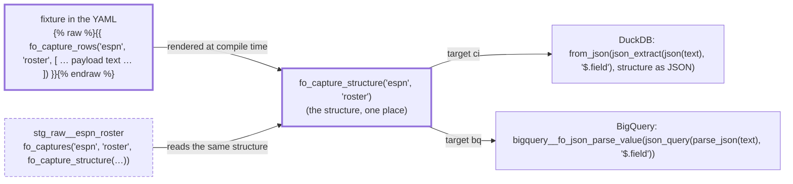

# Every unit test runs on both warehouses — design

Issue: #138 · Requirements: [requirements.md](requirements.md) · Tasks: [tasks.md](tasks.md)

## Overview

The 45 unit tests that cannot run on BigQuery fail for three reasons, and each reason
gets one fix that works on both warehouses. Every fix has been tried on both (C8, C10,
C13).

- **The manifest.** A test that names it does so through the target:
  `source('raw', 'captures')` on DuckDB, `source('raw', 'api_responses')` on BigQuery
  (ADR 0114).
- **JSON values in dict fixtures.** They stay JSON text. A project override of dbt's
  `safe_cast` hands that text to `parse_json` on BigQuery, which dbt-bigquery's own cast
  will not do (ADR 0113).
- **Capture views that declare a structure.** Their fixture is written as the capture's
  payload. The new macro `fo_capture_rows` parses it with the view's own structure, so the
  fixture has the view's columns and types on each warehouse (ADR 0111). The other SQL
  fixtures are rewritten in SQL both warehouses take. A fixture that needs a project macro
  calls it inside ``, because dbt renders a fixture's `rows` before the project's
  macros exist (ADR 0112).

The portable-SQL rule in pytest is extended to fixtures, so a new DuckDB-only fixture
fails the gates in CI (ADR 0110). CI still never touches BigQuery. The unit tests are run
there by hand, against a suffixed `--empty` build of the branch, and the result is
recorded on the issue.

How one capture fixture becomes the view's rows on each warehouse:



## Claims ledger

Logs, prototypes and compiled SQL are kept locally under `data/spec138/` (gitignored).

| # | Claim | Query (or script) | Result | Run on |
|---|---|---|---|---|
| C1 | The project has 223 unit tests, and the `bigquery` selector takes all of them | `dbt ls --target ci --resource-type unit_test`; the selector leaves out only one data test (`dbt/selectors.yml`) | 223 | 2026-10-29 |
| C2 | The populated default BigQuery datasets lack the solver function and `int_fantasy__optimal_lineups`. A complete build is in the suffixed `_141` datasets | `bq ls --routines main` (empty); `bq ls intermediate` (no `int_fantasy__optimal_lineups`); `bq ls --routines main_141` | `solve_lineup_period` exists only in `main_141`; `intermediate` has `int_fantasy__lineup_options` but not the optimal lineups | 2026-10-29 |
| C3 | On BigQuery, against the default datasets: 142 pass, 77 error, 4 fail. Against `_141`: 174 pass, 45 error, 4 fail. The 32 errors that differ are all C2's, and nothing passing regresses | `dbt test --target bq --selector bigquery --resource-type unit_test`, then again with `--vars '{fo_schema_suffix: _141}'`; outcomes compared per test | as stated. The 32: 7 `Function not found: …main.solve_lineup_period`, 25 `Not able to get columns … int_fantasy__optimal_lineups … doesn't exist` | 2026-10-29 |
| C4 | The 45 by cause. 20: `depends on a source named 'raw.api_responses' which was not found` (they give `source('raw', 'captures')`). 9: JSON given as a string (8 dict fixtures `Invalid cast from STRING to JSON`, 1 SQL fixture `Unclosed string literal`). 16: DuckDB SQL (7 WHERE with no FROM, 4 comma joins, 3 `range()`, 2 `::` casts). The first error each test hits is what is counted | the first run's log, the first error per test | 20 + 9 + 16 = 45. By model: `stg_espn__*` 23, `stg_mlb__*` 6, `stg_idmap__players` 2, `rec_espn__matchup_stat_differences` 8, `rec_espn__player_day_residuals` 3, `rec_fantasy__category_wins_by_group` 3 | 2026-10-29 |
| C5 | A unit-test run on BigQuery bills nothing | `bq ls -j` over the runs' jobs, `totalBytesBilled` | 339 query jobs, 0 bytes billed | 2026-10-29 |
| C6 | dbt renders a unit test's `rows` when it parses the YAML: a project macro there is undefined, while `target.type` renders. Inside `…`, the call survives the parse and is rendered when the fixture is compiled, as the target's dispatched form | a fixture with `{{ fo_json_parse(…) }}`, then the same inside `` with `-- {{ target.type }}` after it | `'fo_json_parse' is undefined`; then PASS, with compiled SQL `from_json(json_extract(…)) … -- duckdb` | 2026-10-29 |
| C7 | A SQL fixture file under `tests/fixtures/` (`fixture:`) is compiled with the project's macros and needs no `` | the same macro call in `dbt/tests/fixtures/zz_experiment_schedule.sql`, given with `fixture:` | PASS on `ci` and on `bq` | 2026-10-29 |
| C8 | An input named through the target, `"source('raw', '{{ 'api_responses' if target.type == 'bigquery' else 'captures' }}')"`, is accepted by dbt and resolves on each warehouse | a unit test of `stg_espn__lineup_slot_stat_limits` with that input | PASS on `ci` and on `bq` | 2026-10-29 |
| C9 | dbt-bigquery's `safe_cast` turns a YAML mapping given to a JSON column into a JSON literal, but casts a string with `cast(… as JSON)`, which BigQuery refuses. dbt-duckdb uses dbt's default `cast(… as JSON)`, which DuckDB accepts | `dbt/include/bigquery/macros/utils/safe_cast.sql`; `global_project/macros/utils/safe_cast.sql`; C4's eight dict errors | as stated | 2026-10-29 |
| C10 | A project macro `bigquery__safe_cast` is used by dbt's fixture SQL in place of the adapter's. dbt-bigquery's own form is reached as `dbt.bigquery__safe_cast` (`dbt_bigquery` is undefined). With an override that sends JSON text to `parse_json`, the 8 dict-string tests of C4 pass on BigQuery, unchanged | `data/spec138/experiments/zz_experiment_safe_cast.sql`; `dbt test --target bq` on `stg_espn__transactions`, `stg_espn__transaction_logs`, `stg_idmap__players`, `stg_mlb__players` | 8 PASS. `transactions_are_dated_by_the_eastern_date_of_their_instant` still errors (its fixture is SQL) | 2026-10-29 |
| C11 | dbt's BigQuery string literal leaves backslashes for BigQuery to unescape: JSON text holding `\"` reaches `parse_json` broken. No fixture today holds a backslash | an edge-case fixture through C10's override; `grep -c '\\'` over the model YAML | `PARSE_JSON … invalid literal; last read: '"O'Neil said "h'`; 0 files with a backslash | 2026-10-29 |
| C12 | DuckDB's `cast(json as STRUCT(…))` refuses a key the struct does not name. `from_json(json, structure)` ignores it, and wants a map as a type string, `"MAP(VARCHAR, JSON)"` | a schedule payload with `dates[].date`, which the view's structure does not declare | `Conversion Error: … has unknown key "date"`; with `from_json`, PASS | 2026-10-29 |
| C13 | A prototype of `fo_capture_rows` (keys plus payload text, parsed with the view's structure) gives each view's rows on both warehouses. Tested on the schedule (`stg_mlb__games`), and on the roster with a `stats` map (`stg_espn__roster_entry_slots`), with payloads holding keys outside the structure | `zz_capture_fixture` in `data/spec138/experiments/`; two unit tests | PASS on `ci` and on `bq`, both tests | 2026-10-29 |
| C14 | JSON given as a YAML mapping, with a `safe_cast` override on both warehouses, survives a null, an apostrophe, an escaped quote, a backslash and a list whose items have different keys | `zz_experiment_json_edge_cases` | PASS on `ci` and on `bq` | 2026-10-29 |
| C15 | YAML changes some unquoted values. PyYAML reads `on` and `yes` as `true`; `NONE` and `1e3` stay strings | `yaml.safe_load('{a: on, b: yes, c: NONE, d: 1e3}')` | `{'a': True, 'b': True, 'c': 'NONE', 'd': '1e3'}` | 2026-10-29 |
| C16 | 40 unit-test fixtures are SQL. 14 of them are of a capture view that declares a structure: roster 3, matchup days 6, boxscore 3, schedule 2. Four views declare a structure (roster, matchup days, boxscore, schedule), and seven read `payload` whole | a scan of the model YAML's `given` entries; `grep "set structure" dbt/models/staging/raw` | as stated | 2026-10-29 |
| C17 | In this project, only dbt's fixture SQL calls `safe_cast`. The `safe_cast(` in `json.sql`, `portable.sql` and `request_param.sql` is BigQuery's SQL function, not dbt's macro. The dbt_utils macros that call it (`get_url_host`, `get_url_path`, `width_bucket`) are not used | `grep -rn "safe_cast("` over dbt's include, the project and `dbt_packages`; `grep dbt_utils\.` over the project | `get_fixture_sql` only; the project uses `accepted_range`, `expression_is_true` and `unique_combination_of_columns` | 2026-10-29 |
| C19 | The `safe_cast` override of design §4 works on BigQuery. dbt-bigquery quotes a fixture string as `'''…'''` and escapes `'` as `\'`. Taking that back and requoting with `\` and `'` escaped passes the 8 dict-string tests unchanged, and parses JSON holding an apostrophe, `\"` and `\\`. The value returns exactly | `bigquery__string_literal` in dbt-bigquery; the prototype in `data/spec138/experiments/zz_experiment_safe_cast.sql`; `select json_value(parse_json('{"note": "O\'Neil said \\"hi\\" \\\\ ok"}'), '$.note')` | 8 PASS, the edge case PASS; `O'Neil said "hi" \ ok` | 2026-10-29 |
| C20 | For an absent field, BigQuery's parse (`bigquery__fo_json_parse_value`) gives an empty array for a list and a struct of nulls for an object. DuckDB's `from_json` gives null for both. A scalar is null on both | `array(… unnest(json_query_array(json_query(parse_json('{}'), '$.dates'))) …)`, `struct(lax_int64(json_query(parse_json('{}'), '$.home.teamId')) as teamId)` on BigQuery; `from_json(json_extract(json('{}'), …), …)` on DuckDB | BigQuery `[]`, `{"teamId": null}`, `null`; DuckDB `None`, `None`, `None` | 2026-10-29 |
| C18 | `check_plan_shapes.py` counts a view as heavy when its `fo_captures` call has a third argument that is not `none`. A macro call as that argument counts | `_captures_call` in `scripts/check_plan_shapes.py` | `declares = len(arguments) > 2 and not _NONE_ARGUMENT.fullmatch(arguments[2])` | 2026-10-29 |

## Alternatives considered

The goal (every test runs on both warehouses) was the owner's choice. Leaving the
staging tests DuckDB-only, or all 45, lost because the BigQuery JSON forms would stay
without unit tests, which is #138's concern. The options below are for how to get there.

| | A — one portable form per kind, a gate in CI (chosen) | B — a second copy of each test per warehouse | C — dict fixtures for every capture view |
|---|---|---|---|
| Fixtures to keep in step | one per test | two per test, enabled by target | one per test |
| Capture-view parse checked on BigQuery | yes, through the view's structure | yes, by a hand-written BigQuery fixture | yes, but only through a parser of BigQuery's type strings |
| New code | 2 macros, a `safe_cast` override, gate rules | none | an override that turns a BigQuery `ARRAY<STRUCT<…>>` type string back into a structure |
| Proven today | C8, C10, C13 | — | the dict half (C14); the type-string parse not tried |

**A — chosen.** Each failure kind gets one form that both warehouses take. What a test
says stays in one place, and the gate keeps it so.

**B — a second copy per warehouse.** One fixture in DuckDB SQL, one in BigQuery SQL, each
enabled only on its target. This loses because every case would be written twice, and
nothing checks that the two copies say the same thing.

**C — dict fixtures for capture views.** The typed columns would be given as JSON, and
the `safe_cast` override would parse them into the column's type. On DuckDB,
`from_json(…, type)` does that from the type string. On BigQuery the override would have
to read `ARRAY<STRUCT<…>>` type strings, and a map is an array of key-value structs
there. The YAML would also give each declared column separately, rather than the payload
as it lands. It loses on the parser it needs and on fixtures that look nothing like a
capture.

Each ADR below holds the alternatives for its own choice.

## Decisions

| ADR | Decision | Status |
|---|---|---|
| [0110](../../adr/0110-every-unit-test-runs-on-both-warehouses-held-by-a-text-rule-in-ci.md) | Every unit test runs on both warehouses. A text rule in CI holds the fixtures to it; a by-hand BigQuery run checks it | proposed |
| [0111](../../adr/0111-a-capture-views-fixture-is-its-payload-parsed-with-the-views-own-structure.md) | A capture view's fixture is its payload, parsed with the view's own structure | proposed |
| [0112](../../adr/0112-a-fixture-calls-a-project-macro-inside-a-raw-block.md) | A fixture calls a project macro inside `` in the YAML | proposed |
| [0113](../../adr/0113-a-json-fixture-value-stays-json-text-and-bigquery-parses-it.md) | A JSON fixture value stays JSON text; a project `safe_cast` parses it on BigQuery | proposed |
| [0114](../../adr/0114-a-unit-test-names-the-manifest-through-the-target.md) | A unit test names the manifest through the target | proposed |

## Detailed design

### 1. The structures, in one place (R3.3)

New file `dbt/macros/capture_structures.sql`, with `fo_capture_structure(source_name,
endpoint)`. It returns the structure text of the four endpoints that declare one
(`espn/roster`, `espn/matchup_days`, `mlb/boxscore`, `mlb/schedule`), and raises a
compiler error for any other. Each structure moves from its view's
`` block unchanged, with the comment that explains its fields. The
view keeps its comment on why it parses, and calls:

```sql
{{ fo_captures('espn', 'roster', fo_capture_structure('espn', 'roster')) }}
```

The text is byte-for-byte what the view held, so each view compiles to the same SQL
(R3.3). `check_plan_shapes.py` still finds the four as heavy (C18). It is not changed.

### 2. `fo_capture_rows` (R3.1, R3.2)

In the same file:

```
fo_capture_rows(source_name, endpoint, captures)
  captures: a list of mappings, one per capture, each with
    request_key, fetched_at, file_path   text, required
    partitions                           JSON text, required
    payload                              JSON text, required
    request_path                         text, default '/fixture'
```

It gives one `select` per capture, joined by `union all`, with the columns of
`fo_captures` in its order: `source`, `endpoint`, `request_path`, `request_key`,
`fetched_at`, `partitions`, `file_path`, then each top-level field of the structure in
the structure's order. An empty `captures` gives the same columns and no rows. It uses a
`limit 0` select, because BigQuery refuses a WHERE with no FROM.

Per field:

- **DuckDB:** `from_json(json_extract(json(<payload text>), '$."<field>"'), '<structure as
  JSON>')`. The structure is passed as JSON in which a `{"__map__": X}` becomes the type
  string `"MAP(VARCHAR, <X's type>)"`, so `from_json` ignores undeclared keys as
  `read_json` does (C12). The result's type is what `duckdb__fo_structure_type` gives the
  view.
- **BigQuery:** `bigquery__fo_json_parse_value("json_query(parse_json(<payload text>),
  '$.<field>')", <field structure>, 0)`. This is the view's own expression, with the
  payload text in place of the `payload` column.

`partitions` is `json(<text>)` on DuckDB and `parse_json(<text>)` on BigQuery. Text goes
into SQL through one helper, `fo_sql_string(text)`. On DuckDB it doubles `'`. On BigQuery
it escapes `\` and then `'` with a backslash (C11, C19).

A fixture written this way:

```yaml
- input: ref('stg_raw__espn_roster')
  format: sql
  rows: |
    {{ fo_capture_rows('espn', 'roster', [
      {'request_key': 'scoringPeriodId=85&view=mRoster', 'fetched_at': '20261012T000000Z',
       'partitions': '{"season": 2025, "league_id": "1", "scoring_period": 85}', 'file_path': 'a1',
       'payload': '{"id": 1, "seasonId": 2025, "teams": [{"id": 3, "roster": {"entries": [{"playerId": 77, "playerPoolEntry": {"player": {"eligibleSlots": [13, 14, 22]}}}]}}]}'}
    ]) }}
```

A payload holds only the keys its test needs. It never holds a member key (AGENTS.md rule
2), and the pre-commit guard reads these files as it reads any other.

### 3. The manifest input (R2)

A unit test that gives the manifest writes exactly:

```yaml
- input: "source('raw', '{{ 'api_responses' if target.type == 'bigquery' else 'captures' }}')"
```

The rows stay as they are: the manifest's columns, `partitions` as JSON text. On BigQuery,
`api_responses` also has `payload`, which dbt fills with null because the row does not
give it. The capture views take the payload from their own fixture, so nothing reads it.

### 4. `safe_cast` for JSON text (R4)

New file `dbt/macros/unit_test_fixture_values.sql`, holding `bigquery__safe_cast(field,
type)`. When `type` is `json` and `field` is a string literal dbt has already quoted
(`'''…'''`, dbt-bigquery's form), it takes back the text dbt quoted: it strips the three
quotes at each end and undoes dbt's `\'`. That is unambiguous, because `\'` is not valid JSON. It then gives
`parse_json(fo_sql_string(text))`. Anything else goes to `dbt.bigquery__safe_cast(field,
type)` unchanged (R4.3). DuckDB needs no override: dbt's default `cast('…' as JSON)` is
correct there, backslashes included (C9).

Only dbt's fixture SQL calls `safe_cast` in this project, so the override reaches nothing
else (C17).

### 5. The other SQL fixtures (R5)

The 40 SQL fixtures of C16, less the 14 capture fixtures of §2, leave 26, in 17 tests:

- the mock of the ephemeral `rec_espn__matchup_line_totals` in 11 tests
  (`rec_espn__matchup_stat_differences` 8, `rec_espn__player_day_residuals` 3);
- the four inputs of each of 3 `rec_fantasy__category_wins_by_group` tests;
- the seeds `espn_activity_types` and `espn_stat_ids`, given in SQL beside two staging
  tests;
- `stg_espn__transactions`' SQL fixture of its capture view, which declares no structure.

Each is rewritten with the same spellings the models use:

| DuckDB form | Portable form |
|---|---|
| `select … where false` (no FROM), for an empty ephemeral mock | `select … limit 0` |
| `cast(null as varchar)`, `double` | `{{ fo_type_text() }}`, `{{ fo_type_float() }}`; `bigint`, `integer`, `boolean` as they are |
| `from (values (…), (…)) as t(a, b)` | `select … as a, … as b union all select …` |
| `from a, b` | `from a cross join b` |
| `from range(1, 101) as t(i)` | `from {{ fo_unnest(fo_int_series(1, 100)) }}`, inside `` |
| `x::bigint`, `'…'::JSON` | `cast(x as bigint)`; JSON as in §2 |

### 6. The gate (ADR 0110; R2.2, R3.4, R5.1–R5.3)

`ingestion/tests/test_dbt_portable_sql_rule.py` gains fixtures as a third thing it
scans. It reads them from the YAML text, not from the manifest, because the manifest
holds the manifest input after the parse has already resolved it:

- **R5.1, R5.3:** each `format: sql` fixture, with ``/`` and every
  `{{ … }}` blanked, goes through `refused_constructs`. dbt records no macro dependency
  for a unit test's fixture, and the rule today reaches macros only from models and
  singular tests. So the macro names called inside a fixture's `{{ … }}`, nested calls
  included (`fo_unnest(fo_int_series(…))`), become more starting points for the reach.
  Their dispatched forms, and what they call, are scanned as any reached macro is. So is
  `bigquery__safe_cast`, which nothing in the project calls.
- **R5.2:** two patterns join `_REFUSED`, for models and macros as well: a comma join
  (`from <relation> [alias] ,`) and a WHERE in a query with no FROM. The second is
  checked per statement in the blanked text: `select` … `where` with no `from` between
  them at the same depth of parentheses.
- **R2.2:** an `input:` that is `source('raw', 'captures')` or `source('raw',
  'api_responses')` fails. Only §3's spelling is accepted.
- **R3.4:** a `format: sql` fixture whose input is `ref('stg_raw__<x>')`, for a view
  that declares a structure, must call `fo_capture_rows(`. The heavy views are found as
  `check_plan_shapes.heavy_views` finds them.

Each failure names the YAML file, the unit test and what was found.

### 7. AGENTS.md (R6)

Under dbt gotchas, one entry: the four fixture forms (§2–§5), and that dbt renders
`rows` when it parses. Beside the existing BigQuery `--empty` paragraph, the unit-test
run:

```bash
cd dbt && export FO_BQ_PROJECT=<project>   # named explicitly, never the gcloud default
V='{fo_schema_suffix: _<tag>}'
uv run --group bigquery dbt seed --target bq --vars "$V"
uv run --group bigquery dbt build --target bq --select resource_type:function --vars "$V"
uv run --group bigquery dbt run --target bq --selector bigquery --empty --vars "$V"
uv run --group bigquery dbt test --target bq --selector bigquery --resource-type unit_test --vars "$V"
```

## Test strategy

| Requirement | Test | Catches |
|---|---|---|
| R1.1 | the gates' `dbt build --target ci` (224 unit tests) | a rewrite that breaks a test on DuckDB |
| R1.2 | the BigQuery run of §7, recorded on #138 | a fixture or macro form BigQuery refuses; a BigQuery form of a JSON macro that is wrong on a test's case |
| R1.3 | `git diff main -- dbt/models` reviewed: no `expect:` block changes, no test name is removed | a test weakened to pass |
| R1.4 | per rewritten fixture, old and new rows compared on DuckDB under `except all` both ways, in a scratch query during the build | a payload rewrite that gives the model different rows |
| R2.1 | the 20 tests on both warehouses | the input not resolving on one of them |
| R2.2, R3.4, R5.2, R5.3 | the rule's planted-example tests in `test_dbt_portable_sql_rule.py` (R6.3), and the rule over the project | a new fixture only DuckDB can run |
| R3.1 | the 14 rewritten capture fixtures on both warehouses. `games_*` and `pitching_*` payloads carry a key outside the structure (`copyright`, `dates[].date`), as MLB's do | the macro's columns, types or parse differing from the view's |
| R3.2 | a test in `test_capture_glob.py`, with its harness: one payload holding an undeclared key and lacking a declared scalar, list, object and map, read on DuckDB through `fo_captures` (the view's read) and through `fo_capture_rows`. The rows are equal. On BigQuery the two use one expression, `bigquery__fo_json_parse_value` over `json_query(<JSON>, '$.<field>')`; only where the JSON comes from differs, and the BigQuery run covers it | a fixture that treats an absent or extra field differently from the file it stands for |
| R3.3 | the four views compiled on `main` and on the branch, `ci` and `bq`, compared | a structure changed in the move |
| R4.1, R4.3 | C4's 8 dict-string tests unchanged on BigQuery; every other dict fixture | the override missing JSON text, or changing a non-JSON cast |
| R4.2 | new unit test `stg_mlb__players_keep_a_name_exactly_as_mlb_gives_it`: `Travis d'Arnaud`, and a name holding `\"` and `\\` | an apostrophe, a quote or a backslash lost on either warehouse |

## Risks

- **A payload rewrite changes what a test gives its model.** Likely without a check, and
  serious: a test could pass for the wrong reason. Mitigated by R1.4's comparison of
  every rewritten fixture.
- **The override is a dbt macro, overridden.** A later dbt-bigquery could rename or
  change its `safe_cast`, and only the by-hand BigQuery run would notice. Accepted. The
  override defers to the adapter for everything but JSON text, and the run is in
  AGENTS.md.
- **`` depends on dbt rendering `rows` once at parse time and again at compile
  time** (C6). A dbt release that stopped rendering at compile would turn the macro calls
  into literal text, and the DuckDB unit tests would fail in CI at once. Accepted:
  loud, not silent.
- **The structures move away from their views.** Readers lose sight of them. Mitigated:
  each comment moves with its structure, and the view names the macro.

- **The warehouses already differ on an absent list or object** (C20). A model that asks
  whether such a field `is null` would answer differently on each. This work does not
  change that. With every unit test running on both, a test of such a case would now
  show it.

## Open questions

None. C6 to C14 tested each mechanism this design rests on, on both warehouses.

## Review log

| Source | Finding | Resolution |
|---|---|---|
| design-review (Codex, 2026-10-29) | F1 (P1): the rule reaches macros from models and singular tests only, so a macro called only from a fixture, and the `safe_cast` override, would not be scanned | Fixed: §6 and R5.1 make the macros a fixture calls more starting points, and scan the override |
| design-review | F2 (P1): R3.2 said an absent declared field is null, but BigQuery's parser gives an empty array or a struct of nulls | Fixed: R3.2 now asks for what the view gives on the same warehouse. Checked as C20, with a test in `test_capture_glob.py`, and a note under Risks |
| design-review | F3 (P2): the goal promised that any DuckDB-only fixture fails the gates, but the rule knows a list (it does not know `* exclude`, for one) | Fixed: the goal is limited to constructs the rule knows. A new form of fixture gets a BigQuery run (ADR 0110) |
| design-review | F4 (P2): the exact `safe_cast` sequence (unquote, unescape, requote) had not been tried; C10 called `parse_json(field)` | Fixed: prototyped on both warehouses. dbt-bigquery quotes with `'''`, which the first try missed. It now passes, and the value returns exactly (C19) |
| design-review | F5 (P3): `fo_type_float` was outside `` in §5's table | Fixed |

## Amendments
