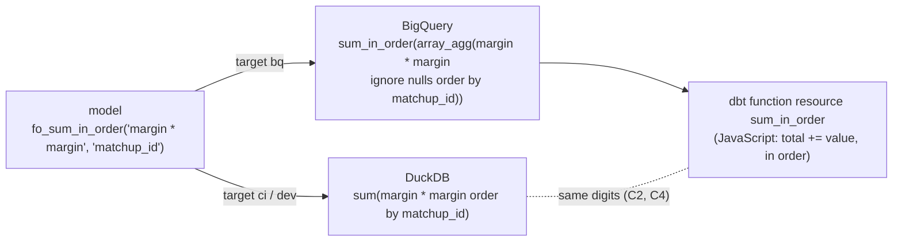

# A float aggregate is computed in its stated order on BigQuery too — design

Issue: #139 · Requirements: [requirements.md](requirements.md) · Tasks: [tasks.md](tasks.md)

## Overview

DuckDB states the order of a float aggregate inside its parentheses. BigQuery cannot, but
it can gather the values in that order, `array_agg(x ignore nulls order by k)`, and hand
the array to a function that adds them up one at a time. DuckDB's ordered `sum` is exactly
that left-to-right fold (C2), and its `corr` is a one-pass fold that ports line for line
(C3). Two JavaScript functions, `sum_in_order` and `corr_in_order`, become dbt function
resources on BigQuery, and the BigQuery forms of `fo_sum_in_order`, `fo_avg_in_order` and
`fo_corr_in_order` call them. Their DuckDB forms do not change, so nothing on DuckDB
moves. On BigQuery the function gives DuckDB's digits (C4) and bills nothing (C4, C5).

With the order stated on both warehouses, `compare_bigquery.py` drops its float
tolerance and holds every column exactly (ADR 0116), as it already does when it compares
BigQuery with itself.



## Claims ledger

Scripts are in [probes/](probes/). The DuckDB ones read a real-season warehouse
read-only, `data/warehouse_135.duckdb` (the real build of #135, 2026-10-24, local). The
BigQuery ones read no table: they run on literals or `generate_array`, in project
`fantasy-front-office-13`.

| # | Claim | Query (or script) | Result | Run on |
|---|---|---|---|---|
| C1 | The ordered float aggregates all go through the three macros: 35 calls in 13 models, and 4 in 2 singular tests | `grep -rhoE 'fo_(sum\|avg\|corr)_in_order\(' dbt/models` (and `dbt/tests`); `grep -rlE … dbt/models \| wc -l` | models: 32 `fo_sum_in_order`, 2 `fo_avg_in_order`, 1 `fo_corr_in_order`, in 13 files; tests: 4 `fo_sum_in_order` in 2 files | 2026-10-29 |
| C2 | DuckDB's ordered `sum` and `avg` are a plain left-to-right fold, and `avg` is that sum over the count | `probes/m1_sequential.py`: `standard_margin²` of `int_fantasy__reported_matchup_margins`, per (league, season, category), in matchup order, against Python `s += x` and `math.fsum` | 138 groups, 17,694 terms. `sum`: equal to the fold in 138, to `fsum` in 31. `avg`: equal to fold / n in 138, to fsum / n in 33 | 2026-10-29 |
| C3 | DuckDB's ordered `corr(y, x)` is one Welford pass (co-moment and both variances), then `covar_pop / (stddev_pop(x) · stddev_pop(y))` | `probes/m2_corr.py`: a Python port against `corr(y, total_value order by platform_player_id)` over `fct_player_season_value`, per (league, season, team), with y = 1.7 · total_value + sin(player id) | 96 of 96 groups equal. The port also gives both unit tests' expected values, 1.0000000000000002 and 0.14953126241169692 | 2026-10-29 |
| C4 | On BigQuery, a JavaScript function over `array_agg(… order by k)` gives DuckDB's digits | `probes/m4_bq_fold.py`: temp JS functions on literals, compared by `=` with the unit tests' expected values (BigQuery's `format('%.17g')` does not print exact digits: its native sum of 0.1, 0.2, 0.3 printed `…08`) | all 6 true: sum 0.6000000000000001 in order and 0.6 reversed; mean 241.5533333333333; corr 1.0000000000000002, 0.14953126241169692, and 0.14953126241169695 reversed. 0 bytes billed | 2026-10-29 |
| C5 | A fold costs seconds and no bytes at the scale of the largest caller | `probes/m5_bq_scale.py`: 200,000 groups × 12 terms from `generate_array`, cache off | JS fold: 3.8 s wall, 7.1 slot-s, 0 bytes. Native `sum`: 0.6 s, 0.7 slot-s, 0 bytes | 2026-10-29 |
| C6 | Exact decimals would change DuckDB's numbers or round differently | `probes/m3_decimal.py`: the 7,921 distinct `standard_margin²` values cast to `decimal(38, s)` against Python's exact `Decimal(v).quantize`; the 138 sums of C2 through the decimal | scale 9: cast exact for 7,921, but 138 of 138 sums change. Scale 18: cast exact for only 1,420 of 7,921, and 107 of 138 sums change | 2026-10-29 |
| C7 | DuckDB 1.5.5's edge cases, which the folds must give too | `duckdb.sql(...)` on `values` lists | `corr`: single pair NaN, zero variance NaN, no non-null pair NULL. `sum`/`avg` of only nulls: NULL. `sum` of a lone -0.0: 0.0. `inf + -inf`: NaN | 2026-10-29 |
| C8 | Two of the 13 models are views and one is ephemeral, so a temporary function in a `sql_header` cannot serve them all | `grep materialized=` over the 13 files | views: `rec_fantasy__category_wins_by_group`, `rec_espn__player_day_residuals`; ephemeral: `rec_espn__matchup_line_totals`; the other 10 tables | 2026-10-29 |
| C9 | dbt-bigquery 1.12.1 makes a JavaScript scalar function from a `.js` file in `functions/`, wraps the body in `r'''…'''`, and writes `DETERMINISTIC` for `volatility: deterministic` | `dbt/parser/base.py:233`, `include/bigquery/macros/materializations/functions/scalar_js.sql` and `scalar.sql:40` | as claimed; a JavaScript function is refused on an adapter other than BigQuery or Snowflake (`parser/manifest.py:1887`), hence disabled on DuckDB | 2026-10-29 |
| C10 | The largest caller folds about 2·10⁵ groups | `select count(*)` on the warehouse of C2 | `int_fantasy__candidate_day_values` 198,363 rows; `fct_player_category_value` 73,553; `rec_espn__matchup_stat_differences` 53,568; the rest under 21,000 | 2026-10-29 |
| C11 | Every float difference between the warehouses measured so far is in a sum BigQuery could not order, and none is in a column that is not a float, except the one the rounded lineup order fixed | #135 acceptance comment; #137 comparison 1; #130 task 15 and R5.5 | #135: largest relative difference 1.05e-11, in `day_value` and `option_value`, "both sums BigQuery cannot order"; no non-float difference. #137: 4 rows of `fct_lineup_decisions` before ADR 0104's rounding. #130: BigQuery against itself, 7 of 17 and 5,718 of 20,183 rows, floats only | 2026-10-12 to 2026-10-28 |
| C12 | This month's BigQuery billing leaves room for a full build | `INFORMATION_SCHEMA.JOBS_BY_USER`, October 2026 | 0.321 TiB billed of the free 1 TiB; a full build is about 56 GB (#137) | 2026-10-29 |
| C13 | The models and macros call no transcendental function on floats | `grep -rnwE '(ln\|log\|exp\|power\|pow\|log10)\(' dbt/models dbt/macros` | no match | 2026-10-29 |
| C14 | The folds give C7's edge cases on BigQuery, and an all-null `array_agg` is NULL there, not empty | `probes/m6_bq_edges.py`: temp JS functions on literals; a zero's sign read through `cast(… as string)`, because BigQuery raises on a float division by zero | all as C7: `corr` NaN for a single pair and a zero variance, NULL over no pairs; `sum` and the mean NULL over only nulls; `sum` of a lone -0.0 is 0; `inf + -inf` NaN. `array_agg(… ignore nulls)` over only nulls is NULL. 0 bytes billed | 2026-11-02 |

## Alternatives considered

| | A: JavaScript fold over an ordered array (chosen) | B: exact decimals | C: tolerance, with rounding at decisions | D: Python UDF fold |
|---|---|---|---|---|
| BigQuery repeats itself to the last digit | yes (C4) | yes, for sums; not `corr` | no (C11) | yes |
| BigQuery equals DuckDB to the last digit | yes (C2–C4) | only if both casts round alike, and they do not at scale 18 (C6) | no | yes |
| DuckDB's numbers unchanged | yes, same SQL | no: 138 of 138 sums move at scale 9 (C6) | yes | yes |
| `corr` covered | yes (C3) | no decimal form | n/a | yes |
| Billed | 0 bytes (C4, C5) | 0 | 0 | an image build and service time per build (ADR 0103) |
| New parts | 2 JS functions, a pytest tripwire | a scale decision, casts in 35 calls | a rule for where to round, applied by hand | a Python UDF and its image |

**A: JavaScript fold.** It reproduces DuckDB's result rather than approximating it, so
both of the issue's failures go away at once: BigQuery against DuckDB, and BigQuery
against itself. It is the one option that changes nothing on DuckDB. It costs a copy of
two DuckDB algorithms. They are small, and pytest checks the copy against DuckDB (R3.3).

**B: exact decimals.** A decimal sum is exact, so its order does not matter. But it
moves every DuckDB sum (C6), so it is a change to what the models compute. It needs a
scale, which trades range against digits. At scale 18 the two engines' casts from a
double cannot be trusted to agree, since DuckDB's is not even exact (C6). `corr` stays on
a tolerance. ADR 0053 already saw these costs, and the measurement confirms them.

**C: tolerance, with rounding at decisions.** This is the status quo, made official.
Rounding hides noise only where someone has thought to round. Two values either side of
a boundary still round apart. And BigQuery would never repeat itself (C11).

**D: Python UDF fold.** It would be correct, but it needs a container image and billed
service time (ADR 0103) for arithmetic JavaScript does inside the query.

## Decisions

| ADR | Decision | Status |
|---|---|---|
| [0115](../../adr/0115-on-bigquery-a-float-aggregate-is-a-javascript-fold-over-its-rows-in-the-stated-order.md) | On BigQuery, a float aggregate is a JavaScript fold over its rows in the stated order (amends 0046) | proposed (direction chosen by the owner 2026-10-29) |
| [0116](../../adr/0116-a-bigquery-build-is-held-to-duckdbs-exactly-floats-included.md) | A BigQuery build is held to DuckDB's exactly, floats included (supersedes 0053) | proposed (chosen by the owner 2026-10-29) |

## Detailed design

### Function resources

Two files in `dbt/functions/`, declared in `_functions.yml` beside `solve_lineup_period`,
each with `config: {enabled: "{{ target.type == 'bigquery' }}", volatility: deterministic}`
(C9). JavaScript numbers are IEEE doubles, as `FLOAT64` and DuckDB's `DOUBLE` are, and
IEEE 754 fixes `+`, `-`, `*` and `/`. It fixes `sqrt` too, but ECMAScript does not promise
`Math.sqrt` is correctly rounded, so that one is a tested assumption: it is the only
function `corr_in_order` calls, C3 and C4 agree with it, and only `corr` depends on it.

`sum_in_order(values array<float64>) returns float64`, in `sum_in_order.js`:

```js
if (values === null || values.length === 0) return null;
let total = 0;
for (const value of values) total += value;
return total;
```

Starting from 0 matches DuckDB on a lone -0.0, and on NaN and infinities (C7, C14). The
array never holds a null: BigQuery refuses a null element, and `ignore nulls` leaves them
out before the call. Over only nulls the array itself is NULL (C14), hence the first test.

`corr_in_order(pairs array<struct<y float64, x float64>>) returns float64`, in
`corr_in_order.js`. The pairs where both are non-null are folded in order, as C3's port
does:

```js
let n = 0, meanX = 0, meanY = 0, coMoment = 0, squaresX = 0, squaresY = 0;
for (const pair of pairs || []) {
  if (pair.y === null || pair.x === null) continue;
  n += 1;
  const dx = pair.x - meanX;
  meanX += dx / n;
  meanY += (pair.y - meanY) / n;
  coMoment += dx * (pair.y - meanY);
  // ... Welford's update of squaresX and squaresY, each with its own running mean
}
if (n === 0) return null;
return (coMoment / n) / (Math.sqrt(squaresX / n) * Math.sqrt(squaresY / n));
```

The variances keep their own running means, as DuckDB's `stddev_pop` states do, and C3's
port shows that order of operations. A single pair or a zero variance gives 0 / 0, NaN, as
DuckDB does (C7, C14), with no special case. The exact statement order is the build's to copy
from C3's port, which equals DuckDB, and R3.3 holds it.

Neither file may contain `'''` or a Jinja delimiter (R3.4, C9).

### The macros

Only the BigQuery forms in `dbt/macros/portable.sql` change:

| Macro | BigQuery form |
|---|---|
| `fo_sum_in_order(e, k)` | `{{ function('sum_in_order') }}(array_agg(e ignore nulls order by k))` |
| `fo_avg_in_order(e, k)` | the same, `/ nullif(count(e), 0)` |
| `fo_corr_in_order(y, x, k)` | `{{ function('corr_in_order') }}(array_agg(struct(y as y, x as x) order by k))` |

`count(e)` counts the non-null values the array holds, so the mean is DuckDB's `s / n`
(C2). With none, `nullif` makes it null over null rather than a division by zero. A
struct is never null, so the `corr` array needs no `ignore nulls`; a pair with a null side
is skipped in the function, as DuckDB skips it.

`function()` in a dispatched macro is how `fo_solve_lineup_period` reaches its function,
so dbt records the dependency for each model that calls the macro on BigQuery. The comment
above the macros says what each form computes and why the two agree (R5.1).

An expression that is `INT64` on BigQuery (a sum of whole counts) does not fit
`array<float64>`. The `--empty` run fails on it (R1.6). Such a sum does not need an order
on either warehouse, so task 1 lists any it finds. With the owner's approval of the list,
the fix is ADR 0046's `order-exempt:` plain `sum`, which keeps both warehouses' types.
It is not a cast, which would make the BigQuery result a float where DuckDB's is an
integer. The DuckDB SQL of such a call changes, the one exception to R1.4, so its model's
DuckDB build is compared with `main`'s and must be identical (R1.6).

### `compare_bigquery.py`

`compare(..., exact_floats=…)` already compares floats exactly, as multisets, for
`--bq-against-bq`. That becomes the only path (R2.1). The float tolerance, the constants,
the unique-key join, `FloatColumn` and their report are removed (R2.2). Columns are still
compared by kind, JSON and nested columns are still skipped, views are still queried, and
GROUPS still print the team-days that differ.

When a relation differs, the report gives its counts each way. Then, for each float
column, it compares the rows on that column together with every non-float column, the
other floats left out, and names the column if they still differ (R2.3). The non-float
columns stand in for the row's identity, so a value that moved to another row is caught.
A column compared alone would miss that: swapped values make equal multisets
(design review F1). Where the non-float columns do not tell two rows apart, a float that
moved between them is not named. The relation still fails, which is the verdict, and
only the pointer to the column is lost.

### Order keys

ADR 0046 asks for an order on columns unique within the group. Where it is not, the
result depends on how ties are sorted, on DuckDB and on BigQuery alike. Task 1 reads each
of the 39 calls and records its key and why it is unique. One call orders by the value
itself (`fo_sum_in_order('difference', 'difference')` in
`rec_espn__player_day_residuals`): tied rows there hold equal values, so their order
changes nothing. No runtime check is added (no-go).

## Test strategy

| Requirement | Test | Catches |
|---|---|---|
| R1.1, R1.2, R1.3 | the four unit tests of #139, unchanged, on both warehouses | a fold in another order, or a BigQuery form that still drops the order |
| R3.2 | new unit tests on `int_fantasy__category_scales` (an all-null group, a null among values, one value) and `rec_fantasy__category_wins_by_group` (a single pair, a zero variance, a null side) | a fold that counts nulls, divides by zero, or gives null where DuckDB gives NaN |
| R1.4 | `dbt compile` on `ci` and `dev`, diffed against `main`'s compile | a DuckDB form that changed |
| R1.5, R1.6 | the BigQuery `--empty` run and unit tests, suffixed (AGENTS.md) | a missing function dependency; an `INT64` call |
| R3.3 | `ingestion/tests/test_float_folds.py`: DuckDB's ordered `sum`, `avg`, `corr` against a Python mirror of the JavaScript, on seeded random groups | a DuckDB upgrade that changes the algorithm the JavaScript copies |
| R3.4 | a pytest over `dbt/functions/*.js`, beside the solver file's | a body that breaks BigQuery's quoting or dbt's rendering |
| R2.1–R2.3 | `compare_bigquery.py`'s pytest, extended: a float differing in the last digit fails, and the report names its column; two rows' float values swapped fail, and the column is named | a tolerance left in, or a float difference reported without its column |
| R4.1, R4.2 | the real-season comparisons (task 9) | anything else that makes a float differ |

The R3.3 pytest's mirror is a third copy of the algorithm, in Python. It checks DuckDB in
CI, which never runs BigQuery. The JavaScript is checked against DuckDB by the unit tests
on BigQuery, run by hand (ADR 0110).

## Risks

- A float column differs for a cause outside the 35 aggregates: a function the two
  engines compute differently, or a cast. The models call no `ln`, `log`, `exp` or `power`
  (C13), and `sqrt` is correctly rounded on both. Unlikely (C11 saw none), high impact on
  R4.1. Mitigation: R4.3 traces it and
  takes it to the owner. ADR 0116 says what such a column would need.
- A DuckDB upgrade changes its `sum`, `avg` or `corr` algorithm. Low likelihood, and
  caught in CI by R3.3.
- BigQuery's JavaScript engine changes floating-point behaviour. Very low: IEEE `+` and
  `/` are fixed by the standard, and `Math.sqrt`, the one call that is not promised, is
  used only by `corr_in_order`. Caught by the next by-hand unit-test run.
- An ordered `array_agg` of a large group exceeds BigQuery's row size limit (100 MB).
  The largest group is a few hundred values (C2, C10). Accepted.

## Open questions

- Whether a BigQuery build then equals DuckDB's exactly in every float column is the
  hypothesis R4.1 tests, not a claim. C11 supports it: no measured difference had another
  cause.
- Whether any of the 39 calls sums an `INT64` on BigQuery. The spike's port compiled them
  with native `sum`, which accepts either type, so none has been seen. Task 1 and the
  `--empty` run find out.

## Review log

| Source | Finding | Resolution |
|---|---|---|
| design-review | F1 (P1): a float column compared as a multiset alone misses values swapped between rows | R2.3 and the design compare each float with every non-float column; a swapped-values test added to task 9 |
| design-review | F2 (P1): the fix for an `INT64` call changes DuckDB's SQL, against R1.4 | R1.4 and the no-go name it as the one exception, approved by the owner per call. R1.6 requires that model's DuckDB build to equal `main`'s |
| design-review | F3 (P2): "every column" in R2.1, while JSON and nested columns are skipped | R2.1 says every scalar column, and keeps the JSON and nested exclusion as it is today |
| design-review | F4 (P2): per-model bytes parity is asserted, not measured | the bytes row is a recorded measurement beside free dry runs of `main`'s SQL, with any increase explained; not a gate |

## Amendments
