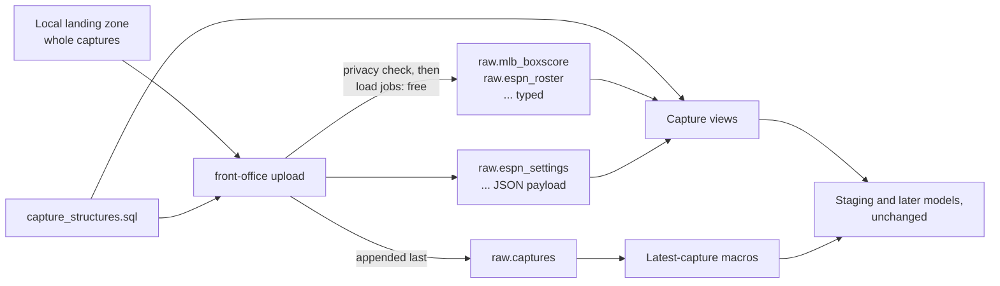

# The production raw loader for BigQuery — design

Issue: #140 · Requirements: [requirements.md](requirements.md) · Tasks: [tasks.md](tasks.md)

## Overview

`front-office upload` lists the local landing zone, finds which captures each BigQuery table
lacks, checks them, and appends them by free load jobs. There is one table per endpoint. The four
heavy endpoints are stored as the structure their capture view already declares, so BigQuery bills
only the columns a model reads and no query parses JSON documents; the other seven hold a JSON
`payload` in a table of their own. `raw.captures` becomes the manifest on both warehouses. The
capture views keep their columns, so no model's SQL changes. Measured on the real season, seven
staging models and two views return identical rows, for a fraction of the bytes and time.



## Claims ledger

Every byte count is from `run_results.json` or a job's statistics. The compiled SQL of each model
was run with its capture view replaced by the probe's table, and the result compared with the
populated `staging_139` table both ways by `except distinct` over `to_json_string`, row counts
beside it. Probes: [boxscore_shapes.py](probes/boxscore_shapes.py),
[other_endpoints.py](probes/other_endpoints.py). C1, C3, C5 and C9 are
[billing_by_endpoint.py](probes/billing_by_endpoint.py); C11's ratios are
[projected_sizes.py](probes/projected_sizes.py). The scratch dataset is deleted.

| # | Claim | Query (or script) | Result | Run on |
|---|---|---|---|---|
| C1 | A full build bills 56.07 GB | sum of `bytes_billed`, `data/139/run_results_build1.json`, and #139's task 12 | 56.07 GB over 579 nodes: models 25.70, tests 30.37 | 2026-11-02 |
| C2 | Daily, that passes the free terabyte | catalog API: Analysis 6.25 USD/TiB after 1 TiB; 30 × 56.07 GB | 1.53 TiB a month, 3.31 USD over | 2026-11-02 |
| C3 | Most of it is reading raw | `depends_on` in the manifest, followed through views and ephemerals to `raw.api_responses` | 47.83 GB reads raw: boxscore 15.42 (3 nodes), roster 3.98 (4), matchup_days 0.44 (5), schedule 9.02 (27), small endpoints or keys only 18.96 (144). No raw: 8.24 (396) | 2026-11-02 |
| C4 | A boxscore model bills every payload | as C1 | `stg_mlb__pitching_game_logs` 6.98 GB, 486.5 s; `stg_mlb__batting_game_logs` 6.98 GB, 1,031.5 s | 2026-11-02 |
| C5 | A shared table costs a small endpoint a block | as C1, for nodes that read only small endpoints | `unique_stg_idmap__players_espn_player_id` 0.32 GB, over a 4.3 MB landed document; 34 nodes bill about 0.3 GB | 2026-11-02 |
| C6 | Typed columns give identical rows, far cheaper | probes, real run | Billed / wall, base rows = probe rows, 0 rows differ either way: pitching 0.287 GB / 5 s (168,036); batting 0.439 GB / 6 s (437,977); `roster_entries` 0.042 / 4 s (437,227); `roster_entry_slots` 0.345 / 4 s (2,348,532); `player_game_stats` 1.369 / 6 s (6,182,774); `matchup_days` 0.021 / 2 s (1,469); `matchup_player_lines` 0.178 / 6 s (1,529,854); `stg_mlb__games` 0.026 / 3 s (20,342). Stored: boxscore 0.634 GB, roster 1.408, matchup_days 0.176, schedule 0.025: 2.244 GB in all | 2026-11-02 |
| C7 | The one value that needed changing is the league id | probe's count of changed leaves | `id` held as a number, stored as text: 1,471 roster and 1,469 matchup_days captures, one per capture; no `BIGINT` leaf held anything else; schedule and boxscore: none | 2026-11-02 |
| C8 | A small endpoint alone bills near the floor | probe, real run | `stg_idmap__players` 0.010 GB, 3 s, 3,656 rows, 0 differ; the view's readers billed 0.32 GB (C5) | 2026-11-02 |
| C9 | **Estimate:** a full build on the chosen shape | C1 with the measured models from C6; other raw readers less a 0.32 GB floor, at least 10.5 MB; the boxscore test at its whole 0.634 GB table; the rest unchanged | 14.45 GB: 0.39 TiB a month at one build a day, 76 builds in the free terabyte. An estimate; the build measures it | 2026-11-02 |
| C10 | The landing zone equals the uploaded table, by key and path | [keys_equal.py](probes/keys_equal.py): `LandingZone.iter_landed` against the table read API | 44,426 each; 0 only landed, 0 only stored, 0 repeated | 2026-11-02 |
| C11 | Projecting payloads inside one table does less | probe, real run; ratios from 400 sampled files | Boxscore payload 22% of whole: 1.554 GB, 269 s and 855 s wall, 0 rows differ; roster 69%, matchup_days 36%, schedule 99% | 2026-11-02 |
| C12 | Prices that bear on the choice | Cloud Billing catalog API | Load jobs bill nothing. BigQuery logical storage 0.02 USD/GiB-month after 10 GiB. Cloud Storage Standard regional 0.02 USD/GiB-month after 5 GiB | 2026-11-02 |
| C13 | The external table is worse | #130, task 16 | 2.84 GB against 0.83 GB for the same model on the spike's data, 3.4 times | 2026-10-12 |

Estimates per option in the matrix use C9's method and are marked `~`.

## Alternatives considered

| | **D: table per endpoint, heavy typed (chosen)** | A: one table, as today, append | B: one table, projected JSON | C: table per endpoint, whole JSON | E: JSON landing, dbt incremental typed | F: bucket, external table |
|---|---|---|---|---|---|---|
| Full build billed | ~14.5 GB (C9) | 56.07 GB (C1) | ~43 GB | ~31 GB | ~15 GB, plus each new capture's parse | above A (C13) |
| Daily, a month | 0.39 TiB, free | 1.53 TiB, 3.31 USD | 1.17 TiB, ~1.05 USD | 0.84 TiB, free, no room for much else | ~0.4 TiB, free | over the terabyte, plus bucket |
| Boxscore model | 0.29 to 0.44 GB, 5 to 6 s (C6) | 6.98 GB, up to 1,032 s | 1.55 GB, up to 855 s (C11) | ~7 GB, slow | as D | 2.84 GB per the spike's smaller data |
| Raw stored | ~2.3 GB | 8.44 GB | ~4 GB | 8.44 GB | ~10.7 GB, past the free tier | bucket and nothing native |
| Adding a declared field | rebuild one table: free | nothing | re-upload one endpoint: free | nothing | full refresh, ~7 GB billed | nothing |
| Parsing lives in | Python at load, and SQL for fixtures | SQL | SQL | SQL | SQL only | SQL |
| Loader interprets | shape only | no | shape only | no | no | no |
| dbt changes | capture views | none | none | capture views | new incremental models, BigQuery-only | capture views |

**D wins** on the driver that matters: it is the only option well inside the free terabyte that
also stops parsing JSON documents, which is where the time goes. The billing target falls out of
two independent causes, which is why each lesser option fixes one and not the other: a shared table
bills blocks of its neighbours (C5), and a JSON column bills whole however little is read (C4).
ADR 0070 anticipated the shape: "it can give BigQuery typed tables, and the capture views'
BigQuery variant then changes in one place."

**A** keeps the loader to its narrow brief, and leaves a daily build over budget's comfort at
3.31 USD of 5 USD, growing about 1/8 a season. **B** needs no dbt change, and leaves most of the
floor and most of the time. **C** removes the floor and no parse. **E** is the serious rival: the
loader would stay uninterpreting and SQL the one place that parses, with the JSON kept for reparse.
It loses on running two copies past the free storage tier, on billing a parse per field added, and
on merge logic and BigQuery-only models that DuckDB and CI never run. **F** was measured at 3.4
times the native table.

Three smaller decisions have ADRs of their own: where parsing happens (E's question), whether a
bucket belongs here, and how an append stays correct.

## Decisions

| ADR | Decision | Status |
|---|---|---|
| [0117](../../adr/0117-bigquery-holds-one-raw-table-per-endpoint-the-heavy-four-typed.md) | One raw table per endpoint, the heavy four typed by their declared structure, and `raw.captures` the manifest on both warehouses | proposed |
| [0118](../../adr/0118-the-loader-reduces-a-heavy-capture-to-its-declared-structure.md) | The loader reduces a heavy capture to its declared structure, read from the one macro file | proposed |
| [0119](../../adr/0119-the-loader-reads-a-local-landing-zone-and-no-bucket-is-created.md) | The loader reads a local landing zone by free load jobs, and no bucket is created | proposed |
| [0120](../../adr/0120-an-upload-appends-what-each-table-lacks-and-a-changed-structure-rebuilds-one-table.md) | An upload appends what each table lacks, and a changed structure rebuilds one table | proposed |

## Detailed design

### Modules

- `ingestion/src/front_office/upload.py` (new): what may go up, what it becomes, the checks. No
  import of `google.*` at module level, so `--dry-run`, the tests and mypy need no `bigquery` group.
  The privacy check, projections and account-id logic move here from the spike script unchanged in
  meaning, with their tests.
- `ingestion/src/front_office/capture_structures.py` (new): reads the structures out of
  `dbt/macros/capture_structures.sql`, returns `{(source, endpoint): structure}`, gives the
  BigQuery schema and reduces a payload. A test holds that exactly the four pairs parse.
- `make_fixtures.py`'s `ESPN_TEAM_FIELDS` and `ESPN_TRANSACTION_MESSAGE_FIELDS` move to the package;
  the fixtures import them from there.
- `cli.py` gains `upload`, thin as its other commands.

### Tables

Key columns on every table: `source`, `endpoint`, `request_path`, `request_key`, `fetched_at`,
`file_path` as `STRING`, `partitions` as `JSON`, as today. All `NULLABLE` except list fields, which
are `REPEATED` by R1.2. No clustering and no partitioning: each table holds one endpoint and every
model reads every season.

| Table | Columns beyond the keys |
|---|---|
| `raw.mlb_boxscore` | `teams` |
| `raw.espn_roster` | `id`, `seasonId`, `teams` |
| `raw.espn_matchup_days` | `id`, `seasonId`, `scoringPeriodId`, `schedule` |
| `raw.mlb_schedule` | `dates` |
| `raw.espn_matchups`, `espn_settings`, `espn_pro_schedule`, `espn_teams`, `espn_transactions`, `mlb_players`, `idmap_player_id_map` | `payload` |
| `raw.captures` | none: the manifest |

### dbt

`bigquery__fo_captures` selects the key columns and either the structure's top-level fields or
`payload` from `source('raw', source_name ~ '_' ~ endpoint)`. Its parse goes; the parse stays in
`bigquery__fo_json_parse_value`, used by `fo_capture_rows` fixtures, which is why unit tests on
BigQuery remain the check on column types. `fo_capture_keys` stops being dispatched and is
`source('raw', 'captures')`. The unit tests' conditional manifest input becomes that source on both
warehouses, `test_dbt_portable_sql_rule.py` and `AGENTS.md` following. `api_responses` leaves the
sources. The freshness filters in `_raw_feeds__sources.yml` already name `raw.captures`, which now
exists on BigQuery too; their hand-written BigQuery form (ADR 0050) is untouched by this.

### One run

```text
0. Take the upload's own lock, <root>.upload.lock. Held: stop, nothing sent.
1. List committed captures through LandingZone: keys and file_path from sidecars. Refuse a bad stamp
   or a collision among them.
2. Read each table's keys and file_path (tabledata.list, selected fields: free) and its schema.
   Refuse a typed table whose schema differs from its structure (R4.1). Refuse a key whose stored
   file_path differs from the landing zone's (R3.5).
3. For each endpoint, new = captures absent from its table. Build each row, and check it.
   Check every transaction id against all account ids (R6.4). Any hit: send nothing, exit 1.
4. --dry-run stops here (and skips step 2 with no --project, saying so). Confirm billing. One load job per endpoint with new rows, WRITE_APPEND,
   from a temporary newline-delimited file under the gitignored data/ directory.
5. Append to raw.captures whatever it lacks, for endpoints whose table now holds them.
6. Check row counts, file_path sets, and that each key appears once (R4.3).
```

Load jobs are atomic per table and free. Step 3 builds and checks before step 4 sends anything, so a
hit leaves BigQuery untouched. A run stopped between jobs leaves each table consistent in itself and
the manifest behind, never ahead; the next run's step 2 finds what each lacks. A boxscore row present
with no manifest row is not read by the latest-capture macros, and the next run lists it.

The lock stops two runs on one machine. Two machines at once are not designed for, since one holds
the landing zone (ADR 0119); their duplicate keys would fail step 6, and a rebuild of the table
clears them.

### A hit on a row already sent

A transaction's id goes up if it equals no known account (ADR 0094). An account first seen later
can match an id already in BigQuery; R6.4 finds that, and none has happened. A check cannot undo a
send, so the loader stops and stays stopped (R6.7), which also holds back any schedule that runs a
build after a successful upload. The remedy is the owner's, because it touches what has left the
machine: drop `raw.espn_transactions` and decide what that id's row becomes, then `--rebuild`. A
dropped table stays recoverable through BigQuery's time travel for seven days and is then gone, so
the message says so.

### Reduction, against the view

`reduce(payload, structure)` keeps declared fields only and gives each what the view gives: BigQuery's
`lax_int64` and `lax_string` semantics for the values seen (C7), `[]` for a missing list or map, since
`REPEATED` holds no null. A missing object is `null` where the view gives a struct of nulls; a field
read from either is null, and C6's models saw no difference. A map's key order follows the document
(`json_keys` sorts on BigQuery, and no model may rely on order: `fo_map_values`).

What does not fit is a refusal, never a quiet default (R5.3). `[]` and `null` are only for a field
that is absent or null: a `teams` that arrives as an object rather than a list would otherwise lose
every row of a capture without a word. BigQuery would reject a whole job for a `null` in a list.
None of these has happened on the probe's captures (C7), so each should be seen rather than guessed at.

## Test strategy

Each test says what it catches. Everything below but the last three rows runs in CI, with no
BigQuery: the client is a fake holding rows and schemas.

| Requirement | Test | Catches |
|---|---|---|
| R1.2, R5.1 | Structures parse from the macro file, exactly four pairs, and give the expected schema | A macro edit the loader misreads |
| R1.2, R5.2, R5.4 | The fixtures' heavy captures through `reduce`, compared with DuckDB's own `read_json` of the same file with the same structure | The loader's reading drifting from a real parse of the structure |
| R5.3 | A string in a `BIGINT`, an object in a `VARCHAR`, a `null` in a list, and an object where a list is declared and a list where an object and where a map are: nothing sent, path named, value absent | A silent wrong value, a capture's rows lost to an empty list, or a value in a message |
| R3.1, R3.3 | Fake client: second run sends nothing; a run stopped after each step, then rerun, ends with the same tables and no duplicate | Duplicates after a crash |
| R3.4 | Fake client: a failed endpoint job leaves its captures out of the manifest | A manifest naming what a table lacks |
| R3.8 | A second run with the lock held: nothing read, nothing sent; a fetch holding the writer lock does not block it | Two runs appending the same rows |
| R3.5, R3.6 | Collision in the zone; collision against a stored row; bad stamp: nothing sent, both files named | A silent first-wins |
| R4.1, R4.2 | A changed structure refuses append, names the command; rebuild replaces with one job | Rows of two shapes, or a half-replaced table |
| R4.3, R4.4 | A wrong count, a missing path, a key stored twice with one path, a changed value: non-zero | A short load that looks fine |
| R6.1 to R6.4 | The spike's privacy tests moved over and run against typed rows; a forbidden key as a map key is a hit; a transaction id equal to an account first seen in a later capture is a hit on a run with nothing new, says the row is already uploaded, and repeats on every run (R6.7) | The check reading the row after keys became values |
| R6.5, R6.6, R7.1 | No project or no billing: no job; `--dry-run` without a project imports no `google` and says the remote checks did not run | A job by accident |
| R2.1, R2.3 | `test_dbt_portable_sql_rule.py` holds manifest inputs to the one source name; a grep test that `api_responses` is gone | A leftover reader |
| R2.2, R2.4 | Unit tests on BigQuery | A view's type differing from the fixture's parse |
| Expected values | The real build and `compare_bigquery.py` | A row or digit changed |
| R4.4, row counts | `front-office upload --verify` against the real tables | A value altered on the way |

## Risks

- **Python and SQL both read a structure.** The fixture test compares Python with DuckDB's reading,
  and the real comparison holds Python against DuckDB's build. BigQuery's parse stays only for
  fixtures, held by unit tests there. Accepted.
- **A rebuild is by hand when a field is added**, and a build before it fails on the missing column.
  Loud, and free to fix (R4.1).
- **A JSON `null` leaf stored as SQL `NULL`.** The view would have given JSON `null`. Seen on no
  model in C6; the full comparison covers the rest.
- **The whole-build figure is an estimate.** The acceptance stops at 20 GB, and the shortfall is
  reported rather than chased.
- **A window with no populated raw tables.** The old table stays until the comparison passes.

## Open questions

- Whether sub-project 4 will want the landing zone in a bucket, or Cloud Run writing straight into
  these tables. It is that project's, and depends on ADR 0054's question of whole captures in the
  cloud. The loader's boundary is `LandingZone`, so it can change at that seam.
- The build's real billing, against C9's estimate. The build measures it.
- Whether the tests' 8.24 GB over materialized tables could fall. Not raw's, and not needed for the
  goal.

## Review log

| Source | Finding | Resolution |
|---|---|---|
| design-review | F1: a present value of the wrong container type became an empty list | R5.3 widened; the reduction refuses it; a test per container |
| design-review | F2: a retrospective privacy hit stopped a run and left the row up | R6.7 and *A hit on a row already sent*; remedy stays the owner's |
| design-review | F3: two runs could append the same rows, and a path-set check would not see it | R3.8's lock; R4.3 now checks each key appears once |
| design-review | F4: C10 compared counts only | Replaced by a comparison of key and path both ways, `keys_equal.py`: 0 differ |
| design-review | F5: a credential-free dry run cannot do the remote checks | R7.1 states what each form checks, and it says so when it runs |

## Amendments

### 2026-11-03: a number in a text leaf is stored only when whole

R5.4 says a number in a `VARCHAR` leaf is stored as its text, as `lax_string` reads it. The case
seen is the league `id`, a whole number (C7), and for it Python's digits, `lax_string` and DuckDB's
`read_json` agree; `test_capture_structures.py` holds the three to that on a written file. A
fraction has no such agreement: DuckDB keeps the text as written in the file, and once Python has
parsed the payload that text is gone (`0.10` and `0.1` are one float). A boolean is no number. So
the reduction stores a whole number's digits, and refuses a fraction or a boolean in a `VARCHAR`
leaf under R5.3, naming the path. None has been seen; one that appears is seen, not guessed at,
as the design's *Reduction, against the view* asks. No goal, no-go or requirement's intent moves.
