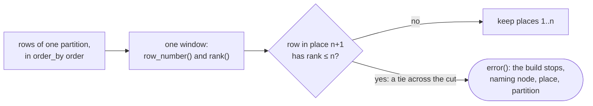

# A tie where a ranking cuts stops the build — design

Issue: #141 · Requirements: [requirements.md](requirements.md) · Tasks: [tasks.md](tasks.md)

## Overview

Every ranking in the project goes through one of two macros, and both check their own
order on the rows they rank, in every build, on both warehouses. `fo_keep_first` keeps the
first *n* rows of each partition. Over the same window, it compares the `rank()` of the row
in place *n* + 1 with *n*. If that row ranks no lower than place *n*, the order ties across
the cut, and the row's `CASE` branch calls `error()`, which stops the build with the node
and the partition named. `fo_row_number` does the same for a numbering that uses every
place. `fo_latest_by_entity` keeps its signature and renders through `fo_keep_first`, so
its eight callers change nothing. A text rule in pytest, built like the ordered-aggregate
rule, fails any `row_number`, `lag`, `lead` or other order-dependent window written outside
the two macros, unless a `tie-exempt:` comment says why ties change nothing there.

The check runs on the data that has the ties: the real season, on DuckDB and on BigQuery.
The CI fixtures have none (C6), so a pytest proves the macros over literal rows instead
(R4.1).



## Claims ledger

Run read-only on `data/build201/branch/warehouse.duckdb`, a real-season build of `main` after
#205 (2026-10-27; #206 and #207 changed no model), and on `dbt/ci.duckdb` (CI fixtures,
2026-10-28). The compiled SQL is from `dbt compile` against each. Scripts are in the spec
PR's comment on #141.

| # | Claim | Query (or script) | Result | Run on |
|---|---|---|---|---|
| C1 | The rankings in models and macros, and how each is written | `grep -rnE "fo_latest_by_entity\|row_number\|qualify\|lag\|lead\|first_value\|last_value\|nth_value\|ntile\|rank\|array_agg"` over `dbt/models`, `dbt/macros`, `dbt/tests` | 8 callers of `fo_latest_by_entity`; 1 raw `qualify` in `fo_espn_latest_paths` (used by 14 staging models); 12 hand-written `row_number`s in 7 models; 2 `lag`s; no other order-dependent window; no ranking in `dbt/tests` except through the macros. *Call sites* below lists them | 2026-10-28 |
| C2 | On the real season, one staging step ties at its cut: `stg_idmap__players` | probe 1: each model's compiled SQL with its last `qualify row_number() … = 1` replaced by `qualify rank() … = 1 and count(*) over (partition by <partition>, <order keys>) > 1`, then counted | `stg_idmap__players` 2 tied rows (2 distinct); `stg_espn__matchups`, `stg_espn__transactions`, `stg_mlb__batting_game_logs`, `stg_mlb__games`, `stg_mlb__pitching_game_logs`, `stg_mlb__players` 0 | 2026-10-28 |
| C3 | The tie is ESPN id 5214984 listed as two MLB players, both `P`, in one capture. Ohtani's two rows (P, DH) share one MLB id and are split by `POS` | the model's rows before its `qualify`, for ESPN ids with more than one row | 39832 → 660271 Shohei Ohtani, LAD, `DH` and `P`; 5214984 → 804636 Jonah Tong, NYM, `P`, and 543859 Michael Tonkin, `N/A`, `P`; all `fetched_at` 2026-09-26 17:36:54 | 2026-10-28 |
| C4 | DuckDB keeps Tong today. The league rostered him, and his MLB name is unambiguous in both seasons | `stg_idmap__players` for 5214984; `stg_espn__roster_entries` for 5214984; distinct MLB ids named "Jonah Tong" in the batting and pitching logs per season; `player_resolution` of rows for 5214984 | 804636; league 73677: 22 entries in 2025 (periods 162–183), 29 in 2026 (55–180), all "Jonah Tong"; 2025: 1 id (804636), 2026: 1 id (804636); resolution `crosswalk_id` in 51 rows of `int_fantasy__roster_days`, 42 of `int_fantasy__started_player_days`, 2 of `dim_player_league_seasons` | 2026-10-28 |
| C5 | Of the hand-written rankings, only `dim_players.latest_game_names` ties at its cut on the real season, and its tied rows are identical | probe 2: rows whose partition and order keys repeat (at rank 1 for a keep-first), on each ranking's input CTE cut from the compiled SQL | `latest_game_names` 514 rows tied at rank 1 on all of (`mlbam_player_id`, `official_date`, `game_pk`, `player_name`), i.e. identical in the two columns kept; `listed_players`, `dim_player_league_seasons`, `int_fantasy__player_crosswalk`, `fct_lineup_decisions.ranked_missed_starts`, `fct_transaction_impact.next_adds`, both replacement pools, `pitching_order` 0 | 2026-10-28 |
| C6 | The CI fixtures hold no tie at any cut | probes 1 and 2 on `dbt/ci.duckdb` with SQL compiled for `--target ci --vars '{anonymize: true}'` | 0 in every step | 2026-10-28 |
| C7 | Probe 1 finds a tie when one exists | probe 1 on `stg_mlb__games` with its order cut to `fetched_at desc` (the order before #130's tie-break) | 890 tied rows | 2026-10-28 |
| C8 | On DuckDB, `CASE … THEN error(…)` in a `QUALIFY` raises only for a tie at the cut, and `row_number()` and `rank()` over one window are one WINDOW operator | DuckDB 1.5.5, literal rows (1,a,1), (1,b,1), (1,c,2), (2,d,1), (2,e,1), (2,f,3): keep 1 and keep 2; `explain` | keep 1: raised, "tie at the cut in partition 1"; keep 2: (1,a), (1,b), (2,d), (2,e), no error; plan: one `WINDOW` with both projections | 2026-10-28 |
| C9 | The check costs nothing measurable on the real season and changes no row | each model's compiled SQL as is and with the check, `count(*)` and `sum(hash(columns(*)))`, 4 threads, twice each, `/usr/bin/time` | `stg_mlb__games`: 20,342 rows, hashes equal, 0.6–1.5 s and 1.16–1.24 GB plain, 0.6–1.1 s and 1.24–1.26 GB checked. `stg_espn__transactions`: 737 rows, equal, 0.1 s, 0.21 GB both. `stg_mlb__batting_game_logs`: 437,977 rows, equal, 10.5–11.6 s and 1.47–1.54 GB plain, 10.5–10.8 s and 1.50–1.52 GB checked. `stg_idmap__players` checked: raised | 2026-10-28 |
| C10 | BigQuery raises in the same place and returns the same rows otherwise | `bq query` in the project of `FO_BQ_PROJECT`, the C8 rows as a literal `unnest`, keep 1 and keep 2 | keep 1: "tie at the cut in partition 1"; keep 2: (1,a), (1,b), (2,d), (2,e); no table read | 2026-10-28 |
| C11 | `dbt show --inline --target ci` reports the raised error | the C8 form over (1,1), (1,1) | `Runtime Error … Invalid Input Error: tie at the cut` | 2026-10-28 |
| C12 | `file_path` is unique in the manifest, so it totals any order of captures | `count(*)`, `count(distinct file_path)` of `raw.captures` | 44,426 and 44,426 | 2026-10-28 |
| C13 | The spike's two ties and their fixes | #130, comment of tasks 10 to 15 | 9 games listed twice under one `game_pk`, and one two-way player, broken differently by the two warehouses; fixed by the owner's tie-breaks, after which 29 of 29 relations matched | 2026-10-12 |
| C14 | `stg_idmap__players` has 3,657 rows, one per ESPN id and one per MLB id | `count(*)`, `count(distinct espn_player_id)`, `count(distinct mlbam_player_id)` | 3,657, 3,657, 3,657 | 2026-10-28 |
| C15 | `missed_start_rank` does not reach `fct_lineup_decisions`' output | `grep -n missed_start_rank` in the model, its YAML and `docs/examples` | lines 306 (defined) and 315 (`where missed_start_rank = 1`) only; the final select reads `platform_player_id`, `lineup_slot` and `option_value` of `missed_starts` | 2026-10-28 |

## Alternatives considered

| | A — the macro checks its own window (chosen) | B — a generic test on each step's input | C — a gate that probes compiled SQL | D — compare the two warehouses |
|---|---|---|---|---|
| Runs on the data that has ties (real season) | yes, every build, both warehouses | only if the input is a relation | only where it is pointed; CI has no ties (C6) | yes, once per comparison |
| Covers staging steps whose input is a CTE over parsed captures | yes | no: needs a relation per input, and parsed captures read twice (ADR 0102) | yes | yes |
| Finds a tie both warehouses break alike | yes | yes | yes | no |
| Cost | none measured (C9) | an extra relation and scan per step | a second build's worth of queries | a BigQuery build, billed |
| Can warn instead of failing | no | yes | yes | n/a |

**A — the macro checks its own window.** It checks where the cut is made, on whatever rows
reach it. The extra `rank()` shares the window's sort (C8, C9). The price is that a tie
stops the whole build instead of failing one test, and a harmless tie (identical rows) has
to be removed first. ADR 0107.

**B — a generic data test on each step's input.** This is the issue's own proposal. dbt
tests read relations, but eight of the steps rank a CTE over parsed captures. Exposing each
input as a view would parse the captures twice, which ADR 0102 forbids for heavy endpoints.
It loses on coverage.

**C — a gate script that rewrites each compiled `qualify` into a probe and runs it**, as
this spec's ledger did. On the fixtures it finds nothing, because the fixtures hold no tie
(C6). Pointed at the real season, it is a local check someone has to remember to run. It
loses because it does not run where ties occur.

**D — compare DuckDB with BigQuery**, as the spike did. It found the first two ties (C13),
but only because the warehouses broke them differently. A tie both break alike, or one
added since the last comparison, goes unseen, and every comparison bills a build.

For the scope of the text rule, the options were the keep-one-row steps alone, as the
issue's title says, or every order-dependent window. ADR 0108 chooses every
order-dependent window. A cut at *n* rows (the replacement pools) and a numbering
(`earlier_pitching_days`) go wrong on a tie in the same way.

## Decisions

| ADR | Decision | Status |
|---|---|---|
| [0107](../../adr/0107-a-tie-where-a-ranking-cuts-stops-the-build.md) | A ranking checks its own window and raises on a tie across its cut, in every build | proposed |
| [0108](../../adr/0108-every-order-dependent-window-goes-through-a-checked-macro.md) | Every order-dependent window goes through `fo_keep_first` or `fo_row_number`, held by a text rule with a `tie-exempt:` escape | proposed |
| [0109](../../adr/0109-an-espn-id-the-id-map-gives-two-mlb-players-is-not-mapped.md) | An ESPN id the id map gives to two MLB players is left out of the map; the name fallback decides | proposed |

## Detailed design

### The macros (`dbt/macros/latest_by_entity.sql`)

```sql

    
        (partition by {{ partition_by | join(', ') }} order by {{ order_by }})
    
    qualify case
        when row_number() over {{ over }} = ({{ rows }}) + 1
            and rank() over {{ over }} <= ({{ rows }})
            then error({{ fo_tie_message(partition_by, rows) }})
        
        -- R1.1a: a cut that varies within a partition is no cut.
        when min({{ rows }}) over (<partition only>) <> max({{ rows }}) over (<partition only>)
            then error({{ fo_tie_message(partition_by, rows) }})
        
        else row_number() over {{ over }} <= ({{ rows }})
    end



    case
        when rank() over (…same window…) <> row_number() over (…same window…)
            then error({{ fo_tie_message(partition_by, 'rank() over (…)') }})
        else row_number() over (…same window…)
    end



    {{ fo_keep_first(partition_by, order_by, 1) }}

```

- **The message**, from `fo_tie_message`, is
  `concat('<node>: rows tie for place ', cast(<place> as <text>), ' in (', <keys>, ')')`.
  `<node>` is `this.identifier` (`inline` when `this` is undefined, as under `dbt show
  --inline`). `<place>` is `rows` for `fo_keep_first`, and the tied row's `rank()` for
  `fo_row_number`. `<keys>` is each partition expression as `coalesce(cast(k as
  {{ fo_type_text() }}), 'null')`, joined with `', '`. With no partition, it is the words
  `whole input`. The keys are ids: league, season, game, player. No name, so the message
  carries nothing rule 2 forbids, and in CI only anonymized ids.
- **One SQL text for both warehouses** (R1.6). DuckDB's and BigQuery's `error(string)` take
  the same arguments (C8, C10), so there is no dispatch. A `QUALIFY` in BigQuery already
  works at every call site.
- **`rows` is wrapped in parentheses**, so `league_seasons.team_count` or `2` both work.
  When it is not an integer literal, the macro also checks that it has one value per
  partition (R1.1a). That takes a second window, partitioned and unordered. Its one caller
  today, the replacement pools, ranks a few hundred players per league-season, so the cost
  is not measured. With no partition, the window is the whole input.
- The window is written out each time, not named: a model's own `window` clause would
  collide, and DuckDB merges identical windows (C8).

### Call sites (R2.3)

| Where | Now | After |
|---|---|---|
| 8 callers of `fo_latest_by_entity` (`stg_mlb__games`, `…__players`, `…__batting_game_logs`, `…__pitching_game_logs`, `stg_idmap__players`, `stg_espn__transactions`, `…__matchups`, `int_fantasy__player_crosswalk`) | `fo_latest_by_entity(…)` | unchanged text, checked through the macro |
| `fo_espn_latest_paths` (macro) | `qualify row_number() … = 1` | `fo_keep_first([...], 'keys.fetched_at desc, keys.file_path desc')` |
| `stg_idmap__players.latest` | `qualify row_number() over (order by fetched_at desc) = 1` | `fo_keep_first([], 'fetched_at desc, file_path desc')` (R3.2) |
| `stg_idmap__players`, final step | order `fetched_at desc, POS desc` | ADR 0109's rule (R3.1) |
| `dim_players.listed_players` | `qualify row_number() … = 1` | `fo_keep_first(['mlbam_player_id'], 'season desc')` |
| `dim_players.latest_game_names` | `qualify row_number() … = 1` over `game_names` | `select distinct` in `game_names` (R3.3), then `fo_keep_first` with the same order |
| `dim_players.platform_names` | `qualify row_number() … = 1` | `fo_keep_first`, same order |
| `dim_player_league_seasons`, `latest_rank` | `row_number()` column, then `where latest_rank = 1` in the outer select | `fo_keep_first` in the inner select's `qualify`, with the outer `where` and the column removed |
| `fct_lineup_decisions.ranked_missed_starts` + `missed_starts` | `row_number()` column, filtered in the next CTE | one CTE `missed_starts` with `fo_keep_first`, same order (the `round(…, 12)` stays, ADR 0104). `missed_start_rank` is read only by `missed_starts`' filter (C15), so it goes |
| `fct_transaction_impact.next_adds` | `row_number()` as `add_rank`, `where add_rank = 1` | `fo_keep_first` in the inner select, same order |
| `int_fantasy__replacement_levels`, `batting_pool` and the pitching pool | `qualify row_number() … <= league_seasons.team_count` | `fo_keep_first([...], '<same order>', 'league_seasons.team_count')` |
| `int_fantasy__replacement_levels`, `earlier_pitching_days` | `row_number() over pitching_order - 1` | `fo_row_number(['mlbam_player_id', 'season'], 'game_date') - 1` |
| same model, two `lag(…) over pitching_order` | `lag` | unchanged, each with its own comment directly above it: `-- tie-exempt: pitching_order is the window fo_row_number checks on earlier_pitching_days, in the same select` (two comments) |
| `int_fantasy__reported_matchup_margins`, two `position` rankings for medians, in separate CTEs | `row_number()` | unchanged, each with its own comment directly above it: `-- tie-exempt: only the values at the middle positions are read, and tied rows hold equal values` (two comments) |

### The text rule (R2.1, R2.2)

`ingestion/tests/test_dbt_tie_rule.py` reuses the comment and string blanking of
`test_dbt_ordered_aggregate_rule.py`. If the blanking is copied rather than imported,
task 4 moves it to a shared helper module in `ingestion/tests/`. It scans `models`,
`tests` and `macros`. It skips the bodies of `fo_keep_first` and `fo_row_number`, matched
like `_UNORDERED_BY_NECESSITY`. It flags `\b(row_number|lag|lead|first_value|last_value|
nth_value|ntile)\s*\(` unless a `tie-exempt:` comment with a letter or digit after it is
on the line or the comment lines directly above. Its own unit tests show a flagged call,
an exempted one, a marker in a string, a marker with no reason, and a call inside the
macro bodies.

### The id map (R3.1, ADR 0109)

ADR 0109, chosen by the owner: an ESPN id that the newest capture lists with more than one
distinct MLB id is not mapped at all. The `mapped` CTE drops such ids, then the existing
`fo_latest_by_entity` keeps one row per ESPN id, ordered `fetched_at desc, POS desc`, for
Ohtani's P and DH. The ambiguity is found by a `group by` on the narrow `(espn id, MLB id)`
pairs after the header's unnest. The payload is already projected away in `header`, so
rule 1 holds. Tong is then resolved by the crosswalk's unambiguous-name fallback to the
same MLB id (C4).

## Test strategy

| Requirement | Test | Catches |
|---|---|---|
| R1.1–R1.6, R1.1a | `ingestion/tests/test_tie_macros.py`: `dbt show --inline --target ci` cases of R4.1 | a macro that keeps the wrong rows, raises on a tie that does not cross the cut, misses one that does, or loses the node or keys from the message |
| R1.6, R4.2 | the same cases on BigQuery over literal rows, once, recorded on #141 | a BigQuery form that differs |
| R2.1, R2.2 | `ingestion/tests/test_dbt_tie_rule.py` and its own cases | a ranking written outside the macros, or an exemption without a reason |
| R2.3 | the rule test passing after the conversion, and failing on `main` before it | a call site left unconverted |
| R3.1, R3.4 | dbt unit test `idmap_players_an_espn_id_given_two_mlb_ids_is_not_mapped` (R3.4's three cases) | a rule fitted to 5214984, one that counts older captures, or one that drops Ohtani |
| R3.1, R5.3 | the real-season build, and the build with R3.1's rule removed on a copy | an id-map rule that does not resolve the real tie |
| R4.3 | `dbt run --empty` then `dbt test` on the `bigquery` selector, suffixed | SQL BigQuery refuses |
| R5.1, R5.2 | real-season build and warehouse comparison against `main` | a changed winner anywhere, or a tie the probes missed |

## Risks

- **A new tie in a future capture stops a daily run** (sub-project 4). The id map is
  refetched, and MLB changes listings. Likely over seasons, and that is the point: the
  alternative is a silently different row. The error names the step and the partition,
  so the fix is a stated tie-break. Accepted in ADR 0107.
- **An existing dbt unit test feeds a full tie** to a converted step and now errors.
  Possible, and it would mean the test asserted a winner chosen by row order. The gates on
  the build branch show it. The fix is in the test's rows, not the macro.
- **The plan-shapes gate (ADR 0102) reads the checked window as a new shape.** Unlikely,
  since it is the same WINDOW operator (C8). The gates on the build branch show it.
- **BigQuery evaluates `error()` outside its `CASE` branch** in a larger plan. Its docs make
  no promise about when `ERROR` is evaluated beyond the branch. C10 shows the literal case
  only. Low: a false error fails loudly, never silently. R4.2 and the `--empty` run are what
  is checked. A BigQuery build of real rows is not required (no-go).

## Open questions

- The follow-up issue for null ordering (requirements, no-gos) is drafted in task 10. The
  number of nullable ascending order keys is not measured.

## Review log

| Source | Finding | Resolution |
|---|---|---|
| design-review | F1 (P1): R3.1 is a general rule checked only on 5214984 and never against an older conflicting capture | Added R3.4, a dbt unit test with a new ambiguous id, Ohtani's form and an older conflicting capture, as task 6, before the model change |
| design-review | F2: the rule needs a comment beside each exempted call, and four calls are exempted, not two | *Call sites* now gives one comment per call (four), and task 5 says four |
| design-review | F3: a `rows` that varies within a partition leaves no single cut, and a tie can pass (reproduced by the reviewer on DuckDB) | Added R1.1a: the macro raises when a non-literal `rows` differs within a partition, with an R4.1 case; the design states the second window it takes |

## Amendments
