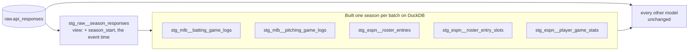

# Staging built a season at a time — design

Issue: #143 · Requirements: [requirements.md](requirements.md) · Tasks: [tasks.md](tasks.md)

## Overview

Five staging models parse one large payload per game or per scoring period, and DuckDB
holds a whole run's parsed payloads at once. They become *incremental* models with the
*microbatch* strategy: dbt runs the model's SQL once per calendar year, each time
reading only that season's captures, and replaces that year's rows in the table. Peak
memory is then one season's, however many seasons are loaded. Every build redoes every
season, so the table is always what a build in one piece would give. On BigQuery, which
has no such limit and bills per query, the same models stay plain tables.

Three dbt terms, new to this project:

- An **incremental** model is a table dbt adds to or replaces part of on each run,
  instead of dropping and recreating it. `--full-refresh` drops and recreates it.
- **Microbatch** is an incremental strategy that splits a run into time windows
  (*batches*). For each batch dbt filters every input that declares an **event time**
  (a date or timestamp column named in the input's config) to that window, runs the
  model's SQL, deletes the window's rows from the table and inserts the new ones.
- **Lookback** is how many batches before the current one an ordinary run redoes.



## Claims ledger

All on 2026-10-12, on `data/warehouse_143.duckdb`: `main` at e8ee62d, every committed
capture loaded, which is 2025 and 2026 with rosters and boxscores. The machine has 29 GB
of RAM; DuckDB's default limit there is 23.9 GiB. Peak is maximum resident set size from
`/usr/bin/time -v`. Logs are kept under `.review/logs/` (gitignored).

| # | Claim | Query (or script) | Result |
|---|---|---|---|
| C1 | What is loaded | captures, megabytes of payload text and largest payload, by endpoint and season | roster 2025: 188, 300 MB, 1.67 MB · roster 2026: 182, 441 MB, 2.52 MB · boxscore 2025: 2,430, 462 MB · boxscore 2026: 4,950 (two per game), 944 MB |
| C2 | The two-season run passes on `main` at the default limit, barely | `dbt run`, 4 dbt threads | 56 of 56; 54.6 s; peak 23.1 GB |
| C3 | dbt's thread count is not the lever | the same, `--threads 1` | 56 of 56; 61.2 s; peak 22.3 GB |
| C4 | Under 16 GB the roster models fail | `memory_limit` 16 GB, defaults otherwise | out of memory in `stg_espn__roster_entries`, `…_entry_slots`, `…player_game_stats`; boxscore models pass |
| C5 | Under 12 GB and 8 GB the boxscore models fail too, at sixteen DuckDB threads | `memory_limit` 12 GB; 8 GB | 12 GB: the five and one more out of memory · 8 GB: the five |
| C6 | On one DuckDB thread the boxscore models fit in 4 GB and the roster models do not fit in 8 | one dbt thread, one DuckDB thread, `memory_limit` 8 GB; 4 GB | both: the three roster models out of memory, everything else passes, the boxscore models among them; 48.8 s and 40.6 s |
| C7 | The roster models need between 12 and 16 GB for two seasons, on one thread | the three roster models alone, one thread, `memory_limit` 12, 16, 20 GB | 12 GB: all three out of memory at 11.1 GiB · 16 GB: pass, peak 12.5 GB · 20 GB: pass, peak 13.2 GB |
| C8 | **Microbatch on `stg_espn__roster_entries`** (a prototype, not kept): the model through a view with `season_start`, `batch_size` year | built under 12 GB on one thread, and at the defaults; then `EXCEPT ALL` both ways against the table built in one piece | *Works:* 113,059 rows against 113,059; 0 rows only in either; 57,406 for 2025 and 55,653 for 2026. Peak 7.2 GB and 7.4 GB, against C7's 12.5. The 2025 batch took 1.0 to 3.1 s, 2026 1.7 to 4.3 s. *Where it behaves badly:* under 8 GB the 2026 batch ran out of memory at 7.4 GiB, so one season of this league's rosters needs about 8 GB and no less; and the seven empty years each ran as a batch of a few hundredths of a second |
| C9 | An ordinary run with a lookback of 20 redoes every batch and duplicates nothing | the prototype run again without `--full-refresh` | 21 batches, 2006 to 2026; 113,059 rows after it; 3 s |
| C10 | The boxscore models' rows are the same a season at a time | each model's compiled query on one season's captures, and on both (#83's branch, same captures) | pitching 20,868 + 20,800 = 41,668 · batting 50,887 + 51,708 = 102,595; peak 6.1 to 6.6 GB a season against 12.1 to 12.3 GB for both |
| C11 | dbt-duckdb implements microbatch as delete and insert on the event time, and refuses a `unique_key` with it | the adapter's `microbatch.sql`, version 1.11.0 | as stated, in its comments and code |
| C12 | A BigQuery build bills a boxscore model for the endpoint's whole payload | #130's measurements | 827 MB for each boxscore model; a `JSON` column is billed whole |

Not measured, and so not claimed: memory with three or more seasons; the whole build
with all five models batched; how dbt unit-tests a microbatch model. They are R3, the
build's first task and R5.1.

## Alternatives considered

| | A — dbt microbatch, a season a batch (chosen) | B — one DuckDB thread and a memory limit | C — a season loop of our own | D — parse payloads when they are loaded | E — build the heavy step elsewhere |
|---|---|---|---|---|---|
| What it is | five models become incremental; dbt runs one query per year | settings in the profile | a macro or script that runs each model's SQL per season into its table | `load.py` writes narrower tables, or one raw table per season | a bigger machine, or these models on BigQuery only |
| Peak memory with eight seasons | one season's: about 8 GB a roster model (C8) | not measured; two seasons already need 12 to 16 GB for a roster model on one thread (C7), and it does not spill (C6) | one season's (C10) | small | not the laptop's problem |
| Rows identical to today | yes, measured (C8) | yes | yes (C10) | yes if done right; a second place that interprets payloads | yes |
| Stays one `dbt build` | yes | yes | no: a step before dbt, or SQL dbt does not see as a model's | yes | no for BigQuery; yes for a machine |
| Lineage, tests, docs | dbt's own | unchanged | the loop is outside them | staging loses the raw payload as its input | unchanged |
| New concepts to carry | incremental, microbatch, event time, full refresh | none | a mechanism of our own to maintain | a schema in ingestion | a cloud dependency for a local build |
| Fails how | a batched model reading an input with no event time inserts every season per batch (R1.5 guards) | at the next season | quietly, if the loop and the model drift | when ESPN changes a payload, at load time | when offline, or on cost |
| Cost on BigQuery | none if these stay tables there (ADR 0060) | none | none | none | per build |

**A — microbatch.** The dbt-native form of "one season at a time". Measured to give the
same rows at about 60% of the memory with two seasons, and its peak does not depend on
how many seasons are loaded, because each batch is its own query over one season's
captures.

**B — one thread and a limit.** No code. It loses on C6 and C7: the roster models do not
spill to disk, so a limit only decides where they fail, and on one thread two seasons
already need more than 12 GB. It postpones the wall by a season at most.

**C — a loop of our own.** Same memory as A. It loses because dbt would no longer run the
SQL it documents and tests: either the build gains a step before `dbt build`, or the
loop lives in hooks that the lineage does not show.

**D — parse at load.** The most memory-efficient. It loses on the project's first rule
for ingestion, fetch and save only, never interpret: the payload's meaning would be
decided twice, once in Python at load and once in SQL.

**E — elsewhere.** BigQuery built these models in one piece in #130. It loses for now
because 26 models are not ported (#135) and a local build that needs the cloud is a
different project; a bigger machine moves the wall without removing it.

## Decisions

| ADR | Decision | Status |
|---|---|---|
| [0058](../../adr/0058-a-model-that-parses-a-payload-per-game-or-day-is-built-a-season-at-a-time.md) | A staging model that parses one payload per game or per scoring period is built a season at a time, by dbt's microbatch | accepted |
| [0059](../../adr/0059-every-build-rebuilds-every-season.md) | Every build rebuilds every season of a batched model | accepted |
| [0060](../../adr/0060-batched-models-are-plain-tables-on-bigquery.md) | A batched model is a plain table on BigQuery | accepted |

Settled by the owner on 2026-10-12, going through the decisions: tier L; the three ADRs
above, option 1 of each; and the names, `season_start` (a date) for the column and
`stg_raw__season_responses` for the view.

## Detailed design

### `stg_raw__season_responses`

A view in `dbt/models/staging/`, with `event_time: season_start` in its config.

| Column | Meaning |
|---|---|
| every column of `raw.api_responses` | unchanged |
| `season_start` | the first of January of the season in the capture's `partitions`; null where a capture has none |

The date is built by a new dispatched macro, `fo_year_start(year)`: `make_date(y, 1, 1)`
on DuckDB, `date(y, 1, 1)` on BigQuery. A capture with no season (the id map) has a null
event time and is in no batch; no batched model reads one.

It is a view, so it costs nothing until read, and a filter on `season_start`, `source`
and `endpoint` reaches the raw table.

### The two macros that choose a capture

`fo_espn_latest(endpoint, extra_partition)` and `fo_latest_boxscore_responses()` read
`source('raw', 'api_responses')` today. Each gains an argument, `relation`, defaulting to
that source, and the five models pass `ref('stg_raw__season_responses')`. Models that
are not batched call them as they do now and compile to the same SQL.

`fo_latest_boxscore_responses` joins the raw rows to themselves to find each game's
newest capture; both sides take the relation, so within a batch both see one season.

The MLB models do not call that macro themselves: they call `fo_boxscore_players()`,
which calls it. So `fo_boxscore_players` gains the same `relation` argument and passes
it down, and both macros select `season_start` from the relation and carry it out: the
latest-capture macro beside `payload`, `fetched_at` and `request_key`, and the players
macro through its `sides` and unnested rows, where it sits beside small columns only
(rule 1 is about the payload, which is already dropped there). The ESPN models carry it
the same way from `fo_espn_latest` through `header` and the unnesting CTEs to the final
SELECT. With the default relation neither macro selects the column, so an unbatched
caller compiles to what it compiles to today.

### The five models

Each keeps its SQL and gains:

```sql
{{ config(
    materialized=('incremental' if target.type == 'duckdb' else 'table'),
    incremental_strategy=('microbatch' if target.type == 'duckdb' else none),
    event_time='season_start',
    batch_size='year',
    begin=var('first_season_start'),
    lookback=fo_batches_back_to_first_season(),
    concurrent_batches=false,
    on_schema_change='fail'
) }}
```

and one column in its final SELECT, `season_start`, carried from the capture it read.
The ESPN models already carry `season`; the MLB game logs do not, and take the date from
the boxscore capture's partitions.

- `first_season_start` is a project variable, `'2018-01-01'`: the earliest season this
  league has data for (R1.4).
- `fo_batches_back_to_first_season()` returns the number of years from that date to the
  run's year, so that an ordinary run redoes every batch (ADR 0059, R1.3). It is computed,
  not a constant like the prototype's 20, so no empty batch from before the first season
  is run.
- `concurrent_batches=false`: dbt may otherwise run the batches between the first and the
  last at the same time, and several seasons in memory at once is the thing being
  avoided (R1.7). The prototype's batches ran in turn; the setting makes that a rule and
  not an accident of the adapter.
- `on_schema_change='fail'`: a warehouse built before this change holds the five as plain
  tables without `season_start`. dbt would treat such a table as the incremental target
  and, by default, ignore the missing column. With `fail` the first ordinary build stops
  and says so, and the person runs `dbt build --full-refresh` once (R1.8). CI and the
  gates build from an empty file and are not affected.
- No `unique_key`: the adapter refuses one with microbatch (C11). A batch is replaced
  whole, so a row whose capture was superseded cannot survive (R2.4).
- A column added to one of these later needs `--full-refresh`, as a seed's does; dbt's
  default for an incremental model is to ignore a new column. AGENTS.md says so (R5.6).

### BigQuery

On the `bq` target the same files are tables (ADR 0060): the config's two conditionals
make them so, and `event_time`, `batch_size`, `begin` and `lookback` are ignored by a
table. The view and `fo_year_start` are ported under ADR 0051 and join the slice, which
becomes 31 models, and the comparison 30 relations: the view is compared like any other. `season_start` is a `DATE` on both.

### What does not change

Every other model; ingestion; the raw table; the fixtures; the profile's threads.

## Test strategy

| Requirement | Test | Catches |
|---|---|---|
| R1.1, R1.5, R1.7, R5.4 | pytest over the manifest: exactly the five are microbatch on `ci`, with `concurrent_batches` false and `on_schema_change` `fail`; each input is a seed or declares an event time | a sixth model batched by accident; an input with no event time, which would multiply rows |
| R1.2, R5.2 | dbt unit tests on the view | a season mapped to the wrong date; a capture with no season landing in a batch |
| R1.3, R2.3 | the build run twice on the real warehouse and compared | a batch not redone; rows duplicated |
| R1.8 | an ordinary build run on a copy of the warehouse made from `main` | an old table kept, or inserted into without its new column |
| R2.1, R2.2 | `compare_warehouses.py` against a copy made from `main`, real and CI | any row moved by the change |
| R2.4 | a dbt unit test per kind (boxscore, roster): two captures of one entity in one season, the newer wins; plus the existing newest-snapshot tests, unchanged | a superseded capture's rows surviving |
| R3.1 | the real build under `memory_limit` 16 GB, set for the run by an environment variable the profile does not commit | the change not bounding memory |
| R4 | spec 0130's empty build, real build and comparison on BigQuery | a construct BigQuery refuses; a table that differs |
| R5.1 | the five models' existing unit tests | a test weakened to pass |
| R5.3 | singular test | a row filed under the wrong season |

## Risks

- **dbt cannot unit-test a microbatch model, or tests it without the batch filter** —
  possible; it decides whether R5.1 holds — the build's first task tries one existing
  unit test on a batched model and stops for the owner if it cannot run.
- **The whole build still needs more than 16 GB** because dbt runs four models at once
  and three roster batches of 7 GB overlap — likely enough to plan for — R3.3 stops for
  the owner with the measurements; the options then are the order of the models or a
  smaller batch, neither chosen here.
- **An input without an event time multiplies rows** — would be silent in dbt — R1.5's
  pytest, and the unique tests the models already have.
- **A season's rosters grow past what one batch can hold** — 2026's payloads are half as
  large again as 2025's (C1) — accepted; the batch could become a month if a capture's
  date were in the raw table, which it is not.
- **A run in January redoes a batch for a year with no season yet** — harmless: an empty
  batch.
- **Contracts and `on_schema_change`** — these five have no enforced contract today — if
  one gains one, the contract and the incremental schema must agree; noted in AGENTS.md.

## Open questions

- **Why does DuckDB hold every payload at once?** Probably because a few hundred rows of
  megabyte payloads sit in one vector, which no thread count or limit can split. Not
  established, and the design does not rest on it.
- **Does memory stay flat with a third season?** By construction each batch is one
  season's query; shown for two. #83's landing will show it for eight, and R3.1 is the
  check that can be made now.
- **How does the tenant-isolation script, which builds each league-season alone, behave
  with batched models?** The build's gates answer it.
- **Does sqlfluff's dbt templater render a microbatch model?** The gates answer it.

## Review log

| Source | Finding | Resolution |
|---|---|---|
| design-review | F1 (P0): dbt can run a model's batches concurrently, which defeats one season at a time | Confirmed as a gap. `concurrent_batches=false` is in the config, R1.7 requires it, the pytest asserts it. The suggested measurement over three seasons cannot be made: two are landed and this spec lands nothing; said under *Rabbit holes* and *Open questions*, and measured by #83 |
| design-review | F2 (P1): no migration for the five existing tables, which lack `season_start` | Confirmed. `on_schema_change='fail'` and R1.8: the first build after the change is a full refresh, an ordinary one fails saying so, and it is tested on a copy of the old warehouse |
| design-review | F3 (P1): the `relation` argument did not reach the MLB models, which go through `fo_boxscore_players`, and `season_start` was dropped before the final SELECT | Confirmed. The design now passes the relation through that macro and carries the column through both macro chains and the roster CTEs |
| design-review | F4 (P2): the comparison stays at 29 relations though the slice gains a view | Confirmed. 30 of 30, and the slice's counts say 9 views |

## Amendments

### 2026-10-12 — R3.1 and R2.1 are measured with `dbt run` and `dbt test`, not one `dbt build`

Found by task 1. The requirements say "the real `dbt build`"; the ledger's runs (C2 to C7)
were `dbt run`, and on the real warehouse with both seasons the difference matters:

- On `main`, `dbt test` over the two seasons gives 5 failing tests and 1 warning, all on
  2025's rows and all #83's to settle: `not_null_stg_espn__roster_entry_slots_lineup_slot`
  and `…_is_starting_slot` (78 rows each), `fct_matchup_results_match_espn` (8),
  `fct_matchup_scores_match_espn` (31), `rec_espn__player_day_differences_are_registered`
  (9); the warning is `stg_idmap__covers_started_players` (17).
- `dbt build` skips every model downstream of a failing test, so a `dbt build` here stops
  at the roster models' tests and measures the memory of half a build.

So, with no requirement's meaning changed: R3.1 is `dbt run` under 16 GB, every model
built, which is the run C4 showed failing on `main`; R2.1 compares warehouses made by
`dbt run`; and `dbt test` on the new warehouse must give the same 5 failures and 1 warning
as on `main`, no more and no fewer. No test is changed for it. Once #83 settles 2025 the
real `dbt build` is one command again; CI's already is.

The baseline of task 1 was built with `dbt run --threads 1`: at four threads `main` ran
out of memory twice at the default limit and was once killed by the kernel (peak 23.5 GB),
where C2 had passed at 23.1 GB. The rows do not depend on the thread count.

### 2026-10-12 — the view is not compared by the tenant-isolation check

Answers the open question on that script. `stg_raw__season_responses` is the raw table
under another name: it holds every league's captures, and its `file_path` names the
landing directory of the build that loaded it, which the check makes anew for each
build. No single build's rows can equal the combined build's (5 differing pairs, every
row of each). The raw table itself is in a schema the check does not read. The view joins
`dim_players` in `EXEMPT_FROM_ROW_COMPARISON`, with the reason beside it; the models that
read it are compared as before, and R5.5's 0 differing pairs is over them.

### 2026-10-12 — a capture filed under a season later than the run's year

Found before task 6, on `fixtures/landing_multi`, and decided by the owner the same day.
dbt runs a microbatch model's batches up to the run's own calendar year and no further,
and has no model config for the end of the window, only the flags `--event-time-start`
and `--event-time-end`. A capture filed under a later season is therefore in no batch:
with a prototype of the batched pitching model, the fixtures' 2027 boxscore was loaded
and none of its rows were in the table, with no error. R1.3's "to the current one" said
as much without saying what it costs.

The real warehouse is not affected: a roster or a boxscore of a season is not captured
before that year begins. The tenant-isolation fixtures are: two of their league-seasons
are 2027.

- A singular test, `stg__batched_models_hold_every_season_with_captures`, fails when one
  of the five holds no row for a season its endpoint has captures of. The loss cannot be
  silent, whatever causes it; the same test catches a season earlier than
  `first_season_start`.
- `scripts/check_tenant_isolation.py` passes its builds an explicit window covering its
  fixtures' seasons. No fixture file changes, and an ordinary build stays one command.

### 2026-10-12 — the comparison scripts leave JSON columns out

Found by task 8 and decided by the owner the same day. The design had the view "compared
like any other". It carries every raw payload, 2.7 GB for two seasons, and
`compare_warehouses.py` on two warehouses that both hold it was killed by the kernel in
its `EXCEPT ALL`. On BigQuery the same comparison would download the payloads, be billed
for them whole, and fail on text BigQuery rewrites.

`warehouse_diff.py`, `compare_warehouses.py` and `compare_bigquery_slice.py` do not
compare a column whose type is JSON, and print its name under its relation; the scratch
copy holds none of its values, and BigQuery's is not read back. The view is the only
relation with such columns (`payload`, `partitions`). It is compared on the rest,
`season_start` among them, so R4.3 stays 30 of 30 relations. The real comparison of two
new warehouses then takes 12 s and 3.2 GB.
