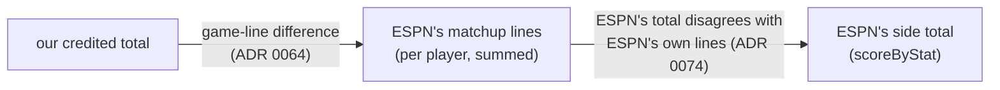

# ESPN's own matchup lines settle the past seasons' differences — design

Issue: #147 · Requirements: [requirements.md](requirements.md) · Tasks: [tasks.md](tasks.md)

## Overview

ESPN keeps two records of a matchup: the side total that decided it (`scoreByStat`) and,
for every player, the line it credited him with (`rosterForMatchupPeriod`). The models
compare our totals with the first and our player-days with ESPN's daily game lines. Every
matchup-days capture already landed also holds the second, and it is not read. A new
staging model, `stg_espn__matchup_player_lines`, reads it. The reconciliation then
completes a chain it now has only half of:



A count is `explained_by_game_lines` when the whole difference is the first link, as
today, and `explained_by_matchup_lines` when the first link takes our value to ESPN's
lines exactly and the second link is where ESPN's total parts from them. Four smaller
rules close the remaining gaps:

- A two-part count (SVHD) takes its components' game-line differences (ADR 0075).
- 2018's rates, whose components ESPN's totals do not report, recover them from ESPN's
  rate (ADR 0076).
- A player-day difference is accounted for when ESPN's matchup lines carry it (ADR 0077).
- A winner that flips only through explained category results is explained (ADR 0078).

Byes leave the category comparison. What none of these can explain, a crediting rule the
models lack, still fails: #152's start limit is the case (C17).

## Claims ledger

Every statement this spec makes about the data, with the query that showed it. Read-only
on `data/warehouse_150.duckdb` (#150's eight-season build) and on the landed captures in
`data/raw/`, on `main` at `d927c00`. "Lines" means the sum, per side and stat, of ESPN's
`rosterForMatchupPeriod` lines with `statSourceId` 0, read from the capture of each
matchup period's last scoring period (`rfmp_all.py`). "gl" is the side's game-line
difference (`rec_espn__player_day_differences`, status `difference`). The scripts and SQL
are posted with the run evidence on #147.

| # | Claim | Query (or script) | Result | Run on |
|---|---|---|---|---|
| C1 | A matchup-days capture holds, for each side of the matchups of the period asked, ESPN's per-player matchup lines | keys of `schedule[].home/away` in captures; `rosterForMatchupPeriod.entries[]`, over 120 sampled captures | sides carry `rosterForMatchupPeriod` beside `rosterForCurrentScoringPeriod` and `cumulativeScore`; 28,222 entries, each with exactly one stat line, `statSourceId` 0, `statSplitTypeId` 5, `scoringPeriodId` 0 (`id` `05null`); `lineupSlotId` is 0 on every entry; only the period's matchups carry it | 2026-10-16 |
| C2 | Every played side of every covered league-season has lines | `rfmp_all.py` over the captures of each period's last scoring period; sides of `stg_espn__matchup_category_results` in `stg_espn__matchups` with no lines | 187,680 side-stat rows; 0 played sides without lines | 2026-10-16 |
| C3 | For a finished season, a period's lines are the whole period whichever of its days is asked | lines of 2023, matchup 1, from the captures of scoring periods 1, 4 and 7 | identical: team 9 87 H and 243 outs, team 3 77 H and 218 outs, in all three | 2026-10-16 |
| C4 | The lines are what ESPN credited, after its own rules | 2023, matchup 110, team 7 (#152's case): lines against ESPN's total and ours | lines = ESPN's total on all six stats (GS 13, outs 255, P_H 76, P_BB 27, ER 42, K 71); ours has Fried's uncredited start | 2026-10-16 |
| C5 | Our value less its game-line difference equals the lines on every count row, with one exception | `c5.sql`: count rows (not byes) where \|ours − gl − lines\| > 1e-9, gl of SVHD as the sum of SV's and HLD's (R2.4), a stat absent from a side's lines taken as 0 | 43,906 rows; 6 fail, all 2023, m110, t7 (GS, outs, P_H, P_BB, ER, K: #152). Stats absent from the lines are zero on both ends (316 in 2018, 61 in later seasons) | 2026-10-16 |
| C6 | Where ESPN's total differs from ours, it is either the game lines' doing or ESPN's total disagreeing with its own lines | `cmp.sql`: by status, lines against ESPN's total, ours, and ours − gl | `match`: lines = ESPN's total on all. `explained_by_game_lines` (424): lines = ESPN's total and = ours − gl on all. `unexplained` counts (74): lines = ours − gl ≠ ESPN's total on 66; = ESPN's total on 7 (#152's 6, and 2023 m24's SVHD); 2024 m83's SVHD the eighth. 2026 `registered` (31): lines = ours on the 8 `espn_total_inconsistent` rows, = ESPN's total on the 23 `official_scoring_change` rows | 2026-10-16 |
| C7 | Seven of the inconsistent sides played a suspended MLB game | sides of C6's 66 whose starters played a game with `stg_mlb__games.resumed_from` not null on its official date; that game's lines for the side's starters | 2018 m37 t4, m38 t1, m38 t3, m39 t9, m40 t2, m41 t10 (game 530032, 2018-05-15) and m125 t1 (531387, 2018-08-28). In 530032, team 4's pitching line is 3 outs, 2 K, 1 L, 3 hits and walks, 2 ER, exactly its deficit; team 10's is 3 outs, 2 K, 1 SV, exactly its deficit. The batting deficits are part of those games' lines | 2026-10-16 |
| C8 | The other inconsistent sides sit at the end of the season | the 25 remaining sides of C6 (21) and 2026's register (4), by matchup period | 23 of 25 in the last four matchup periods of their season (2019 to 2026); 2 in 2018 (m1 t8, m56 t11). Cause not established | 2026-10-16 |
| C9 | The two SVHD values follow from their components' game lines | 2023 m24 t7 and 2024 m83 t1: SVHD, SV and HLD rows | 2023: SVHD ours 2, ESPN 3; SV `explained_by_game_lines` with gl −1, HLD gl 0. 2024: SVHD ours 2, ESPN 1; SV gl +1. SVHD's gl is null today, since it is not one component | 2026-10-16 |
| C10 | With R3.1's shift, every unexplained rate outside 2018 follows its components except #152's | `sim_rates.sql` | 19 of 22 become `explained_by_component`; the 3 left are 2023 m110 t7 (WHIP, ERA, K/9) | 2026-10-16 |
| C11 | 2018's missing rate parts can be recovered from ESPN's rate, and are whole | for every 2018 AVG, WHIP and ERA (not byes): AB = H / AVG; P_H + P_BB = WHIP × outs / 3; ER = ERA × outs / 27, from ESPN's reported H and outs | 858 of 858 recovered, the furthest 1.25e-5 from a whole number. On the 823 that match, recovered = ours = lines. Of the 35 unexplained: on 21, recovered = ours − gl; on 14 (9 sides), recovered ≠ lines and ours − gl = lines. 2018's other 2 unexplained rates are K/9, whose components are reported | 2026-10-16 |
| C12 | ESPN crediting a different player is not the general cause of C6's 66 | `lineup_search.py`: per side, a single roster player-day whose ESPN line equals the side's whole difference on one role's stats | 6 of 31 sides have one; 25 have none | 2026-10-16 |
| C13 | The rules of R2 and R3 together leave only #152's side unexplained | `sim.sql` and `sim_rates.sql` | unexplained 133 → 9: counts 74 → 6 (66 `explained_by_matchup_lines`, 2 SVHD `explained_by_game_lines`), rates 59 → 3 (56 `explained_by_component`); no row of another status changes | 2026-10-16 |
| C14 | ESPN reports results on 2018's byes | `rec_espn__category_result_differences` with status `missing_ours`, joined to `stg_espn__matchups` | 36 rows: 2018 m126 t1 and m129 t4, 18 categories each, all `TIE`; neither matchup is played. No other season has a result on a bye | 2026-10-16 |
| C15 | Of the 15 winners that differ, 10 are tied playoff matchups and 5 follow from category flips | `fct_matchup_results` against `stg_espn__matchups`, with `rec_espn__category_result_differences` | 10: category wins level, ESPN `HOME`, all playoff (#159). 5: 2019 m74 (RBI), 2023 m138 (ERA), 2025 m77 (ERA), whose flips are `explained` today, and 2022 m123 (ERA), 2025 m142 (WHIP), `unexplained` until R2 and R3 explain the values | 2026-10-16 |
| C16 | ESPN's matchup lines carry every player-day difference but one | `keys.sql`: per key of `rec_espn__player_day_residuals` (464), our side value of the key's component less the key's difference sum, against the lines | 446 keys accounted today: all carried. (A first run covered 17 stats only and counted 439; rerun over every single-component stat, `keys.sql`, after design review F2.) 18 failing: 17 carried (2018's P_H, ER and GS, which 2018's totals do not report; HLD and GS where the league scores neither; 2022 m68's two that cancel; 2018 m125's walk; 2021 m133's two) | 2026-10-16 |
| C17 | The one key the lines do not carry is #152's start | the 18th key | 2023 m110 t7, ER: ours 44, key −1, so 45 against lines of 42: the lines leave Fried's start out (C4), the daily game line has it | 2026-10-16 |
| C18 | What stays failing in the category results is #160's | `rec_espn__category_result_differences` after C13's statuses | 6 rows, 2021 m113: WHIP, K/9 and L, both sides. All values match; team 5 recorded 24 outs, under the 30-out minimum | 2026-10-16 |
| C19 | The new model is in the BigQuery slice | `dbt/selectors.yml` | `rec_espn__category_result_differences` with its parents, which include `rec_espn__matchup_stat_differences` | 2026-10-16 |
| C20 | A matchup-days capture holds member data, so the lines are read through declared fields only | ADR 0061; `scripts/spike_load_bigquery.py`, `project_matchup_day` | the capture holds `teams` and `settings`; the BigQuery upload is a projection of allowlisted fields, which has no `rosterForMatchupPeriod` today. An entry's player carries `firstName` and `lastName` (MLB players, but keys the privacy rule names) | 2026-10-16 |
| C21 | The build-cost baseline is #150's | #150's run evidence (issue #150, comment 6204278732): `dbt build` from empty on all eight seasons, committed profile, timed with `/usr/bin/time -v` | 179 s, peak 9.2 GB, PASS=702 WARN=1 ERROR=4; a 29 GB machine with other programs running | 2026-10-14 (reported) |

## Alternatives considered

### How ESPN's inconsistent totals are explained (ADR 0074)

| | A — a status from the lines (recommended) | B — register rows, generated | C — register rows, by hand |
|---|---|---|---|
| Rows to keep | none | 66 count rows, written by a script | 66 count rows, each with evidence |
| Checked on every build | yes: the chain of C5 is recomputed | only that the rows still match | only that the rows still match |
| A new season | explained as it lands | needs the script re-run | needs a person |
| Names a cause | no (C7, C8 are findings) | no | yes, where it is known |
| Precedent | ADR 0064 (game lines) | — | 2026's 8 `espn_total_inconsistent` rows |

**A — a status from the lines.** The evidence is ESPN's own, landed, and the rule is a
comparison the build can repeat. It is tight: our value must equal ESPN's lines exactly,
after differences each traced to a player-day. It leaves #152's start failing (C17), as a
rule that only absorbed differences would not.

**B — generated register rows.** The same evidence frozen into a hand-kept file. It goes
stale on any refetch, and makes the register large, which ADR 0064 already declined.

**C — by hand.** As 2026 was done. 66 rows on 29 sides, in a register meant to stay small
enough to read. And the causes, beyond C7, are not known.

### 2018's rates (ADR 0076)

| | A — recover the missing part (recommended) | B — lines stand in for the missing part | C — leave them to ADR 0063 |
|---|---|---|---|
| 2018 rates explained | 35 of 35 | 21 (14 unexplained: the lines are not ESPN's total) | 0 |
| ESPN's own numbers used | ESPN's rate and its reported parts | ESPN's lines, as if they were its total | — |
| Fails safe | yes: a non-whole recovery is not used | yes | — |

**A — recover.** ESPN reports rates to eight decimals. A recovered total within 1e-4 of a
whole number is ESPN's total for that part, and all 858 are (C11). It then joins the same
two links as any reported component.

**B — lines stand in.** Simpler, but it treats ESPN's lines as ESPN's total. That is
exactly the assumption that fails on the 14 rates of C11.

**C — leave them.** 37 rows keep failing, and ADR 0063 already names this cost.

### The player-day rule (ADR 0077)

| | A — ESPN's matchup lines carry it (recommended) | B — scored stats only, the rest by hand |
|---|---|---|
| Today's 18 | 17 accounted, #152's left (C16, C17) | 9 accounted by a scope rule; 2 by register rows; 2018 m125's walk cannot be registered (the side matches, the key is +1); #152's left |
| A crediting rule the models lack | caught: the lines leave the uncredited day out | caught only where it moves a scored total |
| Cancelling differences | accounted when the lines carry them | a register row each |

**A — the lines carry it.** A key is a player-day where ESPN's daily line and our
credited number differ. ESPN's matchup lines are a second, independent record of what it
credited. When they differ from ours by the same amount, ESPN agrees with itself about
that player, and the difference is the line's, not the crediting's. When they do not,
ESPN credited the player-day differently from us, which is what the test exists to find.

**B — scored stats only.** Keeps today's register-or-total rule, adds a scope rule, and
registers the rest. One of the 18 cannot be registered at all, since the register needs a
side difference to match.

### Winners (ADR 0078)

| | A — explained when every differing category is (recommended) | B — a register of winners | C — keep failing |
|---|---|---|---|
| Today's 5 | explained | 5 hand rows | 5 failures |
| A flip with an unexplained cause | still fails | still fails | fails |

**A.** A winner is a count of category results. When every result that differs is
already explained, the winner's difference adds nothing to find. The test's comment
("worth a person's attention") was written when no residual had flipped one. Five now
have, in seven seasons.

**B and C.** Each puts a person on a difference whose cause is already shown one level
down.

## Decisions

| ADR | Decision | Status |
|---|---|---|
| [0074](../../adr/0074-a-count-espns-own-matchup-lines-account-for-is-explained.md) | A count whose value, less its game-line difference, equals ESPN's matchup lines while ESPN's total differs is `explained_by_matchup_lines`, with no register row; 2026's register rows stay | accepted |
| [0075](../../adr/0075-a-count-of-several-components-takes-their-game-line-differences.md) | A count built from several components (SVHD) has as its game-line difference the sum of its components' | accepted |
| [0076](../../adr/0076-a-rate-part-espn-does-not-report-is-recovered-from-its-rate.md) | A rate part ESPN's totals do not report is recovered from ESPN's rate when it is whole, and then explained like a reported component. Amends 0063 | accepted |
| [0077](../../adr/0077-a-player-day-difference-is-accounted-for-when-espns-matchup-lines-carry-it.md) | A player-day key is accounted for by a register row of its size, or when ESPN's matchup lines differ from ours by its sum. Amends 0064 | accepted |
| [0078](../../adr/0078-a-winner-that-flips-only-through-explained-category-results-is-explained.md) | A winner that differs is explained when every category result of the matchup that differs is `explained` | accepted |

## Detailed design

### The capture view `stg_raw__espn_matchup_days` (changed, R1.4)

Today it declares each side as `"JSON"`, and `stg_espn__matchup_days` asks the side
whether it has `rosterForCurrentScoringPeriod`. A side becomes a declared structure:

```json
{
  "teamId": "BIGINT",
  "rosterForCurrentScoringPeriod": "JSON",
  "rosterForMatchupPeriod": {"entries": [{
    "playerId": "BIGINT",
    "playerPoolEntry": {"player": {"stats": [{
      "statSourceId": "BIGINT",
      "statSplitTypeId": "BIGINT",
      "scoringPeriodId": "BIGINT",
      "stats": "JSON"
    }]}}
  }]}
}
```

The schedule element gains `"id": "BIGINT"` (the matchup id). `rosterForCurrentScoringPeriod`
stays JSON so that `stg_espn__matchup_days` asks for its existence as before. Its
existence check moves from the side to that member, and its rows must not change (R6.2).
No name, no `lineupSlotId` (always 0, C1) and nothing of `teams` or `settings` is declared.
The view's comment says why each field is there, as the roster view's does.

### `stg_espn__matchup_player_lines` (new, staging, R1)

Grain: one row per (`league_id`, `season`, `matchup_id`, `team_id`, `espn_player_id`,
`stat_id`).

Which captures (R1.2): from `stg_espn__matchup_days`, the last scoring period of each
(league, season, matchup period) that has a capture; the newest capture of that scoring
period from `raw.captures` (`fo_espn_latest('matchup_days', extra_partition='scoringPeriodId')`
gives the newest per scoring period); its `file_path` kept by a semi-join on the capture
view, never by ranking parsed rows (AGENTS.md). A matchup's lines are taken only from a
capture of its own period. A capture carries lines only for that period's matchups
(C1), and the model filters on `matchupPeriodId` too.

Rule 1: the entries and lines are unnested beside the narrow identifier columns only, in
CTEs as `stg_espn__player_game_stats` does, and the `stats` object becomes rows with
`fo_unnest_pair(fo_json_keys(...), fo_json_values(...))`. The model is in the BigQuery
slice (C19), so it is written to the two-warehouse rule (ADR 0051).

| Column | Type | Meaning |
|---|---|---|
| `league_id` | text | |
| `season` | integer | |
| `matchup_period` | integer | the schedule element's `matchupPeriodId` |
| `matchup_id` | integer | the schedule element's `id` |
| `team_id` | integer | the side's `teamId` |
| `espn_player_id` | integer | the entry's `playerId` |
| `stat_id` | integer | a key of the line's `stats` |
| `stat_value` | float | its value, by `fo_safe_cast`; a row whose value is not a number is dropped (R1.5) |
| `scoring_period` | integer | the scoring period of the capture read (R1.3) |
| `fetched_at` | timestamp | of the capture read |

Line filter: `statSourceId = 0 and statSplitTypeId = 5`. `scoringPeriodId` is 0 on every
line (C1) and is not filtered on, so that a capture where ESPN fills it is not silently
emptied. A singular test returns any (matchup, team, player) with more than one such
line.

Tests: `unique` on the grain; `not_null` on all columns; `stg_espn__matchup_player_lines_cover_played_sides`
returns each side of a played matchup of a covered league-season with no lines (C2). In CI
there are no matchup-days captures, so the model is empty there and is held by unit tests,
as `stg_espn__matchup_days` is.

### `rec_espn__matchup_stat_differences` (changed, R2, R3)

New CTEs:

- `matchup_lines`: per side and `stat_key`, the sum of `stat_value` over the lines (an
  `fo_sum_in_order` on the player key, as every float sum here is), only for count stats:
  stats of `int_fantasy__stat_components` with no `denominator` part. ESPN's lines carry
  players' rates too (WHIP, K/9), and a sum of rates means nothing. A side with lines and no row for a stat gives 0
  (R2.2): a `sides_with_lines` CTE, left-joined, decides between 0 and null.
- `game_lines` gains composite counts (R2.4): for a count stat with more than one
  component, the sum of its components' single-stat game-line differences, through
  `fo_single_component_stats`. A single-component stat is as today.
- `recovered` (R3.2, R3.3): for each rate with ESPN's value, the part with no component
  reported, recovered as ESPN's rate times, or divided into, the weighted reported part,
  divided by the missing part's weight. Kept when within 1e-4 of a whole number, and
  rounded. For the three rates of today's rules: AB = H / AVG; P_H + P_BB = WHIP × outs
  / 3; ER = ERA × outs / 27. The rule is written from the component rules, not by stat id.
  Where both parts or neither are missing, nothing is recovered.
- `espn_formula`'s implied value takes, per component, ESPN's reported value or the
  recovered part, and the shift of R3.1 or R3.4. A recovered part's game-line difference
  and matchup-line sum are the sums over its components.

Status order: `bye`, `missing_ours`, `missing_espn`, `unverified`, `formula_mismatch`,
`match`, `registered`, `explained_by_game_lines`, **`explained_by_matchup_lines`** (counts:
R2.1), `explained_by_component` (rates), `unexplained`. `formula_checked` is false where a
part was recovered (R3.5). New columns: `matchup_line_value` (R2.3) and `recovered_value`
(the recovered part, null when none). The model's header comment gains the new status and
both columns, with the evidence of C5 and C7 in a sentence each.

### `rec_espn__category_result_differences` (changed, R4.1)

`accounted` gains `explained_by_matchup_lines`. A new first status, `bye`: the matchup is
not in `stg_espn__matchups` (as the stat reconciliation decides it). The header's sentence
"Byes need no exclusion" is corrected with C14.

### `fct_matchup_results_match_espn` (changed, R4.2, R4.3)

The winner branch leaves out a matchup whose category results that differ are all
`explained` and number at least one. The rule lives in a view the test selects from,
`rec_espn__winner_differences` (one row per matchup whose winner differs, with
`differing_categories` and `explained_categories`, and a `problem` column null when
explained), so that a unit test can hold it. This is the pattern of `rec_espn__register_rows`.
The view is a child of the slice's models, not a parent, so `bigquery_slice` in
`dbt/selectors.yml` names it, and `test_bigquery_slice.py` is updated if it objects.

### `rec_espn__player_day_residuals` (changed, R5)

`explained_by_game_lines` is replaced by `carried`: per key, our side value of the key's
component (from `int_fantasy__matchup_side_totals`, by the component column of
`fo_single_component_stats`) less `difference_sum`, against `matchup_lines` for that side
and stat. `problem` is `unregistered` when there is no register row and the key is not
carried, and `wrong_size` as today. The `matchup_lines` CTE is shared through a new
ephemeral model in `reconciliation/espn`, `rec_espn__matchup_line_totals` (one row per
side and stat key, with the sides-with-lines rule of R2.2), read by both reconciliation
models. It is ephemeral so that it adds no relation to the BigQuery comparison. (A dbt
*ephemeral* model is not built as a table or view: dbt inlines its SQL as a CTE into each
model that refs it.)

### BigQuery (R1.4)

`project_matchup_day` in `scripts/spike_load_bigquery.py` adds each schedule element's
`id` (today it keeps only `matchupPeriodId`) and, for each side that has the key,
`teamId` and `rosterForMatchupPeriod.entries[]` with `playerId` and the four stat-line
fields, and nothing else. Its test asserts the `id` is kept. Its test asserts that no name key survives. The new
and changed models are in the slice: `dbt run --target bq --selector bigquery_slice
--empty` is run, and `scripts/compare_warehouses.py` holds DuckDB's rows unchanged
outside the models this spec changes (R6.2).

## Test strategy

| Requirement | Test | Catches |
|---|---|---|
| R1.1, R1.5 | unit test of `stg_espn__matchup_player_lines`: two sides, a line with a non-numeric value, a projected line (`statSourceId` 1) | a side or entry dropped, stats unpaired from their keys, projections read as actuals, a bad value failing the model |
| R1.2 | the same unit test: two captures of one period (scoring periods 1 and 7) with different lines | lines taken from an earlier day of the period, or from both |
| R1.4 | `test_capture_glob.py` / the privacy test over the view's declared fields; the projection test | a name or member key reaching a model or BigQuery |
| R2.1, R2.2 | unit test of `rec_espn__matchup_stat_differences`: a side whose ESPN total is 1 under lines equal to ours; one whose lines equal ESPN's total and not ours; one with gl and an inconsistent total (2021 m133's shape); a stat absent from a side's lines | an inconsistent total left unexplained; a real difference explained by lines that agree with ESPN; absent stats read as null |
| R2.4 | the same: SVHD with a SV game-line difference | composite counts left without a game-line difference |
| R3.1 | the same: WHIP on a side whose P_H is `explained_by_matchup_lines` | a rate not following an explained component |
| R3.2–R3.5 | the same: a 2018-shaped side (no AB in `scoreByStat`) with a whole recovery equal to lines, one not, and one non-whole | a missing part not recovered; a non-whole recovery used; `formula_checked` set true |
| R4.1 | unit test of `rec_espn__category_result_differences`: a bye with ESPN `TIE` results | ESPN's bye results failing the test |
| R4.2, R4.3 | unit test of `rec_espn__winner_differences`: a flip under explained results; one with an unexplained result; one with no differing result | an unexplained flip passing; a winner differing with no category behind it passing |
| R5.1, R5.2 | unit test of `rec_espn__player_day_residuals`: a key carried by lines; #152's shape (daily line has the start, lines do not); a cancelling pair on a matching side | an uncredited day accounted; a carried key failing |
| R6.1 | the real data: `except all` both ways against the saved pre-change `rec_espn__matchup_stat_differences` restricted to rows not `unexplained` | a row that matched changing status |
| R6.2 | `scripts/compare_warehouses.py` against the pre-change warehouse | a production model moving |
| all | the expected values, on the eight-season warehouse | everything |

Each new test is seen to fail against the code it covers before the build's PR opens.

## Risks

- **The rule explains whatever ESPN's lines agree with.** If our crediting and ESPN's
  present lines were wrong the same way, the rule would call it explained. Suspended
  games are such a case in principle (C7): ESPN's lines put the whole game on its
  official date, as we do, while the total of the time did not. Likelihood: it is what
  the 7 sides of C7 are; accepted, and recorded as a finding, because ESPN's lines are
  ESPN's own present record (no-go 4). The rule cannot hide a rule ESPN applies in its
  lines: #152's limit stays failing (C17).
- **A season in progress.** A period's lines read before it ends are period-to-date. The
  newest capture of the last scoring period is taken, and a capture of an unfinished day
  would give lines that disagree with ours, never a false explanation, since R2.1 needs
  ours to equal them. Likelihood: low; the build of a live season may show such a side
  as `unexplained` until the period is recaptured.
- **Recovery could, in principle, admit a wrong whole number.** A rate a few ulps off an
  integer by chance. Likelihood: about 2 in 10,000 per rate (a 1e-4 window), and the
  recovered part must then also equal ours less gl, or the lines, to explain anything.
- **The capture view's change touches `stg_espn__matchup_days`**, which maps every past
  day to its period (ADR 0055). R6.2 and its existing tests hold its rows.

## Open questions

- What makes ESPN's late-season totals disagree with its lines (C8). Totals frozen when
  the fantasy season ended, with later scoring changes reaching only the lines, fits the
  shape (one-unit differences in H, TB, RBI, ER) but is not proved. The rule does not
  depend on it.
- Whether ESPN's totals of the time credited a suspended game's resumed part on the day
  it was played (C7). 530032 was resumed on another date. Whether that date's period
  carries the rest was not checked.

## Review log

| Source | Finding | Resolution |
|---|---|---|
| design-review | F1: the BigQuery projection keeps no matchup `id`, which the new model needs | Changed: *BigQuery* and task 4 add it, with a test |
| design-review | F2: 446 keys are accounted today, not 439 | Changed: the first `keys.sql` covered 17 stats; rerun over every single-component stat, all 446 carried, the 18 failing unchanged. C16, R5 expected value and ADR 0077 corrected |
| design-review | F3: `matchup_line_value` on a rate would be a sum of players' rates | Changed: R2.3 and `matchup_lines` are counts only; null on rates |
| design-review | F4: the build-cost baseline had no ledger row | Changed: C21, from #150's run evidence |

## Amendments

- **2026-10-18 — a wrong-sized register row still fails when the lines carry the key
  (owner, PR #169 review F1).** R5.1 read as if either form of evidence accounted for a
  key, while this design, ADR 0077 ("`wrong_size` is unchanged") and the unit test kept
  `wrong_size`. The owner chose the design's reading: a register row is a hand-kept claim
  of a specific size, and a wrong one means the register is stale, whatever the lines
  say. R5.1 and R5.2 are reworded to say so; the code is unchanged. No real key has this
  shape (all 464 are accounted for).
