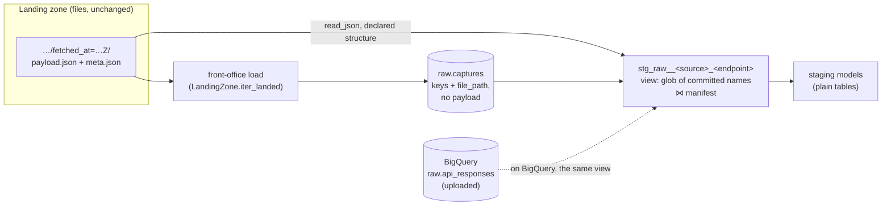

# Staging reads payload files with a declared structure; the raw table holds no payloads — design

Issue: #150 · Requirements: [requirements.md](requirements.md) · Tasks: [tasks.md](tasks.md)

## Overview

The landing zone already holds every payload as a file. Today the loader copies each one
into a JSON column of `raw.api_responses`, and every staging model parses those
megabyte values again in SQL, which is what has run DuckDB out of memory three times.
After this spec the loader writes only a manifest, `raw.captures`: one row per committed
capture, with its key and its file's path, and no payload. For each endpoint there is one
view, `stg_raw__<source>_<endpoint>`, that reads the endpoint's committed payload files
with DuckDB's file reader, inner-joined to the manifest. The three heavy endpoints
(rosters, matchup days, boxscores) are parsed with a declared structure and never become a
JSON value in a query; the small ones arrive as one `payload` value per capture, so their
models keep their SQL. Staging models read these views instead of the raw table, and are
built whole, not a season at a time. On BigQuery the same views read the uploaded
`raw.api_responses`, so a model is still written once.

## Claims ledger

Run on 2026-10-14 against `data/raw` (27,417 committed captures, eight seasons) and
`data/warehouse_83.duckdb` (built by #83 at c9c2851), on the 29 GB development machine,
DuckDB 1.5.5. Probes: [`probes/read_from_files.py`](probes/read_from_files.py),
[`probes/full_shape.py`](probes/full_shape.py) and
[`probes/load_memory.py`](probes/load_memory.py). "Limit" is DuckDB's `memory_limit`;
"peak" is the process's maximum RSS.

| # | Claim | Query (or script) | Result | Run on |
|---|---|---|---|---|
| C1 | The raw table holds 8.97 GB of payload text; three endpoints are nearly all of it | `select source, endpoint, count(*), sum(strlen(payload::varchar)), max(strlen(payload::varchar)) from raw.api_responses group by all` | boxscore 24,385 rows, 4.68 GB, max 0.29 MB · roster 1,471, 2.46 GB, max 2.52 MB · matchup_days 1,469, 1.70 GB, max 1.31 MB · the other eight endpoints 92 rows, 0.13 GB | 2026-10-14 |
| C2 | A DuckDB file refuses a row group below 2,048 rows | `attach '<file>' (row_group_size 64)` | `row group size must be divisible by the vector size (2048)`; 2048 accepted | 2026-10-14 |
| C3 | Direction 3 bounds the load at a row group, not a season, and does not fit 2 GB | `load_memory.py table … --row-group {0,2048} --memory-limit {2GB,none}` | default, 2 GB: out of memory · 2048, 2 GB: out of memory · 2048, no limit: passes, 159 s, peak 6.2 GB, the RSS curve falls from 6.1 to 0.7 GB as a row group is written (default, no limit: 14.9 GB, #149) | 2026-10-14 |
| C4 | #146's two tests do not fit 12 GB under either storage direction | `dbt test --select <test> --threads 1`, profile with `memory_limit: 12GB`, `threads: 4` | out of memory, both tests, on: today's table (peak 12.2 / 11.5 GB) · the table with 2,048-row groups (11.9 / 11.0) · raw as a view over Parquet (11.7 / 9.9) | 2026-10-14 |
| C5 | Parquet loads cheaply, but staging over it is worse than today | `load_memory.py parquet … --memory-limit 2GB --threads 4`, then `dbt build --full-refresh` at 12 GB, 4 DuckDB threads, 2 dbt threads | load: 27,417 rows in 56 s, peak 0.8 GB, 413 MB on disk · build of 2026 alone: `stg_mlb__batting_game_logs` and `stg_espn__player_game_stats` out of memory · eight seasons: four batches out of memory (today's table builds eight seasons at these settings, #83) | 2026-10-14 |
| C6 | Rosters read from files give the model's rows, in under 1 GB, flat with seasons; from the table they need 12 GB for one season and more than 16 for eight | `read_from_files.py roster {files,table} {2026,all} <limit>` | files, 2026, 1 GB: 55,653 rows, 0.3 s, peak 0.13 GB · files, all, 1 GB: 437,227 rows, 2.0 s, peak 0.12 GB; hash equal to `stg_espn__roster_entries` · table, 2026: out of memory at 8 GB, passes at 12 GB (3.8 s, peak 6.1 GB), same hash · table, all: out of memory at 12 and 16 GB | 2026-10-14 |
| C7 | Boxscores read from files fit 512 MB for eight seasons; from the table they need 12 GB | `read_from_files.py boxscore {files,table} {2026,all} <limit>` | files, 2026, 512 MB: 51,708 rows, 0.5 s, 0.12 GB, hash equal to `stg_mlb__batting_game_logs` · files, all, 512 MB: 437,978 rows, 3.8–4.9 s, 0.30 GB · table, 2026, 4 GB: passes, 2.95 GB · table, all: out of memory at 4 and 8 GB, passes at 12 GB in 13.5 s, peak 10.6 GB | 2026-10-14 |
| C8 | ESPN game lines (the largest model) read from files give the model's rows exactly | `read_from_files.py player_game_stats files {2026,all} 1GB` | 2026: 1,054,771 rows, 0.7 s, 0.18 GB · all: 7,526,702 rows, 3.0 s, 0.17 GB; both hashes equal to `stg_espn__player_game_stats` | 2026-10-14 |
| C9 | Matchup-day markers read from files give the model's rows exactly | `read_from_files.py matchup_days files all 1GB` | 1,469 rows, 1.7 s, 0.13 GB, hash equal to `stg_espn__matchup_days`; the marker (`rosterForCurrentScoringPeriod` present) read as a typed `JSON` field, null when absent | 2026-10-14 |
| C10 | The one boxscore row between the probe and the model is the model's dedup, not the read | the newest boxscore per game from files, batting lines with `gamesPlayed = 1`, grouped by game and player, `having count(*) > 1` | one: game 746942, player 643376, listed under both `home` and `away`; the model keeps one (`fo_latest_by_entity`), the table method gives 437,978 too | 2026-10-14 |
| C11 | A glob of committed names matches every committed capture and nothing else, at any depth | Python `glob('data/raw/**/fetched_at=*/payload.json')` against names ending in `Z`; DuckDB `read_json('<dir>/**/fetched_at=*Z/payload.json')` over a test tree holding one committed and one `….tmp-123` directory with a truncated payload | 27,417 on disk, 27,417 match, none left out · the tree: reads the committed one only, no error · `espn/transactions` (with and without an `offset=` level): 7 | 2026-10-14 |
| C12 | Filtering on the file name does not keep DuckDB from opening a file; filtering on a hive column does, but fails at mixed depths | the same test tree, `where filename not like '%.tmp-%'`; and `hive_partitioning = true` with `where fetched_at not like '%.tmp-%'`; and the hive form over `espn/transactions` | filename filter: `Malformed JSON in file …tmp-123…` · hive filter: reads the committed one only, also through a view · transactions: `Hive partition mismatch` | 2026-10-14 |
| C13 | `read_json` over a glob with no match is an error; `glob()` is not | both over `fixtures/landing/espn/matchup_days/**/fetched_at=*Z/payload.json` (the CI fixtures have no matchup days) | `IO Error: No files found that match the pattern` · `glob()`: 0 rows | 2026-10-14 |
| C14 | A file list passed by a pre-hook variable works for a table model, not a view | throwaway dbt project: `pre_hook="set variable f = (select list(file_path) from …)"`, `read_json(getvariable('f'))`, one table and one view | both build; the table holds `(73677, 2026)`; reading the view later: `read_json cannot take NULL list as parameter` | 2026-10-14 |
| C15 | The small endpoints read as whole documents cost almost nothing; one row per file needs `format = 'unstructured'` | `read_json_objects('data/raw/<endpoint>/**/fetched_at=*Z/payload.json', format = 'unstructured', filename = true)`, limit 1 GB | schedule 20 captures, 68 MB, 0.1 s, peak 0.16 GB · id map 1 · transactions 7 · without `unstructured`, the id map's array gives 3,866 rows | 2026-10-14 |
| C16 | The same JSON extraction costs very different memory depending on the query's shape | `json_extract_string(payload, '$.id')` over the ESPN payloads of the Parquet prototype, one thread, limit 12 GB, through the view and through an inline `read_parquet` | view: peak 9.8 GB · inline: 0.8 GB, and 0.7–0.8 GB from one season of rosters to eight | 2026-10-14 |
| C17 | 24 staging unit tests feed rows to the raw source | `grep "input: source('raw', 'api_responses')\|input: ref('stg_raw__season_responses')" dbt/models -r` | 24: ESPN 15, MLB 6, id map 1, `stg_raw__season_responses` 2 | 2026-10-14 |
| C18 | The file reader's own floor is a buffer, not the data | `read_from_files.py roster files {2026,all} {256MB,512MB}` | out of memory allocating 64 MiB at both sizes, for one season and for eight; passes at 1 GB (the probe sets `maximum_object_size` to 32 MB) | 2026-10-14 |
| C19 | Over every committed capture (the glob), choosing the newest by ranking parsed rosters runs out of memory; choosing it on the manifest's columns and semi-joining does not | `full_shape.py player_game_stats {rank,manifest} <limit>`: the full shape of `stg_espn__player_game_stats` over `espn/roster/**/fetched_at=*Z/payload.json` (1,471 captures, the union structure with `eligibleSlots` and game lines), newest per league, season and period either by `qualify row_number()` over the parsed rows or by `row_number()` over `raw.api_responses`' key columns (stand-in for `raw.captures`) then `where path in (…)` | ranking parsed rows: out of memory at 1 GB and at 2 GB · manifest choice: 7,526,702 rows, hash equal to the model, at 1 GB, 3.4–5.2 s, peak 0.18 GB | 2026-10-14 |
| C20 | Boxscore batting lines in the model's full shape, over every committed capture, fit 1 GB | `full_shape.py batting rank <limit>`: over `mlb/boxscore/**/fetched_at=*Z/payload.json` (24,385 captures, players' batting and pitching blocks, team totals), newest per game by `qualify`, then newest per game and player | 437,977 rows (the model's count), 9.5 s, peak 0.95 GB at a 1 GB limit, 0.90 GB at 2 GB | 2026-10-14 |

## Alternatives considered

| Criterion | **A — payload files, declared structure, manifest (chosen)** | B — smaller row groups (#150 dir. 3) | C — Parquet store, raw as a view (dir. 1) | D — leave it, rely on BigQuery (dir. 4) |
|---|---|---|---|---|
| Load from scratch, eight seasons | seconds, no payload read (R1.3) | 6.2 GB, fixed by row-group size × payload size (C3) | 0.8 GB (C5) | 14.9 GB (#149) |
| Staging memory, eight seasons | under 1 GB per heavy model (C6–C9) | unchanged: 12 GB with batching (C4) | worse: out of memory at one season (C5) | unchanged |
| #146's tests | rewritten over capture views (R6.4) | out of memory (C4) | out of memory (C4) | out of memory |
| Flat with seasons | yes, measured (C6–C8) | load yes, queries no | load yes, queries no | no |
| Season batching still needed | no (R4) | yes | yes | yes |
| Size of the change | large: loader, 19 staging models, 7 tests, BigQuery upload | one setting | loader, raw source, upload | none |
| DuckDB as the dev warehouse | yes | barely | no | no: owner ruled it out (ADR 0065) |

**A — read the payload files with a declared structure; the raw table is a manifest.**
The only option measured to meet the bar for load, build and test. The cost is the size of
the change, and it also removes the batching machinery of spec 0143, which is no longer
needed.

**B — a smaller row group.** One setting, and it bounds the load (C3), which confirms
#149's guess about why the load grows. It does nothing for queries: #146's tests still
run out of memory at 12 GB (C4), and the batching stays. A DuckDB file cannot go below
2,048 rows (C2), so the bound is 2,048 megabyte payloads, not a season.

**C — Parquet per source, endpoint and season, raw as a view.** The cheapest load
measured (C5), and 413 MB on disk. It was the owner's fallback if B fell short. It lost on
measurement: a build of 2026 alone ran out of memory at 12 GB (C5), where today's table
builds all eight. The memory is in parsing megabyte JSON values in a query, and Parquet
still hands the query those values.

**D — leave it and rely on BigQuery.** The owner ruled it out on 2026-10-14: DuckDB stays
the development warehouse with every season (ADR 0065).

Within A, how a model finds committed captures, and where the read sits, were each
decided between options (ADRs 0067 and 0068); see *Decisions*.

## Decisions

All seven were the owner's, on 2026-10-14, taken one at a time in that order.

| ADR | Decision | Status |
|---|---|---|
| [0065](../../adr/0065-duckdb-stays-the-development-warehouse-with-every-season.md) | DuckDB stays the development warehouse with every season; the bar: load, build and test pass with the committed profile, and the smallest memory limit is the same for one season as for eight | proposed |
| [0066](../../adr/0066-staging-reads-payload-files-and-the-raw-table-is-a-manifest.md) | Staging reads payload files with a declared structure; `raw.captures` holds keys and paths, no payloads; all endpoints | proposed |
| [0067](../../adr/0067-a-model-reads-committed-captures-by-a-glob-of-committed-names-joined-to-the-manifest.md) | A model reads committed captures by a glob of committed names, inner-joined to the manifest | proposed |
| [0068](../../adr/0068-one-capture-view-per-endpoint-is-the-only-reader-of-payload-files.md) | One capture view per endpoint is the only reader of payload files | proposed |
| [0069](../../adr/0069-staging-models-are-built-whole-not-a-season-at-a-time.md) | Staging models are built whole, not a season at a time; supersedes 0058, 0059, 0060 | proposed |
| [0070](../../adr/0070-bigquery-reads-its-uploaded-table-through-the-same-capture-views.md) | BigQuery reads its uploaded table through the same capture views; the upload reads the landing zone | proposed; amends 0052 |

One refinement after the decisions, recorded in ADR 0067: the owner chose "a glob with a
filter on the path, joined to the manifest". The filter as first described (on the
`fetched_at` hive column) fails on `espn/transactions`, whose depth varies (C12), and a
filter on the file name does not keep DuckDB from opening a half-written file (C12). The
glob pattern itself does both jobs: `fetched_at=*Z` matches a committed directory and not
a temporary one (C11). The choice is the same; only its mechanism is narrower.

## Detailed design

### The manifest: `raw.captures` (R1)

| Column | Type (DuckDB) | Meaning |
|---|---|---|
| `source` | varchar | `mlb`, `espn`, `idmap` |
| `endpoint` | varchar | e.g. `roster`, `boxscore` |
| `request_path` | varchar | the request URL's path, ADR 0011 |
| `request_key` | varchar | canonical parameters, ADR 0011 |
| `fetched_at` | varchar | the stamp, `%Y%m%dT%H%M%SZ` |
| `partitions` | json | the capture's partitions, as the sidecar has them |
| `file_path` | varchar | the payload's path relative to the landing root |

Primary key `(source, endpoint, request_path, request_key, fetched_at)`, as ADR 0011. The
loader keeps its first pass (sidecars only, collisions, which captures are new) and drops
the second (payload reads). In the first pass it also refuses a `fetched_at` that is not
`%Y%m%dT%H%M%SZ` (R1.7): `LandingZone.check` accepts any non-empty stamp that agrees with
its directory, and a row the glob cannot match would vanish from every model silently. Insert in one transaction, as today. Because payloads are not
read at load, a payload that does not parse is found by the model that reads it (R2.3;
DuckDB names the file, C12) and by `front-office audit`, which already reads every
payload against its recorded checksum. `PayloadNotJson` leaves the loader.

`file_path` today is the path as the loader was given it (`data/raw/…`), which differs
with the working directory; relative to the landing root it is the same from anywhere,
which is what the join of R2.2 and the collision check compare.

A warehouse with `raw.api_responses` is refused (R1.5) in the way `RawSchemaOutdated`
refuses the pre-ADR-0011 shape: nothing changes, and the message says to load into a new
file. A load of keys only takes seconds, so a rebuild from empty is the migration.

Readers of the old table that change: the freshness sources (`_raw_feeds__sources.yml`:
identifier `captures`; their filters read `partitions` and `fetched_at` only), `front-office
audit` (the `loaded` check), `scripts/check_tenant_isolation.py`, `scripts/verify_migration.py`
and `scripts/compare_bigquery_slice.py`.

### Finding committed captures (R2, ADR 0067)

A capture view reads `{{ root }}/<source>/<endpoint>/**/fetched_at=*Z/payload.json`. The
writer (ADR 0014) builds a capture in `fetched_at=<stamp>.tmp-<pid>/` and publishes it by
one rename to `fetched_at=<stamp>/`; the stamp always ends in `Z` (`cli.utc_stamp`), so
the pattern matches published directories and never a temporary one, at any depth (C11).
A quarantine is outside the root (ADR 0015). The read is then inner-joined to
`raw.captures` on `file_path`, made relative by removing the root from DuckDB's
`filename`: the manifest, written through `LandingZone`, stays the authority on what is a
capture. A published directory the loader has not seen yet is left out, as a row not yet
loaded is today.

The join decides which rows count, not which files are opened: DuckDB parses every file
the glob matches before joining (C12). So a payload that does not parse, in a directory
named like a published one, fails the model whether or not the manifest lists it (R2.3),
and the error names the file. That is the loader's behaviour today for a committed
capture (`PayloadNotJson` failed the load); what is new is that a directory
`LandingZone.check` rejects for its sidecar, if its payload is also malformed, now fails
the build until `front-office repair` (or the next backfill's sweep) moves it to the
quarantine. Both are corruption at rest, which the audit already reports.

The root comes from `fo_landing_root()`: on target `dev` the variable `FO_LANDING_ROOT`,
default the repository's `data/raw`; on `ci`, `FO_CI_LANDING_ROOT`, default
`fixtures/landing`. The macro returns an absolute path, so dbt run from `dbt/` and
sqlfluff run from the root (the gates' comment on `FO_CI_DUCKDB_PATH`) read the same files.
`check_tenant_isolation.py` sets it for each of its landing roots.

A glob with no match is an error in DuckDB (C13), and the CI fixtures have no matchup
days. The macro asks `glob()` first, when dbt executes, and emits a typed relation with
no rows if there is no file (R2.4); the column set is the same either way. The view is
recreated on every build, so a first capture of an endpoint appears on the next build.

### The capture views (R3, ADR 0068)

Eleven views, one per endpoint, in `dbt/models/staging/raw/`:

| View | Columns beyond the manifest's | Read by |
|---|---|---|
| `stg_raw__espn_roster` | `league_id`, `season` (from the payload's `id`, `seasonId`), `teams`: the union structure below | `stg_espn__roster_entries`, `stg_espn__roster_entry_slots`, `stg_espn__player_game_stats`, the identity test |
| `stg_raw__espn_matchup_days` | `league_id`, `season`, `schedule`: `matchupPeriodId`, and each side's `rosterForCurrentScoringPeriod` as `JSON` | `stg_espn__matchup_days`, its two tests |
| `stg_raw__mlb_boxscore` | `teams`: each side's team id, team batting totals, and players as `MAP(VARCHAR, player)` with person, position, batting order, game status, and the batting and pitching stat blocks the two game-log models read | the two game-log models, the totals test, the one-season test |
| the other eight (`espn_settings`, `espn_teams`, `espn_matchups`, `espn_pro_schedule`, `espn_transactions`, `mlb_schedule`, `mlb_players`, `idmap_player_id_map`) | `payload`: the whole document as one JSON value | the models that read them today, unchanged but for their source |

The roster union is what the three roster models and the identity test read today:
entries with `playerId`, `lineupSlotId`, `injuryStatus`, `acquisitionType`, and the
player's `fullName`, `defaultPositionId`, `proTeamId`, `eligibleSlots`, and `stats` (each
line's `scoringPeriodId`, `statSourceId`, `statSplitTypeId`, `externalId`, and `stats` as
`MAP(VARCHAR, DOUBLE)`). The build writes each structure from the fields its models read
today, and a model reading a field the structure lacks fails to compile, which is the
check that the union is complete.

Each structure is written once, in the notation `fo_json_parse` already takes, and the
macro turns it into DuckDB's column types for `read_json` and into the existing
`bigquery__fo_json_parse` for BigQuery (R5.1). The read lives in one dispatched macro in
`dbt/macros/json.sql` (R3.4), so `test_dbt_json_rule.py` and the portable-SQL rule keep
holding: no model names `read_json`.

The heavy views are views, so the parse runs inside each staging model's own query, which
is how C6 to C9 were measured. The three roster models each parse the roster files; each
parse took 2 to 3 s for eight seasons.

Staging models change only where they read from. `fo_espn_latest` and
`fo_latest_boxscore_responses` keep their partitioning and tie-breaks (rule 5): the
latest capture per league, season (and scoring period), or per game, by `fetched_at`,
then `file_path`. They now rank `raw.captures`' narrow columns only, never parsed rows,
and keep the chosen captures of the view by a semi-join on `file_path` (R3.6). Ranking the
parsed rosters ran out of memory at 2 GB, because a window holds every row it ranks;
the semi-join streams, and gave the model's rows in 0.18 GB (C19). The capture view
reads the manifest for its join anyway, so the choice costs one more scan of a few
thousand narrow rows. Where a model reads a payload field through `fo_json_*` today and
the view now gives it as a typed field, the expression becomes a field access; the rows
must not change (R6.3).

### Built whole (R4, ADR 0069)

The six models lose their microbatch configuration and become `table` on both
warehouses. `stg_raw__season_responses`, `season_start`, `first_season_start`,
`fo_batches_back_to_first_season`, the guard test and `test_dbt_batched_models.py` go.
`scripts/check_tenant_isolation.py` drops `--event-time-start` and `--event-time-end`.

### BigQuery (R5, ADR 0070)

On BigQuery the capture views select from the uploaded `raw.api_responses`, filtered to
their endpoint, parsing the heavy endpoints' structures with `bigquery__fo_json_parse` and
passing the small ones' `payload` through.

Two of the structures hold maps: a boxscore side's `players`, keyed `"ID669016"`, and a
game line's `stats`, keyed by stat id. DuckDB reads them as `MAP`; BigQuery has no map
type, and `bigquery__fo_json_parse` accepts only `BIGINT`, `VARCHAR`, `DOUBLE`,
`BOOLEAN` and `JSON` leaves today. It gains a map leaf, given as
`ARRAY<STRUCT<key STRING, value …>>` built from `JSON_KEYS` (which
`bigquery__fo_json_keys` already uses), and models read maps only through two new
dispatched macros, `fo_map_values(column)` and `fo_map_entries(column)` (R5.4), as they
read JSON through `fo_json_*` today. `stg_espn__player_game_stats` reads its stats this
way on both warehouses, which is how it is in the slice today (it uses `fo_json_keys` and
`fo_json_values`). The upload script reads keys from
`raw.captures` and each payload from its file, through `LandingZone`, applies the same
privacy check and the same projections, and writes the same table, so BigQuery's rows and
bytes billed do not change. The production loader stays #140's.

### Tests that read captures

| Test | Becomes |
|---|---|
| `stg_espn__payload_identity_matches_partitions` | reads `league_id`, `season` from the roster, settings, teams and matchups capture views and compares them with `partitions`; no payload crosses the query |
| `stg_mlb__batting_totals_match_team_stats` | reads team totals from `stg_raw__mlb_boxscore`'s typed fields |
| `stg_espn__matchup_days_answer_the_period_asked`, `…_mark_one_period` | read `stg_raw__espn_matchup_days` |
| `stg_mlb__games_prefers_played_over_unplayed` | reads `stg_raw__mlb_schedule` |
| `stg__batched_models_hold_every_season_with_captures`, `stg__batched_rows_are_filed_under_their_own_season`, `stg_mlb__a_boxscore_game_is_captured_under_one_season` | removed with batching (R4.2): each guards a way a season's batch could miss or misfile rows, which cannot happen when a model reads every capture at once |

The 24 staging unit tests (C17) mock the capture view their model reads instead of the
raw source. For the small endpoints the rows are as today. For the heavy ones they give
typed `teams` / `schedule` values, written with `format: sql` where dict rows cannot hold
a nested type. The two unit tests of `stg_raw__season_responses` go with it.

## Test strategy

| Requirement | Test | Catches |
|---|---|---|
| R1.1–R1.3 | `test_load.py`: the manifest has the columns and rows of the landing zone, and no payload is read (a payload-read counter stays at zero) | a loader that still reads or stores payloads |
| R1.2 | `test_load.py`: the same zone loaded from two working directories gives equal `file_path`s | a path that depends on where the loader ran |
| R1.4, R1.6 | the existing collision and append-only tests, kept | a regression in ADR 0011's refusal |
| R1.5 | `test_load.py`: a warehouse with `raw.api_responses` is refused and left unchanged | a load that writes into an old warehouse |
| R1.7 | `test_load.py`: a committed capture whose stamp does not end in `Z` (a valid sidecar, `fetched_at=20260101T000000`) fails the load and inserts nothing | a capture loaded that no capture view can see |
| R2.1 | `test_capture_glob.py`: in a landing root with a published capture and a `….tmp-<pid>` directory holding a truncated payload, the capture view reads the published one only and does not fail | a pattern that opens a half-written file |
| R2.2 | the same, with a published directory not in the manifest: it is not in the view | the manifest no longer being the authority |
| R2.3 | the same, with a published, loaded payload that does not parse, and separately with one the manifest does not list: the model fails naming the file both times | a corrupt payload passing silently, or the spec claiming the join protects against it |
| R2.4 | CI: the fixtures have no `espn/matchup_days`; `stg_raw__espn_matchup_days` builds with zero rows and its columns | an empty glob failing the build |
| R2.5 | the gates build from the repo root and from `dbt/`; tenant isolation uses four roots | a root that resolves differently by directory |
| R3.2, R3.3 | unit tests per capture view (small: one row per capture, even for the id map's array; heavy: the declared fields) | an array split into rows; a field missing from a structure |
| R3.4, R3.5 | `test_dbt_json_rule.py` extended: no model or test outside the macro names `read_json`, `read_json_objects`, `raw.api_responses` or `raw.captures` (the views read the manifest through the macro) | a model reading files or the manifest directly |
| R3.6 | unit tests of `fo_espn_latest` and `fo_latest_boxscore_responses` through two staging models: two captures of one entity, the newer kept, ties broken by `file_path`; and a rule test that neither macro ranks a capture view's rows | a window over parsed rows coming back (C19) |
| R4 | `test_dbt_batched_models.py` removed; a new rule test that no model has `incremental_strategy='microbatch'` | batching coming back unnoticed |
| R5.1–R5.3 | `compare_bigquery_slice.py` on 2026; the upload's existing tests, with the source changed | BigQuery diverging from DuckDB |
| R5.4 | `dbt run --target bq --selector bigquery_slice --empty` (free) compiles the map leaf; unit tests of `fo_map_values` and `fo_map_entries` on DuckDB; the slice comparison covers both maps' models | a map BigQuery refuses, or reads in another order |
| R6.1, R6.2 | the ladder, recorded on #150: load, build, test at 1, 2, 4, 8 GB for 2026 alone and for eight seasons | memory that grows with seasons |
| R6.3 | `compare_warehouses.py` against `data/warehouse_83.duckdb` | any changed row |
| R6.4 | `dbt test` on eight seasons | #146 not fixed |

## Risks

- **A downstream step of a heavy model needs more memory than the bare read** — reduced:
  C19 and C20 ran the two largest models' full shapes over every committed capture, and
  found one such step (ranking parsed rows), now designed out (R3.6); the other four
  heavy models' windows and joins were not run in full — the ladder finds it — the model
  is reworked, or batching comes back for that one model by a new ADR.
- **Intermediate models and marts need more than the reads** at eight seasons (never
  measured alone; the build ran at 12 GB) — unknown — the ladder of R6.2 measures it;
  if a rung differs between one season and eight because of a non-staging model, that is
  reported to the owner, not tuned away.
- **A typed field differs from today's `fo_json_*` extraction** in an edge case (an
  integer arriving as a float, a missing key against a null) — the probes matched four
  models exactly, but not all nineteen — `compare_warehouses.py` is exact, so it shows.
- **The landing root's layout becomes an interface dbt depends on** — accepted: it is
  already one (ADR 0014), and the glob reads only the directory names ADR 0014 fixes.
- **A unit test needs a nested fixture DuckDB's dict format cannot express** — `format: sql`
  can; if a case cannot be written, the test moves to the capture view's own unit test.
- **PR #148 generates the ADR index**; if it merges first, this branch's index rows move
  to its generated form.

## Open questions

- Why a JSON extraction costs 0.8 GB in one query shape and 9.8 GB in another over the same
  rows (C16) — not needed for this design; a report to DuckDB is the owner's choice.
- The lowest rung the build reaches — the ladder will say; C18 suggests the file reader
  alone is about 1 GB with the probe's buffer, and `maximum_object_size` can be lowered
  to the largest payload (4.3 MB, the id map).
- Whether the three roster models should share one parse (a table of parsed rosters)
  rather than each parsing the files — not needed at 2 to 3 s each; revisit if the
  ladder shows it.

## Review log

| Source | Finding | Resolution |
|---|---|---|
| design-review (Codex, 2026-10-14) | F1 (P0): R4.2 drops `season_start` while the no-goes keep column sets | The drop is the owner's decision 3 (ADR 0069 lists `season_start`); the no-go now names it as the one exception, and R6.3 excludes it by name |
| design-review | F2: the bar says `dbt test` passes, yet four #147 tests are expected to fail | R6.1 defines "pass": every test runs to a result, none errors other than by its assertion, every test passing today passes, and the failures are exactly #147's four with today's rows; ADR 0065 points at R6.1 |
| design-review | F3: the join to the manifest cannot keep DuckDB from opening an unlisted, corrupt file | Agreed (C12 shows it). R2.2 narrowed to "never contributes a row"; R2.3 covers a corrupt file listed or not, with a test of each; *Finding committed captures* says what is new and how `front-office repair` clears it |
| design-review | F4: `bigquery__fo_json_parse` rejects `MAP` leaves, and two structures use maps | Agreed. R5.4 and *BigQuery*: a map leaf on BigQuery as an array of key–value structs, read only through new `fo_map_values` / `fo_map_entries`; checked by the free `--empty` build and the slice comparison |
| design-review | F5: `compare_warehouses.py` fails on a removed relation | R6.3 names the removed relations and the dropped column; task 12 adds named exclusions to the script, and it still fails on anything else missing |
| design-review | F6: the probes read only the newest file per entity and a reduced query, while the views parse every snapshot before dedup | Measured: C19 (game lines, full shape, every capture) and C20 (boxscore lines, full shape). C19 found that ranking parsed rows runs out of memory at 2 GB; R3.6 chooses the newest on the manifest instead, measured at 0.18 GB with the model's exact rows. Risks updated |
| design-review | F7 (P2): the glob assumes stamps end in `Z`, which `LandingZone.check` does not enforce | R1.7: the loader refuses a stamp not of the form `%Y%m%dT%H%M%SZ`, with a test |

## Amendments

- **2026-10-15, `scripts/verify_migration.py` is left unchanged.** *Detailed design* listed
  it among the readers of the old table. It verifies spec 0029's landing-layout migration,
  which is finished, by comparing two warehouses of the old shape; those keep
  `raw.api_responses`, so it has nothing to read in `raw.captures`. Its test builds its own
  old-shape warehouses instead of using the loader. Within the goals and no-goes.
- **2026-10-15, the capture views are tested by `test_capture_glob.py` and a data test, not
  by dbt unit tests.** Task 5 asked for unit tests per capture view. A dbt unit test
  replaces a view's `ref()` and `source()` inputs, and the file read is neither: that is
  why ADR 0068 puts the read in a view at all. R3.2 and R3.3 are held instead by
  `ingestion/tests/test_capture_glob.py` (the whole-document read gives one row for an
  array; a declared structure, map included, gives its typed fields and drops the rest),
  and a new data test, `stg_raw__capture_views_cover_the_manifest`, checks on every build
  that each view has exactly one row per manifest row of its endpoint, which is what
  would catch a listed capture the glob misses. On the eight seasons: 27,417 captures,
  every endpoint equal, 5 s.
- **2026-10-15, a structure stops where its model already reads element by element.** The
  roster's game-line `stats`, a matchup's two sides and a boxscore's team batting totals
  and players stay `JSON` in the structures (the players as a map of JSON), and the models
  keep the `fo_json_*` reads they make of those elements today. So a model's expressions,
  and their semantics (`fo_json_exists` true for a JSON null, `fo_json_text` turning `''`
  into null), do not change; only the megabyte document is no longer a value. The probes
  that typed those elements fully (C7, C20) were within the same memory.
- **2026-10-15, R3.6 binds the two shared latest-capture macros, not the small endpoints'
  own dedups.** R3.6 says the newest capture is chosen on the manifest's columns, never by
  ranking parsed rows. `fo_espn_latest` and `fo_latest_boxscore_responses`, which every
  heavy endpoint's model reads through, now do exactly that (`fo_capture_keys()`, a
  semi-join on `file_path`). Five models of small endpoints (`stg_espn__transactions`,
  `stg_espn__transaction_logs`, `stg_mlb__games`, `stg_mlb__players`, `stg_idmap__players`)
  dedupe their own rows with their own rules today; they keep those rules over their
  capture view, ranking rows whose payloads are small (those eight endpoints are 0.13 GB
  in all, C1). Rewriting their dedups would risk their rows for no memory gain.
- **2026-10-15, `stg_raw__espn_matchup_days` also declares `scoringPeriodId`.** The view
  table above lists `league_id`, `season` and `schedule`; the test
  `stg_espn__matchup_days_answer_the_period_asked` reads the payload's own
  `scoringPeriodId` (that the marker answers the period asked), so the structure gains it.
- **2026-10-15, spec 0130's pinned slice counts move.** `test_bigquery_slice.py` and
  `test_dbt_portable_sql_rule.py` pin the BigQuery slice's size. The slice selects parents,
  so it now holds nine capture views and no longer `stg_raw__season_responses`: 43 models,
  materializations (24, 0, 18, 1), tests (228, 198, 30), 81 unit tests. The pins exist to
  catch an unintended change to the slice; this one is the design's.
