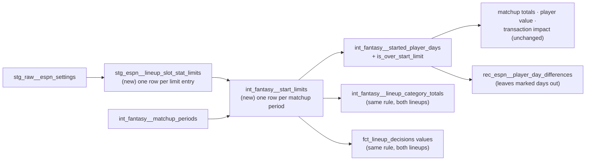

# A league's games-started limit is applied to credited production — design

Issue: #152 · Requirements: [requirements.md](requirements.md) · Tasks: [tasks.md](tasks.md)

## Overview

A new staging model reads each league-season's `lineupSlotStatLimits`. A new
intermediate model turns the games-started entry into a limit per matchup period: the
per-day value times the period's days. `int_fantasy__started_player_days`, the grain
every credited sum is built on, then walks each team's days of each period in order. A
start on a day when the team's earlier credited starts already reach the limit keeps its
row, is marked `is_over_start_limit`, and has its pitching components set to zero. Every
consumer that sums credited production (matchup totals, player value, transaction
impact) follows with no change of its own. Three consumers need one: the player-day
reconciliation leaves the marked day out, because ESPN's game line still holds the
start; the lineup totals and the lineup values apply the same rule to each lineup's own
starts, because the actual lineup's totals and values must agree with what was scored;
and the test that adds day values back to season values leaves the marked day out. The
solver's inputs, the day values, are not limited.

## Claims ledger

Every statement this spec makes about the data, with the query that showed it. Read-only
on `data/warehouse_150.duckdb` (#150's eight-season build, compared identical to the
pre-#150 warehouse), on `main` at `d927c00`. The scripts are kept with the run evidence
on #152.

| # | Claim | Query (or script) | Result | Run on |
|---|---|---|---|---|
| C1 | Every season's newest settings capture says what the limits are | `lineupSlotStatLimits` of the newest `stg_raw__espn_settings` capture per season | 2018, 2019: `{"22": {"statId": 33, "limitValue": 1.5714285714285714}}`; 2020: `{"21": {"statId": 81, "limitValue": 545.0}, "22": {"statId": 33, "limitValue": 78.0}}`; 2021: `{}`; 2022 to 2026: `{"22": {"statId": 33, "limitValue": 1.8571428571428572}}` | 2026-10-16 |
| C2 | The unit of `limitValue` follows the scoring type | `scoring_type` of `stg_espn__league_settings` against C1 | 2020 is `ROTO`, and its 78 starts is a season total; every other season is `H2H_MOST_CATEGORIES`, and its value is a per-day rate (1.857 × 7 = 13 a week). 2020 has no rosters and is not covered (ADR 0026) | 2026-10-16 |
| C3 | A 7-day period's limit is a whole number in floating point | `1.8571428571428572 * 7` and `1.5714285714285714 * 7` in DuckDB and Python; `13 < 1.8571428571428572 * 7` | `13.0`, `11.0`; `false` | 2026-10-16 |
| C4 | ESPN reports games started for every side from 2019 on, and it equals ours on all but one | stat 33 of `rec_espn__matchup_stat_differences`, by season, against the limit × the period's days | 2019 286 sides, 2022 286, 2023 286, 2024 310, 2025 298, 2026 286: our value ≠ ESPN's on 1 side only (2023). 2018's `scoreByStat` has no stat 33 | 2026-10-16 |
| C5 | ESPN lets the day on which the limit is reached finish | the sides of C4 whose ESPN starts exceed the limit | 7 sides over the limit by ESPN's own count (2019: 2, 2022: 3, 2024: 1, 2026: 1), up to 16 starts against 13; ours equal ESPN's on all 7 | 2026-10-16 |
| C6 | The rule "a start is not credited when the team's earlier credited starts in the period reach the limit" removes one start in eight seasons, and breaks nothing | `simulate.py starts lt`: limit = per-day × the period's days; drop started pitcher-days past it; recompute every side and stat | 1 start dropped (2023-08-20, team 7, Fried). Of the 133 unexplained values, 7 become equal to ESPN's (5 counts, 2 rates); 0 of the 52,345 matching values move | 2026-10-16 |
| C7 | Cutting on the day the limit is reached, instead of letting it finish, is wrong | `simulate_strict.py starts strict` | 25 starts dropped on 8 sides; 68 values that match ESPN today stop matching (49 counts, 19 rates) | 2026-10-16 |
| C8 | Relief appearances past the limit still count | `simulate.py all lt`: drop every pitcher-slot day past the limit | 9 player-days dropped; 1 of the 133 becomes equal; 1 matching value breaks | 2026-10-16 |
| C9 | No period tests how a limit that is not a whole number is rounded | `simulate.py starts floor` against `starts lt`; period lengths per season | identical results. Periods of 8 to 19 days, one or two a season (2018: 11, 14; 2019: 14, 19; 2022: 10, 11, 14; 2023: 11, 14; 2024: 8, 12, 14; 2025: 13, 14; 2026: 12, 14), give non-whole limits except at 14 days | 2026-10-16 |
| C10 | The one remaining difference on that side is already explained once the start is dropped | the side's rows of `rec_espn__matchup_stat_differences` | earned runs: ours 44, ESPN 42, game-line difference −1. Without Fried's 3: 41, which is ESPN's 42 plus −1, so `explained_by_game_lines`; ERA follows as `explained_by_component` (27 × 41 / 255 = 4.3412) | 2026-10-16 |
| C11 | That matchup's category results already agree with ESPN | `rec_espn__category_result_differences`, 2023, matchup 110, status ≠ match | no rows | 2026-10-16 |
| C12 | The player-day reconciliation reads the credited columns of `int_fantasy__started_player_days`, and ESPN's line for the dropped start holds it | `rec_espn__player_day_differences.sql` lines 60 to 75; #83's investigation (2023-08-20 is in ESPN's game lines) | the model unions the credited columns by slot role; zeroing the start without leaving it out would add −17 outs, −9 hits and more to the side's game-line difference | 2026-10-16 |
| C13 | The actual lineup's totals are tested equal to the scored totals | `lineup_category_totals_reproduce_the_actual_totals.sql`; `int_fantasy__lineup_category_totals` joins each player's MLB line itself | exact, both ways. With the limit applied to the matchup totals only, it would fail on that side | 2026-10-16 |
| C14 | The optimal lineups go past the limit rarely, and the same rule leaves 6 of their starts uncredited | `fct_lineup_decisions.optimal_pitcher_starts` by team-period against the limit, and the rule of C6 applied to them | optimal over the limit in 22 of the 2,052 team-periods of the seven seasons with a limit (2018: 5, 2019: 6, 2022: 5, 2023: 3, 2024: 1, 2026: 2), by at most 3; the rule leaves 6 starts uncredited on 4 team-periods (2018: 1, 2019: 3, 2022: 1, 2023: 1). ADR 0037 measured 2 of 264 on 2026 alone | 2026-10-16 |
| C15 | `int_fantasy__started_player_days` is in the BigQuery slice | `dbt/selectors.yml`: `fct_matchup_results` with its parents | yes, through `int_fantasy__matchup_side_totals`; a staging model it reads joins the slice too | 2026-10-16 |
| C16 | Within a season, every settings capture holds the same limits, and every capture was fetched after its season | `lineupSlotStatLimits` of every `stg_raw__espn_settings` capture | 21 captures (2018: 3, 2019: 2, 2020: 1, 2021: 2, 2022 to 2025: 2 each, 2026: 5), fetched 2026-09-26 to 2026-10-13; within each season all equal | 2026-10-16 |
| C17 | A played started day is defined by `games_pitched` on the pitching side | `fct_player_season_value.sql` lines 56 to 62; `fct_transaction_impact.sql` lines 175 to 180 | `played_on_credited_side` is `slot_role = 'pitcher' and games_pitched > 0`; transaction impact counts the same way | 2026-10-16 |
| C18 | Day values add back to season values, and lineup values are sums of day values | `candidate_day_values_add_back_to_season_value.sql`; `fct_lineup_decisions.sql` lines 205 to 225 | the test sums a pair's started days' day values against `total_value` within 1e-9; `actual_value` and `optimal_value` sum the day values of each lineup's options. Zeroing a start in the season value alone would fail the test on that pair and leave both lineup values unlimited | 2026-10-16 |

## Alternatives considered

### Where the limit is applied (ADR 0072)

| | A — at the credited grain (chosen) | B — a flag, filtered by each consumer | C — a new model between them |
|---|---|---|---|
| Consumers that must change | 2 (the player-day reconciliation, the lineup totals) | the 5 models that sum credited production, plus the 2 | the 6 models and 6 singular tests that read `int_fantasy__started_player_days`, to point at the new one |
| A consumer that forgets | cannot: the components are already zero | silently credits the start | cannot, once moved |
| What `int_fantasy__started_player_days` means | what the slot credits, the limit applied: what ESPN credits | what the slot credits; the limit is the reader's business | unchanged; the new model is "what counts" |
| ESPN's player-level game line | no longer equal for a marked day, so the reconciliation leaves it out | still equal | still equal on the old model |

**A — at the credited grain.** The model already means "what his slot credits", which is
ESPN's rule (#10); the limit is the rest of that rule. Every sum built on it is right by
construction, and the row stays, marked, so nothing disappears.

**B — a flag, filtered by each consumer.** Leaves the model equal to ESPN's player lines,
but five models (`int_fantasy__matchup_side_totals`, `fct_player_category_value`,
`fct_player_season_value`, `fct_transaction_impact`, `rec_fantasy__category_wins_added`)
must each remember a filter, and one that does not is wrong with no test
to say so: the very failure this spec exists to remove.

**C — a new model between them.** Clean, but moves the grain six models and six
singular tests read, and their unit tests' mocks, for a rule that binds once in eight seasons.

### What the limit means (ADR 0071)

The readings were each run against ESPN's own totals (C6 to C8); the chosen one is the
only one that breaks nothing:

| Reading | Starts dropped | Unexplained values made equal | Matching values broken |
|---|---|---|---|
| Starts on days after the limit is reached (chosen) | 1 | 7 (and 2 more follow, C10) | 0 |
| The same, with the limit floored | 1 | 7 | 0 |
| Every pitcher-slot day after the limit | 9 player-days | 1 | 1 |
| Cut on the day the limit is reached | 25 | 7 | 68 |

### The optimal lineup's totals and values (ADR 0073)

In both options the actual lineup's totals and values are limited: its totals are tested
equal to the scored ones (C13), and its value is the sum of day values that add back to
the season values (C18).

| | A — credited by the same rule (recommended) | B — not limited |
|---|---|---|
| Both lineups scored alike | yes | no: the actual lineup's totals and value are limited, the optimal's are not |
| ADR 0037 | amended: the solver still ignores the limit, the totals do not | unchanged |
| Effect on eight seasons | 6 optimal starts uncredited, on 4 team-periods (C14) | none |
| A league with a tight limit | the gap counts only starts that would have scored | the gap counts starts the league would not have credited |

## Decisions

| ADR | Decision | Status |
|---|---|---|
| [0071](../../adr/0071-a-games-started-limit-is-a-per-day-rate-and-the-day-that-reaches-it-finishes.md) | In a head-to-head league-season, the games-started limit is its per-day value times the matchup period's days; a start is not credited when the team's earlier credited starts in the period reach it; the day that reaches it finishes; relief appearances still count. A limit on another stat, or in a league-season not head-to-head, fails the build | accepted |
| [0072](../../adr/0072-a-start-past-the-limit-is-zeroed-at-the-credited-grain.md) | The limit is applied in `int_fantasy__started_player_days`: the row stays, marked, with every pitching column zero (so it is no played started day); the player-day reconciliation leaves it out | accepted |
| [0073](../../adr/0073-both-lineups-totals-are-credited-under-the-limit.md) | The actual and the optimal lineup's totals and values are credited by the same rule, each counting its own starts; the solver and its inputs are unchanged. Amends 0037 | superseded by 0079 |
| [0079](../../adr/0079-only-the-actual-lineup-is-credited-under-the-limit-until-the-optimal-one-is-solved-a-week-at-a-time.md) | Only the actual lineup's totals and values are credited under the limit; the optimal lineup's are not, until a solver chooses a matchup period's lineups together within it (#164). Supersedes 0073, amends 0037 | accepted |

## Detailed design

### `stg_espn__lineup_slot_stat_limits` (new, staging)

Grain: one row per (`league_id`, `season`, `lineup_slot_id`), from the newest settings
capture of each league-season (`fo_espn_latest('settings')`). Read from
`settings.rosterSettings.lineupSlotStatLimits`, an object whose keys are slot ids, with
`fo_json_keys` / `fo_json_values` and `fo_unnest_pair` as
`stg_espn__matchup_category_results` does: the model is in the BigQuery slice (C15), so it
is written to the two-warehouse rule (ADR 0051), with `payload` projected away in a
`header` CTE before the unnest (rule 1).

| Column | Type | Meaning |
|---|---|---|
| `league_id` | text | |
| `season` | integer | |
| `lineup_slot_id` | integer | the entry's key, as ESPN files it (22 for the games-started limit); not interpreted |
| `stat_id` | integer | the entry's `statId`; 33 is games started |
| `limit_value` | float | the entry's `limitValue`, as given: a per-day rate in a head-to-head league-season (C2) |
| `fetched_at` | timestamp | of the capture read |

Tests: `unique` on the three keys together; `not_null` on all columns.

### `int_fantasy__start_limits` (new, intermediate)

Grain: one row per (`platform`, `league_id`, `season`, `matchup_period`) of every covered
league-season (inner join to `int_fantasy__league_seasons` where `has_rosters`, as
`int_fantasy__matchup_side_totals` does).

| Column | Meaning |
|---|---|
| `period_days` | the number of scoring dates of the period, from `int_fantasy__matchup_periods` |
| `starts_per_day` | the `limit_value` of the league-season's entry with `stat_id` 33; null when it has none |
| `start_limit` | `starts_per_day * period_days`, as a float, not rounded; null when `starts_per_day` is |

A singular test, `int_fantasy__start_limits_are_understood` (R1.4), returns each covered
league-season's limit entry whose `stat_id` is not 33, and each limit entry of a covered
league-season whose `scoring_type` does not start with `H2H_`.

### `int_fantasy__started_player_days` (changed)

The current SELECT becomes a CTE, `credited`, unchanged. Then:

- `day_starts`: per (team, scoring date), the sum of `games_started` over the `credited`
  rows with `slot_role = 'pitcher'`, joined to the date's `matchup_period`.
- `team_days`: for each team-day, `starts_before`, the sum of `day_starts` over the
  earlier dates of the same team and period (`rows between unbounded preceding and 1
  preceding`, ordered by date; 0 when there are none), and the period's `start_limit`.
  Integer sums: no `order by` is needed inside them (AGENTS.md, floating-point
  aggregates).
- A day is past the limit when `start_limit is not null and starts_before >= start_limit`.
  The comparison is exact, with no rounding and no tolerance (C3, C9; ADR 0071).
- Final SELECT: every `credited` row. `is_over_start_limit` is true for a row whose day is
  past the limit, `slot_role = 'pitcher'` and `games_started > 0`; on such a row each
  `fo_pitching_columns()` column is 0, `games_pitched` and `games_started` included, so the
  day is no played started day in the marts either (C17; ADR 0072). `played`,
  `input_status` and the batting columns are as before.

A day with no matchup period (a bye) has no limit and is never past it. The model's
contract and column docs gain `is_over_start_limit` (boolean, not null).

### `rec_espn__player_day_differences` (changed)

The `ours` CTE reads only rows with `not is_over_start_limit` (R3.1). The model's comment
says why: ESPN's game line for that day holds the start, its side total does not, and the
side-level reconciliation already sees the start's absence. Its unit tests mock
`int_fantasy__started_player_days`; their mocked rows gain `is_over_start_limit: false`,
since a mocked column left out is null and the filter would drop every row.

### `candidate_day_values_add_back_to_season_value` (changed)

Its `started_days` CTE reads `int_fantasy__roster_days` where `is_started`; it joins
`int_fantasy__started_player_days` on the team-day and player and keeps only rows that are
not `is_over_start_limit` (R4.4). The day values themselves are unchanged: the solver's
input is what the day was worth, and whether it counted is the lineup's business.

### `fct_lineup_decisions` (changed)

`actual_value`, `optimal_value` and `value_gap` count an option at 0 when it is a start in
a pitcher slot on a day the lineup's own earlier starts put past the period's
`start_limit`: the actual lineup counts its starts, the optimal lineup its own (R4.3). The
rule is the one in `int_fantasy__started_player_days`; the sums stay in player order, as
the model's comment requires. `actual_pitcher_starts` and `optimal_pitcher_starts` are
unchanged: they are what each lineup started, the evidence a period went over.

### `int_fantasy__lineup_category_totals` (changed)

For each lineup (actual and optimal) the same rule, written the same way: per team-day
the lineup's credited starts (`games_started` of players the lineup puts in a pitcher
slot), `starts_before` within the period, and the period's `start_limit` from
`int_fantasy__start_limits`; a pitcher-slot player's pitching components are not summed
on a day past the limit when he started. The actual lineup's totals then still equal the
scored totals (C13, R4.1); the optimal lineup counts its own starts (R4.2).

The window over a lineup's team-days is the one in `int_fantasy__started_player_days`.
If it is written twice, both are covered by the same unit-test cases (below); a macro is
the implementer's call if the two would otherwise differ.

## Test strategy

| Requirement | Test | Catches |
|---|---|---|
| R1.1, R1.2 | dbt unit test of `stg_espn__lineup_slot_stat_limits`: a capture with one entry, with two, and with `{}` | an entry dropped, keys and values unpaired, a row for an empty object |
| R1.3 | dbt unit test of `int_fantasy__start_limits`: a 7-day and a 12-day period with a limit; a league-season with none | a limit scaled by a week instead of the period's days; a missing period row; a zero where null belongs |
| R1.4 | singular test `int_fantasy__start_limits_are_understood`; a unit test feeding it a stat-81 entry and a rotisserie league-season | an unknown limit applied as if it were games started, or ignored |
| R2.1, R2.2 | dbt unit test of `int_fantasy__started_player_days`: a 7-day period at 13, reaching 13 on day 6 with two starts that take it to 14, and one start on day 7 | the reaching day cut short (C7); the later start credited |
| R2.3 | the same test: a relief appearance in a pitcher slot on day 7 | relief dropped with the starts (C8) |
| R2.4 | the same test: a start in a hitter slot (a two-way player) before the limit | an uncredited start counted toward the limit |
| R2.5 | the same test: row count unchanged, `is_over_start_limit` true on the one row, its pitching zero, its batting untouched | a row dropped, or the wrong columns zeroed |
| R2.6 | a unit-test case with no limit; on the real data, every row of 2021 and every row not marked unchanged | a league-season with no limit touched |
| R3.1 | dbt unit test of `rec_espn__player_day_differences`: a marked day with an ESPN line | a false difference on the uncredited start |
| R3.2 | the real data: the status counts of the expected values | the side-level reconciliation moved anywhere else |
| R4.1 | `lineup_category_totals_reproduce_the_actual_totals` (existing) | the lineup path crediting differently from the scored totals |
| R4.2 | dbt unit test of `int_fantasy__lineup_category_totals`: an optimal lineup past the limit | the optimal lineup credited without the limit, or limited by the actual lineup's starts |
| R4.3 | dbt unit test of `fct_lineup_decisions`: an actual and an optimal lineup each past the limit on different days | a lineup's value counting a start it was not credited, or the other lineup's starts deciding it |
| R4.4 | `candidate_day_values_add_back_to_season_value` on the real data, where Fried's pair is the case, seen to fail with its new filter removed | the season value and the day values parting on a marked day |
| R1.1 to R4.4 on fixtures | the fixture settings capture carries `lineupSlotStatLimits` (the fixture allowlist gains it) | the staging-to-total path never meeting the setting in CI |

Each new test is seen to fail against the code it covers before the build's PR opens.

## Risks

- **The rule rests on one league.** C5 to C8 are seven sides past the limit and one start
  dropped, all in one league. Likelihood of a different rule elsewhere: unknown. The
  reading that fits all of them is the one taken, and R1.4 fails on any limit it does not
  cover.
- **Rounding of a limit that is not a whole number is untested** (C9). If ESPN floors it,
  a team that reaches `floor(limit)` before the last day of a long period would have one
  start too many credited. Likelihood: low, one or two periods a season; the exact
  comparison is the literal reading of a per-day value.
- **The rule is written in three places** (the started days, the lineup totals, the
  lineup values) and the copies could drift. The existing exact test (R4.1) and the
  add-back test (R4.4) catch a drift on the actual lineup; the unit tests of R4.2 and
  R4.3 cover the optimal one. A macro is the implementer's call.
- **A limit changed mid-season would be applied to the whole season.** Every capture is
  from after its season (C16), as for every settings model (`fo_espn_latest`). Likelihood:
  low; no capture disagrees with another of its season. A capture fetched during a season
  that differs from a later one would show it.

## Open questions

- How ESPN rounds a start limit that is not a whole number. No period in eight seasons
  tests it (C9). The design compares exactly (ADR 0071); a future season in which a long
  period's team lands between the floor and the limit would show it, as a side whose
  starts differ from ESPN's.
- What slot 22 is. Not needed: the limit is read by its `statId`, and R1.4 fails on
  anything else.

## Review log

| Source | Finding | Resolution |
|---|---|---|
| design-review | F1 (P0): zeroing a start changes `fct_player_season_value` while `int_fantasy__candidate_day_values` keeps the full line, so `candidate_day_values_add_back_to_season_value` fails | confirmed (C18). R4.4: the test leaves marked days out; the day values stay the solver's unlimited input (new no-go) |
| design-review | F2 (P1): `fct_lineup_decisions.actual_value` and `value_gap` stay unlimited while the totals are limited | confirmed (C18). R4.3: both lineup values apply the rule to each lineup's own starts; ADR 0073 covers values as well as totals |
| design-review | F3 (P1): zeroing every pitching column zeroes `games_pitched`, so the marts stop counting the day as a played started day | confirmed (C17), and intended: R2.5 now says so, and ADR 0072 records it for the owner, who decides whether an uncredited start is a played day |
| design-review | F4 (P1): two stat-33 entries on different slot keys would multiply each period's row | R1.4 now fails on more than one stat-33 entry in a covered league-season |
| design-review | F5 (P2): the fixture settings capture has no `lineupSlotStatLimits`; the allowlist omits it | task 2 adds it to the allowlist of `scripts/make_fixtures.py` and regenerates the fixtures |
| design-review | F6 (P2): the newest capture is applied to the whole season | C16: 21 captures, all equal within their season, all fetched after it. Kept as a risk, as every settings model already assumes it |
| spec 0147's session (#147), 2026-10-16 | reports that ESPN's own per-player matchup lines (`rosterForMatchupPeriod` in the landed matchup-day captures) for 2023, matchup 110, team 7 sum to ESPN's limited totals: GS 13, outs 255, hits allowed 76, strikeouts 71 | not rerun here, so not a ledger row; if it holds, ESPN applies the limit in its matchup lines as well as its totals, which agrees with C6 and C12 |

## Amendments

- **2026-10-18 — R1.4 is shown to fail on mutated warehouses, not by a unit test.** The
  test strategy names "a unit test feeding it a stat-81 entry and a rotisserie
  league-season", but dbt unit tests apply to models only, and
  `int_fantasy__start_limits_are_understood` is a singular test. Each of its three
  conditions is instead shown to fail by running it alone against a copy of the CI
  warehouse with the offending entry planted (a stat-81 entry; a second stat-33 entry;
  the season's `scoring_type` set to `ROTO`), and to pass on the untouched copy; the PR's
  *Tests shown to fail* table records the runs. No goal, no-go or meaning moves.

- **2026-10-18 — the optimal lineup is not limited (owner; ADR 0079 supersedes 0073).**
  The real build of task 10 showed that limiting the optimal lineup by its own starts, as
  R4.2 and R4.3 had it, can leave it below the actual lineup. In 2022, matchup period 18,
  team 1, the per-day solver adds a start on 08-20 (+0.104), which takes the team to the
  limit of 13 and leaves its 08-21 start uncredited (−0.299). `value_gap` that day is
  −0.299, and `fct_lineup_decisions_are_never_worse_than_the_actual_lineup` (spec 0012,
  R4.7) fails, with `fct_lineup_decision_categories` skipped behind it. The owner chose a
  week-level solver that keeps the best starts within the limit, as its own spec (#164),
  and for this one: R4.2 and R4.3 now apply to the actual lineup only. The optimal
  lineup's totals and `optimal_value` are credited as the solver chose them. R4.1 and R4.4
  are unchanged. Expected values that move: *Optimal lineups (R4.2)* becomes "no optimal
  row of `int_fantasy__lineup_category_totals` changes"; *`fct_lineup_decisions` values
  (R4.3)* becomes "`actual_value` and `value_gap` change on 1 team-day (2023-08-20,
  team 7); `optimal_value` changes on none". The C14 count (6 optimal starts over the
  limit, on 4 team-periods) stays true and is now what the gap overstates (ADR 0079,
  *Consequences*).
- **2026-10-18 — `rec_espn__player_day_differences_are_registered` falls from 18 to 17,
  not "unchanged".** The row that leaves is 2023, matchup 110, team 7, stat 45 (earned
  runs): an `unregistered` difference of −1. The spec's own expected values make that
  side's earned runs `explained_by_game_lines`, and under ADR 0064 a difference the game
  lines explain needs no register row, so `rec_espn__player_day_residuals` stops flagging
  it. The player-day differences themselves are unchanged (none added or removed), so
  R3.1 holds as written. The expected value was a miscount; no requirement moves.
