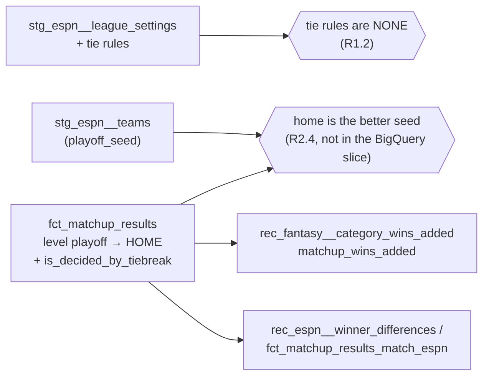

# A tied playoff matchup goes to the higher seed — design

Issue: #159 · Requirements: [requirements.md](requirements.md) · Tasks: [tasks.md](tasks.md)

## Overview

`fct_matchup_results` decides a level playoff matchup for the home side, which is where
ESPN seats the higher seed, and says so in a new column, `is_decided_by_tiebreak`. The
regular season is unchanged. Two singular tests keep the rule honest. One reads each
league-season's tie rules, newly staged in `stg_espn__league_settings`, and fails on any
value but `NONE`. The other reads ESPN's playoff seeds from `stg_espn__teams` and fails if
a playoff matchup ever has the lower seed at home. The rescoring check
`rec_fantasy__category_wins_added` counts a level playoff matchup the same way, so its
`matchup_wins_added` keeps measuring wins as the league counts them. The reconciliation
needs no change: once `winner` is the league's result, ESPN's winners agree.



## Claims ledger

Every statement this spec makes about the data, with the query that showed it. Read-only
on `data/warehouse_147.duckdb` (`main` with #147 and #152, built from empty for #147's
run evidence) and on the landed settings captures. The SQL is posted with the run
evidence on #159.

| # | Claim | Query (or script) | Result | Run on |
|---|---|---|---|---|
| C1 | Every playoff matchup whose categories are level is `TIE` in ours and `HOME` in ESPN's | `fct_matchup_results` where `playoff_tier != 'NONE'` and `winner = 'TIE'`, joined to `stg_espn__matchups` | 10 rows, all 8–8, all ESPN `HOME`: 2018 m133, m139 (winners' bracket); 2019 m143; 2021 m132; 2022 m131; 2024 m145, m155; 2025 m138, m139 (losers' consolation ladder); 2022 m136 (winners' consolation ladder) | 2026-10-18 |
| C2 | ESPN seats the better seed at home in every playoff matchup | playoff matchups of `fct_matchup_results` with both sides' `stg_espn__teams.playoff_seed`, by season and tier | 136 of 136 have the lower seed number at home (17 a season: 5 winners' bracket, 3 winners' consolation, 9 losers' consolation, in each of 2018, 2019 and 2021 to 2026); 0 with a seed missing | 2026-10-18 |
| C3 | These 10 are 10 of the rows `fct_matchup_results_match_espn` fails on, and the other 6 are #160's | #147's run evidence; `rec_espn__winner_differences` by `problem` | the test fails on 16: these 10 winners (`no_category_differs`) and 6 category results of 2021 m113. The view has 15 rows: these 10, and 5 explained flips | 2026-10-18 |
| C4 | Every season's tie rules are `NONE` | `scoringSettings.playoffMatchupTieRule`, `…TieRuleBy`, `matchupTieRule`, `…TieRuleBy` and `scheduleSettings.playoffSeedingRule` of every `stg_raw__espn_settings` capture | 2018 to 2026: `NONE` and `NONE` throughout (the `…By` values 0, or −1 in 2018); seeding `H2H_RECORD` | 2026-10-18 |
| C5 | ESPN's level regular-season matchups are ties, as ours are | `fct_matchup_results` against `stg_espn__matchups` where either winner is `TIE` | regular season: 47 `TIE` on both; 2 more where ESPN has `TIE` and ours a winner (2019 m74, 2025 m77), category flips that spec 0147 explains | 2026-10-18 |
| C6 | Outside the 10, ours and ESPN's playoff winners agree but for explained flips | playoff matchups, ours against ESPN's, by whether the categories are level | not level: 124 agree, 2 differ (2023 m138, 2025 m142, both explained by spec 0147); level: the 10 of C1 | 2026-10-18 |
| C7 | No playoff matchup rests on unverified inputs | `fct_matchup_results` where `playoff_tier != 'NONE' and has_unverified_inputs` | 0 | 2026-10-18 |
| C8 | Only pairs with a started day in a playoff matchup can see `matchup_wins_added` move | distinct (team, player) pairs with a started day in a playoff matchup's period, on either side; and of those, in the 10 level matchups. A rescored draw can level any playoff matchup (design review F1) | 2,090 of the 4,239 pairs of `rec_fantasy__category_wins_added` (352 of them in the 10 level matchups) | 2026-10-18 |
| C9 | A test reading a model outside the slice is left out of it | `dbt/selectors.yml` | every branch of `bigquery_slice` uses `indirect_selection: cautious`: a test is selected only when all its parents are | 2026-10-18 |
| C10 | `matchup_wins_added` is read by nothing, and the slopes read `category_wins_added` | `grep` of `dbt/models`, `dbt/tests`, `docs/examples` | `matchup_wins_added` appears only in its own model and YAML; `rec_fantasy__category_wins_by_group` reads `category_wins_added` | 2026-10-18 |
| C11 | The fixtures hold no playoff matchup, and the standings example reads the regular season only | `playoffTierType` in `fixtures/landing/espn/matchups`; `docs/examples/matchup_results_query.sql` | 4 matchups, all `NONE`; the example filters `playoff_tier = 'NONE'` | 2026-10-18 |
| C12 | ESPN's default for a tied playoff matchup is that the higher seed advances | ESPN's help article *Playoff Matchup Tiebreakers* (support.espn.com, article 360001140611) | "the higher-seeded team advances" is the default in standard and League Manager leagues; a commissioner may override in League Manager | 2026-10-18 |

## Alternatives considered

### What `winner` means (ADR 0080)

| | A — who advanced (chosen) | B — the category result, plus an `advancing_side` column |
|---|---|---|
| A reader of `winner` sees | the league's result | a tie the league never had, unless they know the other column |
| `fct_matchup_results_match_espn` | compares `winner`, as today | compares the new column |
| The standings and the rescoring check | right with no change of their own (the rescoring check follows, R3.1) | each must learn the new column |
| The category tie | kept, in `is_decided_by_tiebreak` and the category counts | kept, in `winner` |

**A — who advanced.** The mart reports results; a playoff matchup has a winner, and ESPN
records it. The category tie stays visible in the counts and in the flag, so nothing is
hidden.

**B — the category result.** Keeps `winner` purely arithmetical. But every reader that
wants the result (the standings, the reconciliation, the rescoring check) has to know about
a second column, and one that does not is wrong only in the playoffs, where it matters
most.

### How the higher seed is found (ADR 0081)

| | A — the home side, held by a test (chosen) | B — read `playoff_seed` in the model |
|---|---|---|
| States the rule | indirectly: home is where ESPN seats the higher seed (C2) | literally |
| The BigQuery slice | unchanged: the model reads nothing new | gains `stg_espn__teams`, a member-data endpoint not yet in BigQuery (#136) |
| If ESPN seats a lower seed at home | the build fails by name (R2.4) | right anyway |

**A — home, held by a test.** The model stays in the slice. The assumption is checked on
every build against ESPN's own seeds, and it holds on all 136 playoff matchups.

**B — read the seeds.** The literal rule, but it blocks the BigQuery slice on #136. If #136
lands, B is a small change, and the test of A shows whether it is needed.

### A tie rule the models do not know (ADR 0082)

| | A — fail the build by name (recommended) | B — apply `NONE`'s rule anyway | C — leave the matchup `TIE` |
|---|---|---|---|
| A league that sets another rule | stops, and says which | gets ESPN's default, perhaps wrongly | gets a tie ESPN never records |
| Precedent | ADR 0071 (an unknown limit fails) | — | today's behaviour |

**A** follows the project's rule for a league setting it cannot read: fail loudly, not
quietly misapply. **B** and **C** each produce a winner the league may not have.

## Decisions

| ADR | Decision | Status |
|---|---|---|
| [0080](../../adr/0080-a-matchup-winner-is-who-advanced-and-a-level-playoff-matchup-goes-to-the-higher-seed.md) | `winner` is who advanced: a level playoff matchup goes to the higher seed, flagged by `is_decided_by_tiebreak`; a level regular-season matchup stays a tie; `matchup_wins_added` counts the same way | proposed (chosen by the owner, 2026-10-18) |
| [0081](../../adr/0081-the-higher-seed-is-found-as-the-home-side-and-a-test-holds-home-to-the-better-seed.md) | The higher seed is found as the home side; a test outside the BigQuery slice holds home to the better seed | proposed (chosen by the owner, 2026-10-18) |
| [0082](../../adr/0082-a-tie-rule-the-models-do-not-know-fails-the-build.md) | A playoff or regular-season tie rule other than `NONE` fails the build | proposed (chosen by the owner, 2026-10-18) |

## Detailed design

### `stg_espn__league_settings` (changed, R1.1)

Two columns, text, read with `fo_json_text` from the settings payload:
`playoff_matchup_tie_rule` (`$.settings.scoringSettings.playoffMatchupTieRule`) and
`matchup_tie_rule` (`$.settings.scoringSettings.matchupTieRule`). The `…By` fields are not
staged: with `NONE` they are 0 or −1 and mean nothing (C4). The fixture allowlist of
`scripts/make_fixtures.py` gains both paths, and the fixtures are regenerated, so CI sees
the setting. `ingestion/tests/test_make_fixtures.py`'s own copy of the allowlist gains them
too.

### Singular test `stg_espn__league_settings_tie_rules_are_understood` (new, R1.2)

Returns each league-season with rosters (`int_fantasy__league_seasons.has_rosters`) whose
`playoff_matchup_tie_rule` or `matchup_tie_rule` is distinct from `NONE` (null included),
with both values.

### `fct_matchup_results` (changed, R2.1–R2.3, R2.5)

```sql
case
    when home.categories_undecided > 0 then null
    when home.category_wins > home.category_losses then 'HOME'
    when home.category_wins < home.category_losses then 'AWAY'
    when sides.playoff_tier != 'NONE' then 'HOME'   -- the higher seed advances (ADRs 0080, 0081)
    else 'TIE'
end as winner,
(
    home.categories_undecided = 0
    and home.category_wins = home.category_losses
    and sides.playoff_tier != 'NONE'
) as is_decided_by_tiebreak
```

`playoff_tier` comes from `int_fantasy__matchup_sides`, as now; nothing new is read, so
the model stays in the slice. `is_decided_by_tiebreak` is boolean, not null, documented in
the mart's YAML, and gets a `not_null` test. The header comment's paragraph on playoff ties
is rewritten: the rule, ESPN's default (C12), the setting (C4), and the test that holds home
to the better seed. The YAML description of `winner` says it is who advanced.

### Singular test `fct_matchup_results_home_is_the_better_seed` (new, R2.4)

For every playoff matchup of `fct_matchup_results` (`playoff_tier != 'NONE'`), LEFT joins
both teams' `playoff_seed` from `stg_espn__teams` (so a team with no row there is a null
seed, not a dropped matchup) and returns the matchup when the home seed is not lower than
the away seed, or either is null. Its parents include
`stg_espn__teams`, which is not in the slice, so the slice's `cautious` selection leaves
it out (C9); `test_bigquery_slice.py`'s counts do not move.

### `rec_fantasy__category_wins_added` (changed, R3.1, R3.2)

The `matchups` CTE carries, per side, whether it is the home side
(`results.home_team_id = sides.fantasy_team_id`) and whether the matchup is a playoff
matchup (`results.playoff_tier != 'NONE'`), through to `matchup_draws`. There, both the
actual and the swapped matchup result score a level matchup as 0.5 in the regular season,
and in a playoff matchup as 1.0 for the home side and 0 for the away side: the rule of
`fct_matchup_results`, written once more. `category_wins_added` is untouched. The header's
sentence "equal is a tie" says which matchups.

### Unchanged

`rec_espn__winner_differences` and `fct_matchup_results_match_espn` compare `winner` with
ESPN's as now: the 10 rows stop differing (C1, C3). `docs/examples/matchup_results_query.sql`
reads the regular season only (C11).

## Test strategy

| Requirement | Test | Catches |
|---|---|---|
| R1.1 | the existing unit test of `stg_espn__league_settings` gains both settings in its payload and both columns in its expectation, one of them a value other than `NONE` | a setting read from the wrong path, or the two swapped |
| R1.2 | singular `stg_espn__league_settings_tie_rules_are_understood`; shown to fail on a CI warehouse copy with a planted value (`playoff_matchup_tie_rule` set to another value; `matchup_tie_rule` null) | a rule the models do not know applied silently |
| R2.1–R2.3 | dbt unit test of `fct_matchup_results`: a level playoff matchup (`HOME`, flag true); a level regular-season matchup (`TIE`, flag false); a playoff matchup won on categories by the away side (`AWAY`, flag false); a level playoff matchup with an undecided category (null, flag false) | the tiebreak missing; applied in the regular season; overriding a real result; deciding an undecided matchup |
| R2.4 | singular `fct_matchup_results_home_is_the_better_seed`; shown to fail on a real warehouse copy with two teams' seeds swapped | the home side assumed when ESPN seated the lower seed there |
| R2.5 | `test_bigquery_slice.py` (counts unchanged), `test_dbt_portable_sql_rule.py`, `dbt run --target bq --selector bigquery_slice --empty` | the model reading outside the slice, or SQL BigQuery refuses |
| R3.1 | dbt unit test of `rec_fantasy__category_wins_added`: a level playoff matchup for a home pair and an away pair, and a level regular-season one | a playoff tie still counted a half; the home and away sides swapped |
| R3.2 | the real data: `category_wins_added` and the group slopes unchanged | the tiebreak leaking into category results |
| all | the expected values on the eight-season warehouse | everything |

Each new test is seen to fail against the code it covers before the build's PR opens.

## Risks

- **The home side is not the rule, only where ESPN puts it.** If ESPN ever seats a lower
  seed at home, the model would give a level matchup to the wrong side. Likelihood: not
  seen in 136 matchups; the build fails by name if it happens (R2.4), and ADR 0081 says
  what to do then.
- **A commissioner can override the default** in a League Manager league (C12). Such a
  result would show as a winner difference in the reconciliation, as any unexplained
  difference does. Not seen here.
- **Seeds are read as of the capture.** `stg_espn__teams` is the newest teams capture of a
  season, fetched after it ended, so the test checks the final seeds. Whether ESPN's
  `playoffSeed` can move during the playoffs is not established (see *Open questions*);
  the model does not read seeds, so only the guard depends on it.

## Open questions

- What ESPN's other `playoffMatchupTieRule` values do. Not needed until a league sets one
  (ADR 0082).
- Whether a team's `playoffSeed` can change once the playoffs start. The landed teams
  captures are post-season, so they cannot show it; the guard checks the final seeds,
  which are the ones the bracket was built on unless ESPN reseeds.

## Review log

| Source | Finding | Resolution |
|---|---|---|
| design-review | F1 (P1): rescoring can level any playoff matchup, so `matchup_wins_added` can move outside the 10 | Changed: C8 and the expected value now bound the change by pairs with a playoff started day (2,090) |
| design-review | F2 (P2): the goal says the build fails on a lower seed at home, but the guard is not in the BigQuery slice | Changed: the goal says the DuckDB build, and BigQuery once #136 lands (ADR 0081 already says so) |
| design-review | F3 (P2): inner joins in the seed test would drop a matchup whose team has no seed row | Changed: the test LEFT joins both seeds |
| design-review | F4 (P2): "a seed does not change once the playoffs start" has no ledger row | Changed: removed as a claim; now a risk worded as unverified, and an open question |

## Amendments
