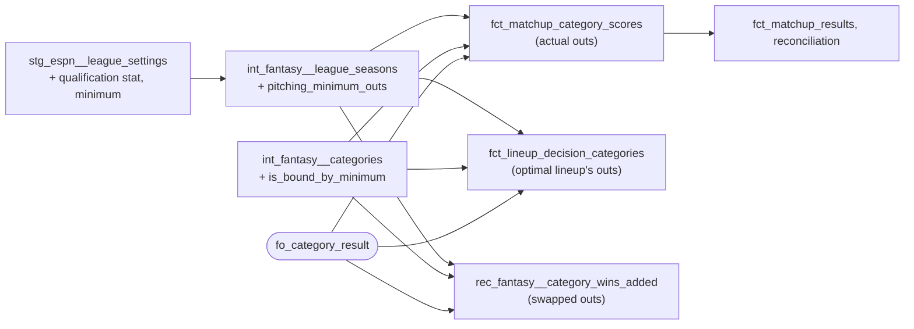

# A side below the league's pitching minimum loses its ratio categories — design

Issue: #160 · Requirements: [requirements.md](requirements.md) · Tasks: [tasks.md](tasks.md)

## Overview

Each league-season's pitching minimum is staged from its settings and carried on
`int_fantasy__league_seasons` as `pitching_minimum_outs`. `int_fantasy__categories` marks
the categories the minimum binds: every component a pitching one, and the category a rate
or lower-is-better. One macro, `fo_category_result`, decides a category from both values,
whether lower is better, whether the category is bound, and whether each side is below the
minimum. All three places that decide a category result call it:
- the fact, with each side's actual outs;
- the optimal lineup, with its own outs;
- the rescoring check, with the swapped side's outs.

A singular test fails the build on a minimum the models cannot read.



## Claims ledger

Every statement this spec makes about the data, with the query that showed it. Read-only
on `data/warehouse_147.duckdb` (`main` with #147 and #152) and on the landed settings
captures. The SQL is posted with the spec PR on #160.

| # | Claim | Query (or script) | Result | Run on |
|---|---|---|---|---|
| C1 | Every season from 2021 sets a minimum of 30 outs on stat 34 | `scoringSettings.statQualificationMinimum` of every `stg_raw__espn_settings` capture | 2018, 2019: none; 2020: `{"statId": 34, "limitValue": 3000.0}` (rotisserie, not covered); 2021 to 2026: `{"statId": 34, "limitValue": 30.0}`; one value per season across all 21 captures | 2026-10-18 |
| C2 | One side in eight seasons was below 30 outs | `int_fantasy__matchup_side_totals.outs_recorded < 30` | 2021, matchup 113 (period 19, 7 days), team 5: 24 outs. The next lowest is 40 (2024), and 43 in 2018, which has no minimum | 2026-10-18 |
| C3 | ESPN turned exactly WHIP, K/9 and L into losses for that side, and kept CG a tie | `fct_matchup_category_scores` with `rec_espn__category_result_differences`, 2021 m113, both sides | team 5's pitching categories: IP LOSS (24 vs 171), WHIP ours WIN (1.25 vs 1.263) / ESPN LOSS, ERA LOSS (6.75 vs 4.105), K LOSS, K/9 ours WIN (10.125 vs 7.263) / ESPN LOSS, W LOSS, L ours WIN (1 vs 4) / ESPN LOSS, SV LOSS, CG TIE (0 vs 0) / ESPN TIE. Team 8's are the complement. Batting: all match, including B_SO (lower is better), WIN for team 5 | 2026-10-18 |
| C4 | Those are the 6 category results `fct_matchup_results_match_espn` fails on that no other spec explains | #147's run evidence; `rec_espn__category_result_differences` by status | `unexplained` 6, all 2021 m113 (WHIP, K/9, L, both sides); the test's other 10 rows are #159's winners | 2026-10-18 |
| C5 | The categories the minimum binds, found from the components, are WHIP, ERA, K/9 and L in every season from 2021 | `int_fantasy__categories` whose components are all pitching columns and which have a denominator part or are lower-is-better | 2021 to 2026: WHIP, ERA, K/9, L; no batting category (B_SO, lower-is-better, has batting components) | 2026-10-18 |
| C6 | Scaling the minimum by period length changes no side | sides with outs below 30 × days / 7, by season and period length | only 2021 m113 team 5 (7 days); in every longer period (8 to 14 days) no side below its scaled minimum (lowest: 40 outs in an 8-day 2024 period, against 34.3) | 2026-10-18 |
| C7 | Team 5's optimal lineup in that matchup is below the minimum too | `int_fantasy__lineup_category_totals`, category 34 (outs), 2021 on, below 30 | 2021 m113 team 5: actual 24, optimal 27. No other lineup, actual or optimal, below 30 | 2026-10-18 |
| C8 | At most 49 rescored pairs can see a category result move | pairs with a started day in 2021 m113 (teams 5 and 8); and pairs whose side's outs less their own in a matchup fall below 30 | 41 in 2021 m113; 8 others (11 pair-matchups) from 2021 on; of 3,277 pairs from 2021 on | 2026-10-18 |
| C9 | Category results are decided in three places, and the lineup mart's optimal rule is an inline copy | `grep "'WIN'"` in `dbt/models`; the header of `fct_lineup_decision_categories` | `fct_matchup_category_scores`, `fct_lineup_decision_categories` (whose comment says "if that rule changes, change it in both"), `rec_fantasy__category_wins_added`; `fct_matchup_results` counts the fact's results | 2026-10-18 |
| C10 | `fct_lineup_decision_categories` copies its actual results from the fact | its header | "The actual figures are fct_matchup_category_scores', copied" | 2026-10-18 |
| C11 | ESPN's help pages do not document what a side below the minimum loses | searches of support.espn.com and the web for H2H categories minimum innings | no ESPN page on it; other hosts' roto rules (last place in the ratio categories) do not apply to H2H | 2026-10-18 |
| C12 | `fct_matchup_category_scores`, `int_fantasy__categories` and `int_fantasy__league_seasons` are in the BigQuery slice; the lineup mart and the rescoring check are not | `test_bigquery_slice.py`'s `SLICE_MODELS` | as stated | 2026-10-18 |

## Alternatives considered

### Which categories a side below the minimum loses (ADR 0083)

The one case (C3) is the only evidence. Each reading is tested against its 9 pitching
results:

| Reading | WHIP | ERA | K/9 | L | IP, K, W, SV | CG (0–0) | Fits |
|---|---|---|---|---|---|---|---|
| Pitching rates and lower-is-better (chosen) | LOSS | LOSS | LOSS | LOSS | by value | by value: TIE | 9 of 9 |
| Pitching rates only | LOSS | LOSS | LOSS | by value: WIN | by value | TIE | 8 of 9 (L) |
| Every pitching category | LOSS | LOSS | LOSS | LOSS | LOSS | LOSS | 8 of 9 (CG) |

The chosen reading is also what a minimum exists for: a team that barely pitches should
not win the categories that reward pitching little (ratios, and fewer losses).

**Both sides below** (not observed). The owner chose a **tie** in the bound categories:
neither side qualifies, and the results stay complementary. The alternatives: judging by
value (the minimum then means nothing when both fall short); or failing the build (a live
season would stop until a spec settled it).

### Where the rule lives (ADR 0084)

| | A — one macro, called in three places (chosen) | B — a column of results computed once, joined in | C — inline in each model |
|---|---|---|---|
| Copies of the rule | 1 | 1 | 3 (today: 2, with a "change it in both" comment) |
| Inputs that differ per place | passed in: actual, optimal or swapped outs | cannot: the optimal and swapped values are not in one table | each writes its own |
| BigQuery | dispatched like every `fo_*` macro | — | — |

**A.** The rule is the same, and the inputs differ by place: actual outs, the optimal
lineup's outs, the swapped side's outs. A macro takes them as arguments. **B** cannot hold
the optimal and swapped results, which are made inside their models. **C** is how the rule
drifted into two copies with a warning comment.

### The minimum's scale and the settings the models cannot read (ADR 0085)

The minimum applies per matchup, as given (C1): 30 outs, whatever the period's length.
Scaling it by days, as the games-started limit is (ADR 0071), changes no side in six
seasons (C6). So the literal reading is taken, and the other is recorded as an open
question. A minimum on another stat, or in a league-season that is not head-to-head, fails
the build: it is not understood, and applying it as outs would be a guess (ADR 0071's rule
for an unknown limit).

## Decisions

| ADR | Decision | Status |
|---|---|---|
| [0083](../../adr/0083-a-side-below-the-pitching-minimum-loses-its-ratio-categories.md) | A side below the minimum loses every bound category (pitching, and a rate or lower-is-better); both below is a tie | accepted |
| [0084](../../adr/0084-every-category-result-is-decided-by-one-macro-that-applies-the-minimum.md) | Every place that decides a category result applies the minimum, through one macro | accepted |
| [0085](../../adr/0085-the-pitching-minimum-applies-per-matchup-and-an-unread-one-fails-the-build.md) | The minimum applies per matchup as given; a minimum on another stat or outside head-to-head fails the build | accepted |

## Detailed design

### `stg_espn__league_settings` (changed, R1.1)

Two columns: `qualification_stat_id` (integer, `$.settings.scoringSettings.statQualificationMinimum.statId`)
and `qualification_minimum` (float, `….limitValue`), null when the settings have no
minimum. Both go into the fixture allowlist (`settings.scoringSettings.statQualificationMinimum`),
and its copy in `ingestion/tests/test_make_fixtures.py`, and the fixtures are regenerated.

### Singular test `stg_espn__league_settings_qualification_is_understood` (new, R1.2)

For each league-season with rosters it returns any whose minimum it cannot read: a
`qualification_minimum` with a `qualification_stat_id` distinct from 34 (null included),
a `qualification_stat_id` with no `qualification_minimum`, or any minimum with a
`scoring_type` that is not known to start with `H2H_` (null included). It names the
league-season, the setting and the scoring type.

### `int_fantasy__league_seasons` (changed, R1.3)

Gains `pitching_minimum_outs`: `qualification_minimum` when `qualification_stat_id` = 34,
else null. A float, compared exactly with integer outs.

### `int_fantasy__categories` (changed, R2.1)

Gains `is_bound_by_minimum`, a boolean that is never null. It is true when every
component of the category in `int_fantasy__stat_components` is one of
`fo_pitching_columns()`, and the category has a `denominator` part or `is_lower_better`.
Nothing names a stat id.

### Macro `fo_category_result` (new, R2.2–R2.5, R3.4)

`fo_category_result(team_value, opponent_value, is_lower_better, is_bound, team_below, opponent_below)`,
in `dbt/macros/`, portable (it is called by a slice model):

```sql
case
    when {{ is_bound }} and {{ team_below }} and {{ opponent_below }} then 'TIE'
    when {{ is_bound }} and {{ team_below }} then 'LOSS'
    when {{ is_bound }} and {{ opponent_below }} then 'WIN'
    when {{ team_value }} is null or {{ opponent_value }} is null then null
    when round({{ team_value }}, 9) = round({{ opponent_value }}, 9) then 'TIE'
    when (round({{ team_value }}, 9) < round({{ opponent_value }}, 9)) = {{ is_lower_better }} then 'WIN'
    else 'LOSS'
end
```

The value comparison is today's rule, moved: 9 decimal places, null on a null value.
`team_below` and `opponent_below` are false, not null, when the league-season sets no
minimum: each caller coalesces `outs < pitching_minimum_outs` to false.

### `fct_matchup_category_scores` (changed, R3.1)

Each side's actual `outs_recorded` comes from `int_fantasy__matchup_side_totals`, and the
minimum from `int_fantasy__league_seasons`. The model gains `is_below_minimum` (the team's
side) and `is_opponent_below_minimum`, both booleans that are never null. `result` is
`fo_category_result(...)`. The header gains a paragraph on the minimum (ADR 0083).

### `fct_lineup_decision_categories` (changed, R3.2)

`optimal_result` is `fo_category_result(optimal_value, opponent_value, …, is_bound,
optimal_below, opponent_below)`. `optimal_below` is the optimal lineup's own outs below
the minimum: `int_fantasy__lineup_category_totals` gains `outs_recorded`, the side's outs
under that lineup, on every row, a column at its grain. `opponent_below` is the fact's.
The header's "copied here … change it in both" paragraph is replaced by a pointer to the
macro. An unvalued optimal row (R5.4 of spec 0012: `optimal_value` null because a team-day
of the period is unvalued) keeps a null `optimal_result`: the macro is called only when the
optimal row is valued, so the minimum never decides a lineup that has no totals. Its
`outs_recorded` is null on such a row.

### `rec_fantasy__category_wins_added` (changed, R3.3)

The actual result is decided by the macro with both sides' actual outs. The swapped result
is decided with the swapped side's outs, the component total after the swap (each draw's
whole-number outs) and the opponent's actual outs. `category_wins_added` and
`matchup_wins_added` then follow. The model leaves out of a draw a category whose swapped
value is undefined (its header); that filter now keeps a bound category whenever either
side is below the minimum, since the minimum decides it whatever the value (R2.5).

## Test strategy

| Requirement | Test | Catches |
|---|---|---|
| R1.1 | the unit test of `stg_espn__league_settings` gains the minimum in one capture and none in another | a field read from the wrong path; a missing minimum not null |
| R1.2 | singular `stg_espn__league_settings_qualification_is_understood`; shown to fail on CI copies with a stat 41 minimum and with a rotisserie scoring type | an unknown minimum applied as outs |
| R1.3 | the unit test of `int_fantasy__league_seasons` (or a new one): stat 34, no minimum | a minimum on another stat used |
| R2.1 | unit test of `int_fantasy__categories`: WHIP-, L-, K- and B_SO-shaped categories | a batting lower-is-better category bound; a volume category bound |
| R2.2–R2.5 | unit tests of `fct_matchup_category_scores`: one side below (bound categories LOSS/WIN against the values; an unbound category by value; a 0–0 count TIE); both below (bound TIE); none below; no minimum set; a side with 0 outs (a null rate, LOSS) | each rule, and the order of the minimum and the null rule |
| R3.2 | unit test of `fct_lineup_decision_categories`: an optimal lineup below the minimum, the actual not | the optimal result judged by value, or by the actual's outs |
| R3.3 | unit test of `rec_fantasy__category_wins_added`: a swap that takes a side below the minimum | the rescored result ignoring the minimum |
| R3.5 | `test_bigquery_slice.py`, `test_dbt_portable_sql_rule.py`, `dbt run --target bq --selector bigquery_slice --empty` | a slice model reading outside it; SQL BigQuery refuses |
| all | the expected values on the eight-season warehouse | everything |

Each new test is seen to fail against the code it covers before the build's PR opens.

## Risks

- **The rule rests on one case.** The chosen reading fits all 9 of its pitching results,
  and the other two readings each miss one (C3). A league that applies the minimum
  differently would show as category differences in the reconciliation.
- **Both sides below the minimum is unobserved.** The tie is a choice, not a measurement.
  If ESPN does otherwise, the reconciliation shows it.
- **Rescoring moves.** At most 49 pairs (C8). `values_track_rescored_category_wins` reads
  the slopes that `category_wins_added` feeds, so the 2023 SP slope (#161) can move by
  what those pairs carry. The test's failing row is expected to stay the same.

## Open questions

- Whether ESPN scales the minimum by a matchup period's length. No side would move either
  way (C6).
- What ESPN does when both sides are below the minimum. The owner chose a tie (ADR 0083).

## Review log

| Source | Finding | Resolution |
|---|---|---|
| design-review | F1 (P1): the rescoring drops a draw's category when the swapped rate is null, before the minimum could decide it | Changed: the filter keeps a bound category when either side is below the minimum |
| design-review | F2 (P1): the guard misses a minimum with a null or unreadable stat id, a stat id with no minimum, and a null scoring type | Changed: the test fails on each of those |
| design-review | F3 (P1): the macro would decide an unvalued optimal lineup through the minimum | Changed: an unvalued optimal row keeps a null result; the macro is called only on valued rows |
| design-review | F4 (P2): "every other relation identical" contradicts the slopes moving | Changed: the expected values name `rec_fantasy__category_wins_by_group` as allowed to move, in 2021 to 2026 only |
| design-review | F5 (P2): 2020's minimum (3,000) is missing from the expected values | Changed: 3,000 in 2020, a league-season without rosters that no model applies it to |
| owner | ADR 0085 and the new columns' names | ADR 0085 chosen as written; `opponent_below_minimum` renamed `is_opponent_below_minimum`, to pair with `is_below_minimum` (2026-10-18) |

## Amendments

- **2026-10-18, build: a present minimum that cannot be read.** The pre-PR review (#166 trial) found that a `statQualificationMinimum` present in the settings but with a `statId` and a `limitValue` that both fail to parse stages as null and null. That is the same as no minimum, so the singular test passed it and the models would apply none, against R1.2 ("cannot be read"). By the owner's choice, `stg_espn__league_settings` gains `has_qualification_minimum` (boolean: the setting is present, by `fo_json_exists`). `stg_espn__league_settings_qualification_is_understood` also fails when it is true and either field is null, and its "any minimum" branch reads it. The unit test of the model gains a capture with both fields unreadable. R1.2 is unchanged; this is the case it already named.
