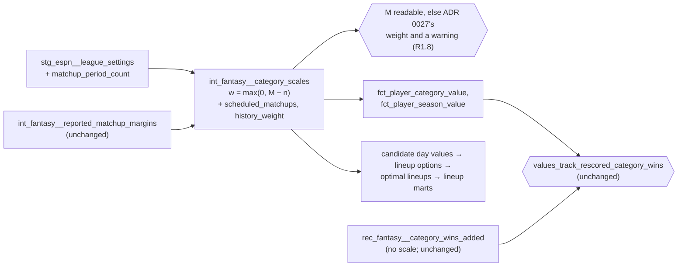

# A season's scale becomes its own as its matchups are played — design

Issue: #161 · Requirements: [requirements.md](requirements.md) · Tasks: [tasks.md](tasks.md)

## Overview

ADR 0027 scales a category from the league's earlier seasons, counted as a fixed 100
matchups, blended with the season's own decided matchups. This spec keeps the blend and
changes what history counts as. History stands in for the season's **matchups not yet
played**: w = M − n, where M is the league-season's scheduled regular-season matchups and
n its decided ones in the category.

The scale then estimates the margin of the whole season being valued. The played
matchups give their own margins, and history predicts the rest. It is p before a matchup
is played, close to ADR 0027's blend early on (w = 114 against 100 after two periods),
and the season's own once the season is complete.

M comes from the settings, as the matchup period count times floor(team count / 2), and
is staged in `stg_espn__league_settings`. Nothing downstream changes its rule; every value
from 2019 on moves, because each season's scale moves. A covered league-season whose M
cannot be read is scaled as ADR 0027 has it, and a warn-severity test names it.

## Claims ledger

Every statement this spec makes about the data, with the query that showed it.
Read-only, on `data/warehouse_160_base.duckdb` (the eight seasons, built from empty from
`main` at 718d494) and on scratch copies of it rebuilt downstream of the scales at other
values of `fantasy_scale_prior_matchups`. The SQL is posted with the spec PR on #161.

| # | Claim | Query (or script) | Result | Run on |
|---|---|---|---|---|
| C1 | 2023 SP is the one failing row, and #152 moved it down | `rec_fantasy__category_wins_by_group where problem is not null` | 2023 SP, slope 0.3333 (0.336 before #152, per the issue) | 2026-10-18 |
| C2 | Starters' slopes run below 0.40 in most seasons | the same view, all rows | SP 0.387, 0.365, 0.385, 0.388, **0.333**, 0.353, 0.417, 0.426 (2018, 2019, 2021 to 2026); hitters 0.372 to 0.430 | 2026-10-18 |
| C3 | In 2023, every pitching scale undershot the season's own margins | `int_fantasy__category_scales` against the root mean square of `int_fantasy__reported_matchup_margins.standard_margin` where `is_measured`, per category and season | blended ÷ own in 2023: ERA 0.924, IP 0.908, K 0.932, WHIP 0.954, L 0.956, W 0.966, K/9 1.036; the season's own margins against history: IP 61.6 vs 47.9 outs, ERA 2.25 vs 1.84. Batting went the other way (R 1.045, HR 1.054) | 2026-10-18 |
| C4 | History carries 42% to 44% of a finished season's scale | 100 / (100 + n), n = `matchups_measured` of the categories that use history | 0.442 (n = 126), 0.420 (2024, 138), 0.431 (2025, 132) | 2026-10-18 |
| C5 | At season end, every category that uses history has n = M | `matchups_measured` by `scale_source`, against regular-season matchups in `stg_espn__matchups` | `prior_and_current_seasons`: n = 126, 126, 126, 126, 138, 132, 126 (2019, 2021 to 2026) = the regular-season matchups scheduled and decided; `current_season` rows (2018; 2019 AVG; 2022 SVHD) count 143, every matchup incl. playoffs, as ADR 0010 does | 2026-10-18 |
| C6 | Slopes under each history weight | three scratch copies rebuilt `int_fantasy__category_scales+` with the variable at 50, 25 and 0.001; the view | 2023 SP: 0.3333 (100), 0.3386 (50), 0.3424 (25), **0.3474** (0.001). At 0.001 every judged group is inside the band: SP 0.3474 to 0.4271, hitters 0.3623 to 0.4207 from 2019; 2018 unchanged (0.3874, 0.3985); RP 0.3305 to 0.4445, not judged. The 2023 SP–hitter gap narrows from −0.039 to −0.015 | 2026-10-18 |
| C7 | A season's slope has a sampling SD of about 0.022 | 2,000 bootstrap resamples of the pairs of each group and season | SP SD 0.017 to 0.029; 2023 SP 95% interval 0.292 to 0.378. Pair resampling ignores pairs sharing a matchup, so it understates | 2026-10-18 |
| C8 | The start replacement level is not the 2023 cause | `int_fantasy__replacement_levels` (`start`) against the mean MLB start (`int_mlb__player_game_days`, `games_started > 0`) | replacement minus MLB ERA: +0.37, +0.70, +0.60, +0.71, **+0.55**, +0.51, +0.49, +0.65; WHIP +.063 to +.142, 2023 +.088 | 2026-10-18 |
| C9 | The settings give M, in every capture landed | `scheduleSettings.matchupPeriodCount` and `settings.size` of every `stg_raw__espn_settings` capture, against `stg_espn__matchups` | 21, 21, 21, 21, 21, 23, 22, 21 periods; 12 teams; 21 × 6 = 126, 23 × 6 = 138, 22 × 6 = 132 = the regular-season matchups of each season. One value per season across all 21 captures. 2020 (rotisserie) has 1. Every capture is from late in its season (the earliest is 2026-09-26), so whether the count is set before a season starts is not shown | 2026-10-18 |
| C10 | What moves, at w = 0.001 | per relation, `except all` both ways between the base and the prototype, by season (`compare_warehouses.py` ran out of 14 GB on these tables; the count ran under a 6 GB limit) | 10 tables differ, none in 2018: `int_fantasy__category_scales` 119 of 139; `fct_player_category_value` 29,889 of 73,553; `fct_player_season_value` 3,676 of 4,240; `int_fantasy__candidate_day_values` 172,453 of 198,363; `int_fantasy__lineup_options` 383,536 of 437,559; `int_fantasy__optimal_lineups` 1,888 of 162,990; `fct_lineup_decisions` 14,909 of 17,628; `int_fantasy__lineup_category_totals` and `fct_lineup_decision_categories` 871 each; `fct_transaction_impact` 686 of 737 (2026). The rescoring check is unchanged | 2026-10-18 |
| C11 | Where 2023's starter tilt sits by category | the rescoring check's `category_results` compiled and summed per category (it reproduces the model's totals to 4e-15), against `fct_player_category_value.scaled_value` | 2023 SP slope by category: K 0.220, WHIP 0.252, IP 0.319, L 0.332 (other seasons: K 0.32 to 0.53, WHIP 0.33 to 0.49); ERA 0.448 and K/9 0.395, normal. K/9 is 38% of the group's value variance in 2023, 26% to 36% in other seasons | 2026-10-18 |
| C12 | A weight of exactly 0 is not the rule | the copy at 0 | it nulls the scale of every category with no history (all of 2018; 2019 AVG) and, through them, 2018's slopes. That is why the prototype is at 0.001 | 2026-10-18 |
| C13 | ADR 0027's evidence: history leads early, the season leads late | ADR 0027, *Context* (measured 2026-10-08) | predicting the rest of a season: from its first two periods 23.8% error, from earlier seasons 9.0%; after sixteen periods the season is ahead, 11.5% against 12.7% | 2026-10-18 |
| C14 | The scale and the settings are in the BigQuery slice | `SLICE_MODELS` in `ingestion/tests/test_bigquery_slice.py` | `int_fantasy__category_scales`, `int_fantasy__reported_matchup_margins` and `stg_espn__league_settings` are listed | 2026-10-18 |
| C15 | A null M would pass unseen today | the YAML of `int_fantasy__category_scales` | `margin_scale` and `side_denominator` carry no `not_null`; a null weight would make them null with no test failing at that model | 2026-10-18 |
| C17 | In-season, M − n is never worse than the fixed 100 (retrospective) | for each category using history, 2019 and 2021–2026 (119), the scale after k regular-season periods under w = 100, w = M − n and the season alone, from `int_fantasy__reported_matchup_margins` joined to `stg_espn__matchups.matchup_period` and the prior scale of `int_fantasy__category_scales`; mean absolute error against the whole season's and the rest of the season's margin. Uses final captures (a decided matchup's margin does not change), so it is a retrospective estimate | whole season, k = 1, 2, 4, 6, 8, 12, 16, 20: fixed 100 8.2, 7.9, 7.4, 6.6, 6.1, 5.2, 4.5, 3.9%; M − n 8.2, 8.0, 7.4, 6.6, 5.9, 4.7, 3.3, 1.6%; season alone 23.8 … 1.5%. Rest of season: fixed 100 and M − n within 0.4 points of each other at every k (8.7% to 11.7% through k = 16) | 2026-10-18 |
| C16 | The CI fixture build scales nothing from history | `int_fantasy__category_scales` of the CI warehouse (`dbt build --target ci`) | 2026 only, all 17 categories `current_season`, 2 prior matchups against the threshold of 100 | 2026-10-18 |

## Alternatives considered

### How much history counts for (ADR 0086)

| | A — the matchups not yet played, M − n (recommended) | B — min(100, M − n) | C — 100 × (1 − n / M) | D — a lower fixed weight (25) | E — keep ADR 0027; move the band |
|---|---|---|---|---|---|
| Scale before any matchup | p | p | p | p | p |
| After two periods (n = 12 of 126): the season's own share | 9.5% | 10.7% | 11.7% | 32% | 10.7% |
| Scale of a finished season | the season's own | the season's own | the season's own | 83% own, 17% history | 56% own, 44% history |
| 2023 SP slope (C6) | 0.3474 | 0.3474 | 0.3474 | 0.3424 | 0.3333 (test fails) |
| A tuned number | none | 100 | 100 | 25 | 100 |
| What the scale means | the margin of the whole season, the unplayed part predicted by history | ADR 0027 until 100 matchups remain, then the same as A | a schedule with no estimate behind it | ADR 0027 with less history | — |
| Needs M | yes | yes | yes | no | no |

**A — the matchups not yet played.** It is ADR 0027's formula with one change that gives
the blend a meaning. The scale estimates the season's whole margin: n matchups are
measured, and M − n are predicted by history. Early in a season it is within a point of
ADR 0027 (C13 is why that matters). By the end the earlier seasons drop out, as ADR
0027's own measurements say they should. It has no tuned number.

**B — capped at 100.** Identical to A once 100 or fewer matchups remain. Before that it
counts history as 100, not as the 114 to 126 unplayed. It keeps ADR 0027 literally in the
first weeks, but the cap is the tuned number A does away with.

**C — a linear fade.** It reaches the same end, but its middle is a schedule, not an
estimate: half the season played gives history 50 matchups of weight, whatever is left to
play.

**D — a lower fixed weight.** The tuned weight ADR 0027's drivers rule out. A finished
season still leans on history, and 2023 passes by 0.002.

**E — move the band.** The owner framed #161 as a tilt to fix, not a band to widen
(2026-10-18). Re-centring the band on the data would weaken the check (C7: a band from
noise centred at 0.40 still fails 2023).

### Where M comes from (ADR 0086)

| | Settings: periods × floor(teams / 2) (recommended) | The scheduled matchups in `stg_espn__matchups` |
|---|---|---|
| Known before the season | yes: every capture holds it (C9) | unproven: no in-season capture of a past season is landed |
| Byes | floor(teams / 2) a period, so an odd league is right | counted directly |
| A schedule changed mid-season | follows the newest settings capture | follows the newest matchups capture |

The settings are the grounded source, and they are already staged once per league-season.

## Decisions

| ADR | Decision | Status |
|---|---|---|
| [0086](../../adr/0086-history-counts-for-the-seasons-matchups-not-yet-played.md) | History in a category's scale counts for the season's matchups not yet played (M − n); M from the settings; a missing M falls back to ADR 0027's weight with a warning. Amends ADR 0027 | proposed (chosen by the owner, 2026-10-18) |

## Detailed design

### `stg_espn__league_settings` (changed, R1.2)

Gains `matchup_period_count`: integer, `fo_json_int('payload',
'$.settings.scheduleSettings.matchupPeriodCount')`. `team_count` is already staged. The
fixture allowlist of `scripts/make_fixtures.py`, and its copy in
`ingestion/tests/test_make_fixtures.py`, gain `settings.scheduleSettings.matchupPeriodCount`;
the fixtures are regenerated. The unit test of the model gains the field.

### `int_fantasy__category_scales` (changed, R1.1–R1.7)

- **M.** Joined from `stg_espn__league_settings` by league-season:
  `scheduled_matchups = matchup_period_count * floor(team_count / 2)`, cast to an integer.
  Written for both warehouses: `floor` and `cast(… as bigint)` are accepted by both.
- **The weight.** In `chosen`, where the category uses history, `history_weight`
  becomes `greatest(scheduled_matchups - own_matchups, 0)` when `scheduled_matchups` is
  positive. Otherwise it is `fantasy_scale_prior_matchups` (R1.8: ADR 0027's weight, as
  today). `fantasy_scale_prior_matchups` stays,
  and only as the threshold for using history at all (`uses_history`), as its name says.
- **The formulas** for `margin_scale` and `side_denominator` are unchanged in form; they
  read the new weight. With n = 0 the scale is p, because the weight cancels, as now.
- **`scale_source` keeps its meaning:** which formula the scale uses. That is the blend of
  the reported regular-season margins (`prior_and_current_seasons`), or ADR 0010's own
  totals, playoffs included (`current_season`). A blend with a weight of 0 is still the
  first: it is the season's reported regular-season margins, not ADR 0010's scale. Its
  YAML description gains that sentence, and points to `history_weight` for how much
  history counted. `int_fantasy__category_scales_using_history_rest_on_enough_of_it`
  checks eligibility, which is unchanged.
- **New output columns:** `scheduled_matchups` (integer; null where the settings do not
  give it) and `history_weight` (integer; null where the category does not use
  history). Both are added to the enforced contract. Named by the owner on 2026-10-18,
  with `stg_espn__league_settings.matchup_period_count`.
- **Header:** the paragraph on the blend is rewritten. History stands for the season's
  matchups not yet played (ADR 0086), and the scale is the estimate of the whole season's
  margin. It is p before the first matchup, the season's own once all are played, and
  close to ADR 0027's 100 early on. The "Why 100, twice" paragraph keeps its first use,
  the threshold, and says the weight is no longer 100.

### Singular test `int_fantasy__category_scales_know_the_scheduled_matchups` (new, warn, R1.8)

`severity: warn`, by the owner's choice (2026-10-18): a missing M falls back to ADR 0027's
weight rather than stopping a live season. It returns each league-season with rosters,
from `int_fantasy__league_seasons` where `has_rosters`, whose settings give no positive M
(`matchup_period_count` or `team_count` null, or M ≤ 0), with both settings. It is in the
BigQuery slice (both parents are), so the slice's pins move by one.

### Singular test `int_fantasy__category_scales_decided_within_the_schedule` (new, warn, R1.9)

`severity: warn`. It returns each category of a covered league-season whose
`matchups_measured`, where the scale uses history, exceeds `scheduled_matchups`, with both
counts. The weight is already clamped at 0 there (`greatest`), so the scale is the
season's own. The warning says M is stale, which happens if the schedule was extended
after the newest settings capture.

### Unchanged

The value facts, the lineup models, the rescoring check and the test: they read the scale
and compute from it as before. `values_track_rescored_category_wins` and
`rec_fantasy__category_wins_by_group` are not edited. ADR 0027's `Status` gains "amended
by 0086" once 0086 is accepted.

## Test strategy

| Requirement | Test | Catches |
|---|---|---|
| R1.2 | the unit test of `stg_espn__league_settings` gains `matchupPeriodCount` | the field read from the wrong path |
| R1.1, R1.3, R1.4, R1.5 | unit tests of `int_fantasy__category_scales`: n = 0 (the scale is p); n part-way (w = M − n, both the scale and a rate's side denominator); n = M (the season's own); n > M (w clamped to 0, not negative). The existing unit tests keep their expected scales by setting M = n + 2, the weight they were written for | the fixed weight kept; the weight not applied to the denominator; a negative weight; the start-of-season scale changed |
| R1.6 | an existing or new unit test with a `current_season` category | a category without history given a weight |
| R1.7 | the columns, in the unit tests above | M or w misreported |
| R1.8 | a unit test of `int_fantasy__category_scales` with no M: the weight is `fantasy_scale_prior_matchups`; singular (warn) `int_fantasy__category_scales_know_the_scheduled_matchups`, shown to warn on CI copies with a null `matchup_period_count` and with 0 | a scale silently null, or a missing M going unseen |
| R1.9 | singular (warn) `int_fantasy__category_scales_decided_within_the_schedule`; shown to warn on a CI copy with M below n | an extended schedule going unseen |
| in-season (R1.1) | the backtest of C17, rerun on the build's warehouse and posted with the run evidence | the weight worse than ADR 0027's in-season |
| R2.2 | `values_track_rescored_category_wins` on the real build: 0 failing rows | the tilt not fixed |
| R2.3 | `test_bigquery_slice.py` pins, `test_dbt_portable_sql_rule.py`, `dbt run --target bq --selector bigquery_slice --empty` | SQL BigQuery refuses; a slice model reading outside it |
| all | the expected values against a base built from `main` | anything else moving |

Each new test is seen to fail against the code it covers before the build's PR opens.

## Risks

- **The in-season behaviour is backtested, not observed.** No in-season capture of a
  past season is landed. The retrospective backtest (C17) puts A level with ADR 0027
  through six periods and ahead of it after that, against the season's margin. The unit
  tests hold both ends.
- **Values move in every season from 2019.** Every downstream number that rests on values
  moves with them: lineup decisions, the optimal lineups, transaction impact, and the
  dashboard's planned numbers. Expected and accepted; the expected values list them.
- **A schedule changed after the newest settings capture** leaves M stale, in either
  direction. Shortened: M is too large, and history keeps a little weight at season end
  (M − n > 0). Extended: M is too small, and history drops out a period or so early; the
  weight clamps at 0, never negative, and R1.9's warning names it. Both converge on the
  season's own scale once the settings are captured again.
- **The fixture build scales nothing from history** (C16), so CI's values do not move
  and the new weight is held by unit tests, not by the fixture build. The tenant-isolation
  check lowers `fantasy_scale_prior_matchups`, so the new weight does run there. It
  compares a league-season built alone with the same built with others, which holds
  whatever the weight.

## Open questions

- **Is M readable before the first matchup?** The landed captures are all late-season
  (C9). If an early capture lacks the count, R1.8 scales that league-season as ADR 0027
  does and warns (owner, 2026-10-18), so the first in-season build shows it.

- **Starters' slope averages about 0.385 under A** (C6), below theory's 0.40, while
  hitters average about 0.389. The groups are close to each other, which is what the test
  asks, but both sit a little below theory. Not chased here; a follow-up issue if the
  owner wants it.
- **K and WHIP carry 2023's low starter slope by category** (C11). A fixes the scale
  part. Whether starters' K and WHIP values have another tilt is not established.

## Review log

| Source | Finding | Resolution |
|---|---|---|
| design-review | F1 (P1): C9 cannot show M is readable before a season starts; R1.8 would then fail a preseason build | Changed: C9 qualified (all captures late-season). The owner chose (2026-10-18) that a missing M falls back to ADR 0027's weight with a warning, not a failed build (R1.8) |
| design-review | F2 (P1): ADR 0027's in-season measurements are of the fixed weight, not the new one | Changed: a retrospective backtest of both weights over seven seasons (C17): M − n is never worse, and better from eight periods on; rerun at build |
| design-review | F3 (P2): `scale_source` says `prior_and_current_seasons` when history's weight is 0 | Changed: `scale_source` defined as the formula (reported regular-season margins vs ADR 0010's totals), which a weight of 0 does not change; `history_weight` reports the contribution |
| design-review | F4 (P2): a stale M goes both ways; n > M treated as normal | Changed: both directions in *Risks*; R1.9 and a warn-severity test for decided matchups beyond M |
| design-review | F5 (P2): "every pitching category" contradicts C3 (K/9 1.036) | Changed: six of seven, 3% to 9%, K/9 above, in requirements and ADR 0086 |
| design-review | F6 (P2): prototype counts at 0.001 are estimates; new columns not listed | Changed: counts marked as estimates to be explained if they differ; slopes and 2018 checked as given; the new columns listed |

## Amendments

- **2026-10-18, build: a missing team count still fails the build.** The pre-PR review (#166
  trial) found that R1.8 names a missing team count as a case that falls back with a
  warning. But `stg_espn__league_settings.team_count` has carried a `not_null` test since
  the settings were first staged, so a missing team count fails the build before the scales
  are reached. By the owner's choice, the `not_null` stays: the team count is set when a
  league is created, and every landed capture has it (C9). R1.8's fallback and warning
  apply to a missing matchup period count and to an M of 0 or below. A missing team count
  fails the build as it always has. `int_fantasy__category_scales_know_the_scheduled_matchups`
  keeps its `team_count` clause as a backstop, and its header says so.
