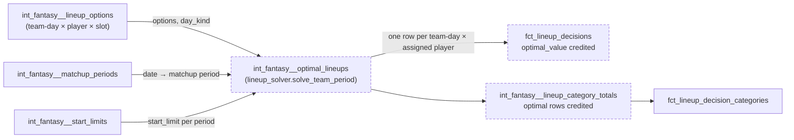

# The optimal lineup is chosen a matchup period at a time, within the games-started limit — design

Issue: #164 · Requirements: [requirements.md](requirements.md) · Tasks: [tasks.md](tasks.md)

## Overview

`int_fantasy__optimal_lineups` solves one problem per team and matchup period instead of
per team-day. The period's lineups may use at most `floor(start_limit)` starts, the
league's gentleman's agreement. Where the actual lineup went past the limit, the cap is
the actual lineup's starts instead (8 team-periods, C18). Lineups are credited as ESPN
credits starts (ADR 0071), each counting its own: a start on a day after the limit is
reached counts 0. Under the plain cap that never applies to the optimum. It does in the 8
over-limit periods, as it does to the actual lineup.

The solver is exact:
- **Each day:** for every subset of the day's starting pitchers, it solves the best lineup
  that starts exactly that subset. That is at most 6 starters on real data, so at most 64
  of today's assignment problems.
- **The period:** a dynamic program over the days, whose state is the starts so far,
  picks the best credited plan within the cap.

A league-season with no limit is solved per day, exactly as today. Both marts credit the
optimal lineup by the same rule as the actual one. The never-worse and no-churn tests are
judged per team-period.

On eight real seasons the change moves `optimal_value` on 19 team-days in 16 team-periods,
with a new lineup on 18 of those days. It solves every period in about 3.5 seconds (C9,
C11).

Which models the change touches, and what flows between them:

## Claims ledger

Read-only, on `data/warehouse_main_ac0e2ac.duckdb` (eight seasons, built from empty at
ac0e2ac on 2026-10-19; the models these queries read are unchanged since).

The prototype is posted on #164 with the spec PR (`proto164.py`; locally
`.review/proto164.py`). It reads `int_fantasy__lineup_options`,
`int_fantasy__lineup_slots`, `int_fantasy__matchup_periods` and `int_fantasy__start_limits`,
and solves each day with its own copy of the assignment that forces a subset of starters
(the method of *Detailed design*). It is run as `uv run python proto164.py <warehouse>
<mode>`, where mode is one of:
- `espn`: ESPN's crediting, no cap;
- `nostart`: no start on a day that is not open;
- `strict`: cap `floor(limit)`;
- `strictcap`: cap `floor(limit)`, or the actual lineup's starts where more, which is the
  chosen rule.

Rows C7 to C13 were first run with v1, whose candidates were not exact (Review log, round 1
F1). They were rerun with the final version on the same date; the results shown are its.

| # | Claim | Query (or script) | Result | Run on |
|---|---|---|---|---|
| C1 | The grain: team-periods and team-days | `fct_lineup_decisions` by season; distinct (season, matchup period, team) | 17,628 team-days (2018 2,148 · 2019 2,244 · 2021 2,148 · 2022 2,184 · 2023 2,148 · 2024 2,340 · 2025 2,256 · 2026 2,160). 2,340 team-periods, 2,052 of them with a limit (2021 has none) | 2026-10-21 |
| C2 | Limits per season, and limits that are not whole numbers | `int_fantasy__start_limits` by season: count, min and max of `start_limit` and `period_days` | 2018: 11–22, 2019: 11–29.857 (a 19-day period), 2021: null, 2022–2026: 13–26. Periods are 7–19 days. Non-whole limits seen: 17.286, 18.571, 20.429, 22.286, 29.857 | 2026-10-21 |
| C3 | A player has at most one start a day, and `day_kind = 'start'` is exactly `games_started = 1` | `max(games_started)` of `int_mlb__player_game_days`; pitcher-slot options joined to it, by `day_kind` and `games_started` | max 1, no player-day with 2. `start`: always 1 (44,825 option rows). `relief`: always 0 (43,612) | 2026-10-21 |
| C4 | At most 6 starting pitchers per team-day | distinct players with a pitcher-slot `start` option per team-day | 1: 6,305 · 2: 3,975 · 3: 1,583 · 4: 406 · 5: 59 · 6: 14 team-days | 2026-10-21 |
| C5 | No team-day is unvalued in any season | `count(*) filter (where is_unvalued)` of `fct_lineup_decisions` by season | 0 in all eight | 2026-10-21 |
| C6 | Every option and every team-day has a matchup period | options left-joined to `int_fantasy__matchup_periods`; `fct_lineup_decisions where matchup_period is null` | 437,559 of 437,559; 0 | 2026-10-21 |
| C7 | Today's per-day lineups, credited by ESPN's rule, fall below the actual lineup in 1 team-period | prototype: per-day plan credited by R1.2 against the actual lineup credited the same way | 1: 2022 p18 t1 (16.4851 against 16.6696), ADR 0079's case | 2026-10-21 |
| C8 | The readings of "within the limit" compared (ADR 0090) | prototype, modes `espn`, `nostart`, `strict` and `strictcap`, each against today's unlimited per-day solve and against the actual lineup | `espn`: 4 team-periods change; 0 below actual; 0 unsolvable. `nostart`: 4 change, 2 of them lower than `espn` (2019 p6 t9 −0.3111, 2023 p19 t7 −0.7843); 0 below actual here, but not by construction (2023 p19 t7's actual lineup fielded an uncredited start). `strict`: 7 team-periods unsolvable under ADR 0037's minimum (2019 p2 t6, 2019 p6 t9, 2022 p18 t11, 2022 p23 t4, 2022 p23 t10, 2024 p3 t11, 2026 p11 t9); 15 change. `strictcap`: 16 change; 0 below actual; 0 unsolvable | 2026-10-21 |
| C9 | Under the chosen rule (`strictcap`), what changes against today's mart | prototype `strictcap`: `optimal_value` and lineup per team-day against today's per-day solve | 16 team-periods, 19 team-days of `optimal_value` (today → new): 2018-05-02 t5 2.5923 → 2.4085; 2018-05-06 t6 0.7786 → −0.3644; 2018-05-04 t10 3.2121 → 2.4815; 2018-08-18 t6 3.1853 → 2.0542; 2018-09-18 t5 3.2018 → 2.8866; 2018-09-21 t5 2.1676 → 1.7787; 2019-04-11 t9 1.2011 → 0.5536; 2019-04-12 t9 3.3621 → 1.7735; 2019-05-10 t9 0.0730 → −0.4634; 2019-05-17 t4 2.8071 → 2.6981; 2019-06-02 t9 3.7890 → 3.7649; 2019-07-26 t11 1.2504 → 0.2596; 2022-08-20 t1 2.0394 → 1.9805; 2022-09-14 t1 3.9726 → 3.8462; 2023-06-11 t4 3.9755 → 3.6368; 2023-08-20 t7 1.0437 → 0.8742; 2023-09-23 t1 0.8022 → 0.5716; 2023-09-24 t1 3.0414 → 2.9219; 2026-06-07 t12 3.0140 → 2.6084. A new lineup on 18 of them (all but 2023-08-20 t7). Period sums: 2018 p5 t5 10.0260 → 9.8422; p5 t6 10.5134 → 9.3704; p5 t10 18.5982 → 17.8676; p19 t6 16.6317 → 15.5006; p24 t5 3.6254 → 2.9213; 2019 p2 t9 8.2951 → 6.0591; p6 t9 15.4735 → 14.9372; p7 t4 16.6813 → 16.5724; p9 t9 3.8852 → 3.8611; p16 t11 16.0878 → 15.0971; 2022 p18 t1 16.7786 → 16.7196; p22 t1 20.9384 → 20.8119; 2023 p10 t4 10.5088 → 10.1700; p19 t7 7.9001 → 7.7307; p24 t1 12.7496 → 12.3994; 2026 p10 t12 9.2159 → 8.8102. 0 team-days with a negative gap | 2026-10-21 |
| C10 | The prototype credits the actual lineup exactly as the mart does | per team-period, the prototype's credited actual value against `sum(actual_value order by scoring_date)` of `fct_lineup_decisions` | equal within 1e-6 on all 2,340 | 2026-10-21 |
| C11 | Solving every period exactly is cheap | prototype wall time for all 2,340 team-periods, after loading the options | 2.7–3.6 s on each run, in every mode | 2026-10-21 |
| C12 | A start past the limit counting 0 matters: a third of starts have a negative day value | actual pitcher-slot `start` options with `option_value < 0` | 6,372 of 18,902 (34%) | 2026-10-21 |
| C13 | The role minimum must come from the actual lineup, not from the options a sub-problem is given | prototype v1 removed the start options of excluded starters before calling `solve_team_day`, which counts the minimum from its input | 1,893 of 2,052 limited team-periods "gained", up to 7.84, in every mode alike: the minimum fell, and slots went idle. With the minimum fixed from the full day: `espn` 4 (C8) | 2026-10-21 |
| C14 | The lineup models are not in the BigQuery slice | `dbt ls --selector bigquery_slice` | no `lineup` or `optimal` model listed | 2026-10-21 |
| C15 | SciPy has a MILP solver here, and exposes only a gap tolerance | `scipy.__version__`; `from scipy.optimize import milp`; the options in `milp.__doc__` | 1.18.1; available (HiGHS). Options: `disp`, `presolve`, `time_limit`, `node_limit`, `mip_rel_gap`. No feasibility or optimality tolerance can be set | 2026-10-21 |
| C16 | Exact-subset candidates solve the design review's counterexample | prototype `review_case()`, ESPN's crediting: limit 1; day 1 an actual reliever worth 0 or a starter worth −1 in one slot; day 2 only a starter worth −10, actual | −1.0: the day-1 start reaches the limit, and day 2's start counts 0. v1's candidates give −10 | 2026-10-21 |
| C17 | A day with 12 starting pitchers is cheap | prototype `bench_12()`: a synthetic day of 12 starters, 8 relievers, 12 hitters, 18 slots | 4,096 subsets, 3,718 distinct feasible candidates, 0.43 s | 2026-10-21 |
| C18 | The actual lineup went past `floor(limit)` in 8 team-periods | `fct_lineup_decisions` summed by team-period against `int_fantasy__start_limits`, `having sum(actual_pitcher_starts) > floor(start_limit)` | 2019 p2 t6 (12 vs 11), 2019 p6 t9 (13 vs 11), 2022 p18 t11, 2022 p23 t4, 2022 p23 t10, 2023 p19 t7, 2024 p3 t11, 2026 p11 t9 (14 vs 13). C8's 7 unsolvable periods are 7 of these | 2026-10-21 |

## Alternatives considered

### What "within the limit" means (ADR 0090)

| | (a) as ESPN credits | (b) as ESPN credits, no uncredited start | (c) at most the limit (chosen) |
|---|---|---|---|
| Follows the league's agreement | no: the day that reaches the limit may finish past it | no, as (a) | yes |
| The actual lineup is a feasible optimum | always | not where it fielded an uncredited start | not in the 8 periods it went past the limit (C18), unless the cap follows it |
| Changes against today (C8) | 4 team-periods | 4 | 15, and 7 unsolvable; with the cap following the actual lineup, 16, none unsolvable |

**(c)** is chosen by the owner (2026-10-21): the league has a gentleman's agreement not to
go past the limit, even though ESPN credits every start on the day that reaches it. The
best lineup a manager here would set stays within the limit.

**(a)** is the literal ESPN rule. It would count, as available, starts the league's
managers agree not to take.

**(b)** sits between the two and still lets the day that reaches the limit go past it.

### Where the actual lineup went past the limit (ADR 0090)

| | Cap at the actual lineup's starts (chosen) | No optimum in those periods | Relax ADR 0037's minimum there |
|---|---|---|---|
| Solvable | all 2,052 (C8) | 2,044; 8 are null | yes |
| Never worse than actual | by construction | vacuous in the 8 | no: the actual lineup used starts the optimum cannot |
| In scope | yes | yes | no: the minimum is a no-go |

**Cap at the actual lineup's starts** is chosen by the owner (2026-10-21). Where a manager
went past the agreement, the optimum may go as far, and no further. Its starts past the
limit are credited by ESPN's rule, as the manager's were.

**No optimum** loses 8 periods' gaps for no gain in meaning.

**Relaxing the minimum** changes a rule this spec does not own, and breaks never-worse.

### How the period problem is solved (ADR 0091)

| | Enumerate starters + DP (chosen) | MILP (`scipy.optimize.milp`, HiGHS) | Price on starts (Lagrangian) + per-day assignment |
|---|---|---|---|
| Exact | yes: every candidate is an exact assignment, and the DP is exhaustive over start counts | to the solver's tolerances | no: misses plans off the convex hull |
| Keeps the 1e-9 tie-break (R1.6) | yes | not assured: only `mip_rel_gap` can be set (C15), and whether HiGHS separates plans 1e-9 apart is not measured | no |
| A cap, and a start past the limit counting 0 | a state transition | constraints per day | a cap only, approximately |
| Cost on real data | about 3.5 s for all periods (C11); 0.43 s for a 12-starter day (C17) | unmeasured; a model per period | cheap |
| New dependency | none | none (C15) | none |

**Enumerate + DP** is exact, and keeps the tie-break that spec 0012 relies on (R3.4,
R4.8). It reuses `solve_team_day` with two additions: an explicit role minimum, and a set
of players who must be assigned. The enumeration's size is bounded by the data: at most 6
starters a day, so 64 solves (C4). Larger days are measured only to 12 (C17); see *Risks*.

The candidates must be the best lineup for each set of starters *used*, not each set
*allowed*. An allowed starter can be passed over for a better reliever. Then a plan that
takes a worse start today, so that tomorrow's worse start counts 0, is never generated
(C16, Review log round 1 F1). Under the plain cap that case cannot arise, but in an
over-limit period it can.

**MILP** is the textbook formulation. But the tie-break works on differences of 1e-9 per
slot, and SciPy exposes only the relative gap, not HiGHS's tolerances (C15). Whether a
MILP keeps the actual lineup on a tie is unmeasured. If it does not, R4.3's no-churn test
fails on ties. An exact method makes the question moot.

**Lagrangian** pricing of starts is fast, but it cannot reach an optimum that needs a
specific start count which no price produces.

### Never-worse and no-churn: per team-period (ADR 0092)

| | Per team-period (chosen) | Per team-day, as today | Per team-period, and warn on a negative team-day |
|---|---|---|---|
| Holds by construction | yes | no: coupling can give up a day for the week | yes |
| Fires today | no | no (0 negative days, C9) | no |
| Cost | the two tests change grain | a correct optimum could fail the build | a warning for correct behaviour |

**Per team-period** is what the solver guarantees: the period's summed gap is at least 0.
A day may trade value for a later day. A per-day test would fail on a correct result. A
warning would flag correct behaviour, so it is not added.

### An unvalued day (ADR 0092)

| | The whole team-period is unvalued (chosen) | Solve the other days, and count the unvalued day as having no starts |
|---|---|---|
| Correct | yes: nothing is guessed | no: the day's starts count toward the cap |
| Fires today | no (C5) | no |
| Loss | the other days' optimal values, when it happens | none, but they may be wrong |

The category mart already nulls a side's optimal totals when any day of its period is
unvalued (spec 0012, R5.4). This extends the same rule to the lineup rows.

## Decisions

| ADR | Decision | Status |
|---|---|---|
| [0090](../../adr/0090-the-optimal-lineup-is-chosen-per-matchup-period-within-the-start-limit.md) | The optimal lineup is chosen per matchup period, with at most the limit's starts, or the actual lineup's where it went past. Chosen by the owner, 2026-10-21. Supersedes 0079, amends 0037 | proposed (accepted on approval) |
| [0091](../../adr/0091-the-period-problem-is-solved-by-enumerating-each-days-starters-and-a-dynamic-program.md) | The period problem is solved exactly, by enumerating each day's starters and a dynamic program over the days. Chosen by the owner, 2026-10-21 | proposed (accepted on approval) |
| [0092](../../adr/0092-a-lineup-decision-is-judged-per-team-period.md) | Never-worse and no-churn are judged per team-period, and an unvalued day makes its team-period unvalued. Chosen by the owner, 2026-10-21 | proposed (accepted on approval) |

## Detailed design

### `dbt/python_modules/lineup_solver.py`

- `Option` gains `is_start: bool = False`. It marks a pitcher-slot option whose
  `day_kind` is `start` (R1.7). The default keeps every existing caller and test as it is.
- `solve_team_day(options, slots, required_per_role=None, forced=frozenset())`:
  - `required_per_role`, when given, is the per-role minimum instead of the count of
    `is_actual` options in `options` (C13).
  - `forced` is players who must be assigned. Exactly, not by a penalty: the cost matrix
    gains dummy rows that can absorb any column except a forced player's at cost 0, so
    every column is matched and a forced player only by a slot row.
  - With neither given, behaviour is unchanged.
  - If the minimum or `forced` cannot be met, it raises `Infeasible`, a `ValueError`
    subclass. On a day's full options it cannot happen, because the actual lineup is a
    solution. It can when a subset's starters are removed or forced (step 3).
- New `solve_team_period(days, slots, start_limit, start_cap)`. `days` is a list of
  `(scoring_date, options)` in any order; it is sorted by date. It returns sorted
  `(scoring_date, player_id, slot_id)`.
  1. **No limit:** `start_limit is None` → `solve_team_day` per day, as today (R1.4).
  2. **The minimum, per day:** `required_per_role` is counted from the day's full options,
     once (the actual lineup's played starters per role).
  3. **Candidates, per day and per open/closed:**
     - The day's starters are the players with an `is_start` option, sorted.
     - For each subset S, in order: all starters first, then smaller sizes, and within a
       size lexicographically by player id. Solve with:
       - the start options of players outside S removed;
       - the other options of players in S removed, since each must take a start;
       - `forced = S`;
       - the minimum of step 2.

       The lineup's starts are then exactly S.
     - On a closed day (step 4), the same, with every `is_start` option's value replaced
       by 0 (`is_actual` kept). Its starts still count toward the cap.
     - Skip a subset that is `Infeasible`. Drop a lineup already found.
     - Record `(score, starts, lineup)`. `score` is the summed credited `option_value`
       plus the 1e-9 terms (spec 0012, R3.1). `starts` is |S|.
  4. **DP:**
     - The state is the starts on earlier days (0 … `start_cap`). A state is *closed* when
       it is `>= start_limit`, compared exactly as `fo_days_past_start_limit` does.
       Under a cap of `floor(start_limit)` a closed state can take only S = ∅.
     - Days are taken in date order and states in ascending count.
     - Each state takes each candidate of its kind (open or closed) whose starts keep it
       within the cap.
     - A new state keeps the first plan with the greatest score: a later plan replaces it
       only if strictly greater.
     - At the end, the greatest score wins, the lowest count on a tie.
  5. **R1.6:**
     - The per-day plan (`solve_team_day` on each day's full options, today's lineups) is
       taken if its starts are within the cap.
     - It is credited by R1.2 and scored with the same function, summed in date order.
     - If its score is `>=` the DP's best (exact, no tolerance; Review log round 2 F1), it
       is returned instead.
  - `check_value_bound` runs on every day first (R1.8).
- **The cap is passed in:** `int_fantasy__optimal_lineups` computes `start_cap` (R1.3)
  from the actual lineup's starts and `start_limit`, so the solver does not read the
  actual lineup to set it.
- **Size:** the subsets are 2ⁿ per day, with n ≤ 6 on real data (C4) and 0.43 s measured
  at n = 12 (C17). There is no cap. See *Risks* for larger n.

### `dbt/models/intermediate/fantasy/int_fantasy__optimal_lineups.py`

- Option rows are joined to `int_fantasy__matchup_periods` (C6) and
  `int_fantasy__start_limits`, and grouped by (platform, league_id, season,
  matchup_period, fantasy_team_id), then by date.
- **`start_cap`:** `floor(start_limit)`, or the count of the period's actual options that
  are starts where that is greater (R1.3). Null when there is no limit.
- **Unvalued (R2.1):** a team-period with any null option value is skipped whole. The
  bound is checked first, as today.
- **Output:** columns and grain are unchanged, one row per team-day and assigned player
  (spec 0012, R3.3).
- The header's "each team-day is solved alone" becomes the period rule, with ADRs 0090 to
  0092.

### `dbt/models/marts/fct_lineup_decisions.sql`

- `optimal_sum` is credited (R3.1): the existing `days_past_limit` CTE already computes
  both lineups (`extra_keys=['lineup']`). It is joined for `lineup = 'optimal'` as for
  `'actual'`, zeroing a pitcher-slot start on a day past the limit.
- `is_unvalued` becomes period-level (R2.1): true on every team-day of a team-period with
  any null option value. Today that is 0 rows (C5).
- The header's ADR 0079 paragraph becomes ADR 0090's rule.

### `dbt/models/intermediate/fantasy/int_fantasy__lineup_category_totals.sql`

- The `optimal` rows are credited by the same past-limit join (R3.2), as the `actual` rows
  already are.
- A side whose period is unvalued already has null optimal totals (spec 0012, R5.4).

### Tests

- `fct_lineup_decisions_are_never_worse_than_the_actual_lineup.sql`:
  - `gap_below_zero` is summed per team-period, in date order (`sum(value_gap order by
    scoring_date)`), against −1e-9 (R4.1).
  - `fewer_than_played` stays per team-day (R4.2).
- `fct_lineup_decisions_change_nothing_when_nothing_is_gained.sql`: per team-period. A
  period with summed gap below 5e-10 and any brought-in, sat or moved player on any day
  fails (R4.3).
- **New** `fct_lineup_decisions_keep_the_optimum_within_the_start_cap.sql` (R3.4): per
  team-period, `sum(optimal_pitcher_starts)` against `floor(start_limit)`, or
  `sum(actual_pitcher_starts)` where greater.
- Plants (spec 0174), because CI cannot hold a failing case:
  - a team-period whose days' gaps sum below zero → `fail`;
  - one day below zero in a period that sums above → `pass`;
  - churn in a zero-gap period → `fail`;
  - optimal starts one over the cap → `fail`;
  - optimal starts at the cap → `pass`.
- pytest (R5.1): the cases listed in R5.1, in `ingestion/tests/test_lineup_solver.py`.
  The brute force enumerates every legal lineup of each day (the existing helper) and every
  combination over 2–3 days, keeps those within the cap, credits each by R1.2, and compares
  the maximum. `test_optimal_lineups_model.py` gains three cases:
  - a two-day period where the cap binds;
  - a period where the actual lineup went past the limit;
  - an unvalued day that blanks its period.

## Test strategy

| Requirement | Test | Catches |
|---|---|---|
| R1.1, R1.2, R1.5 | pytest brute force over small periods; hand-built cases, including C16's | a wrong DP state, a wrong cap, a lost candidate (a starter allowed but not forced) |
| R1.3 | model pytest: an over-limit actual lineup; R3.4's test on the real build | the cap not following the actual lineup, or following it everywhere |
| R1.3 (non-whole limit) | pytest at 29.857 | rounding the limit up |
| R1.4 | pytest: no limit equals per-day; real build: 2021 unchanged | a period solve leaking into unlimited seasons |
| R1.6 | pytest: per-day plan kept when optimal; ties keep actual; the near tie | churn on ties; a worse plan returned within a tolerance |
| R1.7 | pytest: a starter's hitter-slot option is not a start | counting a two-way player's batting as a start |
| R1.8 | existing bound tests, per period | a value past the bound |
| R2.1 | model pytest: an unvalued day blanks its period | solving around an unvalued day |
| R3.1, R3.2 | real build: C9's 19 team-days | the mart crediting differently from the solver |
| R3.3 | existing tests of R4.9 | starts columns limited by mistake |
| R3.4 | the cap test; plants | an optimum over the agreement |
| R4.1, R4.2 | the never-worse test; plants | a negative period; a per-day test left in place |
| R4.3 | the no-churn test; plant | churn on a zero-gain period |
| R4.4 | the real build matches C9 exactly | Python and SQL crediting diverging |
| R5.3 | gates (tenant isolation) | a period solve reading another league-season |

## Risks

- **A day with many starting pitchers.** The enumeration is 2ⁿ, with no cap. Real data has
  at most 6 (C4), and 12 takes 0.43 s for a day (C17). Beyond that it is unmeasured:
  scaling C17, 20 starters on one team-day would take about 110 s, and more grows fast.
  *Low likelihood:* a fantasy roster rarely holds that many starters with a start on one
  day. *Impact:* a slow build, not a wrong one. Accepted, and stated in ADR 0091.
- **The prototype's crediting and the mart's could still differ on a case the data lacks**,
  such as a non-whole limit binding. *Low.* The pytest at 29.857 holds the rule, and the
  real build checks the 16 periods.
- **In the 8 over-limit periods, the optimum may field a start that counts 0**, past the
  limit, when that beats a reliever with a negative day (C12). It is what the league would
  have credited, and only where the manager went past the limit too. *Accepted.*

## Open questions

- None that block the spec. How ESPN rounds a non-whole limit is still unobserved (ADR
  0071). The cap uses `floor`, and the crediting uses the same exact comparison as today.

## Review log

| Source | Finding | Resolution |
|---|---|---|
| design-review round 1 | F1 (P0): candidates per *allowed* starter set are not exact. The day's solve can pass over an allowed starter, so a plan that takes a worse start today to close a worse one tomorrow is never generated (the review's two-day case) | Fixed. Candidates are now the best lineup for each set of starters *used*, forced exactly by dummy rows (*Detailed design*). The prototype solves the case (C16). C7–C13 rerun: the same values. The case is added to R5.1 |
| design-review round 1 | F2 (P2): no evidence that 10–12 starters stay cheap | Measured: a synthetic 12-starter day, 0.43 s (C17) |
| design-review round 2 | F1 (P1): the prototype kept the per-day plan within 5e-10 of the best, against the design's "equal"; a near tie returns a worse plan | Fixed. The comparison is exact (`>=`, both scores computed by one function in date order), in the design and the prototype; rerun gives the same results (C9). The near tie is added to R5.1 |
| design-review round 2 | F2 (P2): "seconds, not minutes" for many starters goes beyond the 12-starter measurement | Reworded to the measured sizes; the 20-starter estimate is stated under *Risks* and in ADR 0091 |
| design-review round 2 | F3 (P3): the ledger named a scratchpad file | The prototype is posted on #164 with the spec PR, and named `.review/proto164.py` locally |
| owner, 2026-10-21 | Decision 1: reading (c), at most the limit, because of the league's gentleman's agreement | ADR 0090 rewritten. R1.1 to R1.3 add the cap; C9's expected values are those of `strictcap`; R3.4's test added |
| owner, 2026-10-21 | Follow-up: where the actual lineup went past the limit (8 periods, C18), the cap is its starts | R1.3; ADR 0090 |
| owner, 2026-10-21 | Decisions 2 and 3, as recommended: enumerate + DP; judged per team-period, with an unvalued day blanking its period | ADRs 0091, 0092 |

## Amendments
