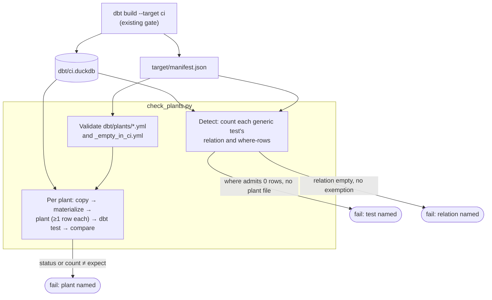

# A data test the CI fixtures cannot exercise is shown to fail on a planted row — design

Issue: #174 · Requirements: [requirements.md](requirements.md) · Tasks: [tasks.md](tasks.md)

## Overview

A new gate step, `scripts/check_plants.py`, runs after the fixture build has made
`dbt/ci.duckdb` and `dbt/target/manifest.json`. It does two things:
- **Detect.** For every generic test in the manifest, it counts the CI rows the test reads.
  A test whose `where` admits none needs a plant. A relation with no rows needs an
  exemption that says why.
- **Plant.** For each plant in `dbt/plants/<test>.yml`:
  - copy the CI warehouse into a scratch directory;
  - turn any named views into tables;
  - run the plant's statements, each of which must change a row;
  - run the real `dbt test` on that one test;
  - compare dbt's status and failure count with what the plant expects.

What the hand-planting on #172 and #173 showed once, every CI run now shows again.



## Claims ledger

Read-only, on a CI warehouse built from empty in the spec's worktree from `main` at
ac0e2ac (`front-office load --raw-root fixtures/landing` and then
`dbt build --target ci --vars '{anonymize: true}'`: PASS=774 WARN=3 ERROR=0), on its
`target/manifest.json`, and on the real warehouse `data/warehouse_main_ac0e2ac.duckdb`.

| # | Claim | Query (or script) | Result | Run on |
|---|---|---|---|---|
| C1 | No row of the CI warehouse is verified | `count(*) filter (where has_unverified_inputs)` on `fct_matchup_category_scores`; `input_status` counts on `int_fantasy__started_player_days` | 68 of 68 unverified; 647 started player-days, all `missing_boxscore` (216, 216 and 215 on 2026-04-24, 04-29 and 04-30) | 2026-10-20 |
| C2 | A fixture date is incomplete because the fixtures hold 3 of its 38 games; complete dates would verify all 4 sides | `int_mlb__game_dates` in CI and in the real warehouse; the real `int_fantasy__started_player_days` on the three dates | CI: played 14 / 13 / 11, loaded 1 / 2 / 0. Real: loaded 14 / 13 / 11, and 0 unverified started days for every one of the 12 teams | 2026-10-20 |
| C3 | 35 of 412 generic tests read zero CI rows: 4 by their `where`, 31 on 7 empty relations | for each generic test in the manifest, `count(*)` of its `attached_node`'s relation, with `config.where` if any (script in the spec PR's comment on #174) | `where`: `int_fantasy__started_player_days_played_matches_input_status`, `not_null_fct_matchup_category_scores_result`, `fct_matchup_category_scores_values_have_a_side`, `not_null_fct_matchup_results_winner`. Empty: C8's 7 relations, with 22 `not_null`, 6 `unique_combination_of_columns` and 3 `accepted_values`. 75 singular tests not counted | 2026-10-20 |
| C4 | Every reconciliation row in CI is unverified, and CI has no playoff matchup | `status` counts of `rec_espn__matchup_stat_differences`, `rec_espn__category_result_differences` and `rec_espn__player_day_differences`; `playoff_tier` of `fct_matchup_results` | 96, 68 and 467 rows, all `unverified`; both matchups `NONE` | 2026-10-20 |
| C5 | The plants proved by hand are recorded on the issues | #173's review triage (rounds 1 and 2); #159's and #160's build progress | values-have-a-side: 5 cases, 3 fail and 2 pass. Tie rules: a non-`NONE` rule and a null. Qualification: stat 41, `ROTO`, a null stat, a null limit. Seed test: two seeds swapped | 2026-10-18 |
| C6 | A plant can be run by the real `dbt test` on a copy, in about 1.3 s once dbt is warm, and a plant can silently plant nothing | copy of `ci.duckdb`, one UPDATE on `fct_matchup_category_scores`; `dbt test --select fct_matchup_category_scores_values_have_a_side` by the CLI and by `dbtRunner` | first UPDATE (filtered on `not is_below_minimum`) changed 0 rows, because every fixture side is below 30 outs, and the test passed. Second UPDATE changed 1 row: `FAIL 1`. CLI 6.5 s cold, 2.5 s warm; `dbtRunner` 1.26 s per invocation | 2026-10-20 |
| C7 | A view can be replaced by a table in the copy, and the seed test fails on a planted playoff matchup | in the copy: `create table … as select * from staging.stg_espn__teams`; drop the view; rename; set `playoff_tier = 'WINNERS_BRACKET'` on matchup 1 | DuckDB allows it (29 views remain); matchup 1 is home 9 (seed 4) against away 6 (seed 1): `FAIL 1` | 2026-10-20 |
| C8 | Why each of the 7 relations is empty in CI | `count(*)` of each; `fixtures/landing/espn/` listing; `espn_reconciliation_residuals.csv` league ids; each model's filters | `stg_espn__matchup_days`: no `matchup_days` fixture endpoint. `stg_espn__matchup_player_lines`: reads it. `rec_espn__register_rows`: the register's rows are all league 73677, and CI loads only 111111. `rec_espn__player_day_residuals`: counts `status = 'difference'`, and all 467 CI rows are `unverified`. `rec_espn__winner_differences`, `rec_fantasy__category_wins_added` and `rec_fantasy__category_wins_by_group`: read only verified results, and C1 has none. Types: the three `rec_espn__` relations and `…_by_group` are views; the other three are tables | 2026-10-20 |
| C9 | A complete real playoff period would cost about four times the fixture size | 2026 periods in the real warehouse; fixture file sizes | period 24 (2026-09-14 to 20): 7 days, 94 games, 6 playoff matchups, all verified. An allowlisted roster fixture is ~300 KB a period, a boxscore ~28 KB. `fixtures/landing` 1.3 MB, `fixtures/landing_multi` 3.0 MB | 2026-10-20 |
| C10 | The fixture's ESPN scores come from another period than its rosters | `scripts/make_fixtures.py` `build_espn_matchups` (the first 2 entries of the season's schedule); real matchup periods | the fixture copies matchup period 1 (2026-03-25 to 04-05, 12 days), while its rosters are scoring periods 31, 36 and 37 (late April). A verified fixture side would be reconciled against a different period's `scoreByStat` | 2026-10-20 |
| C11 | No 2026 side is below the pitching minimum; complete fixture dates would put all 4 fixture sides above it | real `int_fantasy__matchup_side_totals` with `outs_recorded < 30`; real outs of teams 6, 9, 2 and 3 on the three dates | 0 of 288 sides; 68, 98, 80 and 79 outs | 2026-10-20 |
| C12 | The fixture's teams all have seeds, so the seed plants have both directions | `stg_espn__teams`, 2026 | 12 teams, seeds 1 to 12; matchup 1 is 9 (4) v 6 (1), matchup 2 is 2 (10) v 3 (12) | 2026-10-20 |
| C13 | The settings guards read only league-seasons with rosters, and CI has one | `int_fantasy__league_seasons` in CI | 2026 `has_rosters` true; 2025 false | 2026-10-20 |
| C14 | DuckDB splits one entry into its statements and names their types; an UPDATE's row count includes rows it left unchanged, and `EXCEPT ALL` against a before-image does not | DuckDB 1.5.5: `duckdb.extract_statements("update t set a = 1; create table x as select 1")`; on `t(a, b)` = (1, null), (2, 3), `update t set b = null where a = 1`, then `after except all before` | `UPDATE`, then `CREATE`; the UPDATE reports 1 row; 0 rows differ | 2026-10-20 |

## Alternatives considered

### How CI comes to check these tests (ADR 0087)

| | A — planting harness (chosen) | B — a real matchup period in the fixtures | C — complete the three fixture dates |
|---|---|---|---|
| Verified rows in CI | planted, one at a time | real: every side of 6 playoff matchups | real, for 4 sides |
| The ESPN reconciliation in CI | its tests' filters only | end to end | **fails**: a different period's ESPN scores (C10) |
| Below-minimum case | planted | absent (C11) | absent: all 4 sides above 30 (C11) |
| Fixture size | unchanged | ~5 MB from 1.3 MB, plus the multi-league tree (C9) | +~1.1 MB |
| `make_fixtures.py` | untouched | reworked; the postponed game, correction and starter-history cases kept | 38 boxscores instead of 3 |
| Finds new vacuous tests | yes, generic ones (ADR 0088) | no | no |

**A** is chosen by the owner (2026-10-20). It covers every case a plant can be written for,
including ones no real fixture holds (C11), and adds no data. It does not run the models on
verified data in CI. The real-season build, required before any merge, does that.

**B** would make CI meaningful end to end, but quadruples the fixtures. It leaves the
below-minimum case unheld, and it finds nothing new by itself.

**C** looks cheapest, but it loses outright. Once the sides are verified, both
reconciliation tests compare three days of our totals against matchup period 1's ESPN
scores. They would fail unless the fixture's ESPN scores were rewritten, and a rewritten
`scoreByStat` would reconcile the models against themselves.

### How a plant runs the test (ADR 0087)

| | A — real `dbt test` via `dbtRunner` (chosen) | B — the compiled SQL, run directly | C — dbt unit tests |
|---|---|---|---|
| Same `where`, severity and failure count as CI | yes, by construction | re-implemented | n/a |
| Cost a plant | ~1.3 s (C6) | ~ms | n/a |
| Works for data tests | yes | yes | **no**: dbt applies no data test to a unit test's mocked rows (#173, round 3) |

Chosen by the owner on 2026-10-20: **A**.

**B** is faster, but it would re-implement dbt's `where` wrapping, `warn_if`/`error_if` and
`fail_calc`, and could drift from how the gate itself judges the test. At ~25 plants the
cost difference is about half a minute.

### Where the plants live

| | A — `dbt/plants/<test>.yml` (chosen) | B — `meta:` on each test's config | C — one register file |
|---|---|---|---|
| Next to the test | no, but by name | yes | no |
| Singular tests | same as generic | a `config(meta=…)` block holding SQL, inside the test's own Jinja | same |
| Model YAML stays readable | yes | no: SQL in already long property files | yes |
| A stale entry is found | by name (R1.3) | can't be stale | by name |
| Review diff | one file per test | scattered | one growing file |

`dbt/plants/` is outside every dbt path in `dbt_project.yml`, so dbt never parses it.

### Which tests must have a plant (ADR 0088)

Owner's choice, 2026-10-20, in two answers:
- detect generic tests automatically, rather than name tests only or plant every test;
- for a relation that is empty in CI, one reasoned exemption per relation, rather than
  31 plants that would each show only that dbt's built-in test fires.

## Decisions

| ADR | Decision | Status |
|---|---|---|
| [0087](../../adr/0087-data-tests-ci-cannot-exercise-are-shown-to-fail-on-planted-rows.md) | A data test the fixtures can't exercise is shown to fail on a planted row in a copy of the CI warehouse, by the real `dbt test`, in the gates; not a larger fixture | proposed |
| [0088](../../adr/0088-a-generic-test-over-zero-ci-rows-needs-a-plant-or-its-relation-an-exemption.md) | A generic test whose `where` admits no CI row needs a plant; a relation empty in CI needs a reasoned exemption | proposed |

## Detailed design

### The register

`dbt/plants/<test name>.yml`, for example:

```yaml
# fct_matchup_category_scores_values_have_a_side: both sides of a verified category have a
# value, unless the pitching minimum decides it (spec 0160, R2.5). Cases from #173.
plants:
  - name: null_team_value_neither_side_below
    why: a dropped side on a verified row the minimum does not decide
    sql:
      - >-
        update marts.fct_matchup_category_scores
        set has_unverified_inputs = false, is_below_minimum = false,
            is_opponent_below_minimum = false, team_value = null
        where matchup_id = 1 and fantasy_team_id = 6 and category_key = (
            select min(category_key) from marts.fct_matchup_category_scores)
    expect: {status: fail, failures: 1}
  - name: null_team_value_team_below_loses
    why: a side below the minimum with no rate loses the bound category (R2.5)
    sql: [...]
    expect: pass
```

Keys:
- `plants` (list, required);
- per plant `name` (unique within the file), `why`, `sql` (string or list), `expect`
  (required), and `materialize` (optional list of `schema.relation`).

`expect` is `pass`, or `{status: fail|warn, failures: <int ≥ 1>}`. Each `sql` entry is
parsed with `duckdb.extract_statements` and must be exactly one statement, of type INSERT,
UPDATE or DELETE. Two statements in one entry (`update …; attach …`) or any other type
(DDL, ATTACH, COPY, PRAGMA) is refused before anything runs (R1.4), so a plant can't reach
outside the copy.

`dbt/plants/_empty_in_ci.yml`:

```yaml
relations:
  - relation: staging.stg_espn__matchup_days
    reason: the CI fixtures hold no espn/matchup_days capture
    link: "#178"
```

The leading underscore keeps it apart from the plant files: no test name starts with `_`.

### `scripts/check_plants.py`

`uv run python scripts/check_plants.py --db dbt/ci.duckdb [--manifest dbt/target/manifest.json] [--plants-dir dbt/plants] [--project-dir dbt]`

1. **Load.** The manifest and every file in `--plants-dir`, validated as above (R1.4). A
   plant file whose stem is not a test node's `name` in the manifest fails (R1.3).
2. **Detect** (R3). Open `--db` read-only. For each test node with `test_metadata` (a
   generic test) whose `attached_node` is a model or seed:
   - `relation_rows`: `count(*)` of its relation (schema and alias from the node);
   - `admitted_rows`: the same with `config.where` when there is one, else
     `relation_rows`.

   Then classify:
   - `relation_rows = 0`: the relation must be in `_empty_in_ci.yml` (R3.3);
   - `admitted_rows = 0 < relation_rows`: a plant file must exist (R3.2).

   An exemption whose relation has rows fails (R1.3). Print R3.4's summary.
3. **Plant** (R2). One scratch directory for the whole run. For each plant, in file and
   list order:
   - copy `--db` to `<scratch>/ci.duckdb`, overwriting the previous copy;
   - in that copy, for each `materialize` view: `create table <s>.<n>__plant as select *
     from <s>.<n>`, drop the view, then rename the table to `<n>`. Fail the plant if the
     relation is not a view;
   - run each statement and check that it changed something (R2.3); if not, fail the plant
     and don't run its test:
     - an INSERT or DELETE by DuckDB's row count;
     - an UPDATE by comparing its table before and after: the rows of `after EXCEPT ALL
       before` must be at least one. DuckDB counts a row an UPDATE matched even when it set
       the values the row already had, so the row count can't show this. A `pass` plant
       that no longer changes its row would otherwise stay green;
   - close the copy and invoke `dbtRunner().invoke(["test", "--select", <test>, "--target",
     "ci", "--vars", "{anonymize: true}", "--target-path", <scratch>/target, "--quiet"])`
     with `DBT_PROFILES_DIR=<project-dir>` and `FO_CI_DUCKDB_PATH=<scratch>/ci.duckdb`,
     run from `--project-dir`. The path is the same for every plant, so the profile does
     not change between invocations;
   - read the one result: `status` (`pass`, `fail`, `warn`, `error`) and `failures`.
     `expect: pass` needs `pass`. A `fail` or `warn` expectation needs that status and
     exactly that count. `error`, no result, or more than one result always fail the
     plant (R2.5).
4. Print one line per plant (`PASS`/`FAIL`, test, plant, expected, got), a total, and
   exit 1 on any failure (R2.6). `--db` is never written to (R2.1). The scratch directory
   is removed on exit.

The pure parts, which take no warehouse or dbt, are plain functions so that pytest can
reach them (R5.3): validating a register file, classifying a test from its two counts,
and judging a dbt result against `expect`.

### The first register (R4)

Failure counts follow from each plant changing one row, or one league-season. The build
confirms each before committing it.

| Test (file) | Plant | Statements, in outline | Expect |
|---|---|---|---|
| `not_null_fct_matchup_category_scores_result` | verified row, null result | one row of matchup 1: `has_unverified_inputs = false`, `result = null` | fail 1 |
| `fct_matchup_category_scores_values_have_a_side` | the five cases of #173 round 2 (C5), each on one row of matchup 1 made verified | null team value, neither side below | fail 1 |
| | | null team value, team below, result `LOSS` | pass |
| | | null team value, team below, null result | fail 1 |
| | | null team value, only the opponent below, result `WIN` | fail 1 |
| | | null opponent value, opponent below, result `WIN` | pass |
| `not_null_fct_matchup_results_winner` | verified matchup, null winner | matchup 1: `has_unverified_inputs = false`, `winner = null` | fail 1 |
| `int_fantasy__started_player_days_played_matches_input_status` | played status without a game | one row: `input_status = 'played'`, `played = false` | fail 1 |
| | off status with a game | one row: `input_status = 'verified_off'`, `played = true` | fail 1 |
| `fct_matchup_results_home_is_the_better_seed` | home is the worse seed | matchup 1 (home 9, seed 4; away 6, seed 1): `playoff_tier = 'WINNERS_BRACKET'` (C7, C12) | fail 1 |
| | home is the better seed | matchup 2 (home 2, seed 10; away 3, seed 12): the same | pass |
| | a seed is missing | materialize `staging.stg_espn__teams`; matchup 2 as a playoff matchup; delete team 3's 2026 row | fail 1 |
| `fct_matchup_scores_match_espn` | an unexplained stat difference | one row of `rec_espn__matchup_stat_differences`: `status = 'unexplained'` | fail 1 |
| | a formula ESPN's components don't reproduce | one row: `status = 'formula_mismatch'` | fail 1 |
| | a register row that explains nothing (its second branch) | materialize `reconciliation.rec_espn__register_rows`; insert one row with `problem = 'explains_nothing'` | fail 1 |
| `fct_matchup_results_match_espn` | an unexplained category result | one row of `rec_espn__category_result_differences`: `status = 'unexplained'` | fail 1 |
| | a winner that differs (its second branch) | materialize `reconciliation.rec_espn__winner_differences`; insert one row for matchup 1 with `problem = 'category_unexplained'` | fail 1 |
| `stg_espn__league_settings_tie_rules_are_understood` | a rule other than `NONE` | materialize `staging.stg_espn__league_settings`; 2026: `playoff_matchup_tie_rule = 'PLANTED_RULE'` | fail 1 |
| | a null rule | 2026: `matchup_tie_rule = null` | fail 1 |
| | a league-season without rosters | 2025 (C13): `playoff_matchup_tie_rule = 'PLANTED_RULE'` | pass |
| `stg_espn__league_settings_qualification_is_understood` | the four cases of #160 (C5), each on 2026 after materializing the view | `qualification_stat_id = 41` | fail 1 |
| | | `scoring_type = 'ROTO'` | fail 1 |
| | | `qualification_stat_id = null` | fail 1 |
| | | `qualification_minimum = null` | fail 1 |

That is 9 plant files and 24 plants: 20 `fail` and 4 `pass`. Each branch of a `union all` test has a plant of its own.

`_empty_in_ci.yml` holds C8's 7 relations:

| Relation | Reason | Link |
|---|---|---|
| `staging.stg_espn__matchup_days` | no `espn/matchup_days` fixture capture | #178 |
| `staging.stg_espn__matchup_player_lines` | reads `stg_espn__matchup_days` | #178 |
| `reconciliation.rec_espn__register_rows` | the register names real leagues only; CI loads the fixture league | `dbt/seeds/espn_reconciliation_residuals.csv` (by design) |
| `reconciliation.rec_espn__player_day_residuals` | counts player-day differences on verified sides; CI has none | ADR 0087 |
| `reconciliation.rec_espn__winner_differences` | reads verified results; CI has none | ADR 0087 |
| `reconciliation.rec_fantasy__category_wins_added` | rescores verified matchups only; CI has none | ADR 0087 |
| `reconciliation.rec_fantasy__category_wins_by_group` | built on `rec_fantasy__category_wins_added` | ADR 0087 |

### Gates, CI and AGENTS.md (R5)

- `.agentic/gates`: a step `planted failures` after `example queries match their exposures
  and run`, and before `dbt docs generate`, so that the manifest is still the build's.
- `.github/workflows/ci.yml`: the same step, in the same place.
- `AGENTS.md`, *How work is done here*, one bullet:
  - a data test whose failing case the CI fixtures can't hold gets a plant in
    `dbt/plants/` (spec 0174);
  - a generic one is found by the gate, a singular one by its author;
  - the plants that show a new test can fail are committed there, not run by hand;
  - a relation that is empty in CI needs a reason in `dbt/plants/_empty_in_ci.yml`.
- `dbt/plants/README.md`: the format above, in a dozen lines.

## Test strategy

| Requirement | Test | Catches |
|---|---|---|
| R1.1, R1.4 | pytest: a register file missing `expect`, with an unknown key, a duplicate plant name, a `create table` statement, a statement hidden after a comment, `expect: {status: fail}` with no count | a malformed plant passing silently, or one reaching outside the copy |
| R1.3 | pytest: a plant file for a test the manifest lacks; an exemption for a relation with rows | the register rotting |
| R2.3 | pytest on a tiny DuckDB file: an UPDATE that matches nothing; an UPDATE that matches a row but sets the values it already has; a DELETE that matches nothing | C6's silent plant, and a stale `pass` plant |
| R1.4 | pytest: `update …; create table …` in one entry | a second statement escaping validation |
| R2.4, R2.5 | pytest: the judge, with `pass`/`fail`/`warn`/`error` results against each `expect` form, including a wrong count | an `error` or a different count read as success |
| R2.1 | the harness run in the gates, with the checksum of `dbt/ci.duckdb` taken before and after (once, in the build) | a plant written into the real CI warehouse |
| R3.2, R3.3 | pytest: the classifier on synthetic counts (0/0, 0/n, n/n, a where-less test); the build breaks it on purpose (task 7) | a vacuous generic test passing the gate |
| R4 | the harness itself, in the gates | a test that can no longer fail on its planted case |
| R5.1 | `.agentic/gates` and CI both show the step | the step skipped in one place |

## Risks

- **Fixture regeneration moves the rows a plant names** (matchup 1, team 6). Likely over
  time; caught by R2.3 or by a changed failure count, which names the plant. Accepted.
- **A planted table is shaped like its model's output, not by its logic.** A plant shows
  that the test fails on that row, not that the model could produce it. This is the
  limit of option A, accepted in ADR 0087. The real-season build covers the models.
- **dbt's in-process runner keeps state between invocations.** The copy's path is the
  same for every plant, so a cached profile still points at the right file. If 24 plants
  do not fit the 90 s budget at C6's 1.3 s each, the build reports it rather than
  dropping plants. Measured in task 6.
- **`dbt/target` is shared with the gate's later docs step.** The harness uses its own
  `--target-path`, so the gate's manifest is not rewritten.

## Open questions

- Whether `rec_espn__every_side_is_verified`, which warns in CI on purpose, should be
  turned into a plant with an expected `warn`. It is not vacuous: it warns on 4 rows
  today. Left as it is.
- Whether the user-level build skill's step 3 should point to `dbt/plants/`. That is the
  owner's to edit; `AGENTS.md` carries the rule for this repo.

## Review log

| Source | Finding | Resolution |
|---|---|---|
| design-review | F1 (P1): the second `union all` branch of each reconciliation test (register rows; winners) had no plant | Added one plant per branch: 24 plants |
| design-review | F2 (P1): the table listed 22 plants against a stated 23 | Recounted after F1: 24, 20 `fail` and 4 `pass`, in all three files |
| design-review | F3 (P1): a prefix check lets `update …; attach …` through, since DuckDB's `execute` runs both | Each entry parsed by `duckdb.extract_statements`: exactly one statement, of an allowed type (R1.4); pytest case added |
| design-review | F4 (P2): an UPDATE's row count is positive even when it changes no value, so a stale `pass` plant stays green | An UPDATE must change a row by `EXCEPT ALL` against a before-image (R2.3); pytest case added |

## Amendments

None.
