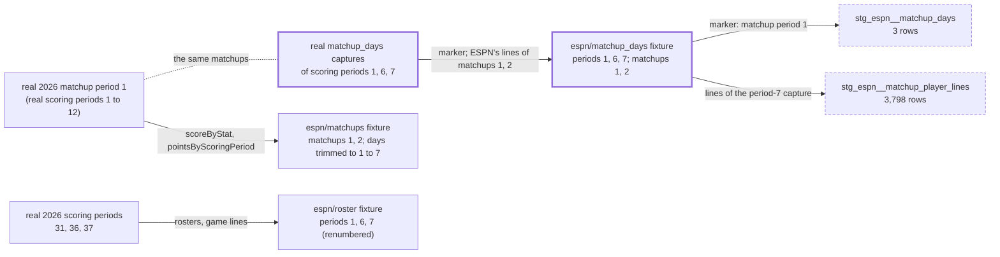

# The CI fixtures carry ESPN matchup-days captures of their own matchups — design

Issue: #178 · Requirements: [requirements.md](requirements.md) · Tasks: [tasks.md](tasks.md)

## Overview

`make_fixtures.py` gains one builder, `build_espn_matchup_days`. For each fixture
scoring period of 2026 with roster data (1, 6 and 7), it takes the newest real 2026
capture of the same scoring period number. It keeps the two matchups that the matchups
fixture keeps, and rebuilds them from an allowlist of what the capture view
`stg_raw__espn_matchup_days` declares. The marker is reduced to an empty object, and the
lines keep player ids and stat lines only. ESPN marks matchup period 1 in all three
captures, and each carries ESPN's real lines for the fixture's two matchups. Those lines
sum exactly to the real totals that the matchups fixture holds (C8).
`make_multi_fixtures.py` keeps only the period-1 capture for its one-period 2027 seasons.
Nothing under `dbt/` changes except comments, descriptions and the two `_empty_in_ci.yml`
entries, which this work removes.

Which real data each fixture piece comes from, and why the new captures follow the
matchups rather than the rosters:

## Claims ledger

All rows were run on 2026-10-23. The prototype is a copy of `fixtures/landing` with the
three captures added by a scratch builder that applies R1.1 to R1.3. Both warehouses were
built from empty with `front-office load` and
`dbt build --target ci --vars '{anonymize: true}'`. "Base" is the same build from the
committed fixtures at `main` 8585a4e.

| # | Claim | Query (or script) | Result | Run on |
|---|---|---|---|---|
| C1 | In CI today, `stg_espn__matchup_days` and `stg_espn__matchup_player_lines` are empty. `int_fantasy__matchup_periods` has 9 rows, all from `points_by_scoring_period`. `rec_espn__matchup_stat_differences` has 96 rows, all `unverified` | `count(*)`; `select … mapping_source`; `select season, status, count(*) … group by all` on base | 0; 0; 9 rows (2025 periods 1 and 2, 2026 periods 1 to 7), all `points_by_scoring_period`; `(2026, 'unverified', 96)` | 2026-10-23 |
| C2 | The fixture's 2026 matchups are real matchups 1 and 2 of matchup period 1, teams 9 v 6 and 2 v 3. Their real `pointsByScoringPeriod` runs over scoring periods 1 to 12, and the fixture trims it to 1 to 7. Real matchup period 1 has 6 matchups | Python over the committed `espn/matchups` 2026 fixture and the newest real 2026 `espn/matchups` capture | fixture: `1 1 HOME 9 6 [1..7]`, `2 1 HOME 2 3 [1..7]`; real: matchups 1 and 2 have keys 1 to 12; 6 matchups have `matchupPeriodId` 1 | 2026-10-23 |
| C3 | Real `matchup_days` captures exist for 2026, one per scoring period, for 180 periods. Those of scoring periods 1, 6, 7 and 12 mark matchup period 1 (12 sides each, so all 6 matchups). Those of 31, 36 and 37 mark periods 4, 5 and 5, and the fixture's matchups 1 and 2 carry no `rosterForMatchupPeriod` in them | scratch `probe.py`: for each period, count sides carrying `rosterForCurrentScoringPeriod` by `matchupPeriodId`; keys of matchups 1 and 2's sides | 180 captures; `{1: 12}` for 1, 6, 7, 12; `{4: 12}` for 31, `{5: 12}` for 36 and 37; no `rosterForMatchupPeriod` key on matchups 1 and 2 in 31, 36, 37 | 2026-10-23 |
| C4 | In the captures of 1, 6 and 7, the four sides of matchups 1 and 2 carry the marker and `rosterForMatchupPeriod`, with 25, 22, 23 and 17 entries. Every stat line is `(statSourceId 0, statSplitTypeId 5, scoringPeriodId 0)`, and there is no bye. Of the 3,803 stat values in the period-7 capture, 5 are the string `"Infinity"`, all stat 82 (K/BB). Projected, the three payloads differ only in `scoringPeriodId` | `probe.py`; a type count over every `stats` value; `diff` of the projected payloads with the header lines dropped | entries 25/22/23/17; line kinds `{(0, 5, 0): n}` only; `3803 5 [(('82', 'str', 'Infinity'), 5)]`; `diff` empty | 2026-10-23 |
| C5 | Each projected capture is 116,550 bytes, written as `write_fixture` writes (`indent=1`). `fixtures/landing` goes from 1.3 MB to 1.6 MB, and `fixtures/landing_multi` from 3.0 MB to 3.9 MB | `stat`; `du -sh` | 116,550 ×3; 1.3M → 1.6M; 3.0M → 3.9M | 2026-10-23 |
| C6 | In the prototype, only the matchup-days relations and the lines column of the stat differences change. `dbt build` is unchanged, and 2026 still lists every fixture day in `pointsByScoringPeriod` | `scripts/compare_warehouses.py base proto --strict-columns`; `dbt build` summary | DIFFERS only `stg_raw__espn_matchup_days` 0 → 3, `stg_espn__matchup_days` 0 → 3, `stg_espn__matchup_player_lines` 0 → 3798, `rec_espn__matchup_stat_differences` 96 → 96 (80 rows differ). Everything else, including `int_fantasy__matchup_periods` and every mart, is identical. Both builds: PASS 776, WARN 3, ERROR 0 | 2026-10-23 |
| C7 | The prototype's rows: `stg_espn__matchup_days` = (111111, 2026, sp 1/6/7, mp 1); lines per side | `select * …`; `select matchup_period, matchup_id, team_id, scoring_period, count(distinct espn_player_id), count(*), count(distinct stat_id) … group by all` | 3 rows, all matchup period 1; `(1,1,6,7,22,953,82)`, `(1,1,9,7,25,1114,82)`, `(1,2,2,7,23,995,82)`, `(1,2,3,7,17,736,82)`: 3,798 rows, which is C4's 3,803 values less its 5 `"Infinity"` ones (spec 0147, R1.5) | 2026-10-23 |
| C8 | The fixture's lines and its totals describe the same matchups. On every count row of the stat differences, the sum of ESPN's lines equals ESPN's total | `select count(*) filter (where matchup_line_value is not null), count(*) filter (where matchup_line_value = espn_value), count(*) filter (where matchup_line_value != espn_value) …` on proto | 80, 80, 0; statuses still 96 `unverified` | 2026-10-23 |
| C9 | The plant gate fails on the two stale exemptions, and passes once they are removed. 17 generic tests (6 on the days, 11 on the lines) stop reading zero rows | `scripts/check_plants.py` on proto, with the plants register as is and then without the two entries; the manifest's tests by `attached_node` | as is: 2 problems, "has 3 rows / has 3798 rows in CI; remove its exemption". Without them: pass, "reading zero rows: 18", 37 plants run. Base: "reading zero rows: 35". 6 + 11 generic tests | 2026-10-23 |
| C10 | `make_multi_fixtures.generate` as it stands gives each 2027 league the captures of periods 1, 6 and 7, and the build fails. With 2027 cut to period 1 it passes, and tenant isolation finds no difference | `generate(proto, scratch)`; load; `dbt build`; then the same with `build_2027_espn` skipping `matchup_days` of a period other than 1; `check_tenant_isolation` with `MULTI_ROOT` pointed at the scratch tree | as is: `int_fantasy__matchup_periods_use_their_own_scoring_periods` FAIL 4. Cut: PASS 776, WARN 3; day rows per league-season 3/3/1/1, 3,798 lines each; "isolation: 0 differing relation/league-season pairs" | 2026-10-23 |
| C11 | The new files hold no forbidden key and no GUID. Their keys are the allowlist's, plus stat ids | `front_office.privacy.walk`, `FORBIDDEN_KEYS` and `GUID` over the 22 new JSON files (proto and multi) | no hit; non-numeric keys: `away, entries, home, id, matchupPeriodId, player, playerId, playerPoolEntry, rosterForCurrentScoringPeriod, rosterForMatchupPeriod, schedule, scoringPeriodId, seasonId, statSourceId, statSplitTypeId, stats, teamId` plus the sidecar's | 2026-10-23 |
| C12 | Six singular tests read the two models, and all pass on the prototype: `stg_espn__matchup_days_mark_one_period`, `…_answer_the_period_asked`, `stg_espn__matchup_player_lines_one_line_per_player`, `…_cover_played_sides`, `int_fantasy__matchup_period_sources_agree`, `int_fantasy__matchup_periods_use_their_own_scoring_periods`. `…_cover_played_sides` now judges 2026, the four played sides, and finds lines on all four | the manifest's singular tests by `depends_on`; the proto build | 6 tests, plus `stg_raw__capture_views_cover_the_manifest`, which reads every view; all pass | 2026-10-23 |
| C13 | Every relation that changes is in `bigquery_slice` | `ingestion/tests/test_bigquery_slice.py`, the slice's model list | `rec_espn__matchup_stat_differences`, `stg_espn__matchup_days`, `stg_espn__matchup_player_lines`, `stg_raw__espn_matchup_days` are all listed | 2026-10-23 |
| C14 | The fixture tests pin each season's captures: 2025 to four kinds, 2026 to a set without `matchup_days` | `test_make_fixtures.py`: `test_the_2025_fixture_season_holds_four_captures_and_nothing_else`, `test_the_2026_fixture_season_is_untouched_by_the_past_season` | as stated; the second needs `("espn", "matchup_days")` | 2026-10-23 |
| C15 | With these captures, every capture view's endpoint has CI captures, so the CI build no longer runs the empty-endpoint branch of `duckdb__fo_captures`. A pytest holds that branch | `ls dbt/models/staging/raw/`, compared with the fixture endpoints; `test_capture_glob.py` | 11 views, 11 endpoints with captures; `test_an_endpoint_with_no_captures_gives_no_rows_and_its_columns` reads an endpoint with none in a temporary zone | 2026-10-23 |
| C16 | The C8 agreement can be checked in plain Python from the committed files. Count stats are those of `espn_stat_components.csv` with no denominator part, as in `rec_espn__matchup_line_totals`. The period-7 capture's numeric (0, 5) lines are summed per side, against the matchups fixture's `scoreByStat` | scratch script over the prototype's files and the seed | 21 count stats; equal 80, differ 0 | 2026-10-23 |

## Alternatives considered

| | A — real captures of the fixture's matchup days (chosen) | B — real captures of the rosters' days, renumbered | C — no fixture; the exemptions stay | D — plants into the empty relations |
|---|---|---|---|---|
| ESPN values rewritten | none | `matchupPeriodId`, matchup ids and teams, to agree with the matchups fixture | none | rows written by hand |
| Models run end to end on real input in CI | yes | yes, on rewritten input | no | no: a plant shows that a test fails, not that the model can produce the row |
| The fixture's lines agree with its totals | yes, on 80 of 80 count rows (C8) | no: the lines are of matchup periods 4 and 5 (C3) | n/a | n/a |
| Tenant isolation sees the two models | yes (C10) | yes | no | no |
| Cost | +350 KB single, +0.9 MB multi; one builder, one change to the multi builder | the same, plus a rewrite rule and its tests | none | about 17 plants, and an ADR that supersedes 0088's no-plant rule |

**A — real captures of the fixture's matchup days.** The matchups fixture is real matchup
period 1, so its days are real scoring periods 1 to 12, trimmed to 1 to 7 (C2). ESPN's
captures for 1, 6 and 7 mark that period and carry its lines (C3, C4). Taking them keeps
every ESPN value as sent, and makes the fixture's two records of a matchup, the totals and
the lines, agree (C8). It wins on every criterion except cost, and the cost is small.

**B — real captures of the rosters' days, renumbered.** This takes real scoring periods
31, 36 and 37, as the rosters do. ESPN marks matchup periods 4 and 5 in those captures and
holds lines only for those periods' matchups (C3). The fixture has no such matchups, and
`int_fantasy__matchup_period_sources_agree` would fail against the fixture's
`pointsByScoringPeriod`. Getting it through means rewriting `matchupPeriodId` and swapping
in other matchups' ids and teams. ADR 0087's drivers rule that out: no rewritten ESPN
data.

**C — no fixture; the exemptions stay.** Cheapest, and honest about the gap, since the
exemptions already say why. It leaves 17 generic tests, 6 singular tests and the tenant
gate reading nothing on these models. That is the gap that #174 found and sent here.

**D — plants into the empty relations.** The plant harness of spec 0174 could insert rows
into the two empty tables and show each test failing. That proves the tests can fail,
not that the models work on real captures, and ADR 0088 chose exemptions over plants
for relations that are empty in CI. It costs more than A and gives less.

Within A, two smaller choices were weighed:

- **Which scoring periods.** {7} alone is the smallest (+117 KB). But it makes the
  last-period choice of `stg_espn__matchup_player_lines` trivial, because a single
  capture is always the last. {1, 6, 7}, the fixture's days of data, makes that choice
  pick 7 out of three, and gives `mark_one_period` and `answer_the_period_asked` three
  captures to judge. {1…7} adds four days that have no roster or game data, for +466 KB.
  **{1, 6, 7} is proposed.** This is part of the ADR, and the owner may prefer {7}.
- **Whose projection.** `spike_load_bigquery.project_matchup_day` already defines what of
  a matchup-days response goes up to BigQuery (ADR 0061), and the fixture could import it.
  But the fixture builder keeps its own allowlists per endpoint, as dotted tuples checked
  by `only_allowed` tests. It also cuts the schedule to two matchups, which the upload must
  not do. The upload's projection is defensive about types in a way that the fixture,
  built from committed real captures, has no need for. **Own allowlist, in the same shape
  as the other ESPN fixtures.** A pytest (R2.2) holds the committed files to it. Undoing
  this choice is cheap, so it gets no ADR.

## Decisions

| ADR | Decision | Status |
|---|---|---|
| [0098](../../adr/0098-the-ci-fixtures-carry-matchup-days-captures-of-their-own-matchups.md) | The CI fixtures carry real matchup-days captures of the fixture's own matchups, for scoring periods 1, 6 and 7 | proposed |

## Detailed design

### `scripts/make_fixtures.py`

- Constants beside the other ESPN allowlists:
  - `ESPN_MATCHUP_DAY_LINE_FIELDS = ("statSourceId", "statSplitTypeId", "scoringPeriodId", "stats")`;
  - `MATCHUP_DAY_MARKER = "rosterForCurrentScoringPeriod"` and
    `MATCHUP_DAY_LINES = "rosterForMatchupPeriod"`;
  - `FIXTURE_MATCHUP_DAY_PERIODS`, derived as
    `tuple(fixture_period_number(p, FIXTURE_SOURCE_SCORING_PERIODS) for p in FIXTURE_SOURCE_SCORING_PERIODS)`,
    which is (1, 6, 7). The comment says why these are real periods with the same numbers,
    not the source periods (C2, C3).
- `rebuild_matchup_day_side(side)`: `{"teamId": …}`, plus `MARKER: {}` if the side has the
  marker, plus `MATCHUP_DAY_LINES: {"entries": [...]}` if it has lines. Each entry is
  `{"playerId": …, "playerPoolEntry": {"player": {"stats": [rebuild(line, ESPN_MATCHUP_DAY_LINE_FIELDS) …]}}}`.
  Every line is kept, filtered on nothing: the model's filter is what is under test, and
  C4 shows that every real line is (0, 5). An entry with no lines gets an empty `stats`
  list. A side without a key gets no key (R1.4).
- `check_matchup_days_match_the_matchups_fixture(season)`: one of the checks that `main()`
  runs before writing anything. For each of `FIXTURE_MATCHUP_DAY_PERIODS` it loads the
  newest real capture, or stops naming the period (R1.6). It stops naming the capture
  (R1.7) if the first `FIXTURE_MATCHUPS` matchups' `(id, home.teamId, away.teamId)`
  differ from those of the newest real `espn/matchups` capture of the season, which is
  what `build_espn_matchups` cuts from.
- `build_espn_matchup_days()`: writes one capture per period. The payload is
  `{"id": FIXTURE_LEAGUE_ID, "seasonId", "scoringPeriodId", "schedule": [{"id", "matchupPeriodId", "home", "away"}]}`
  for the first `FIXTURE_MATCHUPS` matchups, with `away` left out when the real matchup
  has none. The partitions are `{"season": 2026, "league_id": FIXTURE_LEAGUE_ID, "scoring_period": p}`
  and the params `{"view": "mMatchupScore,mScoreboard", "scoringPeriodId": p}`, under the
  default stamp. It prints the periods, the matchups and the entries per side.
  `main()` calls it after `build_espn_matchups()`.

### `scripts/make_multi_fixtures.py`

`build_2027_espn` skips a `matchup_days` capture whose `partitions.scoring_period` is not
1, as it already skips such a roster. The module docstring's table says so. The 2026
leagues need no change: `relabel` already rewrites `id`, `seasonId`, the partitions and the
URL.

### Committed files

- `fixtures/landing/espn/matchup_days/season=2026/league_id=111111/scoring_period={1,6,7}/fetched_at=20260430T160000Z/{payload,meta}.json`.
- `fixtures/landing_multi/…`, regenerated: 3 captures for each 2026 league and 1 for each
  2027 league.

### `dbt/`: comments and the register only

- `dbt/plants/_empty_in_ci.yml`: remove the two `#178` entries.
- Comments that become false (R3.4), each reworded to say that CI holds the three captures
  of the fixture's matchups:
  - `stg_espn__matchup_days.sql` (its closing "In CI there are no matchup_days captures" sentence);
  - `stg_espn__matchup_player_lines.sql` (the "In CI there are no matchup_days captures"
    sentence);
  - `rec_espn__matchup_line_totals.sql` ("In CI there are no matchup-days captures");
  - `tests/stg_espn__matchup_player_lines_one_line_per_player.sql` ("Empty where no matchup_days response is loaded, which includes CI");
  - `tests/stg_espn__matchup_player_lines_cover_played_sides.sql` ("as every CI fixture is"):
    CI's 2026 is now a covered season;
  - `_espn__models.yml`, the descriptions of both models, and
    `_rec_espn__models.yml`, the description of `rec_espn__matchup_line_totals`;
  - `macros/json.sql`, the `fo_captures` doc block ("the CI fixtures have no matchup days"): the example of an endpoint with no captures becomes "a
    new endpoint, or one a league has never fetched". The BigQuery port (#135) works
    alongside, so the build messages that work's coordinator before committing this file.

### Tests

- `test_make_fixtures.py`:
  - unit tests for `rebuild_matchup_day_side`: the allowlist only; a missing marker or
    missing lines gives no key; a name and a slot in the real entry are not copied; the
    marker's contents are not copied;
  - unit tests for the R1.6 and R1.7 checks, on the `roots` fixture;
  - a committed-file test: three captures, periods 1, 6 and 7, league id `111111`, and
    two matchups whose ids and teams equal the matchups fixture's. Every leaf path is in
    the R1.3 allowlist (R2.2). The existing `leaf_paths` stops at a list, so it would see
    `schedule` and nothing inside it. This test walks into list elements, writing an
    element as `[]` (`schedule[].home.rosterForMatchupPeriod.entries[].playerId`), and
    under `stats` it allows only stat-id keys (digits) with scalar values;
  - a committed-file test of R3.6: the C16 comparison, with the seed read from
    `dbt/seeds/espn_stat_components.csv`;
  - `test_the_2026_fixture_season_is_untouched_by_the_past_season` gains
    `("espn", "matchup_days")` (R3.5).
- `test_make_multi_fixtures.py`: each 2027 league holds exactly one `matchup_days`
  capture, of period 1, and each 2026 league holds three (R4.2, R4.3).
  `test_four_league_seasons_are_present` pins every league-season's endpoint set, and
  that set gains `matchup_days`. The byte-for-byte
  test covers the regenerated tree.

## Test strategy

| Requirement | Test | Catches |
|---|---|---|
| R1.1, R1.2, R1.5 | committed-file test in `test_make_fixtures.py` | a missing or extra period, a third matchup, a wrong partition or param |
| R1.3, R1.4, R2.2 | `rebuild_matchup_day_side` unit tests; the list-walking allowlist test over the committed files | a field outside the allowlist (a name, `lineupSlotId`, `teams`, `settings`) reaching a file; an invented key |
| R1.6, R1.7 | check unit tests on `roots` | a fixture built from a missing period, or from matchups that are not the matchups fixture's |
| R3.6 | the lines-against-totals test over the committed files | a regeneration whose lines no longer sum to the fixture's totals |
| R2.1 | `test_fixture_privacy.py` (unchanged; its scan picks up the new files) | a member key or GUID |
| R3.1 | the 6 + 11 generic tests and 6 singular tests, now on rows; the expected values queried on the build | a model that stops producing rows on real input |
| R3.2 | `compare_warehouses.py` CI base vs branch, `--strict-columns` | an unintended change downstream |
| R3.3 | `check_plants.py` in the gates | a stale exemption; a relation that becomes empty again |
| R4.1–R4.4 | `test_make_multi_fixtures.py`; `check_tenant_isolation.py` in the gates | 2027 holding periods that it lacks (C10); a leak across leagues in the two models |
| R5.1 | compiled SQL of `main` and the branch, diffed with comments stripped (task 10) | an edit that was meant to be comment-only but changed SQL |

## Risks

- A regeneration picks other matchups (the landed `matchups` capture changes) and the two
  fixtures drift apart. Likelihood low, impact high: silent inconsistency. Mitigated by
  R1.7, which stops generation.
- A plant names a row of these relations and the fixture moves. No plant names them
  today, so this is accepted.
- Fixture size grows 27% for the single tree and 30% for the multi tree (C5). Accepted:
  the totals are 1.6 MB and 3.9 MB.

## Open questions

- None that block the design. The choice of {1, 6, 7} over {7} goes to the owner with the
  ADR.

## Review log

| Source | Finding | Resolution |
|---|---|---|
| design-review (Codex, 2026-10-23) | F1 (P1): `only_allowed` cannot enforce R2.2 inside `schedule` or `entries`, because `leaf_paths` treats a list as one leaf | Fixed. The committed-file test walks into list elements and allows only stat-id keys under `stats` (*Tests*) |
| design-review | F2 (P1): `test_four_league_seasons_are_present` pins the endpoint set without `matchup_days`, so task 5 would break it | Fixed. Named in *Tests* and in task 5 |
| design-review | F3 (P2): nothing keeps C8 (the lines sum to the totals) true across regenerations | Fixed. Added R3.6 and a committed-file test, checked in plain Python against the prototype (C16: 80 equal, 0 differ). Running it found 5 `"Infinity"` values, now recorded in C4 and C7 |

## Amendments
