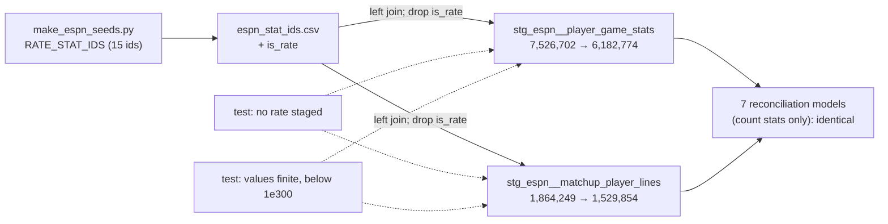

# ESPN's rate stats are not staged — design

Issue: #194 · Requirements: [requirements.md](requirements.md) · Tasks: [tasks.md](tasks.md)

## Overview

`make_espn_seeds.py` gains a constant, `RATE_STAT_IDS`, which names ESPN's 15 rate stats,
and writes it into `espn_stat_ids.csv` as a boolean column `is_rate`.
`stg_espn__player_game_stats` and `stg_espn__matchup_player_lines` each left-join the seed
on `stat_id` and drop the rows whose stat is a rate. A stat the seed does not know is
kept. The rates go, and with them every encoding of "undefined" that ESPN writes into a
rate: the 2018 largest double, the 2019 to 2026 `0.0`, and the 2021 NaN of runs created.
The counts are untouched. Two singular tests and their plants hold the rule: no listed
rate in either model, and no value that is non-finite or at least 1e300. The second
catches an x/0 sentinel or a NaN in any stat, listed or not. It cannot catch an unlisted
rate written as `0.0` (*Risks*). "Rate" covers RC too, which is derived from other stats
rather than a ratio, and is no count either (C5). On a prototype built on a copy
of the real warehouse, only the two line models change (by removed rows), and every
reconciliation model downstream is identical (C9).

## Claims ledger

All rows were run on 2026-10-24, on the real warehouse built from `main` by #135 (`data/warehouse_135.duckdb`), unless they say otherwise. Scripts: `probe194.py` and `probe194b.py` (pivot each game line's stats on its key, then group).

| # | Claim | Query (or script) | Result | Run on |
|---|---|---|---|---|
| C1 | In `stg_espn__player_game_stats`, the only non-finite or huge values are NaN for stat 19 and the largest double for stats 41, 47 and 82. There is no infinity and no other value above 1e6 | `select stat_id, count(*) filter (where stat_value = 1.7976931348623157e308), … isnan …, … isinf …, … abs > 1e6 and not the max … group by 1` | `(19: 0, 4076, 0, 0)`, `(41: 32, 0, 0, 0)`, `(47: 32, 0, 0, 0)`, `(82: 1717, 0, 0, 0)` | 2026-10-24 |
| C2 | Every largest-double value is from 2018 | `select season, count(*) … where stat_value = 1.797…e308 group by 1` | `(2018, 1781)` | 2026-10-24 |
| C3 | In 2018, a zero denominator is left out of the line, and the rate is the largest double. Every WHIP and ERA sentinel has no outs key and a positive numerator. Every K/BB sentinel has no walks key and K > 0. Lines with no outs key and nothing to divide carry no ERA key | the pivot, grouped by sentinel and denominator | WHIP `(sentinel, outs absent) 32`; ERA `32`; K/BB `(sentinel, walks absent, K>0) 1717`; ERA `(2018, outs absent, no key) 9`. Numerators on the sentinel lines: ER 1 to 3, hits 1 to 3 | 2026-10-24 |
| C4 | From 2019, a zero denominator is written as 0.0, and so is the rate | the pivot: ERA where outs is 0 or absent; K/BB where walks is 0 or absent and K > 0, by season | ERA `(outs 0.0, value 0.0)`: 41, 36, 34, 32, 36, 37, 33 (2019, 2021 to 2026). K/BB `(walks 0.0, value 0.0)`: 1579, 1718, 1913, 1828, 2038, 2033, 1803 | 2026-10-24 |
| C5 | RC's NaNs are all from 2021, on lines with AB + BB = 0. Other seasons give RC a real value on such lines, so RC has terms beyond AB + BB | the pivot: RC where AB + BB = 0, by season and value class | `(2021, nan, 4076)`; also in 2021, 29 real values. Other seasons: 0.0, 0.041333377, 0.3315556 and others, e.g. 2019 `0.0 ×116`, `0.0413 ×10`, `0.3316 ×20` | 2026-10-24 |
| C6 | In `stg_espn__matchup_player_lines`, a K/BB with zero walks has no row in any season. ESPN writes the string `"Infinity"` there, which spec 0147 R1.5 drops (spec 0178 C4 counted 5 in one 2026 capture). No value in the model is NaN, infinite or ≥ 1e300 | the same pivot over the matchup lines; `count(*) filter (where isnan …/isinf …/abs > 1e300)` | `(season, walks 0 or absent, no row)`: 541 (2018), 531, 585, 689, 610, 759, 770, 643; `(0, 0, 0)` | 2026-10-24 |
| C7 | The game lines hold 84 stat ids. 15 are rates or derived values: AVG 2, SLG 9, OBP 17, OPS 18, RC 19, PPA 29, OBA 38, WHIP 41, OOBP 43, ERA 47, K/9 49, WPCT 55, SV% 59, FPCT 71, K/BB 82. Only 2, 41, 47 and 49 have a denominator in `espn_stat_components.csv`. WPCT and SV% hold only whole values, 0 or 1. Ids 22, 30, 61, 64, 78, 79 and 80 are not in `espn_stat_ids.csv` (78 ids) and hold only whole values. All 15 rates are in the seed | `probe194b.py`: per stat id, `count(*)`, `count(*) filter (where stat_value <> floor(stat_value))`, min, max, and its seed rows; `set(range(100)) - seed ids` | as stated; e.g. WPCT `38499 rows, 0 fractional, 0 to 1`; SV% `38289, 0, 0 to 1`; FPCT `130846, 6636 fractional`; id 22 `134628, 0, 0 to 1` | 2026-10-24 |
| C8 | Nothing downstream reads a rate. The models downstream of the two line models are 7 reconciliation models (`dbt ls --select stg_espn__player_game_stats+ stg_espn__matchup_player_lines+`). The count stats that `rec_espn__matchup_line_totals` keeps include none of the 15. The rates make 1,343,928 of 7,526,702 game-line rows and 334,395 of 1,864,249 matchup-line rows | `dbt ls`; `select count(*) from int_fantasy__stat_components where stat_key in (<15>) and part = 'numerator' and stat_key not in (<denominator stats>)`; `count(*) filter (where stat_id in (<15>))` | 7 models: `rec_espn__{category_result_differences, matchup_line_totals, matchup_stat_differences, player_day_differences, player_day_residuals, register_rows, winner_differences}`; 0; 1,343,928; 334,395 | 2026-10-24 |
| C9 | The prototype changes only the two line models, and only by removing rows. It is R2.1 and R2.2, with the 15 ids inlined (`proto194.diff`), built with `dbt build --select stg_espn__player_game_stats+ stg_espn__matchup_player_lines+` on a copy of the real warehouse | `dbt build` summary; `scripts/compare_warehouses.py data/warehouse_135.duckdb <copy> --strict-columns`; `count(*)` and the non-finite count on the copy | `PASS=49 WARN=0 ERROR=0`. `compared 73 relations: 71 identical, 2 differ`: `stg_espn__matchup_player_lines` 1864249 → 1529854 (only in OLD 334395, only in NEW 0), `stg_espn__player_game_stats` 7526702 → 6182774 (only in OLD 1343928, only in NEW 0). Non-finite or ≥ 1e300 after: 0 and 0 | 2026-10-24 |
| C10 | In CI, the two models hold rate rows and no non-finite or sentinel value, so neither test's failing case can be built from the fixtures | `count(*)`, `count(*) filter (where stat_id in (<15>))`, the non-finite count, on `dbt/ci.duckdb` at `main` feb82a9 | game lines `(16649, 2834, 0)`; matchup lines `(3798, 656, 0)` | 2026-10-24 |
| C11 | Adding a column to `espn_stat_ids` changes neither of its readers. `stg_espn__scoring_categories` and `stg_espn__matchup_category_results` select `stat_abbrev` and `display_label` by name | `grep -n "stats\." …` | `stats.stat_abbrev`, `stats.display_label`, and the join on `stats.stat_id`, in both | 2026-10-24 |
| C12 | No macro tests for NaN or infinity on both warehouses yet | `grep -n "macro .*\(nan\|inf\|finite\)" -i dbt/macros/*.sql` | no match | 2026-10-24 |

## Alternatives considered

| | A — rates are not staged (chosen) | B — sentinels become null | C — each rate nulled at a zero denominator |
|---|---|---|---|
| The 2018 largest double and the 2021 NaN | gone | null | null |
| The 2019 to 2026 `0.0` at a zero denominator (C4) | gone | stays, a number | null |
| Needs ESPN's formula for each rate | no | no | yes, for 15, of which 4 are known (C7) |
| Rows lost by any reader | none (C8, C9) | none | none |
| Departs from usual staging practice | yes: staging no longer carries all the source sends | no: nulling a source's sentinel is the usual cleaning | no |
| Cost | a seed column, two joins, two tests | one expression per model, one test | a formula per rate, and its tests |

**A — rates are not staged.** It is the only option that removes every encoding at once,
including the `0.0` that B cannot tell from a real zero. It needs no guess at ESPN's
formulas. And rule 4 means no reader wants ESPN's rates: every count and every
reconciliation is unchanged (C9). Its cost is that staging no longer carries everything
ESPN sends. A future model that needs an ESPN rate as ESPN shows it has to take it out of
the list, and the tests show where. **Chosen by the owner, 2026-10-24** (ADR 0099).

**B — sentinels become null.** This is what staging usually does with a source's sentinel
values. It handles the 2018 and 2021 values but leaves about 2,000 `0.0` rates a season,
which read as perfect. That contradicts the owner's reading that every zero-denominator
rate is undefined. It would have to be written down as a known gap.

**C — each rate nulled at a zero denominator.** It keeps the defined rates and nulls only
the undefined ones. But it needs ESPN's formula for every rate, and 11 of the 15 are not
in the components seed (C7). RC's formula has terms beyond AB + BB (C5). That is
inference about ESPN, for stats nothing reads.

Within A, two smaller choices were the owner's:

- **Name the rates, or name the counts.** Values cannot tell them apart: WPCT and SV% are
  0 or 1 per game, and the 7 unnamed ids are whole (C7). Naming the 15 rates keeps the 7
  unnamed ids, which is what both models do today. A rate ESPN adds later would pass as a
  count until it is named, and the value test catches its 2018-style encoding. Naming the
  ~69 counts would fail safe, but drop the 7 now. **Rates: owner, 2026-10-24.**
- **Both line models, or the game lines only.** The matchup lines already drop the
  undefined K/BB (C6), so for them the rule only removes the defined rates. Applying it to
  both means the two models mean the same thing by "ESPN's lines", and one pair of tests
  covers both. **Both: owner, 2026-10-24.**

The meaning itself was the first decision: **every ESPN rate at a zero denominator is
undefined, whatever value ESPN wrote** (owner, 2026-10-24, from C3 to C5). The pattern
between numerator and denominator is exact in every season. ESPN's intent is still
inferred, not documented.

## Decisions

| ADR | Decision | Status |
|---|---|---|
| [0099](../../adr/0099-espns-rate-stats-are-not-staged.md) | ESPN's rate stats are not staged: a rate at a zero denominator is undefined in every encoding ESPN uses, and no reader needs a rate. The 15 rates are named in a generated seed column, and both line models drop them | proposed |

## Detailed design

### `scripts/make_espn_seeds.py`

- A constant beside `DISPLAY_LABELS`:
  `RATE_STAT_IDS = {2, 9, 17, 18, 19, 29, 38, 41, 43, 47, 49, 55, 59, 71, 82}`. Its comment
  names each one (AVG, SLG, …) and says why rates are listed (ADR 0099). It also says why
  this list cannot come from the values: WPCT and SV% are 0 or 1 per game.
- `main()` stops with `SystemExit` naming any id in `RATE_STAT_IDS` that is not in
  `numeric_only(STATS_MAP)` (R1.2), before writing a file.
- `espn_stat_ids` gains a fourth column, `is_rate`, written as `true` or `false` (lower
  case, which dbt's CSV loader reads as a boolean on both warehouses).

### `dbt/seeds/espn_stat_ids.csv` and `_espn__models.yml`

Regenerated by the script, not edited. Its YAML entry gains `is_rate` with
`data_tests: [not_null]` (R1.3) and a description. Locally the seed needs
`dbt seed --full-refresh` once (AGENTS.md: a seed that gains a column). CI builds from
empty.

### `stg_espn__player_game_stats`

The final select gains `left join {{ ref('espn_stat_ids') }} as stat_ids on stat_ids.stat_id = cast(stat_rows.stat_key as bigint)`
and `where not coalesce(stat_ids.is_rate, false)`. The join runs after the unnest, on the
narrow rows that `stat_rows` holds, so rule 1 is untouched: no payload column is beside
it. A stat id that is not in the seed has a null `is_rate`, and is kept (R2.3). The
opening comment gains a paragraph: ESPN's rates are not staged; what ESPN writes for an
undefined rate (C3 to C5); ADR 0099.

### `stg_espn__matchup_player_lines`

The same join and condition, on `numbered`, beside `where stat_value is not null`. The
comment's R1.5 paragraph gains a sentence: rates are not staged either (ADR 0099), and
the `"Infinity"` that R1.5 drops is ESPN's undefined K/BB.

### `fo_is_finite`, in `dbt/macros/portable.sql`

`fo_is_finite(expr)` is dispatched, as the other `fo_*` macros are:
- DuckDB: `isfinite(expr)`;
- BigQuery: `(not is_nan(expr) and not is_inf(expr))`.

It is null for a null input on both warehouses. `test_dbt_portable_sql_rule.py` has no
pattern for `isnan`, `isinf` or `isfinite` (C12's grep, over that file too). Adding one is
not this spec's work: a model or test that called one directly would fail
`dbt build --target bq --selector bigquery_slice --empty`, which costs nothing. `build`,
not `run`, so that the singular tests are compiled and run on BigQuery too (design
review F2).

### Tests

- `dbt/tests/stg_espn__stat_lines_hold_no_rate.sql` (R3.1): a `union all` of both
  models' `(model name, stat_id)`, joined to the seed where `is_rate`, grouped to one row
  per model and stat id with a count.
- `dbt/tests/stg_espn__stat_lines_hold_finite_values.sql` (R3.2): a `union all` of both
  models' `(model name, stat_id, stat_value)` where
  `not {{ fo_is_finite('stat_value') }} or abs(stat_value) >= 1e300`. A null value is not
  a failure: the game lines can hold a null from `fo_safe_cast`, and the matchup lines
  drop theirs.
- `dbt/plants/stg_espn__stat_lines_hold_no_rate.yml` and
  `…_hold_finite_values.yml` (R3.3). For each model:
  - a rate row inserted (stat 82), which is a `fail`;
  - for the value test, a row set to the largest double, and one set to NaN, each a
    `fail`;
  - a large finite count value (1e6), which must `pass`.

  Both models are tables in CI, so no `materialize:` is needed.
- `ingestion/tests/test_make_espn_seeds.py` (exists) gains: the column is written;
  exactly the 15 ids are true; an id missing from `STATS_MAP` stops generation (R1.1,
  R1.2).

### Not changed

- `rec_espn__player_day_differences` and the other 6 reconciliation models (C8, C9).
- The 7 unnamed stat ids (no-go). They are not in the seed, so they are kept.

## Test strategy

| Requirement | Test | Catches |
|---|---|---|
| R1.1, R1.2 | `test_make_espn_seeds.py` | a rate missing from the column; a typo in the constant |
| R1.3 | `not_null` on `espn_stat_ids.is_rate` | a regeneration that leaves the column empty |
| R2.1, R2.2, R3.1 | `stg_espn__stat_lines_hold_no_rate` and its plants | a model that stops filtering, or a rate re-added to staging |
| R2.3 | the unchanged count of the 7 unnamed ids, in task 8's queries | a filter written as an inner join, which would drop stats the seed does not know |
| R2.4, R4.1 | `compare_warehouses.py` on the real season, before vs after; and on CI | an unintended change to a count or downstream |
| R3.2, R3.4 | `stg_espn__stat_lines_hold_finite_values` and its plants, on DuckDB in CI; `dbt build --target bq --selector bigquery_slice --empty`, which runs the singular tests on empty tables, for BigQuery | an x/0 sentinel or NaN in any stat; a macro or test SQL that BigQuery rejects |
| R4.2 | review of the comment and description diff | — |

## Risks

- ESPN adds a rate stat, or espn-api names one of the 7 unknown ids as one, and it is
  staged as a count until it is named in `RATE_STAT_IDS`. If ESPN encodes its undefined
  values as an x/0 sentinel or a NaN, the value test fails. If it encodes them as `0.0`,
  as it has since 2019 (C4), no test sees it. Likelihood low: ESPN's stat ids have not
  changed across the eight landed seasons. Impact low: no model reads ESPN's rates
  (rule 4). Accepted by the owner when choosing to name the rates, not the counts
  (2026-10-24). The alternative, a test that fails on any stat id the seed does not
  classify, would catch a new id only while espn-api does not yet name it.
- A future model wants an ESPN rate as ESPN shows it. Then it is taken out of the list,
  deliberately. The no-rate test fails until the ADR is amended, which is the point.

## Open questions

- None. The owner settled the meaning, the option, the direction of the list, the scope
  and the tests on 2026-10-24.

## Review log

| Source | Finding | Resolution |
|---|---|---|
| design-review (Codex, 2026-10-25) | F1 (P1): an unlisted rate written as `0.0` passes both tests, but the goal claimed the tests cover a new encoding | Fixed. The goal, *Overview* and *Risks* now say what the value test catches (x/0 sentinels and NaN, in any stat) and what it cannot (an unlisted `0.0`). That risk is the one the owner accepted in choosing to name the rates |
| design-review | F2 (P1): `dbt run --empty` does not run singular tests, so the BigQuery form of `fo_is_finite` would go unchecked | Fixed. Task 7 and the test strategy use `dbt build --empty` |
| design-review | F3 (P2): `compare_warehouses.py` compares staging, intermediate, marts and reconciliation, not the `main` schema the seeds live in | Fixed. Task 8 compares `espn_stat_ids` directly, columns and rows |
| design-review | F4 (P2): RC is a derived value, not a ratio, yet the spec promised every count unchanged | Fixed. The requirements and design say `is_rate` covers RC as a derived value, and the promise is limited to the stat ids that are kept |

## Amendments

- **2026-10-25, task 7 builds into suffixed datasets.** `dbt build --target bq --selector
  bigquery_slice --empty` replaces each relation in the slice with an empty one, and the
  BigQuery project holds #135's real-season build (`stg_espn__player_game_stats`:
  7,526,702 rows). Task 7 runs with `--vars '{fo_schema_suffix: _e194}'` (spec 0130,
  R5.5), which builds into `staging_e194`, `marts_e194` and the rest, and leaves that build
  as it is. What it checks is unchanged: BigQuery compiles and runs every model and test in
  the slice, `fo_is_finite` among them.
- **2026-10-25, a unit test for the join.** R2.3 had only task 8's one-off count as a
  check, so a filter written as an inner join would pass every test in the build. The unit
  test `matchup_player_lines_leave_out_rates_and_keep_unknown_stats` gives one line with a
  count (1), a rate (82) and a stat the seed does not know (22), and expects 1 and 22. It
  fails on an inner join and on a model that stages rates. `test_bigquery_slice.py` pins
  189 unit tests.
