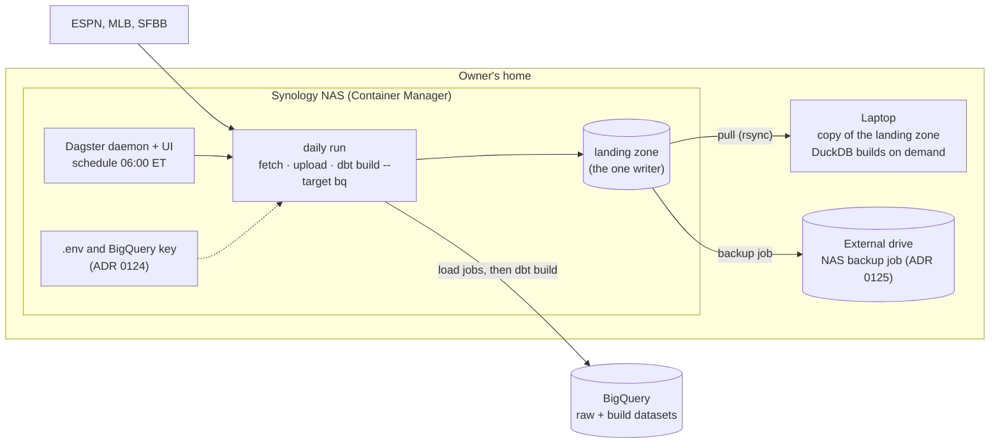

# Where the daily run runs — design

Issue: #216 · Requirements: [requirements.md](requirements.md) · Tasks: [tasks.md](tasks.md)

## Overview

The daily run moves to the owner's Synology NAS, in a container, and the production landing
zone moves with it. The NAS is always on, and captures stay in the house, so ADR 0054 holds as
written. Dagster's daemon runs the schedule there, so the definitions #217 writes are also what
production runs: Cloud Scheduler and Cloud Run leave the roadmap. Each morning the run fetches,
appends to BigQuery's raw tables, and builds BigQuery. The laptop pulls a copy of the landing
zone and builds DuckDB from it when it wants to. The NAS is the one writer. Every option, the
NAS included, costs nothing in GCP in 2027 except the e2-micro's disk after 2027 and Cloud Run's
about 1 USD a month (C1 to C4). The NAS wins on member data, memory and the morning deadline,
not on price.

The owner chose each of these at the walkthrough on 2026-11-05. The run reads the ESPN cookies
and a narrow BigQuery service account key from files on the NAS, "for now", until the owner's
secret manager for all their projects exists (ADR 0124). The landing zone joins the NAS's
existing backup to its external drive (ADR 0125). Two things stay conditional on the build's
spike: the NAS's memory (task 4, R6.2) and the service account's final roles (task 4, R5.2).

## Claims ledger

| # | Claim | Query (or script) | Result | Run on |
|---|---|---|---|---|
| C1 | Compute Engine: the free tier covers one e2-micro, its external IPv4 address for a month, and 30 GiB of standard disk. | Cloud Billing catalog API, service `6F81-5844-456A` (Compute Engine): SKUs "External IP Charge on a Standard VM", "Storage PD Capacity" (us-central1/us-east1/us-west1); [free-tier page](https://docs.cloud.google.com/free/docs/free-cloud-features) | IP: 0 USD for the first 720 h, then 0.005 USD/h. PD: 0 USD for 30 GiB-months, then 0.04 USD/GiB-month. Page: "1 non-preemptible e2-micro VM instance per month" in us-west1, us-central1 or us-east1; "1 GB of outbound data transfer from North America" a month. The E2 core and RAM SKUs list no free tier: the e2-micro allowance is applied as a credit | 2026-11-04 |
| C2 | Cloud Run jobs have no free tier in the catalog. | catalog, service `152E-C115-5142`: "Jobs CPU in us-central1", "Jobs Memory in us-central1"; the free-tier page | 0.000018 USD/vCPU-s and 0.000002 USD/GiB-s from the first second. The page lists its free tier (180,000 vCPU-s, 360,000 GiB-s) for request-based billing only. A job of 1 vCPU and 2 GiB for 900 s is 0.0198 USD, or 0.60 USD a month at one run a day | 2026-11-04 |
| C3 | Storage, scheduling and secrets are free at this project's size, or near it. | catalog: Cloud Storage `95FF-2EF5-5EA1` "Standard Storage US Regional"; Cloud Scheduler `1F14-4801-0E16` "Jobs"; Secret Manager `EE82-7A5E-871C`; Artifact Registry `149C-F9EC-3994` "Artifact Registry Storage" | GCS: 0 USD for 5 GiB-months, then 0.02 USD/GiB-month (about 20 GB in late 2027 is 0.30 USD a month). Scheduler: the first 93 job-days free (three jobs), then about 0.10 USD a job a month. Secret Manager: 6 versions and 10,000 accesses free. Artifact Registry: 0.5 GB free, then 0.10 USD/GB-month | 2026-11-04 |
| C4 | Pulling captures out of Google to the laptop is billed past the free allowance. | catalog: "Artifact Registry Network Internet Egress North America to North America"; C1's page | 0.105 USD/GB for the first 10 TiB. Compute's own egress SKU was not found in the catalog pages read; it is assumed to be of the same order. About 8 GB a season (C9) is about 0.75 USD a season past 1 GB a month | 2026-11-04 |
| C5 | An e2-micro has 1 GB of memory. | Compute Engine machine-type documentation, cited by the free-tier page | 2 shared vCPUs, 1 GB. Not measured here | 2026-11-04 |
| C6 | The landing zone is 12 GB, almost all of it four endpoints. | `du -sh data/raw` and per endpoint; `find … -name payload.json \| wc -l` | 12 GB. `mlb/boxscore` 7.7 GB (41,394 captures), `espn/roster` 2.4 GB (1,471), `espn/matchup_days` 1.6 GB (1,469), `mlb/schedule` 66 MB (20). The rest under 20 MB each | 2026-11-04 |
| C7 | dbt parses this project for BigQuery in about 0.28 GB. | `/usr/bin/time -v dbt parse --target bq --no-partial-parse` (dbt 1.12, dbt-bigquery) | peak RSS 276 MB, 6.8 s on the laptop. `dbt ls --selector bigquery`: 258 MB | 2026-11-04 |
| C8 | Dagster over this project's graph needs about 0.5 GB for its daemon and 0.35 GB for its UI, idle. | `data/spike216/defs.py` (not committed): `@dbt_assets` over the bigquery manifest plus one asset and one daily schedule; `measure.sh` sums PSS over the process tree once a second for 75 s / 60 s | Dagster 1.13.28, dagster-dbt 0.29.28, Python 3.13. 93 assets. `dagster-daemon run`: peak 505 MB over 3 processes (daemon, code server, …). `dagster-webserver`: 349 MB over 2. Loading the definitions alone: 183 MB. **dagster-dbt 0.29.28 failed to load the real manifest** with `KeyError` on a unit test and then on a dbt function: the probe's copy had both removed | 2026-11-04 |
| C9 | A season of daily runs lands about 8 GB, against 1.6 GB for 2026's backfill. | 2026: `du -sh` per endpoint; boxscores per game counted over `season=2026` (script in the session, `glob` of `payload.json` by game directory); ADRs 0018, 0019 | 2026's backfill: boxscores 929 MB, rosters 422 MB, matchup days 217 MB, schedules 14 MB. 2,430 games, mean 186 KB a capture. Daily: each game is fetched on each run until a capture 7 days after its first (ADR 0019), so about 8 captures a game: 2,430 × 8 × 186 KB ≈ 3.5 GB. Rosters: 3.9 GB a season (ADR 0018's figure). Schedules: 3.5 MB a run (ADR 0019) × about 190 runs ≈ 0.7 GB. Total ≈ 8 GB | 2026-11-04 |
| C10 | The laptop has room. The NAS's free space is not known. | `df -h data` | laptop: 405 GB free of 539 GB. NAS: not measured (task 1) | 2026-11-04 |
| C11 | The laptop suspends when idle, and backs up home to the NAS every hour. | `systemctl --user list-timers`, `systemctl --user cat backup.timer`; #137's build (a BigQuery run hung across a suspend) | `backup.timer`: "Hourly backup of home directory to the NAS", `OnCalendar=hourly`, `Persistent=true`. The owner: "on the majority of time but it is a laptop" (2026-11-04) | 2026-11-04 |
| C12 | A full BigQuery build bills about 16 GB and takes under 10 minutes, so a daily one stays inside the free terabyte. | #140's evidence comments (`run_results.json`, 579 nodes) | 16.16 GB, 522 s, PASS=574. × 30 = 485 GB a month, under the free 1 TiB of querying. Storage: heavy tables 2.247 GB, under the free 10 GiB | 2026-11-03 |
| C13 | DuckDB's full build fits in 1 GB for 2026 and 2 GB for eight seasons, with the committed profile. | ADR 0100, spec 0156 C20 | as stated, at 4 dbt threads and 4 DuckDB threads | 2026-10-25 |
| C14 | The first full upload took two hours, in 0.58 GB. | #140's evidence comment | 7,190 s wall, 0.58 GB peak. A daily upload appends only new captures | 2026-11-03 |
| C15 | The NAS is a Synology running Container Manager, with 4 to 6 GB of memory. | the owner, 2026-11-04 | stated, not measured. Model, CPU, free memory and free space: task 1 | 2026-11-04 |
| C16 | By the end of 2027 a full BigQuery build bills at most about 27 GB, still inside the free terabyte at one a day. | from C6, C9, C12: the heavy four land 11.77 GB and are stored in 2.247 GB (ratio 0.191); 2027 adds about 8 GB landed, so about 1.53 GB stored; build bytes scaled by stored size (an upper bound: not every node reads raw) | 16.16 × 3.77 / 2.247 ≈ 27.1 GB a build, about 814 GB a month at the season's end. The same rule gives about 38 GB a build and 1,144 GB a month by the end of 2028, past the free 1 TiB | 2026-11-04 |

## Alternatives considered

| | **d — NAS container (recommended)** | a — laptop on a timer | b — Cloud Run job + bucket | c — e2-micro VM |
|---|---|---|---|---|
| GCP cost a month, 2027 (C1–C4) | 0 USD | 0 USD | about 0.95 USD (job 0.60, bucket 0.30, image 0.05), rising about 0.16 a season | 0 USD; past 30 GB (about 2028) 0.04 USD/GB-month |
| Runs with the laptop away or asleep (R1.1) | yes | no | yes | yes |
| Done by 09:00 (R1.2) | yes, at home's uptime | only if the laptop is awake at the hour (C11) | yes | yes |
| Whole captures leave the home (R2.3) | no | no | yes: reverses ADR 0054 | yes: reverses ADR 0054 |
| Memory for Dagster's daemon + UI (C8: 0.85 GB) plus a run | 4 to 6 GB (C15): fits | 29 GB: fits | per run, no daemon | 1 GB (C5): the daemon and a run (C7, C8) do not fit; a one-shot run without the daemon is at the limit |
| Could build DuckDB too (C13) | 2 GB for eight seasons: fits, beside DSM | yes | yes, at about 3 USD a month more | no |
| New code | a container image and a pull to the laptop | a systemd timer | `LandingZone` on object storage: ADR 0014 publishes a capture by one rename, which GCS does not have | a VM image, and a pull to the laptop (egress, C4) |
| BigQuery credential | a key file on the NAS (ADR 0124) | the owner's own login, as today | the job's own service account, no key | the VM's own service account, no key |
| Fails when | home power or internet is out; the NAS is down | the laptop is shut or away | Google is down (rare); ESPN refuses cloud addresses (unknown) | as b; and the disk fills |
| Portfolio story | self-hosted Dagster in production | a cron job | the roadmap's Cloud Scheduler + Cloud Run | self-hosted Dagster on a free VM |

**d — NAS container.** The one option that meets every requirement with nothing reversed. It
runs whatever the laptop is doing, is free, keeps members' data where ADR 0054 put it, and has
the memory to run Dagster as a real deployment: daemon, UI on the LAN, and a run, which a 1 GB
VM cannot. A NAS is also where the backups go today, so it changes the backup's shape (ADR
0125). It shares the laptop's one weakness, the home's power and internet, and a missed morning
catches up on the next run (R1.3).

**a — laptop on a timer.** Free, and nothing to build. It loses on the owner's own constraint:
it is a laptop, and a run that needs it awake at 06:00 misses whenever it is closed or away.
Those are the days that matter for #66's first week.

**b — Cloud Run job + a private bucket.** The roadmap's answer, and the only one with no machine
to look after. It loses on two counts. It reverses ADR 0054 for every capture, members' names and
account ids included. And it ports `LandingZone` to object storage, where ADR 0014's publish by
one rename does not exist, so the capture protocol is redesigned for about 1 USD a month of
hosting. ESPN's treatment of a cloud address is unknown.

**c — free e2-micro VM.** The answer to the owner's question whether Dagster fits a free VM.
Measured: no. The daemon alone is 505 MB idle (C8), dbt is 276 MB just to parse (C7), and the
machine has 1 GB in all, operating system included. Without the daemon, a cron entry calling
`dagster asset materialize` is at the limit and would need swap on a shared vCPU. It also
reverses ADR 0054 and fills its free disk in about two seasons (C6, C9).

## Decisions

| ADR | Decision | Status |
|---|---|---|
| [0121](../../adr/0121-the-daily-run-runs-on-the-nas-and-the-landing-zone-moves-there.md) | The daily run runs on the NAS in a container, and the production landing zone moves there | proposed |
| [0122](../../adr/0122-dagster-runs-the-daily-schedule-in-production.md) | Dagster's daemon runs the daily schedule in production; Cloud Scheduler and Cloud Run leave the plan | proposed |
| [0123](../../adr/0123-bigquery-is-built-each-day-and-duckdb-on-the-laptop-on-demand.md) | Each run builds BigQuery; DuckDB is built on the laptop from its copy, when wanted | proposed |
| [0124](../../adr/0124-the-run-reads-its-credentials-from-files-on-the-nas.md) | The run reads the ESPN cookies and a BigQuery service account key from files on the NAS, and rule 3 is reworded to say where Google credentials live | proposed: the owner's |
| [0125](../../adr/0125-the-landing-zone-joins-the-nas-backup-to-its-external-drive.md) | The landing zone joins the NAS's backup job to its external drive; the laptop's pull is a third copy | proposed: the owner's |

ADR 0121 amends ADR 0119: the loader still reads a local landing zone, on the host that holds it.

## Detailed design

**The host.** A container on the NAS, built from the repository: Python 3.13 with `uv sync
--locked --group bigquery`, the CLI and dbt, and Dagster once #217 adds it. The landing zone is
a NAS volume mounted into the container at the path the CLI's `--raw-root` names. Two volumes
are mounted read-only: one with `.env` (the ESPN cookies, as `espn/client.py` reads them) and
one with the BigQuery key (ADR 0124). Dagster's instance directory (`DAGSTER_HOME`, SQLite) is a
volume of its own, so run history survives an image rebuild. The UI listens on the LAN only.

**The run.** Provisionally, from today's commands: `backfill mlb --season <s>`, `backfill espn
--season <s>`, `backfill idmap`, `upload --project 
`, then `dbt build --target bq --selector
bigquery --exclude-resource-type unit_test` and `dbt source freshness`. `load` drops out, because
DuckDB's manifest is not needed on the NAS under ADR 0123. Whether these commands land
everything an in-season build needs is not shown. `backfill espn` does not call the matchup-days
fetch, which serves only seasons that are over. #217 settles the run's steps against the models
before it writes them. The schedule's hour is #218's. 06:00 America/New_York leaves three hours
before R1.2's deadline for a retry. A game not final at that hour arrives on the next run, inside
its settle window (ADR 0019).

**One writer.** The NAS holds the writer lock (`LandingZone.writer_lock`) as the laptop does
today, on its own filesystem. The switch is this spec's task 3, so that the spike's run is a
real one: the laptop's landing zone is copied to the NAS and checked (`front-office repair
--dry-run --deep`, which must move nothing), and from then on the laptop's fetch commands are not
run against production. In the off-season nothing fetches daily, so the switch interrupts
nothing. The laptop's copy is refreshed by
`rsync --archive --exclude '*.tmp-*'` from the NAS. That needs no new code, because captures are
only ever added, and each is published by one rename (ADR 0014): a capture directory on the NAS
is complete once it is visible, and the exclusion leaves out one still being written. On the
laptop, `rsync` writes a directory's two files one after the other, so a pull is not run while a
laptop build reads the copy. The pull adds and never deletes (no `--delete`), as nothing in a
landing zone is ever deleted.

**Room.** About 12 GB now, plus about 8 GB a season of daily runs (C9). Task 1 records the NAS's
free space against that.

## Test strategy

| Requirement | Test | Catches |
|---|---|---|
| R1.4 | the ledger rows C1 to C4, and the billing report after #218 | a billed SKU the catalog read missed |
| R2.4 | task 1's free space against C9 | a volume too small for the season |
| R3.2, R6.1, R6.2 | task 4: daemon and UI idle on the NAS, then one run by hand, PSS summed over the container | a host without the memory, before #217 depends on it |
| R4.1 | task 4's `dbt build --target bq` into `_216` datasets, `compare_bigquery.py --suffix _216` | a build that differs when run from the NAS |
| R5.1 | task 3: `docker image history` and the run's log grepped for the cookie names and the key's `private_key_id` | a credential baked into the image or written to a log |
| R1.3 | #220's rehearsal, with a run skipped on purpose | a missed day that is not caught up |

## Risks

- **The NAS lacks the memory beside DSM's own services.** Possible: 4 to 6 GB is the owner's
  figure, and DSM uses some of it. Task 4 measures it. R6.2 stops before #217 if it fails, and
  the fallback is c's one-shot run on the NAS, without the daemon.
- **dagster-dbt cannot read this project's manifest** (C8: unit tests and dbt functions raised
  `KeyError` in 0.29.28). Likely to matter in #217, whose spec chooses between a newer version, a
  manifest filtered before Dagster reads it, or running dbt as one asset. Recorded on #217.
- **A home power or internet outage on a morning that matters.** Accepted: the next run catches
  up (R1.3), and #219 alerts on a missed run.
- **The NAS fails and takes the primary copy.** ADR 0125: the external drive holds everything to
  the backup job's last run, and the laptop's copy everything to its last pull. Captures since
  both are lost. The job's schedule (task 1) bounds that.
- **ESPN treats the NAS's requests differently from the laptop's.** Unlikely: the same home
  network, the same cookies.
- **BigQuery's free terabyte runs out in 2028** (C16), if build bytes keep growing with every
  season's captures. Accepted for 2027. #220 records the real figure, and a follow-up issue is
  opened if a month's projection passes 1 TiB.

## Open questions

- The NAS's model, CPU, free memory and free space (C15) → task 1, the owner.
- Whether ESPN's in-season responses need anything of the run that the backfill commands lack
  (`espn/matchup_days.py` fetches only seasons that are over, and says a running season has
  `pointsByScoringPeriod` instead) → #217's spec, and #220's rehearsal.
- Compute Engine's own internet egress rate (C4) → only if option b or c is chosen.

## Review log

| Source | Finding | Resolution |
|---|---|---|
| design-review | F1 (P0): a BigQuery key file beside `.env` conflicts with rule 3, "Credentials live only in `.env`" | Owner decided (ADR 0124, 2026-11-05): the key file, "for now", and rule 3 reworded on acceptance to say where Google credentials live. The laptop's BigQuery login was already outside `.env` |
| design-review | F2 (P0): ADR 0125 leaves a capture on one device until the next pull, against R5.3 | Owner decided (ADR 0125, 2026-11-05): the landing zone joins the NAS's existing backup to an external drive, a second device that does not need the laptop. R5.3 states the remaining gap, bounded by the job's schedule |
| design-review | F3 (P1): task 4's `upload --dry-run` cannot show a capture fetched on the NAS reaching BigQuery | Fixed: the writer moves to the NAS in task 3, so task 4's upload is real, and R6.1 asks for a landed capture to be found in raw and in the build |
| design-review | F4 (P1): a query does not prove the narrow account can upload (billing check, `create_dataset`) and build suffixed datasets | Fixed: task 4 runs both with the spike account, and ADR 0124's roles are fixed from what that needs (R5.2) |
| design-review | F5 (P1): the run's commands do not fetch matchup days in a running season | Partly fixed: the sequence is now marked provisional, and #217 settles the steps against the models (task 6). Matchup days are fetched only for seasons that are over by design (`espn/matchup_days.py`), so whether anything is missing is #217's question |
| design-review | F6 (P1): C8 used a manifest with unit tests and functions removed | Fixed: R6.3 makes C8 a lower bound, and #217 measures with its real definitions (task 6) |
| design-review | F7 (P1): 485 GB a month ignores 2027's growth | Fixed: C16 estimates about 27 GB a build at the season's end, about 814 GB a month, and 2028 past the free terabyte. #220 records the real figure |
| design-review | F8 (P2): "06:00 is late enough" has no evidence | Fixed: the claim is removed. A game not final at the hour arrives next run (R1.2), and the hour is #218's |

## Amendments
