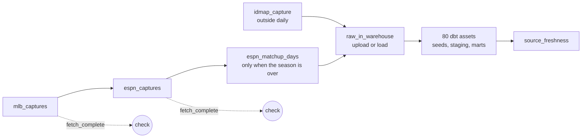

# The daily pipeline as Dagster assets — design

Issue: #217 · Requirements: [requirements.md](requirements.md) · Tasks: [tasks.md](tasks.md)

## Overview

One Dagster code location, `orchestration/front_office_pipeline/`, with the pipeline written once.
Six hand-written assets call the `front-office` CLI as a subprocess (fetch MLB, fetch ESPN, fetch
matchup days once a season is over, fetch the id map, get the captures into the warehouse, check
freshness), and `dagster-dbt` supplies the 80 dbt assets from the real manifest. One job, `daily`,
selects all but the id map and is what #218 schedules and what `dagster dev` runs on the laptop.
Two settings choose the rest: `FO_WAREHOUSE` (`bigquery` in production, `duckdb` locally) says
whether the captures reach the warehouse by `upload` or by `load` and which dbt target builds, and
`FO_SEASON` overrides the season, which is otherwise the current calendar year in New York. A fetch
that exits non-zero still lands what it could and fails a non-blocking check, so one expired ESPN
login does not also leave BigQuery without that morning's MLB games.

Dagster's terms, as they first appear. An **asset** is a thing the pipeline produces (here: a
set of landed captures, a dbt model); Dagster records each materialization and the asset's
upstream assets. A **job** is a named selection of assets that a run materializes together, in
dependency order. An **asset check** is a pass/fail test attached to an asset; a *non-blocking* one
reports failure without stopping the assets downstream. A **run** is one execution of a job. A
**schedule** starts a job at set times (#218), and the **daemon** is the process that evaluates
schedules. An **executor** decides how a run's steps are executed: `in_process_executor` runs them
one after another in one process.

The arrows from the two fetches are order only (they share the landing zone's writer lock, R1.4);
the lineage into dbt runs through `raw_in_warehouse`, which stands for the warehouse's view of the
captures: `raw.captures` and the per-endpoint raw tables are dbt sources, and a translator maps every
dbt source to this one asset key.

## Claims ledger

| # | Claim | Query (or script) | Result | Run on |
|---|---|---|---|---|
| C1 | `dagster-dbt` 0.29.30 reads this project's real manifest, unfiltered (0.29.28 raised `KeyError` on it, spec 0216 C8). | Scratch venv, `uv pip install dagster dagster-dbt dagster-webserver`; `@dbt_assets(manifest=Path('dbt/target/manifest.json'))` over a no-op body; `len(specs)`; compare asset names to the manifest's model and seed names | dagster 1.13.30, dagster-dbt 0.29.30; 80 assets, no error. The two manifest nodes it did not make assets of are the two `ephemeral` models (`int_fantasy__player_crosswalk`, `rec_espn__matchup_line_totals`); 73 non-ephemeral models + 7 seeds = 80. | 2026-11-15 |
| C2 | The manifest used is the real one, with unit tests and the dbt function. | `python3`: `Counter(resource_type)` over `nodes`; `len(unit_tests)`; `functions` | dbt 1.12.5, adapter duckdb, generated 2026-11-14: 75 models (43 table, 30 view, 2 ephemeral), 7 seeds, 492 tests, 231 unit tests, 1 function (`solve_lineup_period`), 15 sources | 2026-11-15 |
| C3 | A finished season's settings have `latestScoringPeriod` above `finalScoringPeriod`, though `isActive` stays true; the two seasons in `data/` agree. | `python3` over the newest `settings/season=S/…/payload.json`, key `status` only | 2026: latest 188, final 180, `isActive` true (capture 20261110T034033Z). 2025: latest 196, final 188, `isActive` true (20261012T013731Z). No running-season settings capture exists | 2026-11-15 |
| C4 | A season's matchup days were fetched after it was over, and are the bulk of ESPN's data. | `find data/raw/espn/matchup_days -name payload.json \| wc -l`; `ls matchup_days/season=2026/…/scoring_period=1`; `du -sh` | 1,469 payloads; 2026's period 1 captured 20261011T202525Z; 1.6 GB | 2026-11-15 |
| C5 | A running season does not need matchup days: the bridge takes `pointsByScoringPeriod` first and the marker only for scoring periods it has no row for. | Read `int_fantasy__matchup_periods.sql` (`from_points`, `from_marker … where from_points.scoring_period is null`) and the header of `espn/matchup_days.py` | As stated. Whether a running season's `pointsByScoringPeriod` really grows by the day is **not** verified: no running-season capture exists (Open questions) | 2026-11-15 |
| C6 | `backfill espn` has no settings-only or transactions-only mode, so an endpoint grain would repeat calls. | Read `cli.py` `backfill_espn`: `--only` takes `pro-schedule`, `matchups` (pro schedule, settings, matchups), `rosters` (settings, teams, rosters), `matchup-days`; the full run adds transactions | As stated | 2026-11-15 |
| C7 | A second writer of the landing zone fails rather than waiting. | Read `cli.py` `writing_session`, `landing.py` `writer_lock` | `LandingLocked` is caught and the command exits 1 with the message | 2026-11-15 |
| C8 | Every fetch command exits 1 on any failure; there is no distinct code for expired login. | Read `cli.py`: `exit_on_expired_auth` prints the message and exits 1; `backfill_mlb`/`backfill_espn` raise `typer.Exit(code=1)` after landing what they could | As stated. The message text is the only difference between `AuthExpired` and the rest | 2026-11-15 |
| C9 | The id map is rarely captured and small. | `find data/raw/idmap -name payload.json`; `du -sh data/raw/idmap` | 2 captures (2026-09-26, 2026-11-10), 8.4 MB | 2026-11-15 |
| C10 | The landing zone is 12 GB, about 7.7 GB of it box scores, 2.4 GB rosters and 1.6 GB matchup days. | `du -sh data/raw/{espn,mlb}/*` | as stated | 2026-11-15 |
| C11 | No 2027 settings capture exists, so ESPN's rollover behaviour is unobserved. | `ls data/raw/espn/settings` | `season=2018` through `season=2026` | 2026-11-15 |

## Alternatives considered

The five decisions each have an ADR with their options; the first two decided the shape.

| | One asset per CLI command (chosen, ADR 0127) | One asset per endpoint | One asset for the whole CLI run |
|---|---|---|---|
| CLI changes | none | new `--only` modes for settings, teams, transactions (C6) | none |
| Lineage the UI shows | command level, then 80 dbt models | landed endpoint to staging view | one box then dbt |
| Calls per day | what the CLI makes | settings fetched 2 to 3 times unless the CLI changes | what the CLI makes |
| Per-step retry | MLB, ESPN, upload, build separately | finer | all or nothing |

**One asset per command.** It is what the CLI already is, and what the owner decided. Its cost is
that lineage inside a command (settings before rosters) is not drawn; the `fetch_complete` check
and the CLI's own output carry that. The split stays open as a follow-up once a morning shows which
endpoint fails.

**One asset per endpoint** loses on C6: the ESPN commands bundle endpoints, so either settings is
fetched again per asset (extra captures, and the freshness marker is the first call of a run,
`_raw_feeds__sources.yml`), or the CLI gains modes, which this spec's no-gos keep out.

**One asset for the CLI run** discards the per-step status that ADR 0122 chose Dagster for.

## Decisions

| ADR | Decision | Status |
|---|---|---|
| [0127](../../adr/0127-an-asset-is-one-cli-command-and-one-dbt-model.md) | An asset is one CLI command or one dbt model | proposed |
| [0128](../../adr/0128-dagster-reads-the-real-dbt-manifest-through-dagster-dbt-0-29-30.md) | Dagster reads the real dbt manifest through dagster-dbt 0.29.30 | proposed |
| [0129](../../adr/0129-a-failed-fetch-fails-a-check-and-the-run-goes-on.md) | A failed fetch fails a non-blocking check and the run goes on | proposed |
| [0130](../../adr/0130-a-run-fetches-the-current-calendar-year-and-matchup-days-once-the-season-is-over.md) | A run fetches the current calendar year, and matchup days once the season is over | proposed |
| [0131](../../adr/0131-one-definition-set-the-warehouse-chosen-by-a-setting.md) | One definition set, the warehouse chosen by a setting | proposed |

## Detailed design

**Layout.** `orchestration/front_office_pipeline/` (added to `[tool.hatch.build.targets.wheel] packages`, so
`uv sync` installs it and `dagster dev -m front_office_pipeline` imports from the repository root)
holds `__init__.py` (`defs = Definitions(...)`),
`season.py`, `cli.py` (the subprocess call), `assets.py`, `dbt_assets.py` and `settings.py`. A
dependency group `orchestration` in `pyproject.toml` holds `dagster`, `dagster-dbt` and
`dagster-webserver`, with versions locked; it is not a default group, and the gates and CI install
it so the definitions are loaded and tested there. The module's mypy and ruff config follow the
repository's. `ingestion/` does not depend on it.

**Calling the CLI.** `cli.run(args, context)` runs `front-office <args>` with `subprocess.run`,
captures stdout and stderr, keeps only the lines that match the allowlist of R2.4 (the shapes the CLI prints, tested
against the CLI's real output on the fixtures) and no `privacy.py` pattern, replaces each other line
with `<line withheld>` (a bare `ESPN_S2=<value>` in an error line matches nothing on the allowlist, so
it is withheld; the patterns of `privacy.py` do not cover cookie values, which is why they are
the second filter and not the only one), logs the result to the run's log, and returns the exit code and
the last 20 filtered stderr lines. It passes the environment through and reads no file: the CLI
reads `.env` itself, and the Google credentials are found by Google's client (rule 3). The two
shared modules it imports are `front_office.privacy` and, in `season.py`, `front_office.landing`.
It runs in the repository root. The landing root is resolved once in `settings.landing_root()`
(R3.6): the same absolute path is `--raw-root` of each command, the root `season.is_over` reads, and
dbt's `FO_LANDING_ROOT`, because `load` records captures by the CLI's root while the DuckDB capture
views read the files by dbt's (`fo_landing_root()`). The landing zone is mounted one level above its
root (0216 *Lessons*).

**Season.** `season.current()` is `FO_SEASON` if set, else the year of `now` in America/New_York.
`season.is_over(season)` reads the newest committed settings capture of that season through
`front_office.landing.LandingZone` (the only reading of the landing zone allowed, AGENTS.md) and
returns `latestScoringPeriod > finalScoringPeriod`; no capture means not over. The orchestration
imports `LandingZone` here only (R1.1's second named module): nothing is written, and it is the
same read `espn/matchup_days.py` does for its periods.
Where that import is unwanted the alternative is a CLI subcommand that prints the status (task 2
decides, and records it here if it changes).

**Hand-written assets.** Each is a `@multi_asset` with a check spec where stated.
- `mlb_captures`: `backfill mlb --season S`; check `fetch_complete`.
- `espn_captures`: `backfill espn --season S`; check `fetch_complete`; its stderr's last lines are
  the check's metadata, which is where `AuthExpired`'s message shows (C8).
- `espn_matchup_days`: if `season.is_over(S)`, `backfill espn --season S --only matchup-days`;
  else it logs why and materializes nothing new (a materialization with `skipped=true` metadata).
  Check `fetch_complete`.
- `idmap_capture`: `backfill idmap`; check `fetch_complete`. Not in `daily`.
- `raw_in_warehouse`: `FO_WAREHOUSE=bigquery`: `upload --project "$FO_BQ_PROJECT"`, with
  `uv run --group bigquery`; `duckdb`: `load --db <FO_DUCKDB_PATH>`. A non-zero exit raises.
- `source_freshness`: `dbt source freshness` on the same target; a non-zero exit raises. In `daily`
  only for `FO_WAREHOUSE=duckdb` (R3.5): the declarations' filters use DuckDB's `strptime` and
  `json_extract_string`, and AGENTS.md says they are rewritten by hand for BigQuery, which nobody has
  done. On BigQuery it would fail after a good build. The declarations are also dormant until the
  2027 schedule wakes them (`_raw_feeds__sources.yml`).

**dbt assets.** `@dbt_assets(manifest=…, dagster_dbt_translator=…)` over a manifest produced by
`dbt parse` for the chosen target when the code location loads (`DbtProject.prepare_if_dev` locally;
`dbt parse` once at start in production, #218). The translator maps every dbt source to the asset
key `raw_in_warehouse`. The body streams `dbt build --exclude-resource-type unit_test`, plus
`--selector bigquery --target bq` for `bigquery` and `--target dev` for `duckdb`, as
`dbt.cli(...).stream()`. A failing model or test fails that asset (and, as dbt does, skips what
depends on it).

**Order and concurrency.** The job uses `in_process_executor`, so steps run one after another and
the two fetches never hold the writer lock together (C7); the dbt build's own threads are unchanged.
`mlb_captures` runs before `espn_captures` by a declared dependency that is order only.

**Failure.** A fetch asset materializes whatever the CLI's exit code, and emits an
`AssetCheckResult` for `fetch_complete`: passed on exit 0, failed on non-zero, with the exit code
and the stderr tail as metadata. The check's severity is `ERROR` (a `WARN` failure would not read as
a failure) and it is non-blocking (`blocking=False`, Dagster's default), so `raw_in_warehouse` and
the dbt assets still run. The failed check shows in the UI and in GraphQL (`assetCheckExecutions`),
which is what #219 reads; task 6 confirms that a run with a failed check is not reported as plainly
green. `raw_in_warehouse` and the dbt assets raise on failure, as ordinary asset failures.

**Running it.** `dagster dev -m front_office_pipeline` for the UI; `dagster job execute -m
front_office_pipeline -j daily` runs it once, without the daemon, which is how the verification task and #220's rehearsal run it.
`dagster asset materialize --select '*'` is not the same: it would include `idmap_capture`. In
production the daemon runs the schedule #218 attaches to `daily`.

## Test strategy

| Requirement | Test | Catches |
|---|---|---|
| R1.1 | a test that the imports of `orchestration/` from `front_office` are `front_office.landing` (in `season.py` only) and `front_office.privacy` (in `cli.py` only), and no other; and one that runs `dagster dev`'s loader (`dagster definitions validate -m front_office_pipeline`) from the repository root | an import that bypasses the CLI boundary; a module not importable from the root |
| R2.4 (allowlist) | the allowlist's regexes run over the CLI's real stdout and stderr on the fixtures (every line it prints on a success and on a failure is withheld or matched deliberately), and over a line `ESPN_S2=abc…` and one with a GUID, which are withheld | an allowlist that drifts from the CLI's messages, a credential in an error line |
| R3.5 | a test that `daily`'s selection holds `source_freshness` for `duckdb` and not for `bigquery` | a run that fails after a good BigQuery build |
| R3.6 | a test that the CLI, `season.is_over` and dbt receive the same root | a `load` and a dbt build reading different landing zones |
| R1.2, R1.3 | a test that loads `defs`, lists asset keys, and checks the 6 hand-written ones and that the dbt count equals the manifest's non-ephemeral models and seeds | a model that no asset covers, a manifest change that breaks the translator |
| R1.4 | a test that the `daily` job's executor is `in_process_executor` | parallel writers (C7) |
| R2.1 | `materialize` the fetch assets with `cli.run` faked to exit 1: asset materialized, `fetch_complete` failed, `raw_in_warehouse` and a dbt asset (faked) still ran | a failed fetch that stops the build |
| R2.2 | the same with `upload` exiting 1: the dbt assets are not run | a build on a failed upload |
| R2.4 | a fake command output with a line holding a GUID, one with `ESPN_S2=…` and one with a member key, asserted absent from the run's events and the check's metadata | a member's name, account id or cookie in Dagster's SQLite instance |
| R3.1 | unit tests on `season.current()` with clocks at 2026-12-31 23:00 and 2027-01-01 05:00 ET, and with `FO_SEASON` set | the rollover off by a timezone |
| R3.2 | a test that `bigquery` without `FO_BQ_PROJECT` fails before any command runs | a build into no project |
| R3.3 | `season.is_over` over a tmp landing zone with settings captures: latest 188/final 180, 120/180, none | matchup-day requests for future periods |
| R4.1 | `dagster job execute` on the fixtures (`fixtures/landing`, `FO_WAREHOUSE=duckdb`, the `ci` target) with the fetch commands faked | a job that does not select what it should |
| R4.3 | task 7's measurement | a host without the memory |

The real-season run (task 5) is the acceptance test; the fixtures cannot show a real fetch.

## Risks

- **A BigQuery-target manifest or a real materialization breaks `dagster-dbt`** — C1 used the
  DuckDB manifest and no run — task 3 does both before anything else is built on it; the fallback
  is ADR 0128's filtered manifest.
- **`pointsByScoringPeriod` does not grow in a running season**, so no matchup-period mapping
  exists until the season is over (C5, C11) — that is a data question, not an orchestration one;
  the first in-season week (#66, #69) and #220 settle it, and #217 does not wait for it.
- **ESPN does not answer for a new season in January** — `fetch_complete` fails daily until it
  does; #218 schedules the run only in-season (ADR 0130).
- **Dagster's instance (SQLite) holds output.** R2.4's filter keeps members' data out of it; the
  instance directory is on the host with the run's other files, not backed up as captures are.
- **Memory** — 1.18 GB was measured on a filtered manifest (0216 C8, 2026-11-09); R4.3 repeats it.

## Open questions

- Whether a running season's matchups carry `pointsByScoringPeriod` that grows by the day (C5) →
  the first in-season week, and #220. Not an assumption this design depends on for correctness of
  the pipeline, only for the models' output.
- The id map's cadence (C9: two captures in 7 weeks) and its `idmap` freshness feed, which goes
  stale if nothing refreshes it → #218, with the schedule; the asset exists here, outside `daily`.
- Whether `season.is_over` should import `LandingZone` or ask the CLI (Detailed design) → task 2,
  recorded here.
- The 2 GB limit of R4.3 is a proposal, not a measurement → task 7 replaces it with a number.
- Whether the daily BigQuery build should run the unit tests (R3.4 excludes them) → #221.

## Review log

| Source | Finding | Resolution |
|---|---|---|
| design-review | F1 (P0): `dbt source freshness` on BigQuery fails: the filters are DuckDB SQL | Fixed: R3.5 leaves `source_freshness` out of the BigQuery `daily`; a BigQuery rewrite is a follow-up that #219 needs, for the owner to open (PR: Decisions for you) |
| design-review | F2 (P1): `front_office_pipeline` is not importable from the root | Fixed: the wheel's packages list gains it (task 1), and a test runs `dagster definitions validate` from the root |
| design-review | F3 (P1): `FO_RAW_ROOT` vs dbt's `FO_LANDING_ROOT` | Fixed: R3.6, one setting `FO_LANDING_ROOT` given to the CLI, `season.is_over` and dbt; `FO_RAW_ROOT` was invented here and is gone |
| design-review | F4 (P1): importing `privacy.py` contradicts R1.1 | Fixed: R1.1 names the two modules it may import |
| design-review | F5 (P1): `privacy.py` does not match a cookie value | Fixed: an allowlist is the main filter, `privacy.py` the second (R2.4), and the allowlist is tested against the CLI's real output |
| design-review | F6 (P1): blank cookies in a `.env` copy cannot give `AuthExpired` | Fixed in task 6: an invalid, non-secret `ESPN_S2` in the run's environment (`load_dotenv` does not override it); a missing-credentials case stays a fake-command test |
| design-review | F7 (P2): `asset materialize --select '*'` includes the id map | Fixed: dropped from the documented ways to run it once |

## Amendments

None yet.
