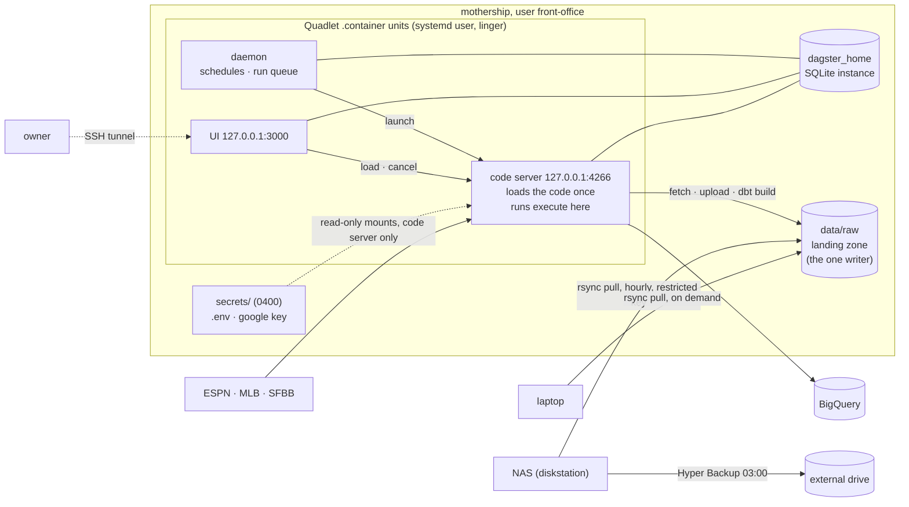

# Run the daily pipeline on a schedule — design

Issue: #218 · Requirements: [requirements.md](requirements.md) · Tasks: [tasks.md](tasks.md)

## Overview

> **Amended 2026-11-17 (ADR 0138):** the first rehearsal showed that two containers each loading the
> code on their own unix socket cannot cancel each other's runs. There are now **three** containers: a
> code server that loads the code once and in which runs execute, and the daemon and the UI, which
> connect to it over the host's loopback. The text below says three where it first said two; the
> *Amendments* entry has the evidence.

On `mothership`, as the `front-office` user, three Podman containers built from one image run
Dagster: the **code server** (it loads the code location once, and every run executes in it), the
**daemon** (which holds the schedules and the run queue and launches runs through the code server) and
the **UI**. Systemd's user instance starts and restarts them (three Quadlet `.container` files kept
in `deploy/`), and `loginctl enable-linger` keeps them up with nobody logged in.
The code location gains two schedules: `daily` at 06:00 America/New_York from March 1 to October 31, and the id map
on Mondays at 05:00 in the same months. Both start `RUNNING`, so a new instance needs no click.
The instance's own settings (`deploy/dagster.yaml`) allow one run at a time and end a run after two
hours; a missed stretch of ticks already becomes one run (C2). The landing zone, the ESPN `.env` and
the Google key move from `ubuntu`'s home to `front-office`'s, under a new service account, and only the
code server's container mounts them. The NAS pulls the landing zone hourly over the tailnet with a key
that can only read it, and its existing 03:00 Hyper Backup job carries the pulled folder to the
external drive.

## Claims ledger

All run on 2026-11-17 unless another date is given.

| # | Claim | Query (or script) | Result | Run on |
|---|---|---|---|---|
| C1 | A Dagster schedule starts stopped unless its code says otherwise. | `.venv/lib/python3.13/site-packages/dagster/_core/definitions/schedule_definition.py`: `default_status: DefaultScheduleStatus = DefaultScheduleStatus.STOPPED` (line 608); the parameter's text: "If set to ``RUNNING``, the schedule will start as running" (line 523) | Dagster 1.13.30 (`uv pip list`). A schedule without `default_status=RUNNING` would not fire on a fresh instance | 2026-11-17 |
| C2 | When the daemon was down across several ticks, a schedule with no partition set launches one run, for the latest tick; `max_catchup_runs` (default 5) applies only to a partitioned schedule. | `dagster/_scheduler/scheduler.py:637-642`: `if not remote_schedule.partition_set_name and len(tick_times) > 1: logger.warning(f"{schedule_name} has no partition set, so not trying to catch up"); tick_times = tick_times[-1:]`, then `elif len(tick_times) > max_catchup_runs`; `dagster/_core/scheduler/scheduler.py:263`: `DEFAULT_MAX_CATCHUP_RUNS = 5`. `daily` is an unpartitioned asset job | One run after any outage, with nothing to set. (First read wrongly as five replays; the design review, F6, caught it) | 2026-11-17 |
| C3 | The instance defaults let ten runs go at once, and run monitoring has a `max_runtime_seconds`. | `dagster/_core/instance/config.py:473` (`runs.max_concurrent_runs`: "Defaults to 10"), `:543-548` (`run_monitoring`: `enabled`, `max_runtime_seconds`) | A second `daily` would start beside the first by default, and the writer lock (0217 C7) would fail its fetch | 2026-11-17 |
| C4 | `mothership` has what the units need: an empty `front-office` account with linger on, Podman 4.9.3 with Quadlet's generator, a running user systemd, the memory controller delegated to the user's slice, and a route to GitHub. | `ssh mothership 'id; loginctl show-user $USER -p Linger; podman --version; systemctl --user is-system-running; cat /sys/fs/cgroup/user.slice/user-1002.slice/cgroup.controllers; git ls-remote https://github.com/nick-socci/front-office HEAD'`; `ls -la ~` | uid 1002; home holds only dotfiles (`.cache`, `.config`, `.local`, `.ssh`); `Linger=yes`; `podman version 4.9.3`; `running`; `cpu memory pids`; `64ccf36…  HEAD` | 2026-11-17 |
| C5 | The landing zone is under `ubuntu`, and both it and the laptop's copy have captures the other lacks. | `ssh mothership-admin 'find ~/front-office/data/raw -name payload.json \| wc -l; du -sh …'`; `find data/raw -name payload.json \| wc -l`; `rsync -an --itemize-changes --exclude '*.tmp-*'` each way | Host 44,444 captures, 12 GB, `/home/ubuntu/front-office/data/raw`. Laptop 44,457. Host lacks 19 captures the laptop landed 2026-11-16 20:02 to 20:13Z (`espn/matchups` 2, `pro_schedule` 3, `settings` 2, `teams` 2, `transactions` 4, `mlb/players` 3, `mlb/schedule` 3: #217's real-season runs on the laptop). The laptop lacks 6 the host landed 2026-11-17 02:34 to 03:13Z (`mlb/players` 3, `mlb/schedule` 3: #217's task 7). A listing of 44k captures took 14 s | 2026-11-17 |
| C6 | The credentials are under `ubuntu`, and the key is the spike account's. | `ssh mothership-admin 'cut -d= -f1 ~/front-office/.env; ls -l ~/front-office/.env; ls ~/secrets'` (names only) | `.env` (0400, 430 bytes) holds `ESPN_S2`, `SWID`, `LEAGUE_ID`; `~/secrets/fo-key-2026-11-10.json` is the key of `fo-spike216`, which #217 (2026-11-17) gave `WRITER` on `main`, `staging`, `intermediate`, `marts` and `reconciliation`, beside BigQuery User and `WRITER` on `raw` | 2026-11-17 |
| C7 | The NAS can pull: a DS220+ on the tailnet with rsync, Tailscale and Container Manager, and room. | `ssh synology-nas 'uname -a; rsync --version; synopkg list; df -h /volume1'`; `tailscale status`; #216's task 1 comments | `diskstation`, x86_64 DSM; `rsync 3.1.2`; Tailscale 1.104.7; `/volume1` 12 T with 9.7 T free; Hyper Backup to `/volumeUSB1/usbshare` runs daily at 03:00 (#216) | 2026-11-17 |
| C8 | MLB's 2027 season: the regular season runs March 25 to September 26, the postseason to October 31. | `curl https://statsapi.mlb.com/api/v1/seasons/2027?sportId=1` | `preSeasonStartDate` 2027-01-01, `springStartDate` 2027-02-19, `regularSeasonStartDate` 2027-03-25, `regularSeasonEndDate` 2027-09-26, `postSeasonEndDate` 2027-10-31 (2026's: 03-25 to 09-27, postseason to 10-28) | 2026-11-17 |
| C9 | Dagster's daemon, UI and code server idle peak at 674 MB; with one full `daily` beside them, 1,395 MB, in 9 min 30 s. | #217's task 7 evidence (summed PSS per second, `FO_WAREHOUSE=bigquery`, arm64 `mothership`); 0216 C8 (882 MB on a filtered manifest, 1,180 MB with a build) | as stated. That was `dagster dev`, one process tree, not two containers | 2026-11-17 |
| C10 | ESPN's behaviour for a new season and for rosters from this address cannot be observed before the season. | 0217 C11 (`ls data/raw/espn/settings`: `season=2018` to `season=2026`); 0216 *Amendments* 2026-11-10 (settings and matchups answered, rosters and teams untested); #217's task 7 (the run had no ESPN credentials on the VM) | No 2027 settings capture exists; rosters and teams from this address are untried | 2026-11-17 |
| C11 | The id map is captured rarely, and its freshness feed warns after 14 days. | 0217 C9 (`find data/raw/idmap -name payload.json`: 2 captures, 2026-09-26 and 2026-11-10, 8.4 MB); `grep -n idmap_runs -A12 dbt/models/staging/_raw_feeds__sources.yml` | `warn_after: {count: 14, period: day}` | 2026-11-17 |
| C12 | The repository has no Containerfile, unit file or Dagster instance file. | `git ls-files \| grep -i -E "docker\|container\|compose\|systemd\|quadlet\|\.service\|\.timer"`; `ls orchestration` | no output; `orchestration/front_office_pipeline` and `tests` only | 2026-11-17 |
| C13 | `dagster dev` is described as a local deployment, and `dagster-daemon run` runs the instance's daemons. | `dagster/_cli/dev.py:36-40` (help text: "Start a local deployment of Dagster …"); `uv run dagster-daemon run --help` | as quoted; `dagster-daemon run` is "Run any daemons configured on the DagsterInstance" | 2026-11-17 |
| C14 | `dagster` loads the working directory's `.env` over the process environment; the CLI finds `.env` by itself. | 0217 *Amendments* 2026-11-16; `ingestion/src/front_office/espn/client.py:66-68` (`load_dotenv(dotenv_path)`, called with no path from the CLI) | Dagster started where a `.env` sits puts the cookies in its processes; the CLI, run in the repository root, finds the repository root's `.env` itself | 2026-11-17 |
| C15 | The code location runs `dbt parse` when it loads, and it needs no Google credential for the BigQuery target. | `dbt_assets.load_manifest` (it runs `dbt parse --target <target>`); `GOOGLE_APPLICATION_CREDENTIALS=/nonexistent.json HOME=<empty dir> FO_BQ_PROJECT=not-a-project dbt parse --target bq --target-path <tmp>` from `dbt/` | a `manifest.json` was written; no credential file, no ADC, no real project. 0216 C7: 276 MB and 6.8 s a parse | 2026-11-17 |
| C16 | The latest start of a played 2026 regular-season game was 22:15 ET; 103 of 2,430 started at or after 22:00 ET. | DuckDB over `data/raw/mlb/schedule/season=2026/game_type=R/fetched_at=20261116T201325Z/payload.json`: games with `gameType = 'R'` and `codedGameState = 'F'`, `gameDate` converted to America/New_York | 2,430 games (2026-03-25 to 2026-09-27); latest start 22:15 ET; 103 at or after 22:00 ET. A game of three and a half hours from 22:15 ends about 01:45 ET | 2026-11-17 |
| C17 | `mothership` has `rrsync` and a newer rsync than the NAS, and what listens on it is sshd, rpcbind and Tailscale. | `ssh mothership 'which rrsync; rsync --version; ss -tlnp'` | `/usr/bin/rrsync`; rsync 3.2.7 (NAS 3.1.2, both protocol 31); listeners: DNS stubs on loopback, sshd on 22 (0.0.0.0 and ::), rpcbind on 111, Tailscale's own ports on its interface | 2026-11-17 |
| C18 | `front-office`'s home is mode 0700 and `/srv` is root's. | `ssh mothership 'ls -ld ~ /srv'` | `drwx------ front-office`; `/srv` is `root:root` 0755 | 2026-11-17 |
| C20 | A run launched through the UI could not be cancelled, and its worker ran on, because each process's code server listens on a unix socket in its own container's `/tmp`. | on `mothership`, rehearsal 2026-11-17: `launchRun` then `terminateRun` over the UI's GraphQL; `podman exec front-office-daemon ls -la /tmp` and the same in the UI container | `PythonError: DagsterUserCodeUnreachableError: Could not reach user code server. gRPC Error code: UNAVAILABLE`; the run stayed `CANCELING`, its `front-office upload` and `dbt build` ran to the end; sockets `tmp…` (type `s`) in the daemon container's `/tmp`, none in the UI's | 2026-11-17 |
| C19 | Podman 4.9.3's Quadlet loads `.container` files, ignores `.pod`, rejects `Memory=` and accepts `PodmanArgs=--memory=` and `WorkingDir=`. | on `mothership`: `QUADLET_UNIT_DIRS=<scratch> /usr/lib/systemd/system-generators/podman-system-generator --user --dryrun` over a `.container` with `PodmanArgs=--memory=3g`, `WorkingDir=/dagster_home`, `PublishPort=127.0.0.1:3000:3000`, a `.pod`, and a `.container` with `Memory=3g` | "Loading source unit file" for the two `.container` files only; `converting "m.container": unsupported key 'Memory' in group 'Container'`; the first unit's `ExecStart` held `-w=/dagster_home`, `--publish 127.0.0.1:3000:3000`, `--memory=3g`; `Restart=always` and `WantedBy=default.target` passed through. (The design review, F1 and F2, said so from the 4.9.3 reference; this is the generator itself) | 2026-11-17 |

C17 shows rpcbind on port 111, beside sshd and Tailscale. ADR 0126 says no public port is open (the
public address answers ICMP only), so it is a listener the cloud's rules already block; task 6
records it, and the owner decides whether to close it (*Open questions*).

## Alternatives considered

Five decisions, each with an ADR (proposed). The recommendation comes first.

### D1. How Dagster runs on the host (ADR 0133)

| | **A. Two containers, `.container` units in the repo** (recommended) | B. One container running `dagster dev` | C. `uv` venv and systemd user services, no containers |
|---|---|---|---|
| Matches ADR 0126 ("in containers", "their own memory limit") | yes | yes | no: amends it |
| What was measured (C9) | no: two code loads (two `dbt parse`, C15); measured in task 6 | yes, exactly | no |
| A UI crash leaves the daemon running | yes, separate containers and limits | unknown: not read | yes |
| What `dagster` says it is for | `dagster-daemon run` runs the instance's daemons (C13) | `dagster dev`: "a local deployment" (C13) | the same processes as A, no image |
| Credentials | the daemon container mounts them, the UI does not (C15: it needs none) | one container holds them | one user holds them |
| Update | `git pull`, `podman build`, restart | the same | `git pull`, `uv sync`, restart |

**A.** The daemon and the UI are separate commands (C13), and a container each gives each its own
memory limit (`PodmanArgs=--memory=`: Quadlet 4.9 has no `Memory=` and no `.pod`, C19) and its own
restart. They share nothing but the instance's volume, so no pod is needed. The UI needs no credential
(C15), so only the daemon's container mounts the files. Its cost is a second `dbt parse` when the
UI loads the code, and a measurement that does not exist yet in this shape: task 6 takes it, and if
the two do not fit their limits, **B** is the fallback and is the shape C9 measured.
**B.** The simplest and the one measured, but its own help calls it a local deployment (C13),
and one container means one limit and one restart for both. **C.** Smaller still, with systemd
cgroups for the limit, but ADR 0126 chose containers and amending it for a gain of one build step
is not worth the owner's attention; the home server (ADR 0126) will want an image anyway.

### D2. The schedule (ADR 0134)

| | **A. A cron with a month range; the instance limits runs** (recommended) | B. A year-round daily schedule | C. A schedule function that skips outside MLB's season dates |
|---|---|---|---|
| Quiet outside the season (ADR 0130: "only in-season") | yes: no tick | no: ESPN fails daily from January 1 (ADR 0130) | yes |
| New code | a cron string | none | a function, MLB's dates (C8) read from somewhere, and its tests |
| Covers 2027's first week | from March 1: before spring training ends (C8) | yes | from the first date it reads |
| A date moves (an expansion, a lockout) | edit one string | n/a | follows MLB's dates |
| Fails when | a season starts before March 1 or runs past October 31 (C8: regular season ends September 26) | the owner is paged by a failed check every winter day (#219) | the dates feed is wrong or missing |

**A.** The window March 1 to October 31 holds spring training's end (C8: February 19 to March
24), the regular season (March 25 to September 26), the seven-day settle tail (ADR 0019) and the
postseason (October 31), and costs one cron string. **B** fails ESPN's rollover every January
day and trains the owner to ignore a red check. **C** follows MLB's calendar exactly, for a
function and a data source that A's one string replaces within a month of slack.

The hour, 06:00, is the one 0216 left to this spec. The latest 2026 start was 22:15 ET (C16), so a
game ends about 01:45 ET; 06:00 leaves three hours before R1.2's deadline of 09:00 for a person
to act on a failed morning (#219), and a game still not final arrives on the next run (ADR 0019).
Later hours catch more extra-inning and delayed games, and take from that margin.

The instance's settings (`deploy/dagster.yaml`): `runs.max_concurrent_runs: 1` (C3) and
`run_monitoring` enabled with `max_runtime_seconds: 7200` (C3). Catching up needs no setting (C2). Two hours is a proposal: a run is about 10 minutes (C9), and the first in-season run
fetches a full roster history that no run has timed (C10). Task 6 and #220 may move it.

### D3. The id map's cadence (ADR 0136)

| | **A. Its own weekly schedule, Mondays 05:00** (recommended) | B. Inside `daily` | C. By hand |
|---|---|---|---|
| Keeps `idmap_runs` under its 14-day warning (C11) | yes, with a week of slack | yes | only if remembered |
| Added landing | about 35 captures a season at 4.2 MB (C11), about 0.15 GB | about 245 at 4.2 MB, about 1 GB | as asked |
| Changes `daily` (a no-go) | no | yes | no |
| Lands before the build it feeds | yes: 05:00, an hour ahead | yes | n/a |

**A.** The id map changed twice in seven weeks (C11) and the freshness feed already treats two
weeks as late. **B** changes `daily`, which this spec may not, and lands about 245 captures a season to
catch a change that comes about monthly. **C** is how the feed goes stale; nothing would say so until
#219.

### D4. The run's Google identity (ADR 0135)

| | **A. A new service account for the daily run, the spike account retired** (recommended) | B. Keep `fo-spike216`, with its grants | C. The owner's own login |
|---|---|---|---|
| Name says what it is | yes | no ("spike") | n/a |
| Grants known and written down | yes, from C6, as R3.2 | yes, the same, but added ad hoc | everything the owner can do |
| A new key to place | yes, on `front-office` only | no: the key in `ubuntu`'s `secrets/` moves | a refresh token |
| The spike's key can be removed from `ubuntu`'s home | yes | no: it is the run's key | n/a |
| Work for the owner | create the account, grant (the owner runs IAM) | none | none |

**A.** The grants are known (C6) and the ones that matter are those on `raw` and five datasets,
so a clean account gets them once, on purpose, and the spike's key and account can go. It costs
the owner one account and one key (ADR 0124 already says to replace the key each off-season).
**B** is no work, and the run keeps a key named for a spike whose access was widened in steps on
the day. **C** is ADR 0124's rejected option 2.

### D5. How the NAS pulls (ADR 0137)

| | **A. The NAS pulls hourly, with a key restricted to `rrsync -ro` on the landing zone** (recommended) | B. A separate read-only unix account, a daily pull after the run | C. The NAS pulls hourly through a second account that owns a copy |
|---|---|---|---|
| Key can do nothing but read the landing zone (R5.2) | yes: `restrict,command="rrsync -ro …"` | yes, by file permissions | yes |
| New accounts and permissions on the host | none (C18: the landing zone stays in `front-office`'s 0700 home) | a user and a group, the landing zone outside the home (C18: under `/srv`, root's) | a user, a copy, and a job that fills it |
| Gap before a second device holds a capture | up to 1 hour | up to 24 hours | up to 1 hour plus the copy's |
| Load | a 14 s listing (C5) and the new captures | the same, once a day | twice |
| Fails when | `rrsync` is missing (C17: present) | a permission drifts | the copy lags |

**A.** The restriction is on the key, not on the account: a stolen NAS key can read the landing
zone, which the NAS holds anyway, and gets no shell, no `.env` and no Google key. It needs no new
account. **B** is ADR 0126's "read-only account" taken literally, at the price of a group, a
landing zone outside the home (so under `/srv`, root's: C18) and a daily gap. **C** doubles the
disk and the job for no gain. The hourly interval (the owner's to change) takes the time between a capture landing and its
second copy, while the pull succeeds, from up to a day to up to an hour, for a listing that costs 14 s
(C5). It is an interval, not a bound: a failing pull leaves the gap open (R5.4).

## Decisions

| ADR | Decision | Status |
|---|---|---|
| [0133](../../adr/0133-dagster-runs-as-two-containers-under-the-run-user.md) | Dagster runs as two containers under `front-office`, from units kept in the repository | proposed |
| [0138](../../adr/0138-dagsters-code-runs-in-its-own-container-and-the-daemon-and-ui-connect-to-it.md) | Dagster's code runs in its own container, and the daemon and the UI connect to it (amends 0133) | accepted: the owner chose it during the build |
| [0134](../../adr/0134-daily-runs-at-06-00-et-from-march-to-october-one-at-a-time.md) | `daily` runs at 06:00 ET from March 1 to October 31, one at a time, with a two-hour limit | proposed |
| [0135](../../adr/0135-the-daily-run-has-its-own-google-service-account.md) | The daily run has its own Google service account, and the spike account is retired | proposed: the owner's |
| [0136](../../adr/0136-the-id-map-is-refreshed-weekly-on-its-own-schedule.md) | The id map is refreshed weekly on its own schedule | proposed |
| [0137](../../adr/0137-the-nas-pulls-the-landing-zone-hourly-with-a-read-only-key.md) | The NAS pulls the landing zone hourly with a key that can only read it | proposed: the owner's |

ADRs 0135 and 0137 touch credentials and the NAS backup, which AGENTS.md leaves to the owner.

## Detailed design

**Files in the repository.** `deploy/Containerfile`, `.containerignore` (at the root),
`deploy/dagster.yaml`, `deploy/workspace.yaml`, `deploy/quadlet/` (two `.container` units),
`deploy/pull_landing.sh` (one script for the NAS, the laptop and a restore, with the
exclusions in one place) and a runbook under `docs/` (R6.1). The schedules are
`orchestration/front_office_pipeline/schedules.py`, added to `Definitions` in `__init__.py`. Nothing
else in `orchestration/` changes: `daily`'s selection is untouched.

**The schedule.** `schedules.py` holds `DAILY_CRON = "0 6 * 3-10 *"` and `IDMAP_CRON = "0 5 * 3-10
1"`, `execution_timezone="America/New_York"` (Dagster evaluates the cron in that zone, so 06:00
holds across the clocks changing), and `default_status=DefaultScheduleStatus.RUNNING` (C1). Each
is built by a function taking the cron, so a test can use any expression; `FO_DAILY_CRON`, when it
is set, replaces `DAILY_CRON` and is for rehearsals (R1.7): the production unit does not set it,
and the runbook's rehearsal sets it through a drop-in and removes it. `idmap_capture` gets a job of
its own (`idmap`), so a schedule can start it; `daily` does not select it, as before. The
`DAILY_CRON` day-of-week is `*`, so every day from March 1 runs, weekends included: MLB plays
them.

**The instance.** `deploy/dagster.yaml` sets `storage` to SQLite under `DAGSTER_HOME` (the
default), `runs.max_concurrent_runs: 1`, run monitoring enabled with a two-hour limit, and telemetry
off. It sets nothing for catching up: neither schedule has a partition set, so after an outage each
launches its latest tick only (C2). With one concurrent run, a second `daily` queues behind the
first; the instance's run coordinator, not a lock, holds it. `deploy/workspace.yaml` points each process at the code server's gRPC address (ADR 0138).

**The image.** Python 3.13 on arm64 with `uv sync --locked --group orchestration --group bigquery`,
`dbt deps` run at build, and the repository at the built commit, whose hash is an image label
(R2.5). `.containerignore`, **at the repository root** (Podman reads it from the build's context
directory, or from `--ignorefile`), leaves out `.env`, `data/`, key files, `.git` and `.review/`, so
the build context cannot carry a credential. The build is always `podman build -f deploy/Containerfile
-t <tag> .` from the root, and the test reads the root file and the command in the runbook. The entrypoint is `dagster-daemon run` or
`dagster-webserver`, chosen by the unit.

**The containers.** Three `.container` files (C19, ADR 0138), all on the host's network
(`Network=host`) and all with `WorkingDir=/dagster_home` in `[Container]` (not `WorkingDirectory=`,
which is systemd's, for the service on the host), a directory with no `.env` (R2.4, C14); the
entrypoint copies the instance file in. The **code server** runs `dagster api grpc -m
front_office_pipeline -h 127.0.0.1 -p 4266`, and every run executes as its subprocess, so it is the one
container with `FO_WAREHOUSE=bigquery`, `FO_BQ_PROJECT`, `FO_LANDING_ROOT=/data/raw`, the host's
`data/` at `/data` read-write (one level above the landing root, because the writer lock sits beside
it: 0216 *Lessons*), `dagster_home`, `dbt_target`, `secrets/.env` at `/app/.env` read-only (the CLI, run
in `/app`, finds it itself: C14) and `secrets/google-key.json` read-only, named by
`GOOGLE_APPLICATION_CREDENTIALS`. The schedules are defined in the code location, so
`FO_DAILY_CRON` is read here too. The **daemon** runs `dagster-daemon run -w
/app/deploy/workspace.yaml` and the **UI** `dagster-webserver -h 127.0.0.1 -p 3000 -w …`: each mounts
`dagster_home` and nothing else, and `workspace.yaml` points both at the code server's
`grpc_server` (127.0.0.1:4266). The UI's SSH tunnel is the one way in (R2.3). Neither needs a
credential, because `dbt parse` for the BigQuery target does not (C15), and they never load the code
themselves. Each has `PodmanArgs=--memory=` and `--init` set from task 6's measurement; the provisional
limits are 3 GB for the code server (1.4 GB was measured for daemon, UI and a run together, C9), 1 GB for
the daemon and 1 GB for the UI. The daemon and the UI start after the code server and show the location
as errored for a few seconds until it is up. `Restart=always`, and the units are
`WantedBy=default.target`, which with linger starts them at boot (C4).

**The host's layout.** Under `/home/front-office`: `src/front-office` (a clone of the public
repository, at the commit being built), `data/raw` (the landing zone; `data/raw.lock` and
`raw.upload.lock` beside it), `dagster_home`, `secrets/` (0700; `.env` and `google-key.json` 0400).
A **deploy** is: in `src/front-office`, `git fetch` and check out the commit; `podman build` it
tagged with the commit; edit the unit's image tag (or `latest` re-tagged); `systemctl --user
restart`. A **rollback** is the same with the older tag, which stays. The instance and the
landing zone are volumes, so neither moves.

**The move (R4.1).** Nothing fetches during it: it is the off-season, and the units are not up.
(1) Stop writers: the spike's `dagster` and `prod` containers under `ubuntu`. (2) Copy the landing
zone to `front-office`'s `data/raw` with `rsync --archive --exclude '*.tmp-*'`. (3) Merge the
laptop's 19 captures into it, and the host's 6 into the laptop (C5), both with `rsync --archive
--ignore-existing`: captures are only ever added, and each is a directory published by one rename
(ADR 0014), so a union loses nothing. (4) Check: capture counts per endpoint equal on both sides,
and `front-office repair --dry-run --deep` reporting 0 items to move. (5) The owner places `.env`
and the new key under `secrets/`. (6) Only after the units have run a `daily` from it
does the owner remove the `ubuntu` copies (R3.1); an agent does not delete them. The laptop's
fetch commands are not run against production again, as 0216 task 7 says: C5 shows what happens
when they are (two writers, a union to repair).

**The NAS's pull.** `pull_landing.sh` is `rsync --archive --ignore-existing --exclude '*.tmp-*'
front-office@mothership:./ <destination>/` (`rrsync` serves the one directory, so the remote path is
relative to it), with no `--delete`, so a copy only grows, as the
landing zone does. On `mothership`, `front-office`'s `authorized_keys` gains one line for the NAS's
key: `restrict,command="rrsync -ro /home/front-office/data/raw"` (C17: present); `restrict` turns
off the shell, forwarding and a pty. The owner adds the NAS to the tailnet's rules so that it
reaches `mothership` on port 22 and that `mothership` reaches nothing (R5.2): a connection from
`mothership` to the NAS is tried and must fail. The script writes a `last_pull_ok` file beside the copy after a good run, so a pull that has failed
for days shows as a stale file (R5.4). The NAS runs the script from DSM's Task Scheduler
every hour as a user the owner chooses, into a shared folder the Hyper Backup job already includes
or gains. The restore test (R5.3): copy one capture's two files from the external drive with Hyper
Backup's restore, and compare sha256 with the host's.

**The laptop.** `pull_landing.sh` with the laptop as the destination, run by hand and never while
a build reads the copy (0216). The hourly home backup's exclusion list gains `data/raw` (the NAS
holds the copy now: ADR 0125's follow-up).

**Boot volume (R5.5).** The owner's `oci` CLI shows the boot volume's `is-auto-tune-enabled` and
encryption (`kms-key-id` empty means Oracle-managed keys, which encrypt at rest); recorded on the
issue. If the CLI cannot say, the Oracle console does.

## Test strategy

| Requirement | Test | Catches |
|---|---|---|
| R1.1, R1.2, R1.7 | a unit test: `croniter` over `DAILY_CRON` and `IDMAP_CRON` in America/New_York, from 2027-02-28 to 2027-11-02, asserting the Expected values row (first, DST day, last, none after), and the default status | a window off by a day or a DST hour; a schedule that starts stopped (C1) |
| R1.1 | a unit test that `Definitions` holds the two schedules, their targets (`daily` and `idmap`) and that `daily`'s selection is the same as before | a schedule on the wrong job; `idmap_capture` pulled into `daily` |
| R1.3 | a test that `daily` and `idmap`'s schedules have no partition set | a schedule that would replay several ticks (C2) |
| R1.4, R1.5 | a test that loads `deploy/dagster.yaml` through Dagster's instance config and asserts `max_concurrent_runs == 1`, run monitoring enabled and `max_runtime_seconds == 7200`; and, on a scratch instance, a run that sleeps past a 60-second limit ends failed | an instance file that Dagster ignores or misreads |
| R1.3, R1.4 | task 6 on the host: stop the daemon across 3 ticks (`FO_DAILY_CRON` each minute), start it, see 1 run and the log line "has no partition set, so not trying to catch up"; launch a second `daily` during one and see it queued | the settings are in the file but not in effect |
| R2.4 | a test that reads the root `.containerignore` (excludes `.env`, `data`, `*.json` keys, `.git`) and the Quadlet units (the `.env` and key mounts are read-only, the UI unit mounts neither, no `Environment=` holds a cookie name's value, `WorkingDir=` is not the repository), and the dry-run of C19's generator over them | a credential in the build context; a writable credential mount; an unsupported key (C19) | a credential in the build context; a writable credential mount |
| R2.1, R2.2, R2.6 | task 6: kill the daemon's process (it restarts); reboot `mothership`, `systemctl --user` shows both units up with nobody logged in; peak PSS per container from `measure.sh` against its `--memory` limit | a unit that does not start at boot; a limit under the real peak |
| R2.3 | `ss -tlnp` on `mothership` after the units are up (3000 and 4266 on 127.0.0.1 only); the UI reached through an SSH tunnel to `127.0.0.1:3000`; a curl of port 3000 at `mothership`'s tailnet address from the laptop, which must be refused | a published port; a UI that is up but not reachable through the tunnel |
| R3.1, R3.4 | the scan of 0217's task 5 over `dagster_home`, `podman image history`, the units and `journalctl --user`, and `stat` of the files | a cookie or key in the instance, the image or a log; a mode wider than 0400 |
| R3.2 | `gcloud` (the owner's) listing the account's roles and each dataset's access entries; a `dbt build` and an `upload` as it | a role missing (a refused step) or too many (another dataset, a project role) |
| R4.1 | counts per endpoint and `repair --dry-run --deep` as the Expected values say | a capture lost in the move |
| R5.1, R5.2 | on the NAS: a pull, then `rsync -n --itemize-changes` listing nothing; from the NAS, `ssh front-office@mothership` must refuse a shell and `ssh … ls` must refuse; from `mothership`, a connection to the NAS must fail | a key that can do more than read; a route from `mothership` to the tailnet |
| R5.3 | the restore with sha256 equal | a backup job that does not include the folder |
| R5.5 | the `oci` output, recorded | an unencrypted volume |
| R6.1 | a person other than the author follows the runbook for a deploy and a rollback on `mothership` | a runbook that skips a step |
| R7.1 | awaiting the check: the command and the expected values on #218 | rosters and teams refused from this address |

The schedule's tests run in CI: they need Dagster, which the gates and CI already install
(0217, task 1). The container, the units and the host's tests cannot run in CI and are recorded
as evidence on the issue.

## Risks

- **ESPN refuses the host's address in season.** Unknown (C10): rosters and teams from this address
  are untried and a single datacenter call worked once (0216). Accepted, as ADR 0126 accepted it:
  the first runs are watched, and the fallback is the laptop on a timer. R7.1 records the first
  result.
- **The two containers use more than the one process tree measured (C9).** Likely small: two
  `dbt parse` loads of 276 MB (C15) and one more Python. Task 6 measures it against the limits; the
  fallback is D1's option B.
- **The daemon is down on a morning that matters.** Restart policy and linger make it unlikely
  (C4); a missed day is caught by the next run (R1.3) and is #219's alert.
- **A run hangs and holds the next day's.** The two-hour limit (R1.5) ends it; the writer lock is
  released with the process.
- **A moved copy loses a capture.** The union and the checks of R4.1; the `ubuntu` copy stays until
  a `daily` has run from the new one.
- **The pull key is stolen.** It reads the landing zone, which the NAS holds anyway (R5.2). It
  reaches no credential, because those are not under the path `rrsync` serves.
- **The key and cookies expire in season.** ESPN's cookies expire without notice (0129); the
  failure shows as a failed `fetch_complete` and is #219's alert. The Google key lasts until the
  off-season.
- **The window is wrong.** A season outside March 1 to October 31 is not played (C8), but a
  rescheduled start or a delayed finish would need the string changed; the runbook says where.

## Open questions

- Whether `dagster-daemon run` and `dagster-webserver` both load `workspace.yaml`'s module without
  a separate code server, and so what each one's memory is (D1) → task 6, measured.
- When ESPN's scoring period rolls over to the new day, which the issue asks the hour to follow. No
  capture we hold can show it (the 9 settings captures of 2026 were fetched in September and
  November; the period changes between two of them, 09-26 12:23 ET and 09-28 18:56 ET) → the first
  in-season runs (R7.1): a settings capture at 06:00 ET must name the day's period. If it does not,
  the hour moves.
- Whether the UI container can stay up with no credential mounted, which C15 shows for `dbt
  parse` but not for the whole location's import → task 3: the UI is started in the image with
  no credentials.
- Whether a guard in the CLI should refuse to fetch into a landing zone marked as a copy, so the
  laptop cannot become a second writer by accident (C5 shows it did, for 19 captures) → the owner;
  it changes ingestion, a no-go here, so it would be its own issue.
- Whether rpcbind on port 111 (C17) should be closed → task 6, the owner's say.
- The tailnet's access rules for the NAS and `mothership` → the owner, in the Tailscale admin
  console: the agent cannot edit them.
- The two-hour run limit (D2) → #220's rehearsal times a full run.

## Review log

| Source | Finding | Resolution |
|---|---|---|
| design-review | F1 (P0): Quadlet in Podman 4.9.3 has no `.pod` and no `Memory=` | True, shown by the generator itself (C19). No pod: two `.container` units, limit by `PodmanArgs=--memory=`; D1, ADR 0133 and the diagram changed |
| design-review | F2 (P1): `WorkingDirectory=` is systemd's, not the container's | Fixed: `WorkingDir=` in `[Container]`; task 6 reads the running process's directory |
| design-review | F3 (P1): `deploy/.containerignore` is not read for a build from the root | Fixed: `.containerignore` at the repository root, one fixed build command, tested |
| design-review | F4 (P1): a UI bound to the container's loopback is unreachable through a published port | Fixed: bind `0.0.0.0` in the container, publish `127.0.0.1:3000:3000` on the host; task 6 shows the tunnel works and the tailnet address refuses |
| design-review | F5 (P1): the issue's "Done when" (three consecutive green days, the billing report) was missing | Fixed: R7.2, R7.3, Expected values rows, tasks 10 and 11. I had not seen the issue's body when I oriented (`gh issue view --comments` printed only the comments); the issue's other asks (the hour after ESPN's rollover, no two writers) are in R1.4 and the Open questions |
| design-review | F6 (P2): the expected "has fallen behind" line is wrong for an unpartitioned schedule | True: such a schedule launches only the latest tick (C2) and `max_catchup_runs` never applies. Setting and test removed, C2 corrected, the log line changed |
| design-review | F7 (P2): the one-hour and 25-hour gaps are intervals, not bounds | Fixed: R5.4 conditional on the jobs succeeding, a `last_pull_ok` file, and the backup log read in the runbook; ADR 0137 and D5 reworded |

## Amendments

### 2026-11-17: details the build settled (tasks 1 to 3)

None moves scope, a no-go or a decision of an ADR.

- **The instance key.** Dagster 1.13.30 rejects `runs: {max_concurrent_runs: 1}` ("unexpected config
  entry runs"); the valid form is `concurrency: {runs: {max_concurrent_runs: 1}}`, which is what
  `deploy/dagster.yaml` has. The test reads the limit from `instance.get_concurrency_config()`, which
  is what the queued-run daemon reads (`run_coordinator.get_run_queue_config()` still says 10).
- **The schedules' names** are `daily_schedule` and `idmap_schedule`. The ticks test uses Dagster's
  own cron iterator (`dagster._utils.schedules.cron_string_iterator`, the one the daemon uses,
  private to Dagster), not `croniter`, so no dependency was added; a Dagster upgrade that moves it
  breaks that test, loudly.
- **The instance file reaches the container by the entrypoint.** `$DAGSTER_HOME` is a volume, so
  `deploy/entrypoint.sh` copies the image's `deploy/dagster.yaml` into it on every start: the
  settings follow the commit that was built.
- **dbt's `target/` is a volume** (`~/dbt_target`), so `run_results.json` (the bytes billed, #220)
  survives a restart.
- **`FO_BQ_PROJECT` is in a non-secret `EnvironmentFile`** (`~/config/front-office.env`) on the host,
  not in the unit files, so the public repository holds no project id.
- **`.containerignore` patterns need `**/`** to match below the root: the first local image build held
  `dbt/ci.duckdb` until `**/*.duckdb` replaced `*.duckdb`.
- **Local image check (x86_64, the laptop):** the image builds; the code location validates for
  `FO_WAREHOUSE=bigquery`; the CLI finds `/app/.env` when it is mounted and not when it is not (C14);
  the UI container runs with no credential mounted, answers `/server_info` 200 and holds 342 MB idle.
  This answers the open question on the UI. The arm64 build and the generator's dry run are task 3's
  verification on `mothership`.

### 2026-11-17: task 6's first rehearsal on `mothership`

Run as `front-office`, on the new service account, from the image built at `a40a20b` (arm64). None of
this moves scope, a no-go or an ADR decision.

- **Up and reachable (R2.1, R2.3, R2.4).** Both units `active`; `podman exec … pwd` names
  `/dagster_home` in both; `dagster schedule list` shows `daily_schedule` (`0 6 * 3-10 *`) and
  `idmap_schedule` (`0 5 * 3-10 1`) `RUNNING` on the new instance with no click (C1); `ss -tlnp` adds one
  listener, `127.0.0.1:3000` (`rootlessport`); the UI container has no `/app/.env` and no secrets mount.
  rpcbind (111) was already there and is left to the owner (*Open questions*).
- **The daemon starts a run by itself (R1.1).** With a one-shot cron three minutes ahead, the daemon
  launched `daily` at 14:26 ET: `RUN_SUCCESS` in 10 min 15 s (614.8 s); the dbt step's `run_results.json`:
  579 nodes (83 success, 491 pass, 5 no-op), 437.7 s, **16.42 GB billed** (the expectation: about 16 GB,
  at most 20). `fetch_complete` passed on `mlb_captures`, `espn_captures` and `espn_matchup_days`; no step
  failed. The run landed ESPN settings, matchups, pro schedule, **teams and transactions** from this
  address (rosters were all settled, so none were requested): a first piece of R7.1, not the whole.
- **A missed stretch is one run (R1.3, C2).** Daemon stopped across about three ticks of an
  every-minute cron, then started: `daily_schedule has no partition set, so not trying to catch up`,
  and one evaluation, at the latest tick; the next run was the next ordinary tick.
- **One at a time (R1.4).** A second `daily` launched during the run was `QUEUED`, and started when the
  first ended. (That second run was meant to be cancelled and was not, because of a quoting slip in the
  cancelling command; it ran in full.) Cancelling an in-progress run through the UI's GraphQL
  (`terminateRun`, `SAFE_TERMINATE`) returned a `PythonError` and left the run `CANCELING` with its
  worker alive: not investigated, noted.
- **Memory (R2.2).** `podman stats` every 3 s over the run (and the second run's start): daemon
  **996 MB** peak, UI **329 MB**; with the limits `3g` and `1g`, each is under a third of its limit, so the
  limits stay (R2.2 asks for at least half again). The sum is about 1,325 MB, beside #217's 1,395 MB for
  one process tree.
- **Defect found: zombie processes.** `dagster-daemon` as the container's PID 1 does not reap its
  children, and 27 `<defunct>` processes had built up after a few runs (the container's process limit is
  2,048, and a season is about 245 days of runs). Both units gain `PodmanArgs=--init` (catatonit is on
  the host: `/usr/libexec/podman/catatonit`), with a test.
- **Rehearsal switch.** Quadlet 4.9 ignores `.container.d` drop-ins, and a systemd `[Service]
  Environment=` reaches Podman, not the container (confirmed with the generator's dry run). The
  rehearsal is a `FO_DAILY_CRON=<cron>` line in `~/config/front-office.env`, which the daemon's unit
  already reads; the runbook says so, and says to remove the line at once after the tick. Editing the
  file does not change a running daemon's environment.
- **dbt's `target/`.** dagster-dbt writes each run's results into its own subdirectory of the volume
  (`front_office_dbt-<run id prefix>-<hash>/run_results.json`), not into `target/` itself: the bytes
  billed of a run are read there (#220).

### 2026-11-17: the second rehearsal changes the layout to three containers (ADR 0138)

- **Found (C20).** A run launched through the UI's GraphQL started and ran; cancelling it returned
  `DagsterUserCodeUnreachableError: Could not reach user code server. gRPC Error code: UNAVAILABLE`, the
  run stayed `CANCELING`, and its `front-office upload` and `dbt build` ran on to the end (another full
  16 GB build). Each of the daemon's and the UI's processes started its own code server on a unix socket
  in its own container's `/tmp`; the UI could not reach the daemon's. A run cancelled with
  `MARK_AS_CANCELED_IMMEDIATELY` (as two of the first rehearsal's were) only changes its status.
- **Decided (owner, 2026-11-17, AskUserQuestion; ADR 0138 amends 0133):** a third container, a shared
  code server on the host's loopback, loaded by both through `grpc_server`. The owner's alternatives
  were keeping two containers and cancelling from the daemon's, or one container.
- **Changes.** `deploy/workspace.yaml`; a third unit; the credentials and the landing zone move to the
  code server's unit, away from the daemon's; `Network=host` and loopback binds replace `PublishPort`;
  tests follow. The runbook says which container to restart for what.
- The first rehearsal's numbers (memory, run time, bytes billed) were for the two-container shape. The
  memory is measured again on the three.

### 2026-11-17: task 6 on the three-container shape (image `942fb27`, arm64)

- **Cancel works (R1.4, C20).** A run launched through the UI's GraphQL, cancelled at 45 s with
  `SAFE_TERMINATE`: `TerminateRunSuccess`, `CANCELED`, 0 run processes left in the code server's
  container, 0 zombies. (Before ADR 0138: `PythonError`, the worker ran on.)
- **Restarts (R2.1).** `podman kill` of the code server: it came back in under 25 s and the daemon
  listed both schedules again without being restarted. `podman kill` of the daemon: back in under 25 s,
  0 errors in its log, the UI `200` and the location `LOADED`.
- **A full run (R1.1, R2.2).** Launched from the UI, run by the daemon through the code server:
  `RUN_SUCCESS` in **537.6 s**; the dbt step 579 nodes (83 success, 491 pass, 5 no-op), 398.9 s,
  **16.58 GB billed**; `fetch_complete` passed on all three fetch assets; 0 zombies. Peak memory by
  `podman stats` every 3 s: code server **855 MB** (limit 3 GB), daemon **139 MB** (1 GB), UI **149 MB**
  (1 GB), 1,143 MB together (C9: 1,395 MB for one process tree), each under a third of its limit, so the
  limits stay. After the run, `repair --dry-run --deep` on the 44,505 captures: 0 items; no `*.tmp-*`
  left by the cancelled runs.
- **A run over its limit (R1.5).** On a scratch instance on the laptop with `max_runtime_seconds: 20`
  and a job that sleeps: the daemon logged "has exceeded maximum runtime of 20.0 seconds: terminating
  run" and the run ended `FAILURE` ("Exceeded maximum runtime of 20 seconds"). The production limit is
  the same setting at 7,200.
- **Reboot (R2.6).** `systemctl reboot` of `mothership`: ssh was back in about 30 s; with no login
  session of `front-office`'s own open, all three units and containers were up within a minute, both
  schedules `RUNNING`, and 127.0.0.1:3000 and :4266 listening.
- **Listeners and reach (R2.3).** The tailnet address refuses ports 3000 and 4266 and accepts 22 (the
  control); the UI answers `200` through an SSH tunnel to 127.0.0.1:3000. rpcbind (111) was there
  before and is untouched: the owner's to close or keep.
- **Secrets (R3.4).** The scan read the cookie values and the key's `private_key_id` inside the image
  and printed counts only: 0 occurrences in `dagster_home` (28 files) and `dbt_target` (4,608 files),
  0 forbidden keys; 0 in the image history, the units, the user journal and the three containers' logs.
  `privacy.GUID` matched 9 strings in `dagster_home`: all lowercase version-4 UUIDs of the kind Dagster
  makes for run ids, caught with a trailing `}` (the pattern's optional brace), none braced or upper
  case like a SWID. Not exempted in the scan by value, but by shape, as in 0217's task 5.
- **Not repeated on the new shape:** the one-at-a-time queueing (an instance setting, shown in the
  first rehearsal: the second run `QUEUED` while the first ran), the missed-stretch log line (the
  daemon's behaviour), and the ESPN fetches, which the full run above shows passing.

### 2026-11-17: the pre-PR review's triage (Codex, 4 findings)

- **F1 (P1, fixed):** after removing the rehearsal line from `front-office.env`, the code server still
  holds the rehearsal cron until it restarts. The runbook now restarts it (when no run is going) and
  says the schedule list shows the rehearsal cron until then.
- **F2 (P1, disputed):** a pull copies a capture's two files one after the other, so a reader can see
  a directory with only `meta.json`. Shown on a scratch landing zone: `LandingZone.check` says "not
  exactly payload.json and meta.json" and `committed()` lists 0, so it is not a capture to the loader,
  the views or a restore; `rsync` writes each file whole or not at all and the next pull adds the other.
  The one hazard is running `repair` (not `--dry-run`) on a copy mid-pull, which quarantines the half
  capture; the runbook says so.
- **F3 (P2, requirement reworded):** R1.2 said no run starts outside the window, but a tick missed on
  October 31 launches on the daemon's return (one run, C2), which is the catch-up R1.3 wants. R1.2 now
  says the schedule creates no tick outside the window and that one missed in-window tick may launch late.
- **F4 (P2, fixed):** the instance test only read the limit. It now also starts a daemon on a scratch
  instance built from `deploy/dagster.yaml` with the limit cut to 10 s, launches a job that sleeps, and
  asserts the run ends `FAILURE` ("Exceeded maximum runtime").
