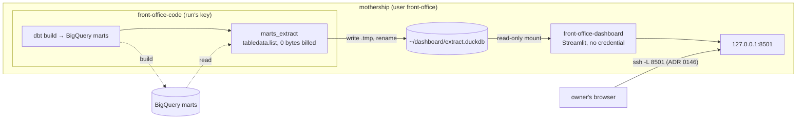

# The dashboard over the marts, on `mothership` — design

Issue: #232 · Requirements: [requirements.md](requirements.md) · Tasks: [tasks.md](tasks.md)

## Overview

After each daily run builds BigQuery, a new asset, `marts_extract`, copies the marts the
dashboard reads into one DuckDB file on `mothership`'s disk. It reads them with `tabledata.list`,
which bills nothing, as the run's own identity, and publishes the file by one rename. A Streamlit
app in a fourth container reads that file and nothing else: it has no credential, no network
route to the run, and listens on the host's loopback, reached by an SSH tunnel as Dagster's UI is.
Every number a page shows is a column of a mart. The two things the pages need that no mart holds,
team names and standings, become two new marts, `dim_fantasy_teams` and `fct_team_standings`,
tested like the other nine. CI runs every page's query and renders every page over the anonymised
fixtures.



## Claims ledger

| # | Claim | Query (or script) | Result | Run on |
|---|---|---|---|---|
| C1 | The nine marts total about 20 MB in BigQuery. | `bq show --format=json marts.<t>` for each mart (metadata, bills nothing) | rows / bytes: `dim_player_league_seasons` 3,748 / 346,913; `dim_players` 3,626 / 220,898; `fct_lineup_decision_categories` 40,366 / 4,124,876; `fct_lineup_decisions` 17,628 / 3,153,560; `fct_matchup_category_scores` 40,366 / 3,706,615; `fct_matchup_results` 1,162 / 126,767; `fct_player_category_value` 73,553 / 7,304,048; `fct_player_season_value` 4,240 / 428,240; `fct_transaction_impact` 737 / 338,731. 19,750,648 bytes in all | 2026-11-21 |
| C2 | BigQuery's marts are current: the deployed run built them today. | `lastModifiedTime` from C1 | 2026-11-21 21:25:31 UTC (`dim_player_league_seasons`) to 21:28:41 UTC (`fct_lineup_decision_categories`), during #219's task 10 deploy | 2026-11-21 |
| C3 | No mart carries a team's name; `int_fantasy__teams` and `stg_espn__teams` do. | on `dbt/ci.duckdb`: `select table_schema, table_name from information_schema.columns where column_name = 'team_name'` | `intermediate.int_fantasy__teams`, `staging.stg_espn__teams` only. Mart columns name teams by `fantasy_team_id`, `opponent_team_id`, `home_team_id`, `away_team_id`, `next_added_by_team_id` only | 2026-11-21 |
| C4 | The real league has 12 named teams in each of 8 seasons: 2018, 2019, 2021 to 2026. | `select season, count(*), count(team_name) from intermediate.int_fantasy__teams group by 1` on `data/warehouse_217.duckdb` | 12 and 12 for each of the 8 seasons; no 2020 row | 2026-11-21 |
| C5 | Every season with matchups is `H2H_MOST_CATEGORIES`. 2020 was `ROTO`, and has settings but no teams or matchups. The CI fixtures are `H2H_MOST_CATEGORIES`. | `select season, scoring_type from staging.stg_espn__league_settings`, and `select season, count(*) from marts.fct_matchup_results group by 1`, on `warehouse_217` and `ci.duckdb` | real: 2020 `ROTO`, the other eight `H2H_MOST_CATEGORIES`, matchups 143 to 155 a season, none in 2020; CI: two rows, both `H2H_MOST_CATEGORIES` | 2026-11-21 |
| C6 | The proposed standings definition (each team's regular-season matchup W-L-T from `fct_matchup_results`, `playoff_tier = 'NONE'`) equals ESPN's reported record for 90 of 96 teams. The 6 that differ come in pairs, one pair per regular-season matchup in `rec_espn__winner_differences`. | the prototype query: `fct_matchup_results` unpivoted to one row per side, `winner` mapped to W/L/T per side, counted per (season, team), joined to `int_fantasy__teams` on (season, `fantasy_team_id`), on `warehouse_217` | **In:** every team of 2018, 2021, 2023, 2024, 2026. **Out:** 2019 teams 8 (ours 11-10-0, ESPN 11-9-1) and 9 (6-15-0 / 5-15-1), matchup 74 (ours AWAY, ESPN TIE); 2022 teams 7 (13-8-0 / 14-7-0) and 8 (11-10-0 / 10-11-0), matchup 123; 2025 teams 4 (14-7-1 / 13-7-2) and 7 (11-9-2 / 11-8-3), matchup 77 (ours HOME, ESPN TIE). The other two listed matchups (2023 #138, 2025 #142) are consolation-ladder matchups and change no record. **Behaves badly:** a matchup in progress, which this definition would count by the categories decided so far (R1.5 excludes it). 2026's `categories_undecided` sums to 0 | 2026-11-21 |
| C7 | ESPN's playoff seed is not the computed record's order with category wins as the tiebreak, so the page cannot rebuild it. | 2026 rows of C6's query, ordered by `playoff_seed` | seeds 1 to 3: 15-3-3, 15-4-2, 15-5-1 (in win-percentage order). Seeds 9 and 10 are both 8-12-1: seed 9 (team 5) has 149 category wins, seed 10 (team 2) has 162. Seeds 7 and 8 are both 9-12-0: 157 above 142. So ESPN's tiebreak is not category wins alone | 2026-11-21 |
| C8 | The 2026 season is complete in the warehouse. | on `warehouse_217`: `select sum(categories_undecided), count(*) filter (where has_unverified_inputs) from marts.fct_matchup_results`; #66's body | 0 and 0; "All 180 captures of 2026 were taken after the season ended" | 2026-11-21 |
| C9 | The marts in BigQuery use six column types, all `NULLABLE`. | `bq show --schema --format=json marts.<t>` for the nine marts, counted by (type, mode) | `INTEGER` 97, `STRING` 39, `FLOAT` 16, `BOOLEAN` 13, `DATE` 10, `TIMESTAMP` 3; no `NUMERIC`, `JSON`, `RECORD` or `REPEATED`. DuckDB's `HUGEINT` sums in `fct_transaction_impact` are `INTEGER` in BigQuery | 2026-11-21 |
| C10 | Reading a table with `tabledata.list` bills nothing, and the project already reads that way. A query over a small table bills about 10 MB. | `ingestion/src/front_office/bigquery.py` (`stored`, `rows`: "by `tabledata.list` … it bills nothing, and it is never a query"); spec 0140 R3.2 and *Detailed design* step 2; spec 0140 C8 | as quoted; 0140 C8: `stg_idmap__players` billed 0.010 GB over a 4.3 MB document. That 0 bytes are billed by this extract is checked again in the build (*Expected values*) | 2026-11-21 |
| C11 | The run's identity can read the marts. | ADR 0135 *Decision* | `WRITER` (data editor) on `raw` and the five model datasets, `marts` among them; BigQuery User on the project | 2026-11-21 |
| C12 | A new asset joins `daily` with no change to the job. | `orchestration/front_office_pipeline/__init__.py:31` | `selection = AssetSelection.all() - AssetSelection.assets("idmap_capture")` | 2026-11-21 |
| C13 | `mothership` has room. | spec 0218 C9; the host (memory `mothership-access`, 2026-11-21) | 11.9 GB; the three Dagster processes idle at 674 MB, and peak at 1,395 MB with a full `daily` running | 2026-11-17 |
| C14 | Real team names in the deployed app are already the project's rule. Only CI and published builds anonymise. | `dbt/macros/anonymize.sql` header | "Fantasy team names and the league name are chosen by real people who never agreed to appear in a public repository, so CI and any published build run with this on. Local development keeps the real names, because a dashboard listing "Team 07" is useless." | 2026-11-21 |
| C15 | Dagster's UI is reached only by an SSH tunnel to the host's loopback, and holds no credential. | `deploy/quadlet/front-office-ui.container`; the runbook, *See the schedule and the last run* | `dagster-webserver -h 127.0.0.1 -p 3000`, `Network=host`, one volume (the instance); "an SSH tunnel … is the one way in" | 2026-11-21 |
| C16 | No manifest sits at a fixed path in the code server, so the extract cannot read the exposure from one. The exposure's YAML is in the image. | `orchestration/front_office_pipeline/dbt_assets.py:94` (`load_manifest` parses into a `tempfile.TemporaryDirectory`); `.containerignore:37` (`dbt/target`); design review F3 (dagster-dbt writes each build's artifacts under its own subdirectory) | as stated. `dbt/models/marts/_exposures.yml` is not ignored, so it is in the image | 2026-11-22 |
| C17 | The dashboard directory is a placeholder. | `git ls-files dashboard` | `dashboard/.gitkeep` only | 2026-11-21 |
| C19 | ESPN's status counter is past the last day of every season's regular season, and past the final scoring period once a season is over. `is_active` is true for every season, so it does not mark a season in progress. | on `warehouse_217`: `stg_espn__league_settings` (`latest_scoring_period`, `final_scoring_period`, `current_matchup_period`, `is_active`) beside the largest `scoring_period` of the regular-season matchup periods (`int_fantasy__matchup_periods` joined to `fct_matchup_results`, `playoff_tier = 'NONE'`) | latest / final / last regular-season period: 2018 187/179/158; 2019 195/187/166; 2021 187/179/158; 2022 183/182/158; 2023 187/179/158; 2024 196/195/173; 2025 196/188/167; 2026 188/180/159. Regular-season periods: 21, but 23 in 2024 and 22 in 2025. `current_matchup_period`: 24, but 26 in 2024 and 25 in 2025 (the last playoff period, past every regular one; 2020 `ROTO` 1). `is_active` true in all nine rows | 2026-11-22 |
| C20 | The image leaves out `dashboard/`, `.git` and `dbt/target`, and keeps the commit only as a label. | `.containerignore:29,35,37`; `deploy/Containerfile` (`ARG GIT_COMMIT`, then `LABEL org.opencontainers.image.revision=$GIT_COMMIT`, no `ENV`) | as stated (design review F2, F4) | 2026-11-22 |
| C18 | sqlglot is in the locked environment the gates install. | `grep -n sqlglot uv.lock` | `sqlglot` 30.19.0, a dependency of `dagster-dbt` 0.29.30 (`extra = ["rs"]`) and of `dbt-core` | 2026-11-21 |
| C21 | The revised definition and its test hold on the real season. Counting only finished regular-season matchups (R1.5) gives every team its season's full regular season. Each team's difference from ESPN equals what its listed matchups change, and no other team differs. | the prototype on `warehouse_217`: `fct_matchup_results` unpivoted to sides, joined to each matchup period's largest `scoring_period` and to `stg_espn__league_settings.latest_scoring_period`; counted where `playoff_tier = 'NONE'`, `categories_undecided = 0` and that period is below the counter; differences from `int_fantasy__teams` compared with the per-team sum, over the regular-season rows of `rec_espn__winner_differences`, of (result by our winner − result by ESPN's) | `matchups` 21 for every team in 2018, 2019, 2021 to 2023 and 2026, 23 in 2024, 22 in 2025 (96 rows). Rows that differ or have a listed matchup: 6, each equal to its expected change: 2019 team 8 (0, +1, −1), team 9 (+1, 0, −1); 2022 team 7 (−1, +1, 0), team 8 (+1, −1, 0); 2025 team 4 (+1, 0, −1), team 7 (0, +1, −1) | 2026-11-22 |

## Alternatives considered

What the dashboard reads (ADR 0144):

| | A: an extract made by the run (chosen) | B: BigQuery, queried by the app | C: DuckDB built on `mothership` each day | D: BigQuery through the run's key |
|---|---|---|---|---|
| Cost a month | $0: `tabledata.list` bills nothing (C10) | about 10 MB billed for each table a query reads (C10). Inside the free 1 TiB, but taken from the headroom the builds need by 2028 (0216 C16) | $0 | as B |
| Credential in the dashboard | none | a new read-only service account and key (the owner's work, rule 3) | none | the run's writer key, in a web-facing container |
| What the app can reach | one read-only file | BigQuery, as the identity allows | one file | every dataset the run can write |
| Page speed | local file, about 20 MB (C1) | a BigQuery round trip a query, cached | local file | as B |
| Same engine as CI | yes: CI's warehouse is DuckDB | no: CI has no BigQuery (ADR 0110) | yes | no |
| Run time and memory | one more step: about 20 MB read | none | `front-office load` plus a DuckDB build each day, up to 2 GB for eight seasons (0216 C13) | none |
| When the build fails | the last good extract stays, and its age shows | the half-built marts are what the page sees | as A | as B |
| Fits earlier decisions | ADR 0123 (BigQuery is built daily) stands | stands | reverses ADR 0123's reason for not building DuckDB daily | breaks ADR 0135 (least access) |

**A — an extract made by the run.** The run already holds the only identity that needs to touch
BigQuery, and the marts are small. Copying them once a day costs nothing, and leaves the dashboard
with nothing to protect except the file. It also means the app reads DuckDB in production and in
CI alike. A failed build leaves the previous extract in place, with its age on every page, rather
than a mix of new and old tables.

**B — BigQuery, queried by the app.** This is the conventional choice, and what ADR 0123's follow-up
assumed. It loses on three counts. It needs a second Google identity and key on the host, which is
the owner's work and one more thing to rotate. Every uncached view is a billed query against a free
tier the builds will outgrow in 2028. And the pages could not be run in CI as they run in
production.

**C — DuckDB built on `mothership`.** This has the same isolation as A, but it doubles the run to
rebuild what BigQuery already built, and it brings back the memory ADR 0123 avoided. It would also
make DuckDB a second production warehouse, compared with BigQuery nowhere but the laptop.

**D — BigQuery through the run's key.** No new credential, but a page bug or a dependency's
vulnerability then holds write access to every dataset. Rejected on ADR 0135's driver.

The framework (ADR 0145):

| | Streamlit (chosen) | Evidence (SQL and markdown, static build) | Metabase |
|---|---|---|---|
| Language and toolchain | Python, the repo's own; `uv` group | Node and npm, new to the repo | a JVM service |
| Pages as reviewed code | yes | yes | no: questions are saved in its database |
| CI | `AppTest` under pytest (R7.2) | a build in CI | none |
| Interactive filters | yes, server-side | yes, client-side, over data baked into the build | yes |
| Memory | measured in the build; expected small beside 11.9 GB (C13) | a static server | 1 GB or more for the JVM (not measured) |

**Streamlit** is what the README's roadmap promised. Its pages are Python the owner reads fluently,
and they are tested with the rest of the repo. **Evidence** suits "pages compute nothing" well,
since a page is SQL and markdown, but it brings a Node toolchain into a Python repo for one
component. It would also need its own build step in the run. **Metabase** keeps its pages outside
the repository, so they could not be reviewed or held by the gates.

The other decisions weighed their options in their ADRs: how the dashboard is reached (0146), what
a page may compute (0147), and what standings are (0148).

## Decisions

| ADR | Decision | Status |
|---|---|---|
| [0144](../../adr/0144-the-dashboard-reads-an-extract-of-the-marts-made-by-the-daily-run.md) | The dashboard reads a DuckDB extract of the marts, made by the daily run with `tabledata.list` | proposed |
| [0145](../../adr/0145-the-dashboard-is-a-streamlit-app-in-the-repository.md) | The dashboard is a Streamlit app in the repository | proposed |
| [0146](../../adr/0146-the-dashboard-listens-on-the-hosts-loopback-and-is-reached-by-ssh.md) | It listens on the host's loopback, reached by an SSH tunnel | proposed |
| [0147](../../adr/0147-a-page-shows-mart-columns-and-computes-nothing.md) | A page shows mart columns and computes nothing; a new number is a new mart | proposed |
| [0148](../../adr/0148-standings-are-the-computed-record-reconciled-with-espns.md) | Standings: the computed regular-season record beside ESPN's, tested to differ only by listed matchups; seed order once the regular season is complete | proposed |

## Detailed design

### The two new marts (R1)

Both are tables in `dbt/models/marts/`, written once for both warehouses (ADR 0051), with
contracts like the other marts. They need no ranking, and no float aggregate (the counts are
integers: `order-exempt`).

**`dim_fantasy_teams`**: grain (platform, league_id, season, fantasy_team_id), unique.
Columns: `platform`, `league_id`, `season`, `fantasy_team_id`, `team_name`, `team_abbrev`. A
straight select from `int_fantasy__teams`, whose names are already anonymised in CI (C14). Tests:
the grain is unique, and every `fantasy_team_id` in every other mart (and `opponent_team_id`,
`home_team_id`, `away_team_id`, `next_added_by_team_id` where not null) has a row here for its
(platform, league_id, season).

**`fct_team_standings`**: same grain, one row per row of `dim_fantasy_teams`.

| Column | Meaning |
|---|---|
| `platform`, `league_id`, `season`, `fantasy_team_id` | the grain |
| `scoring_type` | from `stg_espn__league_settings`, through a new `int_fantasy__league_seasons` column (marts read `int_fantasy__*` only, the seam) |
| `matchups` | the team's finished regular-season matchups (R1.5): `playoff_tier = 'NONE'`, `categories_undecided = 0`, and the largest `scoring_period` of the matchup period (`int_fantasy__matchup_periods`) below the league-season's `latest_scoring_period`, a second new `int_fantasy__league_seasons` column (C19) |
| `wins`, `losses`, `ties` | of those matchups, by `winner` from the team's side: `HOME`/`AWAY` as win or loss, `TIE` as a tie. Null unless `scoring_type = 'H2H_MOST_CATEGORIES'` (R1.3) |
| `category_wins`, `category_losses`, `category_ties` | the sums of the team's side's category wins, the opponent's, and `category_ties`, over the same matchups (integers: `order-exempt`). Null as above |
| `is_regular_season_complete` | every regular-season matchup of the league-season is finished. True for all eight real seasons (C19) |
| `reported_wins`, `reported_losses`, `reported_ties`, `reported_playoff_seed` | ESPN's, from `int_fantasy__teams` (`wins`, `losses`, `ties`, `playoff_seed`), as reported |

Tests: the grain; `wins + losses + ties = matchups` where not null. And the singular test
`fct_team_standings_record_matches_espn` (R1.4). For each listed regular-season matchup in
`rec_espn__winner_differences`, joined to `fct_matchup_results` for its two teams, it takes each
side's result by our winner and by ESPN's as a W-L-T vector, and sums the differences per team.
Each row's (`wins - reported_wins`, `losses - reported_losses`, `ties - reported_ties`) must
equal that sum, which is zero for a team with no listed matchup. So a second error in a team that
already has a listed matchup still fails (review F5). It is `error` where `is_regular_season_complete`, and
a second copy at `warn` covers the season in progress. On the real season, the 6 differing rows each
equal their matchup's change, and no other row differs (C21). It needs a plant in `dbt/plants/` (spec 0174), because the fixtures hold
no difference.

### The extract (R2)

`front-office extract-marts --out PATH (--project P | --db WAREHOUSE.duckdb) [--exposures PATH]`,
in `ingestion/src/front_office/extract.py`, with the command in `cli.py`:

1. Read the exposure `front_office_dashboard`'s `depends_on` from
   `dbt/models/marts/_exposures.yml` (`--exposures`, default relative to the repository root, `/app`
   in the image; no manifest is at a fixed path, C16), and take the model name of each
   `ref('…')`. These are the tables, and the only ones. pyyaml is imported in the command, and is
   installed wherever dbt is.
2. For each table, read its schema and rows. BigQuery: `client.get_table`, then `client.list_rows`
   (`tabledata.list`, C10), project named explicitly. DuckDB: `ATTACH` the warehouse read-only and
   select from `marts.<table>`.
3. Map types (BigQuery → DuckDB): `INTEGER`→`BIGINT`, `FLOAT`→`DOUBLE`, `STRING`→`VARCHAR`,
   `BOOLEAN`→`BOOLEAN`, `DATE`→`DATE`, `TIMESTAMP`→`TIMESTAMPTZ` (C9). Any other type, or a mode
   other than `NULLABLE` or `REQUIRED` (amended 2026-11-22), stops the extract (R2.5). The DuckDB path copies its types as they are.
4. Write every table into a new DuckDB file, `PATH.tmp-<pid>`, in schema `marts`, under the same
   names, so the page queries run unchanged on the extract and on `dbt/ci.duckdb`.
5. Write `marts.extract_info`: one row per table (`table_name`, `row_count`, `warehouse_modified_at`
   from the table's `lastModifiedTime`, or the file's mtime for DuckDB), and the extract's
   `extracted_at` and `git_commit`: `FO_GIT_COMMIT`, which the Containerfile now sets with
   `ENV FO_GIT_COMMIT=$GIT_COMMIT` (today the commit is only a label, C20); else `git rev-parse
   HEAD`; else `unknown`. A missing commit never fails the extract. No project id: the file needs
   none.
6. `CHECKPOINT`, close, then `os.replace(tmp, PATH)` (R2.3). On any error, delete the temporary
   file and exit 1, with the table and column named, and the old `PATH` untouched.

**The asset** `marts_extract` (in `assets.py`) depends on the dbt assets of the exposure's
models, and runs the command with `--project $FO_BQ_PROJECT` or `--db` by `FO_WAREHOUSE` (ADR
0131), to `$FO_DASHBOARD_EXTRACT` (default `/dashboard/extract.duckdb` in the image). It joins
`daily` with no change to the job (C12). If the dbt step fails, Dagster skips the steps below it,
so the extract is not made (R2.6). Task 5 proves that on an ephemeral instance. The code server's
unit gains `Volume=%h/dashboard:/dashboard:rw`.

### The app (R3, R4, R6)

```text
dashboard/
  .streamlit/config.toml        headless, no telemetry, XSRF on, address and port
  front_office_dashboard/
    app.py                      st.navigation over the pages; the freshness banner (R6)
    data.py                     open the extract read-only per query; run a named query
    format.py                   display-only formatting: innings from outs (R3.3), flags (R3.4)
    pages/standings.py, matchups.py, players.py, lineups.py, transactions.py
    queries/*.sql               one file per query, parameters by name ($season, $team_id …)
dashboard/tests/                pytest: the query rules, AppTest per page
scripts/check_dashboard.py      the gate: R4.2, R4.3, R7.1, R7.2 against dbt/ci.duckdb
```

- `data.py` opens `duckdb.connect(path, read_only=True)` for each query, and closes it. A query
  result is cached by `st.cache_data`, keyed on the query, its parameters and the extract's
  `(st_ino, st_mtime_ns)`, so a new extract (a new inode after the rename) clears the cache.
- Standings orders by `reported_playoff_seed` where `is_regular_season_complete`, and otherwise by
  `wins desc, losses asc, team_name`: a sort on columns, no arithmetic (ADR 0148, review F6).
- Each page joins `dim_fantasy_teams` on its keys for names, and labels columns from the dbt
  column descriptions, read once from the manifest that ships in the image (R3.2).
- **R4.2's rule**, held by `scripts/check_dashboard.py` with sqlglot (locked already: `dagster-dbt` depends on
  it, C18): parse each query and fail on a `GROUP BY`, an
  aggregate or window function, or a projection whose expression is arithmetic over two or more
  columns. Literals in `WHERE` and `ORDER BY` are fine.
- **R4.3**: the set of `marts.*` relations across all queries must equal the exposure's
  `depends_on`. The exposure is rewritten in this build to name exactly those, the two new
  marts among them, and the extract copies exactly the exposure's marts (R2.1).
- **The freshness banner**: `extracted_at` and the newest `warehouse_modified_at`. From March to
  October, an extract older than 36 hours (the feeds' threshold, ADR 0050) shows a warning that
  points to the runbook's *When an alert arrives*. With no extract, a single page says how to make
  one.
- Dependencies: a new group `dashboard = ["streamlit"]`, installed in the image, in the gates and
  in CI. `dashboard/` joins ruff's `src` and mypy's `files`.

### On `mothership` (R5)

`deploy/quadlet/front-office-dashboard.container`:

```ini
[Unit]
Description=Front Office: dashboard (Streamlit over the marts extract)

[Container]
Image=localhost/front-office:current
ContainerName=front-office-dashboard
WorkingDir=/app/dashboard
Exec=streamlit run front_office_dashboard/app.py
Environment=FO_DASHBOARD_EXTRACT=/dashboard/extract.duckdb
Volume=%h/dashboard:/dashboard:ro
PublishPort=127.0.0.1:8501:8501
PodmanArgs=--memory=<from task 9>
PodmanArgs=--init

[Service]
Restart=always
RestartSec=10

[Install]
WantedBy=default.target
```

Unlike the other three units, it has no `Network=host`. It gets the rootless default network, and
its port is published on the host's loopback only. Inside it, the app listens on `0.0.0.0:8501`,
which is the container's own interface. From there the host's loopback (the code server on 4266,
the UI on 3000) is not reachable under Podman 4.9's default `slirp4netns` (host loopback is off by
default). Task 9 shows that on the host. The image's entrypoint copies `dagster.yaml` into the
container's own `/dagster_home`, which is harmless here.

The image changes in three lines. `.containerignore` stops leaving out `dashboard/` (C20). The
Containerfile installs the `dashboard` group, sets `ENV FO_GIT_COMMIT=$GIT_COMMIT` after its `ARG`,
and ends with a smoke check, `RUN python -c "import front_office_dashboard.data"` with `dashboard/` on
the path, so a build that leaves the app out fails (review F2).

The runbook gains *The dashboard*: reach it (`ssh -L 8501:127.0.0.1:8501 mothership`), see it is
up, make an extract by hand (`podman exec front-office-code front-office extract-marts …`, R2.7),
and the lines that *Deploy a commit* and *Roll back* add (copy the fourth unit, restart it with the
others; restarting it alone touches no run, R5.4).

## Test strategy

| Requirement | Test | Catches |
|---|---|---|
| R1.1 | grain and relationship tests on `dim_fantasy_teams` | a team id in a mart with no name; a duplicated team-season |
| R1.2, R1.5 | contract; `wins + losses + ties = matchups`; a unit test over a fixture with one decided, one tied and one in-progress matchup | a tie counted as a loss; a matchup in progress in the record |
| R1.3 | a unit test with a `ROTO` league-season | a computed record invented for a scoring type it is not defined for |
| R1.4 | `fct_team_standings_record_matches_espn`, with its plant | a record that differs from ESPN's with no listed cause |
| R2.1, R2.4 | `test_extract.py`, DuckDB path over `dbt/ci.duckdb`: the tables are exactly the exposure's, each equal to its source (`except all` both ways), and `extract_info` has a row per table | a mart missing from the extract; a row dropped or changed |
| R2.2 | a fake BigQuery reader that fails on any `query` call; the real-season check of 0 bytes billed | an extract that queries |
| R2.3 | publish with a reader open on the old file; kill between write and rename | a reader seeing a partial file; a stale `.tmp` mistaken for the extract |
| R2.5 | a fake schema with a `NUMERIC` column, a `REPEATED` one, and a missing table | a silent cast; a partial extract |
| R2.6 | an ephemeral Dagster instance with a failing dbt step | an extract made after a failed build |
| R3.1, R6.1, R6.3, R7.2 | `AppTest` per page over an extract of the CI warehouse, and over no extract | a page that raises; a missing banner |
| R3.3 | `format.py` unit tests: 19 outs → "6.1", 20 → "6.2", 21 → "7.0" | decimal innings |
| R4.2 | `check_dashboard.py` over planted queries (`group by`, `sum(`, `a / b`) that must fail | a page computing a number |
| R4.3, R7.1 | `check_dashboard.py` against `dbt/ci.duckdb` in the gates, after the dbt build | an exposure that disagrees with the pages; a query broken by a mart change |
| R5.1 to R5.4 | on the host (task 9): unit up at boot, memory peak, `curl` by each path, a connection from inside the container to 127.0.0.1:4266 refused | a public or tailnet listener; a dashboard able to reach the run |
| R6.2 | `AppTest` with a planted `extracted_at` 37 hours old, in May and in December | a stale warning missing in season, or shown out of season |

## Risks

- **What ESPN's fields hold mid-season is unseen.** Every 2026 capture was taken after the season
  (C8, #66), so neither `playoffSeed` nor the status counter has been read during one. The seed
  orders only a completed season (ADR 0148). The counter decides which matchups are finished, which
  ADR 0016 already relies on for rosters. If it lags a day, a finished matchup counts a day late.
  Both are checked in #220's rehearsal or the first week of 2027.
- **The in-season record test could fail on a capture between rollovers** → it is `warn` for the
  season in progress, `error` once the regular season is complete (R1.4).
- **A failing reconciliation test holds the extract back** (R2.6), so a data question unrelated to
  the dashboard leaves it stale for days → accepted: the banner says how old it is, and the alert
  (spec 0219) has already gone out. All of one build or none is the rule ADR 0144 chooses.
- **Streamlit's memory** has not been measured on arm64 → task 9 measures it, and the unit's limit
  is set from the measurement, as 0218 did.
- **Streamlit's dependencies grow the run's image** (pyarrow, pandas, altair) → accepted for one
  image that deploys and rolls back as one. A second image is the fallback if the build time or
  size turns out to hurt. Task 9 records both.
- **The extract's floats may not equal DuckDB's** if the API's float text is not round-trip exact →
  the *Expected values* check compares exactly, and the build does not pass without it.

## Open questions

- Is ESPN's `playoffSeed` live in season, and does `latest_scoring_period` move at each day's
  rollover? → #220's rehearsal or the first week of 2027 (ADR 0148, ADR 0016).
- Does Podman 4.9's rootless default network keep the dashboard's container from reaching the
  host's loopback? → task 9, on the host.

## Review log

| Source | Finding | Resolution |
|---|---|---|
| design-review | F1 (P0): `categories_undecided = 0` does not mean a matchup has ended | True: it counts null rates (`fct_matchup_results.sql` header). R1.5 now counts a matchup once its period's last scoring period is before ESPN's status counter (C19, ADR 0016's reading), and `is_regular_season_complete` is added |
| design-review | F2 (P0): `.containerignore` leaves `dashboard/` out of the image | True (C20). The image keeps it, and a smoke import in the build fails without it (R5.1) |
| design-review | F3 (P0): no manifest at `dbt/target/manifest.json` in the code server | True (C16). The extract reads the exposure from `_exposures.yml`, which is in the image |
| design-review | F4 (P1): no `git_commit` inside the image | True (C20). `ENV FO_GIT_COMMIT`; a missing commit is `unknown`, never a failure (R2.4) |
| design-review | F5 (P1): the record test checks only that a listed matchup exists | True. The test now compares each team's W-L-T difference with the sum its listed matchups change |
| design-review | F6 (P1): ordering the current season by an unverified seed | True. The seed orders only a completed regular season. A season in progress is ordered by computed wins, then losses, labelled (R3.1, ADR 0148) |

## Amendments

### 2026-11-22: the extract is `extract.duckdb`, loaded by `read_json` (task 4)

- **The file is `extract.duckdb`, not `marts.duckdb`.** DuckDB names a file's catalog after its
  stem, so a connection to `marts.duckdb` reads `marts.<table>` as ambiguous between the catalog
  and the schema ("Ambiguous reference to catalog or schema marts", found by the implementer's
  tests). `FO_DASHBOARD_EXTRACT` defaults to `/dashboard/extract.duckdb`. The extract writes its
  temporary file under an explicit catalog name, so the writer was never affected.
- **`REQUIRED` columns are accepted** beside `NULLABLE`: a required column is still one scalar
  value. `REPEATED`, `RECORD` and any unmapped type are refused, as before.
- **Rows are staged as newline-delimited JSON and loaded by one `read_json` per table**, typed
  by the declared columns, instead of `executemany`. On the real season (`warehouse_232`), the
  row-by-row load took 4 min 32 s for 185,546 rows; the new one takes 1.7 s at a 243 MB peak.
  All 11 tables equal their source, `except all` both ways, with the same column types. A NaN
  or an infinity stops the extract (JSON has no form for one), and a test holds that.
- **The DuckDB-path tests use a synthetic warehouse**, because the gates run pytest before they
  build `dbt/ci.duckdb`. The extract of the CI warehouse is checked by
  `scripts/check_dashboard.py` (task 6), which runs after the build.

### 2026-11-22: how the dashboard's gate reads a query (task 6)

- **A query's header gives its example parameters.** A leading `-- example: {"season": 2026, …}`
  gives a value for every `$parameter` the query uses, and the gate runs the query with them on an
  extract of `dbt/ci.duckdb` (R7.1). `-- may-be-empty: <reason>` lets a query return no rows on
  the fixtures; without it, no rows is a failure.
- **No `queries/` directory means no dashboard yet**, and the gate passes saying so. It existed
  only between tasks 6 and 7. Once the directory exists, an empty one fails.
- **`marts.extract_info` is the extract's own table, not a mart.** The freshness banner reads it
  (R6.1), so R4.3's comparison with the exposure leaves it out. R4.1 and R4.2 apply to it as to
  any query.
- **What R4.2 does not see:** a computation through a function over two columns (`greatest(a,
  b)`, `coalesce(a, b)`) and `||` concatenation are not arithmetic nodes, so the gate passes them.
  `coalesce` and `||` are display choices. `greatest` and its kin are deferred: the pages are
  reviewed for them by hand until a query needs one.

### 2026-11-22: the app as built (task 7)

- **The freshness banner is drawn by each page** (`common.header`), not by `app.py`: Streamlit's
  headless test runs one page's script, so a banner in `app.py` would be invisible to the gate's
  per-page check (R7.2). `app.py` only shows the no-extract page (R6.3) or runs the navigation.
- **Column help comes from `_marts__models.yml`**, which ships in the image; the manifest does
  not (C16). Columns keep their dbt names (R3.2). A column the YAML does not describe, and a
  joined name such as `home_team_name`, has no help text.
- **The gate's stale-warning check sets the time** through `FO_DASHBOARD_NOW` (an ISO time with
  an offset), read only by `freshness.current_time`, so the check does not depend on the month it
  runs in.
- **Pickers are select boxes**, and the Players page filters its rows by team and replacement
  group in the page: a filter, not a computation (ADR 0147).

### 2026-11-23: a matchup is finished once ESPN's current matchup period is past it (PR #236 review, ADR 0149)

- **R1.5's rule changed.** The first rule (the period's last mapped scoring period before
  `latest_scoring_period`) was wrong in season. `int_fantasy__matchup_periods` grows a day at a
  time from `pointsByScoringPeriod`, so a matchup counted after its first day. A matchup now counts
  when `matchup_period < current_matchup_period` (ESPN's `status.currentMatchupPeriod`) and no
  category is undecided. The owner chose this on 2026-11-23. `int_fantasy__league_seasons` carries
  `current_matchup_period` in place of `latest_scoring_period`.
- **The CI fixtures** now say which matchup period they are on: `make_fixtures.py` sets
  `currentMatchupPeriod` to the fixture's own period, as it already set `latestScoringPeriod` to
  the fixture's span.
- **The real-season numbers do not change.** After every real season the counter is past every
  regular-season period (C19: 24 against 21 in 2026), so C21's counts and the six explained
  differences stand. They are rebuilt and checked again on #232.
- **The detailed design's `matchups` row and C21's query** describe the first rule. They are left
  as written, and this entry supersedes them.
